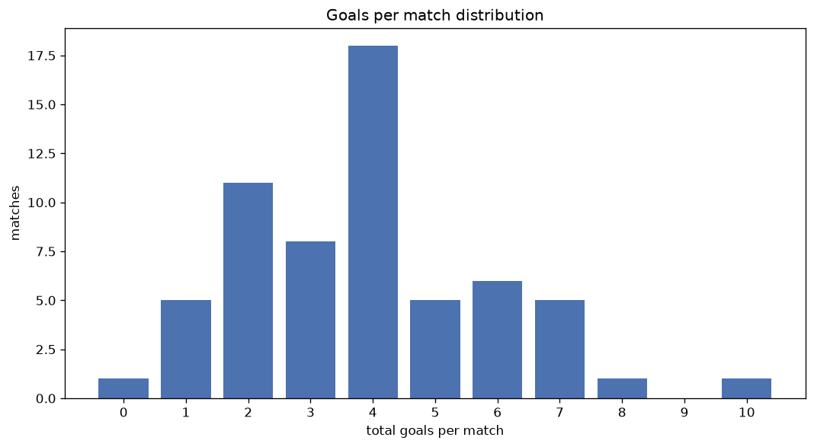
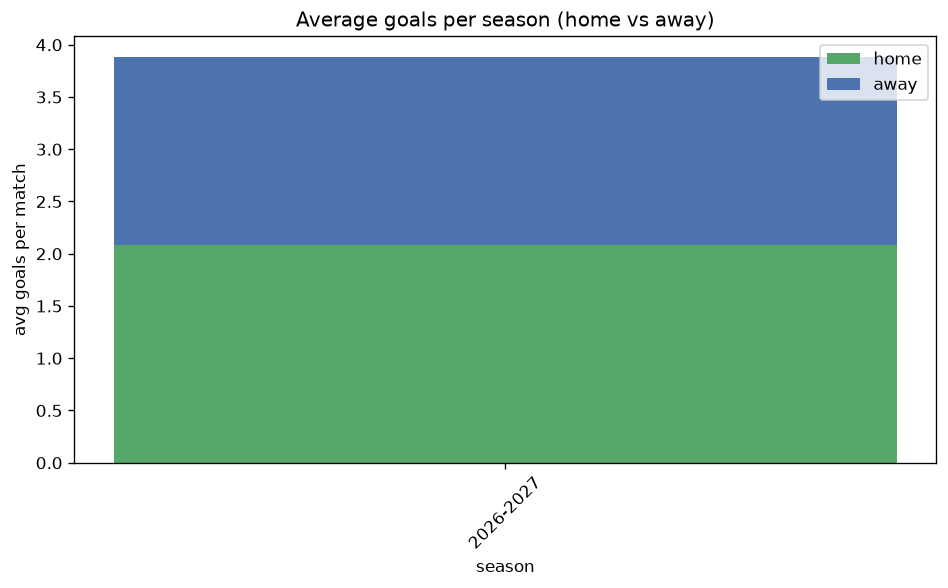

# Goal Analysis
- Report: `goals_analysis`
- Generated: 2026-10-26T01:30:21+00:00
- Script: `backend/scripts/analyze_goals.py` v1.0.0
- League: Professional Development League (England)
- Scope: league `develop21`

## 1. Goals per match distribution
| goals | matches | pct |
|---|---|---|
| 0 | 1 | 1.6% |
| 1 | 5 | 8.2% |
| 2 | 11 | 18.0% |
| 3 | 8 | 13.1% |
| 4 | 18 | 29.5% |
| 5 | 5 | 8.2% |
| 6 | 6 | 9.8% |
| 7 | 5 | 8.2% |
| 8 | 1 | 1.6% |
| 9 | 0 | 0.0% |
| 10 | 1 | 1.6% |

## 2. Goals per match per season
| season | matches | total goals | avg home | avg away | avg total |
|---|---|---|---|---|---|
| 2026-2027 | 61 | 237 | 2.082 | 1.803 | 3.885 |

## 3. Home vs away goal share
- Home goals: **127** (53.6%)
- Away goals: **110** (46.4%)
- Home/away ratio: **1.155**

| season | home goals | away goals | total | home pct | away pct |
|---|---|---|---|---|---|
| 2026-2027 | 127 | 110 | 237 | 53.6% | 46.4% |

## 4. BTTS (Both Teams To Score)
- Overall: **42** of `61` (68.9%)

| season | matches | BTTS | pct |
|---|---|---|---|
| 2026-2027 | 61 | 42 | 68.9% |

## 5. Clean sheets
- Home clean sheets: **10** (16.4%)
- Away clean sheets: **10** (16.4%)
- Total clean sheets recorded: **20**
- Matches with at least one clean sheet: **19** (31.1%)
- Both teams kept clean sheets (0-0): **1**

| season | matches | home CS | away CS | total CS | matches w/ CS |
|---|---|---|---|---|---|
| 2026-2027 | 61 | 10 | 10 | 20 | 19 (31.1%) |

## 6. Scoring intensity
- First-half goals: **118** (49.8%)
- Second-half goals: **119** (50.2%)
- Avg first-half goals per match: **1.934**
- Avg second-half goals per match: **1.951**
- Second-half-only scoring (HT 0-0, FT goals >= 1): **5** (8.2%)

| season | matches | 1st half | 2nd half | 1st half pct | 2nd half pct |
|---|---|---|---|---|---|
| 2026-2027 | 61 | 118 | 119 | 49.8% | 50.2% |

## 7. First-goal timing
- Matches with first-goal time recorded: `60` of `61` (98.4%)
- Goalless matches: `1`
- Min `1` | Max `70` | Mean `24.4` | Median (p50) `21.0`

| bucket | count | % of matches | % of scoring matches |
|---|---|---|---|
| 1-15 | 19 | 31.1% | 31.7% |
| 16-30 | 21 | 34.4% | 35.0% |
| 31-45 | 15 | 24.6% | 25.0% |
| 46-60 | 2 | 3.3% | 3.3% |
| 61-75 | 3 | 4.9% | 5.0% |
| 76-90 | 0 | 0.0% | 0.0% |
| 91-120 | 0 | 0.0% | 0.0% |

---
*All statistics are computed from PostgreSQL tables (read-only). Run with `python backend/scripts/analyze_goals.py` to regenerate.*

## Charts

