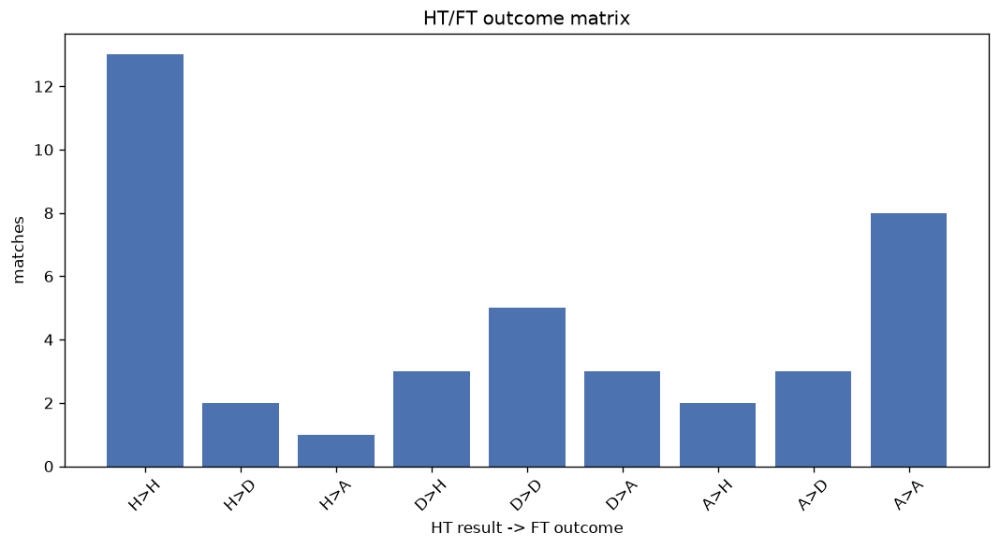
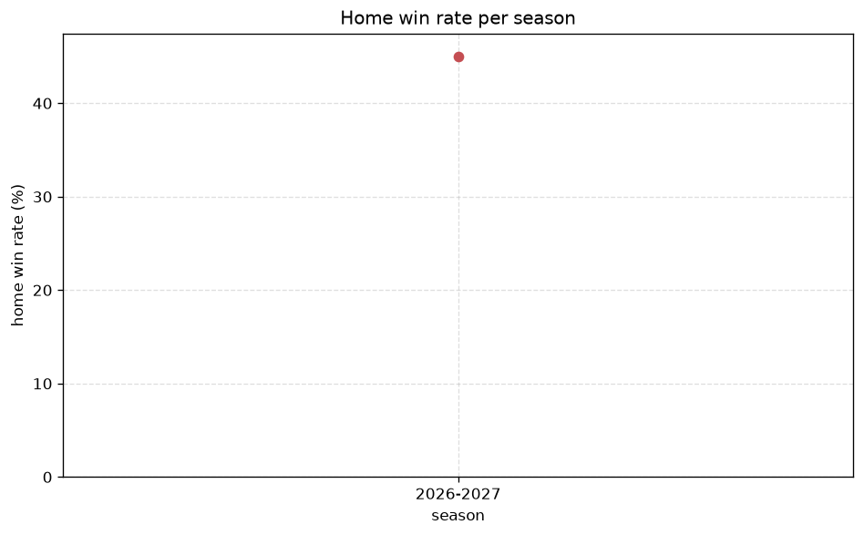

# Match Analysis
- Report: `matches_analysis`
- Generated: 2026-10-30T03:49:01+00:00
- Script: `backend/scripts/analyze_matches.py` v1.0.0
- League: Professional Development League (England)
- Scope: league `develop21`

## 1. Overall summary
| metric | value |
|---|---|
| Matches | 68 |
| Home wins | 28 (41.2%) |
| Draws | 15 (22.1%) |
| Away wins | 25 (36.8%) |
| Total goals | 274 |
| Average goals per match | 4.029 |
| Goalless matches | 1 (1.5%) |

## 2. Per-season breakdown
| season | matches | home wins | draws | away wins | total goals | avg goals | goalless |
|---|---|---|---|---|---|---|---|
| 2026-2027 | 68 | 28 (41.2%) | 15 (22.1%) | 25 (36.8%) | 274 | 4.029 | 1 (1.5%) |

## 3. HT/FT outcome matrix
| HT result \ FT result | Home | Draw | Away | total |
|---|---|---|---|---|
| HT home lead | 20 (74.1%) | 6 (22.2%) | 1 (3.7%) | 27 |
| HT draw | 5 (31.2%) | 4 (25.0%) | 7 (43.8%) | 16 |
| HT away lead | 3 (12.0%) | 5 (20.0%) | 17 (68.0%) | 25 |

## 4. Comeback matches
- Home comebacks (trailing at HT, won at FT): **3** (4.4%)
- Away comebacks (trailing at HT, won at FT): **1** (1.5%)

### Home comebacks
| season | home | away | HT | FT |
|---|---|---|---|---|
| 2026-2027 | Bristol City U21 | Sheffield Utd U21 | 0-1 | 3-1 |
| 2026-2027 | Wigan U21 | Colchester U21 | 1-2 | 6-4 |
| 2026-2027 | Swansea U21 | Charlton U21 | 0-1 | 3-2 |

### Away comebacks
| season | home | away | HT | FT |
|---|---|---|---|---|
| 2026-2027 | Millwall U21 | Huddersfield U21 | 2-0 | 2-4 |

## 5. HT lead conversion
| HT state | matches | converted to win | held as draw | collapsed to loss |
|---|---|---|---|---|
| Home lead | 27 | 20 (74.1%) | 6 (22.2%) | 1 (3.7%) |
| Away lead | 25 | 17 (68.0%) | 5 (20.0%) | 3 (12.0%) |

### Matches level at half-time
| FT result | count | pct |
|---|---|---|
| Home win | 5 | 31.2% |
| Draw | 4 | 25.0% |
| Away win | 7 | 43.8% |

## 6. First-goal timing
- Matches with a first-goal time recorded: `67` of `68` (98.5%)

Outcome distribution by first-goal timing bucket:
| bucket | matches | % of matches | home | draw | away |
|---|---|---|---|---|---|
| 1-15 | 23 | 33.8% | 7 (30.4%) | 6 (26.1%) | 10 (43.5%) |
| 16-30 | 24 | 35.3% | 14 (58.3%) | 3 (12.5%) | 7 (29.2%) |
| 31-45 | 14 | 20.6% | 5 (35.7%) | 4 (28.6%) | 5 (35.7%) |
| 46-60 | 3 | 4.4% | 0 (0.0%) | 1 (33.3%) | 2 (66.7%) |
| 61-75 | 3 | 4.4% | 2 (66.7%) | 0 (0.0%) | 1 (33.3%) |
| 76-90 | 0 | 0.0% | 0 (-) | 0 (-) | 0 (-) |
| 91-120 | 0 | 0.0% | 0 (-) | 0 (-) | 0 (-) |

## 7. Goalless matches
- Overall: **1** of `68` (1.5%)

| season | matches | goalless | pct |
|---|---|---|---|
| 2026-2027 | 68 | 1 | 1.5% |

---
*All statistics are computed from PostgreSQL tables (read-only). Run with `python backend/scripts/analyze_matches.py` to regenerate.*

## Charts

