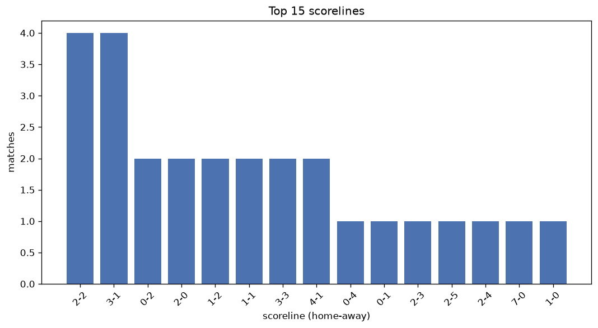
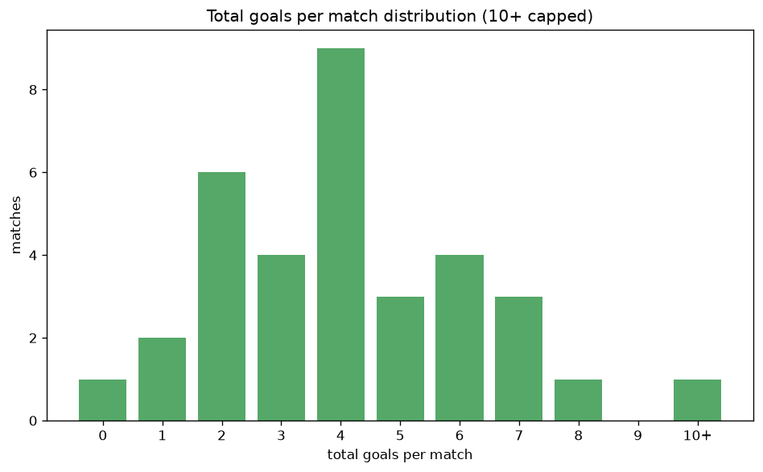

# Scoreline Analysis
- Report: `scoreline_analysis`
- Generated: 2026-10-30T03:49:07+00:00
- Script: `backend/scripts/analyze_scorelines.py` v1.0.0
- League: Professional Development League (England)
- Scope: league `develop21`

## 1. Scoreline frequency
- Matches analysed: **68** across **1** seasons.
- Distinct scorelines seen: **29**.

| scoreline | count | pct |
|---|---|---|
| 2-2 | 9 | 13.2% |
| 3-1 | 7 | 10.3% |
| 0-2 | 4 | 5.9% |
| 2-0 | 4 | 5.9% |
| 1-2 | 4 | 5.9% |
| 4-1 | 4 | 5.9% |
| 0-1 | 3 | 4.4% |
| 1-1 | 3 | 4.4% |
| 1-0 | 3 | 4.4% |
| 2-1 | 3 | 4.4% |
| 0-4 | 2 | 2.9% |
| 2-5 | 2 | 2.9% |
| 3-3 | 2 | 2.9% |
| 3-4 | 2 | 2.9% |
| 1-3 | 2 | 2.9% |
| 2-3 | 1 | 1.5% |
| 2-4 | 1 | 1.5% |
| 7-0 | 1 | 1.5% |
| 0-0 | 1 | 1.5% |
| 5-3 | 1 | 1.5% |

## 2. Scoreline frequency per season

### 2026-2027
| scoreline | count | pct |
|---|---|---|
| 2-2 | 9 | 13.2% |
| 3-1 | 7 | 10.3% |
| 0-2 | 4 | 5.9% |
| 2-0 | 4 | 5.9% |
| 1-2 | 4 | 5.9% |

## 3. Total-goal histogram
_10+ groups all matches with 10 or more total goals._

| total goals | matches | pct |
|---|---|---|
| 0 | 1 | 1.5% |
| 1 | 6 | 8.8% |
| 2 | 11 | 16.2% |
| 3 | 8 | 11.8% |
| 4 | 20 | 29.4% |
| 5 | 6 | 8.8% |
| 6 | 7 | 10.3% |
| 7 | 5 | 7.4% |
| 8 | 2 | 2.9% |
| 9 | 1 | 1.5% |
| 10+ | 1 | 1.5% |

## 4. Extreme scorelines
- Matches with 7+ total goals: **9**

| season | date | scoreline | total goals |
|---|---|---|---|
| 2026-2027 | 2026-09-15 | 6-4 | 10 |
| 2026-2027 | 2026-10-26 | 3-6 | 9 |
| 2026-2027 | 2026-09-15 | 5-3 | 8 |
| 2026-2027 | 2026-10-27 | 2-6 | 8 |
| 2026-2027 | 2026-08-25 | 2-5 | 7 |
| 2026-2027 | 2026-08-25 | 7-0 | 7 |
| 2026-2027 | 2026-09-01 | 3-4 | 7 |
| 2026-2027 | 2026-10-13 | 2-5 | 7 |
| 2026-2027 | 2026-10-23 | 3-4 | 7 |

## 5. Margin-of-victory distribution (decided matches)
- Decided matches: **53** (draws: **15**)
- Average winning margin: **2.19**

| margin | matches | pct |
|---|---|---|
| 1 | 17 | 32.1% |
| 2 | 21 | 39.6% |
| 3+ | 15 | 28.3% |

## 6. Margin by outcome

### Home wins
- Matches: **28** | avg margin: **2.29** | max margin: **7**
| margin | matches | pct |
|---|---|---|
| 1 | 7 | 25.0% |
| 2 | 14 | 50.0% |
| 3+ | 7 | 25.0% |
- *Full match-by-match list available in `scoreline_analysis.json`.*

### Away wins
- Matches: **25** | avg margin: **2.08** | max margin: **4**
| margin | matches | pct |
|---|---|---|
| 1 | 10 | 40.0% |
| 2 | 7 | 28.0% |
| 3+ | 8 | 32.0% |
- *Full match-by-match list available in `scoreline_analysis.json`.*

## 7. Most common exact score by outcome type
| outcome | matches | most common score | count | pct |
|---|---|---|---|---|
| home | 28 | 3-1 | 7 | 25.0% |
| draw | 15 | 2-2 | 9 | 60.0% |
| away | 25 | 0-2 | 4 | 16.0% |

---
*All statistics are computed from PostgreSQL tables (read-only). Run with `python backend/scripts/analyze_scorelines.py` to regenerate.*

## Charts

