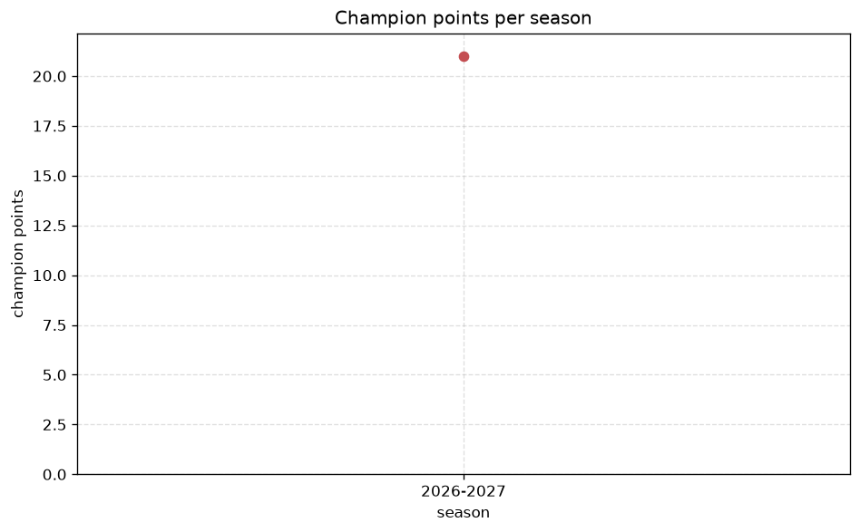
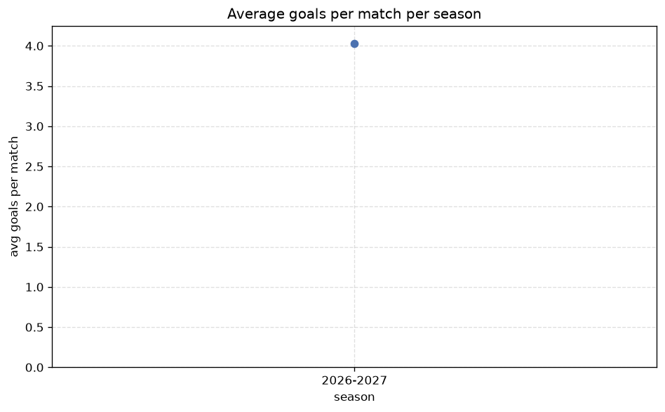

# Season Trends Analysis
- Report: `season_trends`
- Generated: 2026-10-27T01:45:21+00:00
- Script: `backend/scripts/analyze_seasons.py` v1.0.0
- League: Professional Development League (England)
- Scope: league `develop21`

## 1. Champions per season
| season | champion | pts | runner-up | margin |
|---|---|---|---|---|
| 2026-2027 | Bolton U21 | 21 | Fleetwood U21 | 5 pts |

## 2. Title-race tightness
- Tight races (margin <= 3 pts): **0** of 1 seasons
- Tightest race: **2026-2027** - Bolton U21 beat Fleetwood U21 by **5** pts

| season | margin | tight |
|---|---|---|
| 2026-2027 | 5 pts |  |

## 3. Points thresholds
_Position-specific points per season. Key: 1 = champion, 2 = runner-up, 4 = CL line, 6 = Europa, 14 = last safe, 17 = bottom._

| season | pos 1 | pos 2 | pos 4 | pos 6 | pos 14 | pos 17 |
|---|---|---|---|---|---|---|
| 2026-2027 | 21 | 16 | 13 | 12 | 7 | 0 |

## 4. Relegation battle
| season | safe pos | safe pts | drop pos | drop pts | gap |
|---|---|---|---|---|---|
| 2026-2027 | 14 | 7 | 15 | 6 | 1 pts |

## 5. League-level trends
| season | matches | total goals | avg goals | home win | draw | away win | goalless | avg pts/team |
|---|---|---|---|---|---|---|---|---|
| 2026-2027 | 61 | 237 | 3.885 | 42.6% | 23.0% | 34.4% | 1.6% | 9.94 |

## 6. View divergence
- Largest divergence: **2026-2027** (goals view, avg abs position diff = 6.118)

_Avg absolute position difference between classic view and alternative view per season._

| season | classic vs luck | classic vs goals |
|---|---|---|
| 2026-2027 | 2.000 | 6.118 |

---
*All statistics are computed from PostgreSQL tables (read-only). Run with `python backend/scripts/analyze_seasons.py` to regenerate.*

## Charts

