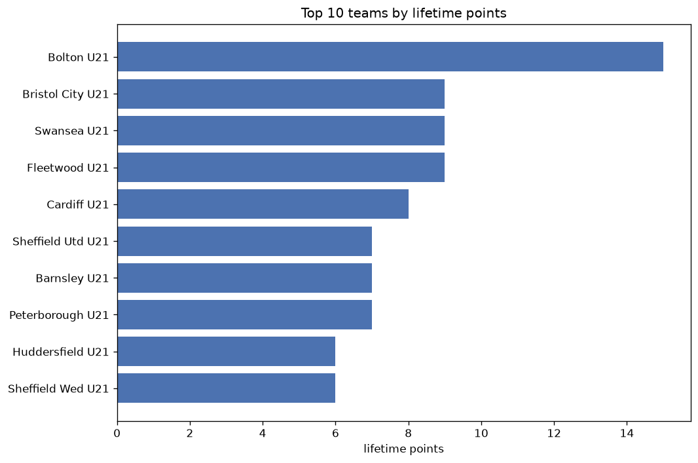
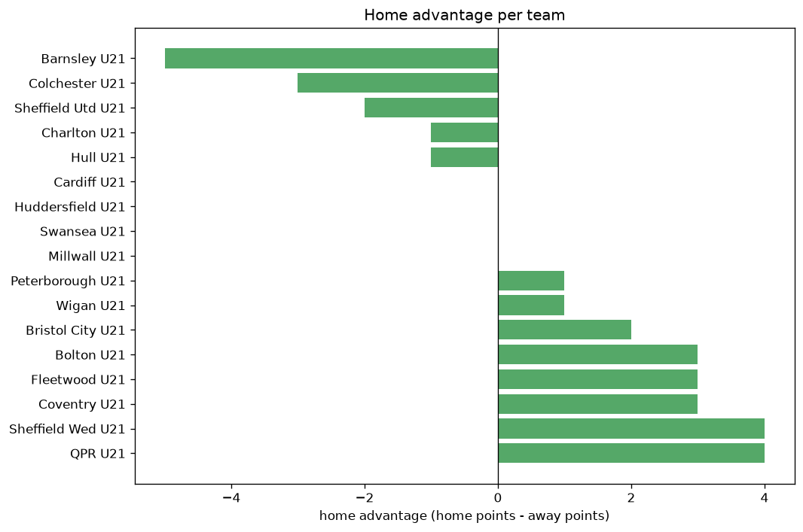

# Team Analysis
- Report: `teams_analysis`
- Generated: 2026-10-30T03:49:04+00:00
- Script: `backend/scripts/analyze_teams.py` v1.0.0
- League: Professional Development League (England)
- Scope: league `develop21`

- Teams: **17** | Seasons: **1** | Matches: **68**

## 1. Team standings (lifetime)
| team | seasons | played | W | D | L | pts | GF | GA | GD | avg pts/season | best pos | worst pos | titles |
|---|---|---|---|---|---|---|---|---|---|---|---|---|---|
| Bolton U21 | 1 | 9 | 7 | 0 | 2 | 21 | 24 | 12 | 12 | 21.0 | 1 | 1 | 1 |
| Fleetwood U21 | 1 | 9 | 6 | 1 | 2 | 19 | 13 | 13 | 0 | 19.0 | 2 | 2 | 0 |
| Swansea U21 | 1 | 9 | 5 | 0 | 4 | 15 | 16 | 14 | 2 | 15.0 | 3 | 3 | 0 |
| Coventry U21 | 1 | 8 | 4 | 2 | 2 | 14 | 19 | 13 | 6 | 14.0 | 4 | 4 | 0 |
| Cardiff U21 | 1 | 8 | 3 | 4 | 1 | 13 | 20 | 11 | 9 | 13.0 | 5 | 5 | 0 |
| Sheffield Utd U21 | 1 | 8 | 4 | 1 | 3 | 13 | 13 | 8 | 5 | 13.0 | 6 | 6 | 0 |
| Huddersfield U21 | 1 | 6 | 4 | 0 | 2 | 12 | 19 | 11 | 8 | 12.0 | 7 | 7 | 0 |
| Bristol City U21 | 1 | 8 | 3 | 3 | 2 | 12 | 19 | 15 | 4 | 12.0 | 8 | 8 | 0 |
| Peterborough U21 | 1 | 8 | 3 | 2 | 3 | 11 | 16 | 21 | -5 | 11.0 | 9 | 9 | 0 |
| Wigan U21 | 1 | 9 | 2 | 4 | 3 | 10 | 20 | 25 | -5 | 10.0 | 10 | 10 | 0 |
| Charlton U21 | 1 | 9 | 2 | 3 | 4 | 9 | 16 | 19 | -3 | 9.0 | 12 | 12 | 0 |
| Colchester U21 | 1 | 8 | 3 | 0 | 5 | 9 | 19 | 22 | -3 | 9.0 | 11 | 11 | 0 |
| Barnsley U21 | 1 | 8 | 2 | 2 | 4 | 8 | 16 | 23 | -7 | 8.0 | 13 | 13 | 0 |
| QPR U21 | 1 | 10 | 2 | 2 | 6 | 8 | 17 | 28 | -11 | 8.0 | 14 | 14 | 0 |
| Sheffield Wed U21 | 1 | 8 | 1 | 4 | 3 | 7 | 13 | 16 | -3 | 7.0 | 15 | 15 | 0 |
| Hull U21 | 1 | 6 | 1 | 2 | 3 | 5 | 9 | 13 | -4 | 5.0 | 16 | 16 | 0 |
| Millwall U21 | 1 | 5 | 1 | 0 | 4 | 3 | 5 | 10 | -5 | 3.0 | 17 | 17 | 0 |

## 2. Home vs away split
| team | home P | H-W | H-D | H-L | H-pts | away P | A-W | A-D | A-L | A-pts | adv |
|---|---|---|---|---|---|---|---|---|---|---|---|
| Bristol City U21 | 5 | 3 | 1 | 1 | 10 | 3 | 0 | 2 | 1 | 2 | 8 |
| QPR U21 | 5 | 2 | 2 | 1 | 8 | 5 | 0 | 0 | 5 | 0 | 8 |
| Charlton U21 | 5 | 2 | 1 | 2 | 7 | 4 | 0 | 2 | 2 | 2 | 5 |
| Coventry U21 | 4 | 3 | 0 | 1 | 9 | 4 | 1 | 2 | 1 | 5 | 4 |
| Wigan U21 | 5 | 2 | 1 | 2 | 7 | 4 | 0 | 3 | 1 | 3 | 4 |
| Swansea U21 | 5 | 3 | 0 | 2 | 9 | 4 | 2 | 0 | 2 | 6 | 3 |
| Colchester U21 | 4 | 2 | 0 | 2 | 6 | 4 | 1 | 0 | 3 | 3 | 3 |
| Sheffield Wed U21 | 4 | 1 | 2 | 1 | 5 | 4 | 0 | 2 | 2 | 2 | 3 |
| Fleetwood U21 | 5 | 3 | 1 | 1 | 10 | 4 | 3 | 0 | 1 | 9 | 1 |
| Peterborough U21 | 5 | 1 | 2 | 2 | 5 | 3 | 2 | 0 | 1 | 6 | -1 |
| Bolton U21 | 4 | 3 | 0 | 1 | 9 | 5 | 4 | 0 | 1 | 12 | -3 |
| Cardiff U21 | 4 | 1 | 2 | 1 | 5 | 4 | 2 | 2 | 0 | 8 | -3 |
| Hull U21 | 3 | 0 | 1 | 2 | 1 | 3 | 1 | 1 | 1 | 4 | -3 |
| Millwall U21 | 2 | 0 | 0 | 2 | 0 | 3 | 1 | 0 | 2 | 3 | -3 |
| Sheffield Utd U21 | 3 | 1 | 1 | 1 | 4 | 5 | 3 | 0 | 2 | 9 | -5 |
| Huddersfield U21 | 1 | 1 | 0 | 0 | 3 | 5 | 3 | 0 | 2 | 9 | -6 |
| Barnsley U21 | 4 | 0 | 1 | 3 | 1 | 4 | 2 | 1 | 1 | 7 | -6 |

## 3. Top performers
### Best points per game (PPG)
| rank | team | PPG |
|---|---|---|
| 1 | Bolton U21 | 2.33 |
| 2 | Fleetwood U21 | 2.11 |
| 3 | Huddersfield U21 | 2.00 |
| 4 | Coventry U21 | 1.75 |
| 5 | Swansea U21 | 1.67 |

### Most goals scored
| rank | team | goals |
|---|---|---|
| 1 | Bolton U21 | 24 |
| 2 | Cardiff U21 | 20 |
| 3 | Wigan U21 | 20 |
| 4 | Coventry U21 | 19 |
| 5 | Huddersfield U21 | 19 |

### Best goal difference
| rank | team | GD |
|---|---|---|
| 1 | Bolton U21 | 12 |
| 2 | Cardiff U21 | 9 |
| 3 | Huddersfield U21 | 8 |
| 4 | Coventry U21 | 6 |
| 5 | Sheffield Utd U21 | 5 |

### Best defence (goals against per match, standings)
| rank | team | GA/match |
|---|---|---|
| 1 | Sheffield Utd U21 | 1.000 |
| 2 | Bolton U21 | 1.333 |
| 3 | Cardiff U21 | 1.375 |
| 4 | Fleetwood U21 | 1.444 |
| 5 | Swansea U21 | 1.556 |

## 4. Team consistency
- Teams present in all **1** seasons: **17**

Barnsley U21, Bolton U21, Bristol City U21, Cardiff U21, Charlton U21, Colchester U21, Coventry U21, Fleetwood U21, Huddersfield U21, Hull U21, Millwall U21, Peterborough U21, QPR U21, Sheffield Utd U21, Sheffield Wed U21, Swansea U21, Wigan U21

## 5. Head-to-head dominance
- Distinct fixtures: **68** (showing the 15 most frequent)

| fixture | meetings | home wins | draws | away wins | home pct | draw pct | away pct |
|---|---|---|---|---|---|---|---|
| Bolton U21 vs Colchester U21 | 1 | 1 | 0 | 0 | 100.0% | 0.0% | 0.0% |
| Bolton U21 vs Coventry U21 | 1 | 1 | 0 | 0 | 100.0% | 0.0% | 0.0% |
| Bolton U21 vs QPR U21 | 1 | 1 | 0 | 0 | 100.0% | 0.0% | 0.0% |
| Bolton U21 vs Sheffield Utd U21 | 1 | 1 | 0 | 0 | 100.0% | 0.0% | 0.0% |
| Bristol City U21 vs Charlton U21 | 1 | 1 | 0 | 0 | 100.0% | 0.0% | 0.0% |
| Bristol City U21 vs Hull U21 | 1 | 1 | 0 | 0 | 100.0% | 0.0% | 0.0% |
| Bristol City U21 vs QPR U21 | 1 | 1 | 0 | 0 | 100.0% | 0.0% | 0.0% |
| Cardiff U21 vs Peterborough U21 | 1 | 1 | 0 | 0 | 100.0% | 0.0% | 0.0% |
| Charlton U21 vs Millwall U21 | 1 | 1 | 0 | 0 | 100.0% | 0.0% | 0.0% |
| Colchester U21 vs QPR U21 | 1 | 1 | 0 | 0 | 100.0% | 0.0% | 0.0% |
| Colchester U21 vs Sheffield Wed U21 | 1 | 1 | 0 | 0 | 100.0% | 0.0% | 0.0% |
| Coventry U21 vs Barnsley U21 | 1 | 1 | 0 | 0 | 100.0% | 0.0% | 0.0% |
| Coventry U21 vs Colchester U21 | 1 | 1 | 0 | 0 | 100.0% | 0.0% | 0.0% |
| Fleetwood U21 vs Millwall U21 | 1 | 1 | 0 | 0 | 100.0% | 0.0% | 0.0% |
| Fleetwood U21 vs QPR U21 | 1 | 1 | 0 | 0 | 100.0% | 0.0% | 0.0% |

## 6. Position per season (classic view)
_Cells show final position; '-' when the team was absent from that season._

| team | 2026-2027 |
|---|---|
| Bolton U21 | 1 |
| Fleetwood U21 | 2 |
| Swansea U21 | 3 |
| Coventry U21 | 4 |
| Cardiff U21 | 5 |
| Sheffield Utd U21 | 6 |
| Huddersfield U21 | 7 |
| Bristol City U21 | 8 |
| Peterborough U21 | 9 |
| Wigan U21 | 10 |
| Charlton U21 | 12 |
| Colchester U21 | 11 |
| Barnsley U21 | 13 |
| QPR U21 | 14 |
| Sheffield Wed U21 | 15 |
| Hull U21 | 16 |
| Millwall U21 | 17 |

---
*All statistics are computed from PostgreSQL tables (read-only). Run with `python backend/scripts/analyze_teams.py` to regenerate.*

## Charts

