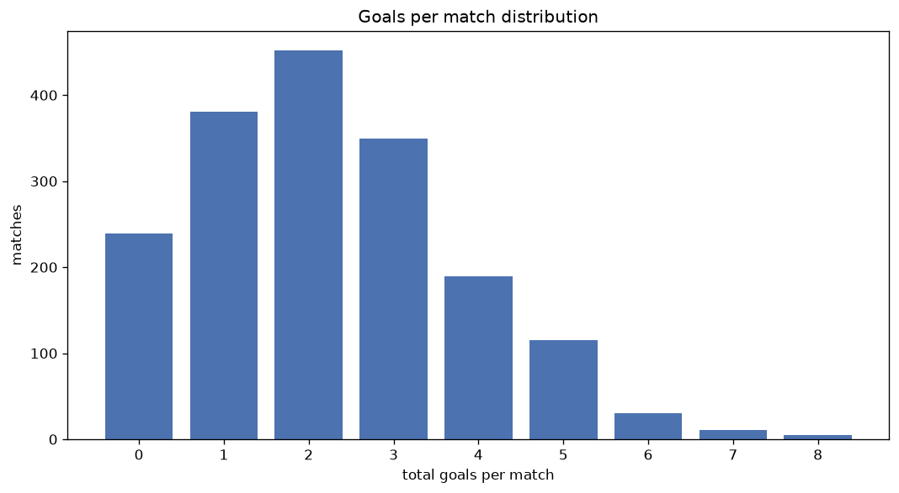
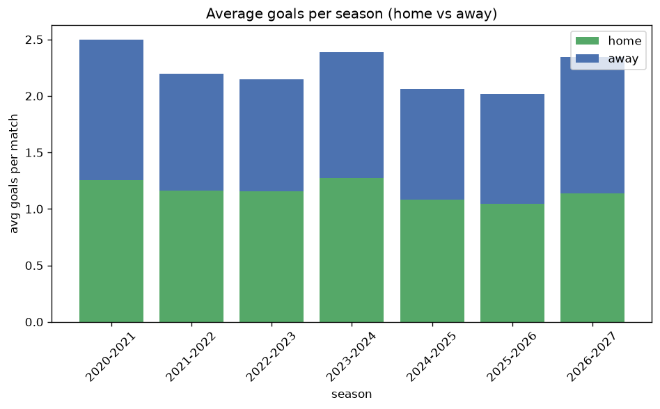

# Goal Analysis
- Report: `goals_analysis`
- Generated: 2026-10-30T03:49:19+00:00
- Script: `backend/scripts/analyze_goals.py` v1.0.0
- League: Premier League (Egypt)
- Scope: league `egypt`

## 1. Goals per match distribution
| goals | matches | pct |
|---|---|---|
| 0 | 239 | 13.5% |
| 1 | 381 | 21.5% |
| 2 | 452 | 25.5% |
| 3 | 349 | 19.7% |
| 4 | 189 | 10.7% |
| 5 | 115 | 6.5% |
| 6 | 30 | 1.7% |
| 7 | 11 | 0.6% |
| 8 | 5 | 0.3% |

## 2. Goals per match per season
| season | matches | total goals | avg home | avg away | avg total |
|---|---|---|---|---|---|
| 2020-2021 | 306 | 765 | 1.252 | 1.248 | 2.5 |
| 2021-2022 | 306 | 673 | 1.163 | 1.036 | 2.199 |
| 2022-2023 | 306 | 657 | 1.154 | 0.993 | 2.147 |
| 2023-2024 | 306 | 730 | 1.271 | 1.114 | 2.386 |
| 2024-2025 | 153 | 315 | 1.085 | 0.974 | 2.059 |
| 2025-2026 | 322 | 651 | 1.043 | 0.978 | 2.022 |
| 2026-2027 | 72 | 169 | 1.139 | 1.208 | 2.347 |

## 3. Home vs away goal share
- Home goals: **2065** (52.1%)
- Away goals: **1895** (47.9%)
- Home/away ratio: **1.09**

| season | home goals | away goals | total | home pct | away pct |
|---|---|---|---|---|---|
| 2020-2021 | 383 | 382 | 765 | 50.1% | 49.9% |
| 2021-2022 | 356 | 317 | 673 | 52.9% | 47.1% |
| 2022-2023 | 353 | 304 | 657 | 53.7% | 46.3% |
| 2023-2024 | 389 | 341 | 730 | 53.3% | 46.7% |
| 2024-2025 | 166 | 149 | 315 | 52.7% | 47.3% |
| 2025-2026 | 336 | 315 | 651 | 51.6% | 48.4% |
| 2026-2027 | 82 | 87 | 169 | 48.5% | 51.5% |

## 4. BTTS (Both Teams To Score)
- Overall: **838** of `1771` (47.3%)

| season | matches | BTTS | pct |
|---|---|---|---|
| 2020-2021 | 306 | 177 | 57.8% |
| 2021-2022 | 306 | 130 | 42.5% |
| 2022-2023 | 306 | 136 | 44.4% |
| 2023-2024 | 306 | 152 | 49.7% |
| 2024-2025 | 153 | 59 | 38.6% |
| 2025-2026 | 322 | 150 | 46.6% |
| 2026-2027 | 72 | 34 | 47.2% |

## 5. Clean sheets
- Home clean sheets: **614** (34.7%)
- Away clean sheets: **558** (31.5%)
- Total clean sheets recorded: **1172**
- Matches with at least one clean sheet: **933** (52.7%)
- Both teams kept clean sheets (0-0): **239**

| season | matches | home CS | away CS | total CS | matches w/ CS |
|---|---|---|---|---|---|
| 2020-2021 | 306 | 78 | 83 | 161 | 129 (42.2%) |
| 2021-2022 | 306 | 120 | 98 | 218 | 176 (57.5%) |
| 2022-2023 | 306 | 119 | 103 | 222 | 170 (55.6%) |
| 2023-2024 | 306 | 96 | 91 | 187 | 154 (50.3%) |
| 2024-2025 | 153 | 60 | 58 | 118 | 94 (61.4%) |
| 2025-2026 | 322 | 121 | 102 | 223 | 172 (53.4%) |
| 2026-2027 | 72 | 20 | 23 | 43 | 38 (52.8%) |

## 6. Scoring intensity
- First-half goals: **1736** (43.9%)
- Second-half goals: **2219** (56.1%)
- Avg first-half goals per match: **0.981**
- Avg second-half goals per match: **1.254**
- Second-half-only scoring (HT 0-0, FT goals >= 1): **447** (25.2%)
- *2 match(es) excluded (no HT score recorded).*

| season | matches | 1st half | 2nd half | 1st half pct | 2nd half pct |
|---|---|---|---|---|---|
| 2020-2021 | 306 | 318 | 447 | 41.6% | 58.4% |
| 2021-2022 | 306 | 293 | 380 | 43.5% | 56.5% |
| 2022-2023 | 306 | 326 | 331 | 49.6% | 50.4% |
| 2023-2024 | 306 | 327 | 401 | 44.9% | 55.1% |
| 2024-2025 | 153 | 127 | 185 | 40.7% | 59.3% |
| 2025-2026 | 322 | 279 | 372 | 42.9% | 57.1% |
| 2026-2027 | 72 | 66 | 103 | 39.1% | 60.9% |

## 7. First-goal timing
- Matches with first-goal time recorded: `1530` of `1771` (86.4%)
- Goalless matches: `241`
- Min `1` | Max `101` | Mean `35.18` | Median (p50) `31.0`

| bucket | count | % of matches | % of scoring matches |
|---|---|---|---|
| 1-15 | 413 | 23.3% | 27.0% |
| 16-30 | 345 | 19.5% | 22.5% |
| 31-45 | 277 | 15.6% | 18.1% |
| 46-60 | 225 | 12.7% | 14.7% |
| 61-75 | 146 | 8.2% | 9.5% |
| 76-90 | 91 | 5.1% | 5.9% |
| 91-120 | 33 | 1.9% | 2.2% |

---
*All statistics are computed from PostgreSQL tables (read-only). Run with `python backend/scripts/analyze_goals.py` to regenerate.*

## Charts

