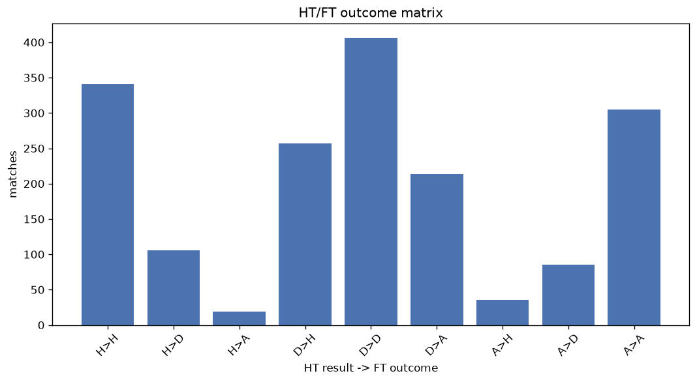
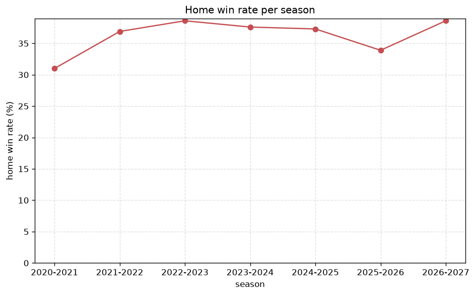

# Match Analysis
- Report: `matches_analysis`
- Generated: 2026-10-27T01:45:34+00:00
- Script: `backend/scripts/analyze_matches.py` v1.0.0
- League: Premier League (Egypt)
- Scope: league `egypt`

## 1. Overall summary
| metric | value |
|---|---|
| Matches | 1769 |
| Home wins | 634 (35.8%) |
| Draws | 596 (33.7%) |
| Away wins | 539 (30.5%) |
| Total goals | 3955 |
| Average goals per match | 2.236 |
| Goalless matches | 239 (13.5%) |

## 2. Per-season breakdown
| season | matches | home wins | draws | away wins | total goals | avg goals | goalless |
|---|---|---|---|---|---|---|---|
| 2020-2021 | 306 | 95 (31.0%) | 112 (36.6%) | 99 (32.4%) | 765 | 2.5 | 32 (10.5%) |
| 2021-2022 | 306 | 113 (36.9%) | 105 (34.3%) | 88 (28.8%) | 673 | 2.199 | 42 (13.7%) |
| 2022-2023 | 306 | 118 (38.6%) | 102 (33.3%) | 86 (28.1%) | 657 | 2.147 | 52 (17.0%) |
| 2023-2024 | 306 | 115 (37.6%) | 92 (30.1%) | 99 (32.4%) | 730 | 2.386 | 33 (10.8%) |
| 2024-2025 | 153 | 57 (37.3%) | 47 (30.7%) | 49 (32.0%) | 315 | 2.059 | 24 (15.7%) |
| 2025-2026 | 322 | 109 (33.9%) | 122 (37.9%) | 91 (28.3%) | 651 | 2.022 | 51 (15.8%) |
| 2026-2027 | 70 | 27 (38.6%) | 16 (22.9%) | 27 (38.6%) | 164 | 2.343 | 5 (7.1%) |

## 3. HT/FT outcome matrix
| HT result \ FT result | Home | Draw | Away | total |
|---|---|---|---|---|
| HT home lead | 341 (73.2%) | 106 (22.7%) | 19 (4.1%) | 466 |
| HT draw | 256 (29.2%) | 406 (46.3%) | 214 (24.4%) | 876 |
| HT away lead | 36 (8.5%) | 84 (19.8%) | 305 (71.8%) | 425 |
- *2 match(es) excluded (no HT score recorded).*

## 4. Comeback matches
- Home comebacks (trailing at HT, won at FT): **36** (2.0%)
- Away comebacks (trailing at HT, won at FT): **19** (1.1%)

### Home comebacks
| season | home | away | HT | FT |
|---|---|---|---|---|
| 2020-2021 | El Gouna | El Ismaily | 0-1 | 2-1 |
| 2020-2021 | Al Ahly | Arab Contractors | 0-2 | 3-2 |
| 2020-2021 | Ceramica Cleopatra | El Gouna | 0-1 | 2-1 |
| 2020-2021 | Al Ittihad | Wadi Degla | 0-1 | 2-1 |
| 2020-2021 | Zamalek | El Gaish | 0-1 | 2-1 |
| 2020-2021 | El Gouna | Ceramica Cleopatra | 1-2 | 3-2 |
| 2021-2022 | Zamalek | Modern Sport | 1-2 | 3-2 |
| 2021-2022 | Zamalek | Al Masry | 0-1 | 2-1 |
| 2021-2022 | Ceramica Cleopatra | El Gouna | 0-1 | 3-2 |
| 2022-2023 | Al Ittihad | El Gaish | 0-1 | 3-1 |
| 2022-2023 | Modern Sport | Aswan SC | 0-1 | 2-1 |
| 2022-2023 | Al Ahly | El Gaish | 0-1 | 2-1 |
| 2022-2023 | Ghazl El Mahallah | El Gaish | 1-2 | 3-2 |
| 2022-2023 | Arab Contractors | Enppi | 1-2 | 3-2 |
| 2022-2023 | Arab Contractors | Haras El Hodood | 1-2 | 3-2 |
| 2022-2023 | Al Masry | Zamalek | 1-2 | 3-2 |
| 2023-2024 | Modern Sport | El Daklyeh | 0-1 | 2-1 |
| 2023-2024 | Pyramids | El Ismaily | 0-1 | 2-1 |
| 2023-2024 | Smouha | Pharco | 0-1 | 2-1 |
| 2023-2024 | National Bank Egypt | Arab Contractors | 0-1 | 3-1 |
| 2023-2024 | National Bank Egypt | Al Ahly | 1-2 | 4-3 |
| 2023-2024 | El Ismaily | Smouha | 0-1 | 2-1 |
| 2023-2024 | Pyramids | Modern Sport | 0-1 | 2-1 |
| 2023-2024 | Enppi | Ceramica Cleopatra | 0-2 | 3-2 |
| 2023-2024 | Pyramids | Arab Contractors | 0-1 | 3-1 |
| 2024-2025 | Pyramids | National Bank Egypt | 0-1 | 3-1 |
| 2024-2025 | Pharco | Smouha | 0-1 | 2-1 |
| 2025-2026 | Wadi Degla | Zamalek | 0-1 | 2-1 |
| 2025-2026 | Al Ahly | Zamalek | 0-1 | 2-1 |
| 2025-2026 | Ceramica Cleopatra | Petrojet | 0-1 | 2-1 |
| 2025-2026 | Enppi | Al Masry | 1-2 | 3-2 |
| 2025-2026 | Pharco | Haras El Hodood | 0-1 | 2-1 |
| 2025-2026 | National Bank Egypt | Arab Contractors | 0-1 | 2-1 |
| 2025-2026 | National Bank Egypt | Modern Sport | 0-1 | 2-1 |
| 2025-2026 | El Gouna | El Gaish | 0-1 | 2-1 |
| 2026-2027 | Al Ahly | Enppi | 1-2 | 3-2 |

### Away comebacks
| season | home | away | HT | FT |
|---|---|---|---|---|
| 2020-2021 | El Ismaily | Ceramica Cleopatra | 1-0 | 1-2 |
| 2020-2021 | Al Masry-El | Entag El-Harby | 2-1 | 2-3 |
| 2020-2021 | Misr Lel Makkasa | Ceramica Cleopatra | 1-0 | 1-2 |
| 2020-2021 | Ghazl El Mahallah | Arab Contractors | 1-0 | 1-2 |
| 2022-2023 | Ceramica Cleopatra | Modern Sport | 2-1 | 2-3 |
| 2022-2023 | Enppi | Modern Sport | 1-0 | 2-3 |
| 2022-2023 | National Bank Egypt | Al Ittihad | 2-0 | 2-3 |
| 2022-2023 | El Daklyeh | Arab Contractors | 1-0 | 1-2 |
| 2022-2023 | Haras El Hodood | El Gaish | 2-0 | 2-3 |
| 2023-2024 | National Bank Egypt | Zamalek | 1-0 | 1-2 |
| 2023-2024 | Pharco | ZED | 1-0 | 1-2 |
| 2023-2024 | Ceramica Cleopatra | Zamalek | 1-0 | 1-2 |
| 2024-2025 | National Bank Egypt | Ceramica Cleopatra | 1-0 | 1-2 |
| 2024-2025 | El Ismaily | El Gaish | 1-0 | 1-2 |
| 2025-2026 | Kahrabaa Ismailia | Wadi Degla | 1-0 | 1-4 |
| 2025-2026 | El Ismaily | El Gouna | 1-0 | 1-2 |
| 2025-2026 | Wadi Degla | Kahrabaa Ismailia | 1-0 | 1-2 |
| 2025-2026 | Petrojet | El Gouna | 1-0 | 1-2 |
| 2026-2027 | Ceramica Cleopatra | Al Qanah | 1-0 | 1-2 |

## 5. HT lead conversion
| HT state | matches | converted to win | held as draw | collapsed to loss |
|---|---|---|---|---|
| Home lead | 466 | 341 (73.2%) | 106 (22.7%) | 19 (4.1%) |
| Away lead | 425 | 305 (71.8%) | 84 (19.8%) | 36 (8.5%) |

### Matches level at half-time
| FT result | count | pct |
|---|---|---|
| Home win | 256 | 29.2% |
| Draw | 406 | 46.3% |
| Away win | 214 | 24.4% |
- *2 match(es) excluded (no HT score recorded).*

## 6. First-goal timing
- Matches with a first-goal time recorded: `1528` of `1769` (86.4%)

Outcome distribution by first-goal timing bucket:
| bucket | matches | % of matches | home | draw | away |
|---|---|---|---|---|---|
| 1-15 | 413 | 23.3% | 170 (41.2%) | 100 (24.2%) | 143 (34.6%) |
| 16-30 | 345 | 19.5% | 136 (39.4%) | 91 (26.4%) | 118 (34.2%) |
| 31-45 | 276 | 15.6% | 111 (40.2%) | 74 (26.8%) | 91 (33.0%) |
| 46-60 | 224 | 12.7% | 89 (39.7%) | 47 (21.0%) | 88 (39.3%) |
| 61-75 | 146 | 8.3% | 64 (43.8%) | 29 (19.9%) | 53 (36.3%) |
| 76-90 | 91 | 5.1% | 48 (52.7%) | 11 (12.1%) | 32 (35.2%) |
| 91-120 | 33 | 1.9% | 15 (45.5%) | 5 (15.2%) | 13 (39.4%) |

## 7. Goalless matches
- Overall: **239** of `1769` (13.5%)

| season | matches | goalless | pct |
|---|---|---|---|
| 2020-2021 | 306 | 32 | 10.5% |
| 2021-2022 | 306 | 42 | 13.7% |
| 2022-2023 | 306 | 52 | 17.0% |
| 2023-2024 | 306 | 33 | 10.8% |
| 2024-2025 | 153 | 24 | 15.7% |
| 2025-2026 | 322 | 51 | 15.8% |
| 2026-2027 | 70 | 5 | 7.1% |

---
*All statistics are computed from PostgreSQL tables (read-only). Run with `python backend/scripts/analyze_matches.py` to regenerate.*

## Charts

