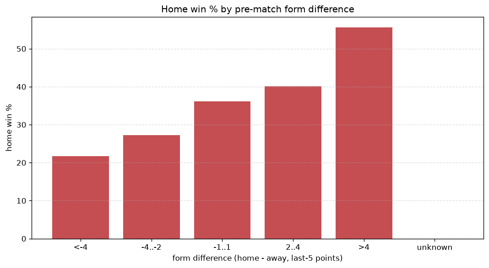
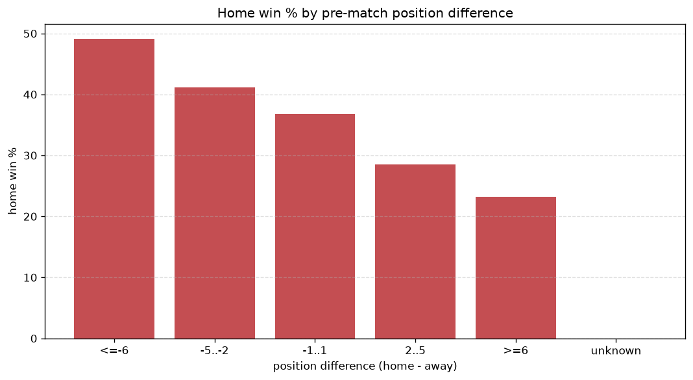

# Relationships Analysis
- Report: `relationships`
- Generated: 2026-10-26T01:30:44+00:00
- Script: `backend/scripts/analyze_relationships.py` v1.0.0
- League: Premier League (Egypt)
- Scope: league `egypt`

- Matches analysed: **1699** (23 leakage-safe pre-match features).

## 1. Correlation matrix
_Pearson correlation of each pre-match feature with observed goals; sorted by |corr(total goals)|._

| feature | corr(home) | corr(away) | corr(total) |
|---|---|---|---|
| home_team_goals_scored_last_5 | 0.181 | -0.045 | 0.097 |
| home_team_home_goals_avg | 0.175 | -0.050 | 0.090 |
| home_team_wins_last_5 | 0.180 | -0.067 | 0.082 |
| home_team_home_win_rate | 0.159 | -0.056 | 0.075 |
| rest_days_difference | 0.071 | 0.037 | 0.074 |
| home_team_points_last_5 | 0.166 | -0.072 | 0.069 |
| home_points_before_match | 0.121 | -0.032 | 0.064 |
| home_rest_days | 0.063 | 0.023 | 0.059 |
| away_team_away_goals_avg | -0.021 | 0.105 | 0.054 |
| home_position_before_match | -0.149 | 0.078 | -0.053 |
| away_points_before_match | -0.036 | 0.110 | 0.047 |
| away_team_away_win_rate | -0.065 | 0.126 | 0.037 |
| position_difference | -0.185 | 0.152 | -0.029 |
| away_team_goals_scored_last_5 | -0.068 | 0.111 | 0.025 |
| away_team_points_last_5 | -0.080 | 0.123 | 0.024 |
| away_team_wins_last_5 | -0.077 | 0.120 | 0.024 |
| points_difference | 0.214 | -0.194 | 0.023 |
| away_position_before_match | 0.085 | -0.116 | -0.016 |
| home_team_home_conceded_avg | -0.078 | 0.071 | -0.008 |
| away_team_away_conceded_avg | 0.066 | -0.083 | -0.008 |
| away_rest_days | 0.011 | -0.009 | 0.002 |
| home_team_goals_conceded_last_5 | -0.085 | 0.088 | -0.002 |
| away_team_goals_conceded_last_5 | 0.072 | -0.076 | -0.000 |

## 2. Form vs outcome
_Home win/draw/away % per bucket of `home_team_points_last_5 - away_team_points_last_5`._

| bucket | matches | home | draw | away | home % | draw % | away % |
|---|---|---|---|---|---|---|---|
| <-4 | 267 | 58 | 91 | 118 | 21.7% | 34.1% | 44.2% |
| -4..-2 | 320 | 87 | 118 | 115 | 27.2% | 36.9% | 35.9% |
| -1..1 | 532 | 192 | 184 | 156 | 36.1% | 34.6% | 29.3% |
| 2..4 | 337 | 135 | 115 | 87 | 40.1% | 34.1% | 25.8% |
| >4 | 243 | 135 | 72 | 36 | 55.6% | 29.6% | 14.8% |
| unknown | 0 | 0 | 0 | 0 | - | - | - |

## 3. Position vs outcome
_Home win/draw/away % per bucket of `position_difference` (home position - away position; negative favours the home team)._

| bucket | matches | home | draw | away | home % | draw % | away % |
|---|---|---|---|---|---|---|---|
| <=-6 | 407 | 200 | 131 | 76 | 49.1% | 32.2% | 18.7% |
| -5..-2 | 314 | 129 | 106 | 79 | 41.1% | 33.8% | 25.2% |
| -1..1 | 253 | 93 | 93 | 67 | 36.8% | 36.8% | 26.5% |
| 2..5 | 316 | 90 | 116 | 110 | 28.5% | 36.7% | 34.8% |
| >=6 | 409 | 95 | 134 | 180 | 23.2% | 32.8% | 44.0% |
| unknown | 0 | 0 | 0 | 0 | - | - | - |

## 4. Rest advantage
_Home win/draw/away % per bucket of `rest_days_difference` (home rest - away rest). Matches with unknown rest are bucketed separately._

| bucket | matches | home | draw | away | home % | draw % | away % |
|---|---|---|---|---|---|---|---|
| <-1 | 336 | 119 | 125 | 92 | 35.4% | 37.2% | 27.4% |
| -1..0 | 262 | 95 | 89 | 78 | 36.3% | 34.0% | 29.8% |
| 0 | 393 | 153 | 136 | 104 | 38.9% | 34.6% | 26.5% |
| 1..2 | 388 | 138 | 117 | 133 | 35.6% | 30.2% | 34.3% |
| >2 | 230 | 75 | 77 | 78 | 32.6% | 33.5% | 33.9% |
| unknown | 90 | 27 | 36 | 27 | 30.0% | 40.0% | 30.0% |
- *90 match(es) had unknown rest difference (missing rest data on at least one side).*

## 5. Home team quality
_Home win rate by `home_team_home_win_rate` tier (split at 0.5)._

- `< 0.5` tier: **30.8%** home win (372/1208)
- `>= 0.5` tier: **47.9%** home win (235/491)
- Home-win gap (>= split minus < split): **+17.1 pp**

| tier | label | matches | home | draw | away | home % |
|---|---|---|---|---|---|---|
| low | < 0.5 | 1208 | 372 | 427 | 409 | 30.8% |
| high | >= 0.5 | 491 | 235 | 153 | 103 | 47.9% |

## 6. Feature averages by result
_Mean feature value per outcome; `range` is home-minus-away spread of the group means._

| feature | home mean | draw mean | away mean | range |
|---|---|---|---|---|
| points_difference | 3.590 | -0.286 | -3.959 | 7.549 |
| position_difference | -2.249 | 0.186 | 2.365 | 4.614 |
| away_points_before_match | 18.498 | 19.340 | 22.299 | 3.801 |
| home_points_before_match | 22.087 | 19.053 | 18.340 | 3.747 |
| home_position_before_match | 9.168 | 10.771 | 11.545 | 2.377 |
| away_position_before_match | 11.417 | 10.584 | 9.180 | 2.237 |
| away_team_points_last_5 | 5.404 | 5.902 | 6.707 | 1.303 |
| home_team_points_last_5 | 6.586 | 5.600 | 5.311 | 1.276 |
| away_team_goals_scored_last_5 | 4.493 | 4.824 | 5.600 | 1.107 |
| home_team_goals_scored_last_5 | 5.437 | 4.602 | 4.410 | 1.026 |
| away_rest_days | 8.717 | 9.501 | 8.477 | 1.023 |
| rest_days_difference | 0.700 | -0.142 | 0.505 | 0.842 |
| home_team_goals_conceded_last_5 | 4.577 | 4.941 | 5.293 | 0.716 |
| away_team_goals_conceded_last_5 | 5.196 | 4.853 | 4.566 | 0.630 |
| home_team_wins_last_5 | 1.712 | 1.343 | 1.256 | 0.456 |
| away_team_wins_last_5 | 1.292 | 1.459 | 1.734 | 0.443 |
| home_rest_days | 9.433 | 9.249 | 9.116 | 0.317 |
| home_team_home_goals_avg | 1.197 | 0.987 | 0.949 | 0.248 |
| away_team_away_goals_avg | 0.892 | 0.928 | 1.045 | 0.153 |
| away_team_away_conceded_avg | 1.124 | 1.054 | 0.994 | 0.130 |
| home_team_home_conceded_avg | 0.881 | 0.966 | 1.008 | 0.127 |
| home_team_home_win_rate | 0.382 | 0.308 | 0.292 | 0.090 |
| away_team_away_win_rate | 0.238 | 0.269 | 0.321 | 0.083 |

---
*All features are leakage-safe pre-match values built by `ml.features.build_features.build_rows` from strictly prior matches. Run with `python backend/scripts/analyze_relationships.py` to regenerate.*

## Charts

