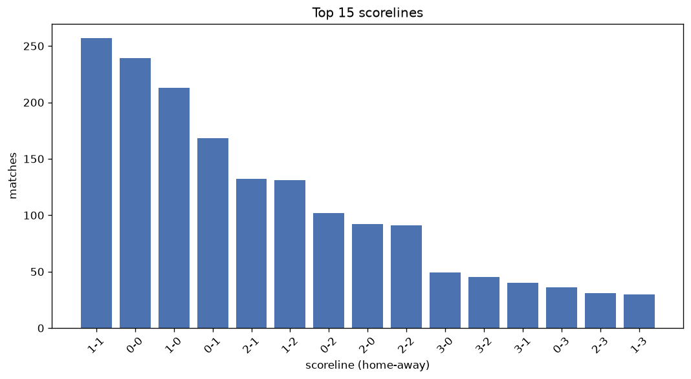
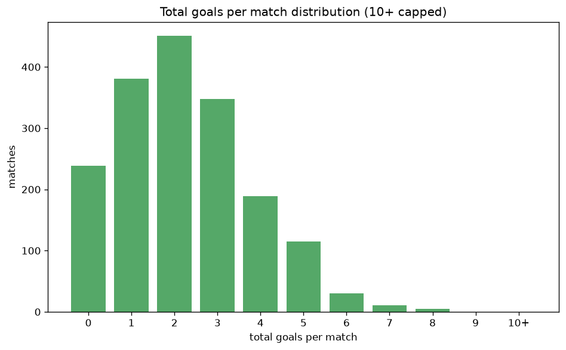

# Scoreline Analysis
- Report: `scoreline_analysis`
- Generated: 2026-10-26T01:30:43+00:00
- Script: `backend/scripts/analyze_scorelines.py` v1.0.0
- League: Premier League (Egypt)
- Scope: league `egypt`

## 1. Scoreline frequency
- Matches analysed: **1769** across **7** seasons.
- Distinct scorelines seen: **33**.

| scoreline | count | pct |
|---|---|---|
| 1-1 | 257 | 14.5% |
| 0-0 | 239 | 13.5% |
| 1-0 | 213 | 12.0% |
| 0-1 | 168 | 9.5% |
| 2-1 | 132 | 7.5% |
| 1-2 | 131 | 7.4% |
| 0-2 | 102 | 5.8% |
| 2-0 | 92 | 5.2% |
| 2-2 | 91 | 5.1% |
| 3-0 | 49 | 2.8% |
| 3-2 | 45 | 2.5% |
| 3-1 | 40 | 2.3% |
| 0-3 | 36 | 2.0% |
| 2-3 | 31 | 1.8% |
| 1-3 | 30 | 1.7% |
| 4-1 | 19 | 1.1% |
| 4-0 | 16 | 0.9% |
| 1-4 | 15 | 0.8% |
| 4-2 | 13 | 0.7% |
| 0-4 | 12 | 0.7% |

## 2. Scoreline frequency per season

### 2020-2021
| scoreline | count | pct |
|---|---|---|
| 1-1 | 60 | 19.6% |
| 0-0 | 32 | 10.5% |
| 1-2 | 26 | 8.5% |
| 0-2 | 23 | 7.5% |
| 2-1 | 22 | 7.2% |

### 2021-2022
| scoreline | count | pct |
|---|---|---|
| 1-0 | 47 | 15.4% |
| 1-1 | 43 | 14.1% |
| 0-0 | 42 | 13.7% |
| 0-1 | 28 | 9.2% |
| 2-1 | 19 | 6.2% |

### 2022-2023
| scoreline | count | pct |
|---|---|---|
| 0-0 | 52 | 17.0% |
| 1-1 | 36 | 11.8% |
| 1-0 | 36 | 11.8% |
| 2-1 | 30 | 9.8% |
| 0-1 | 24 | 7.8% |

### 2023-2024
| scoreline | count | pct |
|---|---|---|
| 1-1 | 39 | 12.7% |
| 1-0 | 36 | 11.8% |
| 0-1 | 35 | 11.4% |
| 0-0 | 33 | 10.8% |
| 1-2 | 29 | 9.5% |

### 2024-2025
| scoreline | count | pct |
|---|---|---|
| 0-0 | 24 | 15.7% |
| 0-1 | 24 | 15.7% |
| 1-0 | 20 | 13.1% |
| 1-1 | 16 | 10.5% |
| 2-0 | 10 | 6.5% |

### 2025-2026
| scoreline | count | pct |
|---|---|---|
| 1-1 | 54 | 16.8% |
| 0-0 | 51 | 15.8% |
| 1-0 | 45 | 14.0% |
| 0-1 | 29 | 9.0% |
| 1-2 | 26 | 8.1% |

### 2026-2027
| scoreline | count | pct |
|---|---|---|
| 1-1 | 9 | 12.9% |
| 0-2 | 8 | 11.4% |
| 1-0 | 7 | 10.0% |
| 2-0 | 7 | 10.0% |
| 0-1 | 7 | 10.0% |

## 3. Total-goal histogram
_10+ groups all matches with 10 or more total goals._

| total goals | matches | pct |
|---|---|---|
| 0 | 239 | 13.5% |
| 1 | 381 | 21.5% |
| 2 | 451 | 25.5% |
| 3 | 348 | 19.7% |
| 4 | 189 | 10.7% |
| 5 | 115 | 6.5% |
| 6 | 30 | 1.7% |
| 7 | 11 | 0.6% |
| 8 | 5 | 0.3% |
| 9 | 0 | 0.0% |
| 10+ | 0 | 0.0% |

## 4. Extreme scorelines
- Matches with 7+ total goals: **16**

| season | date | scoreline | total goals |
|---|---|---|---|
| 2020-2021 | 2021-08-18 | 3-5 | 8 |
| 2021-2022 | 2021-10-25 | 4-4 | 8 |
| 2021-2022 | 2021-11-05 | 3-5 | 8 |
| 2021-2022 | 2021-12-20 | 4-4 | 8 |
| 2023-2024 | 2024-02-23 | 3-5 | 8 |
| 2021-2022 | 2022-05-11 | 2-5 | 7 |
| 2021-2022 | 2022-05-17 | 4-3 | 7 |
| 2022-2023 | 2023-02-27 | 3-4 | 7 |
| 2022-2023 | 2023-04-09 | 4-3 | 7 |
| 2022-2023 | 2023-06-28 | 5-2 | 7 |
| 2023-2024 | 2024-03-12 | 4-3 | 7 |
| 2023-2024 | 2024-05-16 | 5-2 | 7 |
| 2023-2024 | 2024-08-11 | 2-5 | 7 |
| 2024-2025 | 2024-11-02 | 5-2 | 7 |
| 2024-2025 | 2024-11-22 | 4-3 | 7 |
| 2025-2026 | 2026-02-04 | 2-5 | 7 |

## 5. Margin-of-victory distribution (decided matches)
- Decided matches: **1173** (draws: **596**)
- Average winning margin: **1.56**

| margin | matches | pct |
|---|---|---|
| 1 | 725 | 61.8% |
| 2 | 285 | 24.3% |
| 3+ | 163 | 13.9% |

## 6. Margin by outcome

### Home wins
- Matches: **634** | avg margin: **1.58** | max margin: **6**
| margin | matches | pct |
|---|---|---|
| 1 | 394 | 62.1% |
| 2 | 145 | 22.9% |
| 3+ | 95 | 15.0% |
- *Full match-by-match list available in `scoreline_analysis.json`.*

### Away wins
- Matches: **539** | avg margin: **1.54** | max margin: **5**
| margin | matches | pct |
|---|---|---|
| 1 | 331 | 61.4% |
| 2 | 140 | 26.0% |
| 3+ | 68 | 12.6% |
- *Full match-by-match list available in `scoreline_analysis.json`.*

## 7. Most common exact score by outcome type
| outcome | matches | most common score | count | pct |
|---|---|---|---|---|
| home | 634 | 1-0 | 213 | 33.6% |
| draw | 596 | 1-1 | 257 | 43.1% |
| away | 539 | 0-1 | 168 | 31.2% |

---
*All statistics are computed from PostgreSQL tables (read-only). Run with `python backend/scripts/analyze_scorelines.py` to regenerate.*

## Charts

