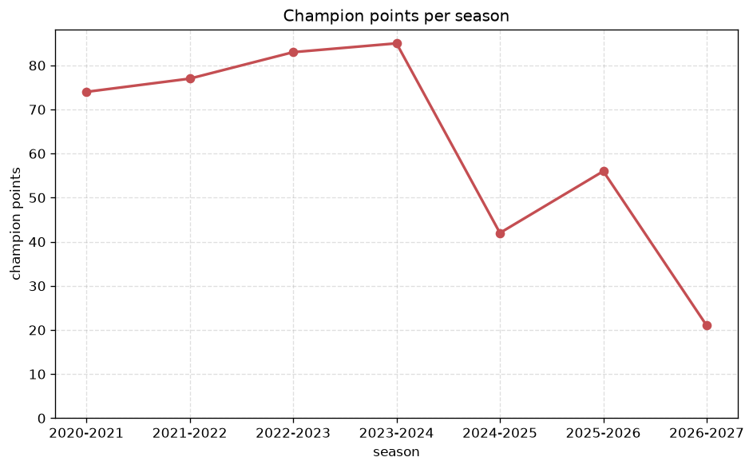
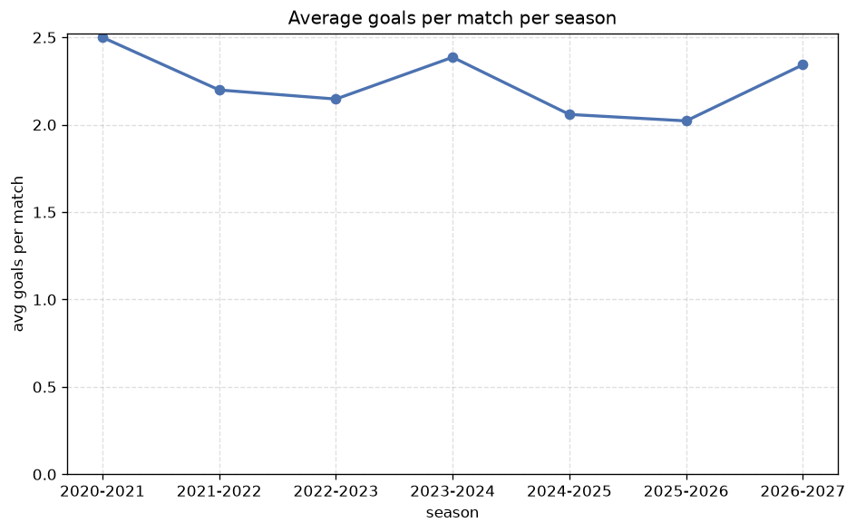

# Season Trends Analysis
- Report: `season_trends`
- Generated: 2026-10-26T01:30:41+00:00
- Script: `backend/scripts/analyze_seasons.py` v1.0.0
- League: Premier League (Egypt)
- Scope: league `egypt`

## 1. Champions per season
| season | champion | pts | runner-up | margin |
|---|---|---|---|---|
| 2020-2021 | Zamalek | 74 | Al Ahly | 4 pts |
| 2021-2022 | Zamalek | 77 | Pyramids | 6 pts |
| 2022-2023 | Al Ahly | 83 | Pyramids | 10 pts |
| 2023-2024 | Al Ahly | 85 | Pyramids | 6 pts |
| 2024-2025 | Pyramids | 42 | Al Ahly | 3 pts |
| 2025-2026 | Zamalek | 56 | Pyramids | 2 pts |
| 2026-2027 | Pyramids | 21 | Al Ahly | 4 pts |

## 2. Title-race tightness
- Tight races (margin <= 3 pts): **2** of 7 seasons
- Tightest race: **2025-2026** - Zamalek beat Pyramids by **2** pts

| season | margin | tight |
|---|---|---|
| 2020-2021 | 4 pts |  |
| 2021-2022 | 6 pts |  |
| 2022-2023 | 10 pts |  |
| 2023-2024 | 6 pts |  |
| 2024-2025 | 3 pts | yes |
| 2025-2026 | 2 pts | yes |
| 2026-2027 | 4 pts |  |

## 3. Points thresholds
_Position-specific points per season. Key: 1 = champion, 2 = runner-up, 4 = CL line, 6 = Europa, 17 = last safe, 20 = bottom._

| season | pos 1 | pos 2 | pos 4 | pos 6 | pos 17 | pos 20 |
|---|---|---|---|---|---|---|
| 2020-2021 | 74 | 70 | 50 | 47 | 25 | 3 |
| 2021-2022 | 77 | 71 | 56 | 47 | 33 | - |
| 2022-2023 | 83 | 73 | 58 | 45 | 33 | - |
| 2023-2024 | 85 | 79 | 55 | 54 | 26 | - |
| 2024-2025 | 42 | 39 | 30 | 24 | 12 | - |
| 2025-2026 | 56 | 54 | 53 | 48 | 32 | 25 |
| 2026-2027 | 21 | 17 | 15 | 13 | 4 | 2 |

## 4. Relegation battle
| season | safe pos | safe pts | drop pos | drop pts | gap |
|---|---|---|---|---|---|
| 2020-2021 | 17 | 25 | 18 | 15 | 10 pts |
| 2021-2022 | 17 | 33 | 18 | 15 | 18 pts |
| 2022-2023 | 17 | 33 | 18 | 25 | 8 pts |
| 2023-2024 | 17 | 26 | 18 | 20 | 6 pts |
| 2024-2025 | 17 | 12 | 18 | 9 | 3 pts |
| 2025-2026 | 17 | 32 | 18 | 31 | 1 pts |
| 2026-2027 | 17 | 4 | 18 | 4 | 0 pts |

## 5. League-level trends
| season | matches | total goals | avg goals | home win | draw | away win | goalless | avg pts/team |
|---|---|---|---|---|---|---|---|---|
| 2020-2021 | 306 | 765 | 2.5 | 31.0% | 36.6% | 32.4% | 10.5% | 15.21 |
| 2021-2022 | 306 | 673 | 2.199 | 36.9% | 34.3% | 28.8% | 13.7% | 45.17 |
| 2022-2023 | 306 | 657 | 2.147 | 38.6% | 33.3% | 28.1% | 17.0% | 45.33 |
| 2023-2024 | 306 | 730 | 2.386 | 37.6% | 30.1% | 32.4% | 10.8% | 45.89 |
| 2024-2025 | 153 | 315 | 2.059 | 37.3% | 30.7% | 32.0% | 15.7% | 22.89 |
| 2025-2026 | 322 | 651 | 2.022 | 33.9% | 37.9% | 28.3% | 15.8% | 40.19 |
| 2026-2027 | 70 | 164 | 2.343 | 38.6% | 22.9% | 38.6% | 7.1% | 9.7 |

## 6. View divergence
- Largest divergence: **2020-2021** (luck view, avg abs position diff = 16.906)

_Avg absolute position difference between classic view and alternative view per season._

| season | classic vs luck | classic vs goals |
|---|---|---|
| 2020-2021 | 16.906 | 16.302 |
| 2021-2022 | 2.889 | 4.444 |
| 2022-2023 | 3.000 | 5.444 |
| 2023-2024 | 1.778 | 5.000 |
| 2024-2025 | 2.222 | 3.778 |
| 2025-2026 | 3.429 | 4.762 |
| 2026-2027 | 2.200 | 4.900 |

---
*All statistics are computed from PostgreSQL tables (read-only). Run with `python backend/scripts/analyze_seasons.py` to regenerate.*

## Charts

