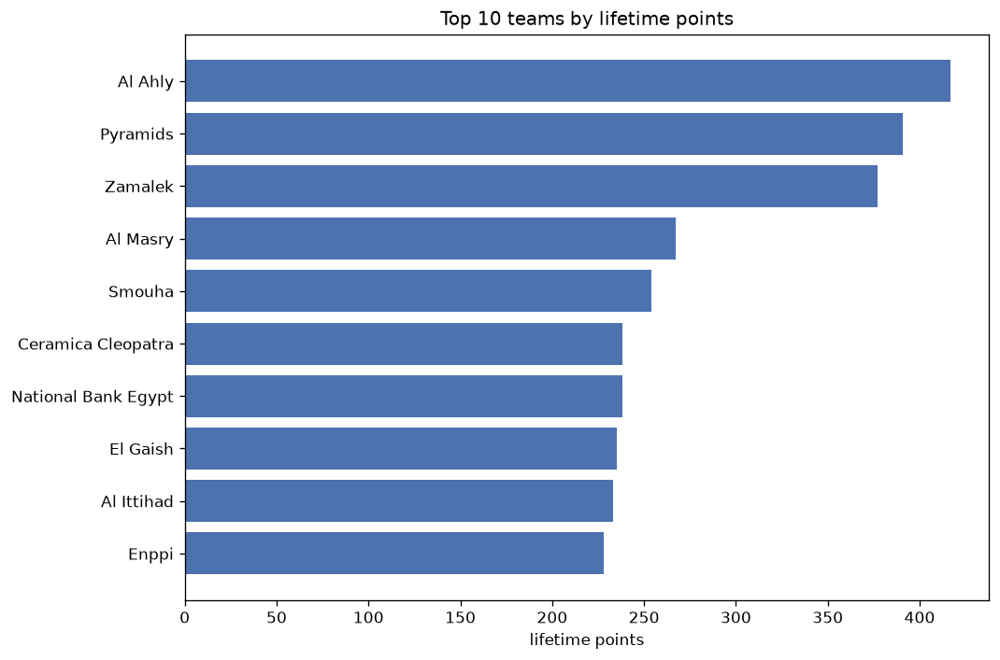
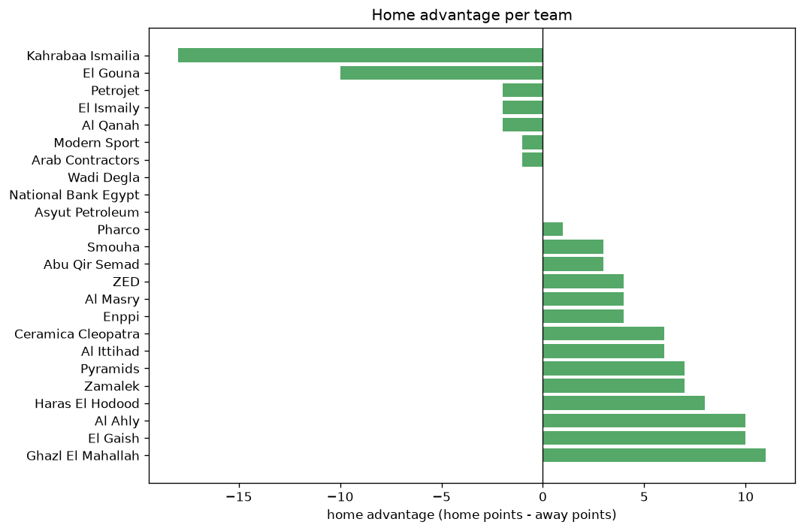

# Team Analysis
- Report: `teams_analysis`
- Generated: 2026-10-29T01:57:56+00:00
- Script: `backend/scripts/analyze_teams.py` v1.0.0
- League: Premier League (Egypt)
- Scope: league `egypt`

- Teams: **65** | Seasons: **7** | Matches: **1769**

## 1. Team standings (lifetime)
| team | seasons | played | W | D | L | pts | GF | GA | GD | avg pts/season | best pos | worst pos | titles |
|---|---|---|---|---|---|---|---|---|---|---|---|---|---|
| Al Ahly | 7 | 184 | 123 | 48 | 13 | 417 | 353 | 127 | 226 | 59.57 | 1 | 3 | 2 |
| Pyramids | 7 | 184 | 116 | 43 | 25 | 391 | 320 | 143 | 177 | 55.86 | 1 | 3 | 2 |
| Zamalek | 7 | 184 | 111 | 41 | 32 | 374 | 302 | 159 | 143 | 53.43 | 1 | 3 | 3 |
| Al Masry | 7 | 184 | 67 | 65 | 52 | 266 | 215 | 197 | 18 | 38.0 | 4 | 13 | 0 |
| Smouha | 7 | 184 | 64 | 62 | 58 | 254 | 209 | 211 | -2 | 36.29 | 4 | 18 | 0 |
| Ceramica Cleopatra | 7 | 184 | 56 | 70 | 58 | 238 | 224 | 209 | 15 | 34.0 | 4 | 14 | 0 |
| National Bank Egypt | 7 | 191 | 55 | 72 | 64 | 237 | 222 | 225 | -3 | 33.86 | 5 | 15 | 0 |
| El Gaish | 7 | 191 | 56 | 67 | 68 | 235 | 166 | 209 | -43 | 33.57 | 5 | 15 | 0 |
| Al Ittihad | 7 | 191 | 58 | 59 | 74 | 233 | 190 | 232 | -42 | 33.29 | 6 | 16 | 0 |
| Enppi | 7 | 184 | 55 | 63 | 66 | 228 | 192 | 211 | -19 | 32.57 | 6 | 17 | 0 |
| Modern Sport | 6 | 159 | 57 | 56 | 46 | 227 | 170 | 152 | 18 | 37.83 | 4 | 18 | 0 |
| Arab Contractors | 6 | 174 | 43 | 68 | 63 | 197 | 172 | 204 | -32 | 32.83 | 7 | 17 | 0 |
| El Ismaily | 6 | 184 | 41 | 59 | 84 | 182 | 158 | 222 | -64 | 30.33 | 9 | 21 | 0 |
| El Gouna | 6 | 157 | 40 | 57 | 60 | 177 | 138 | 178 | -40 | 29.5 | 7 | 20 | 0 |
| Pharco | 5 | 152 | 34 | 63 | 55 | 165 | 116 | 153 | -37 | 33.0 | 7 | 20 | 0 |
| Ghazl El Mahallah | 6 | 157 | 33 | 61 | 63 | 160 | 124 | 189 | -65 | 26.67 | 11 | 19 | 0 |
| ZED | 4 | 91 | 32 | 36 | 23 | 132 | 110 | 87 | 23 | 33.0 | 5 | 10 | 0 |
| Wadi Degla | 3 | 72 | 19 | 31 | 22 | 88 | 78 | 75 | 3 | 29.33 | 4 | 16 | 0 |
| Petrojet | 3 | 57 | 17 | 24 | 16 | 75 | 66 | 68 | -2 | 25.0 | 8 | 12 | 0 |
| Haras El Hodood | 3 | 84 | 16 | 25 | 43 | 73 | 64 | 112 | -48 | 24.33 | 9 | 19 | 0 |
| Aswan SC | 2 | 66 | 14 | 16 | 36 | 58 | 57 | 103 | -46 | 29.0 | 16 | 17 | 0 |
| El Daklyeh | 2 | 68 | 10 | 25 | 33 | 55 | 49 | 86 | -37 | 27.5 | 15 | 18 | 0 |
| Misr Lel Makkasa | 2 | 66 | 11 | 17 | 38 | 50 | 47 | 103 | -56 | 25.0 | 13 | 18 | 0 |
| Eastern Company | 1 | 34 | 7 | 12 | 15 | 33 | 33 | 56 | -23 | 33.0 | 17 | 17 | 0 |
| Kahrabaa Ismailia | 1 | 33 | 7 | 11 | 15 | 32 | 35 | 53 | -18 | 32.0 | 17 | 17 | 0 |
| Baladiyat El Mahalla | 1 | 34 | 7 | 7 | 20 | 28 | 31 | 65 | -34 | 28.0 | 16 | 16 | 0 |
| Entag El-Harby | 1 | 17 | 3 | 6 | 8 | 15 | 22 | 35 | -13 | 15.0 | 18 | 18 | 0 |
| El-Entag El | 1 | 17 | 2 | 7 | 8 | 13 | 15 | 27 | -12 | 13.0 | 19 | 19 | 0 |
| Al Qanah | 1 | 7 | 1 | 5 | 1 | 8 | 9 | 9 | 0 | 8.0 | 11 | 11 | 0 |
| Asyut Petroleum | 1 | 7 | 1 | 2 | 4 | 5 | 3 | 7 | -4 | 5.0 | 16 | 16 | 0 |
| Abu Qir Semad | 1 | 7 | 1 | 1 | 5 | 4 | 3 | 11 | -8 | 4.0 | 18 | 18 | 0 |
| Al Ahly-El | 1 | 1 | 1 | 0 | 0 | 3 | 4 | 1 | 3 | 3.0 | 20 | 20 | 0 |
| El Gaish-El | 1 | 1 | 1 | 0 | 0 | 3 | 3 | 0 | 3 | 3.0 | 21 | 21 | 0 |
| Harby-Al Masry | 1 | 1 | 1 | 0 | 0 | 3 | 3 | 0 | 3 | 3.0 | 23 | 23 | 0 |
| National Bank Egypt-El | 1 | 1 | 1 | 0 | 0 | 3 | 3 | 0 | 3 | 3.0 | 22 | 22 | 0 |
| Al Ittihad-El | 1 | 1 | 1 | 0 | 0 | 3 | 2 | 0 | 2 | 3.0 | 28 | 28 | 0 |
| Harby-Ceramica Cleopatra | 1 | 1 | 1 | 0 | 0 | 3 | 2 | 0 | 2 | 3.0 | 30 | 30 | 0 |
| Harby-El Ismaily | 1 | 1 | 1 | 0 | 0 | 3 | 2 | 0 | 2 | 3.0 | 26 | 26 | 0 |
| Harby-National Bank Egypt | 1 | 1 | 1 | 0 | 0 | 3 | 3 | 1 | 2 | 3.0 | 25 | 25 | 0 |
| Harby-Zamalek | 1 | 1 | 1 | 0 | 0 | 3 | 2 | 0 | 2 | 3.0 | 27 | 27 | 0 |
| Smouha-El | 1 | 1 | 1 | 0 | 0 | 3 | 4 | 2 | 2 | 3.0 | 24 | 24 | 0 |
| Zamalek-El | 1 | 1 | 1 | 0 | 0 | 3 | 2 | 0 | 2 | 3.0 | 29 | 29 | 0 |
| Harby-Al Ahly | 1 | 1 | 1 | 0 | 0 | 3 | 3 | 2 | 1 | 3.0 | 32 | 32 | 0 |
| Harby-El Gaish | 1 | 1 | 1 | 0 | 0 | 3 | 2 | 1 | 1 | 3.0 | 33 | 33 | 0 |
| Harby-Ghazl El Mahallah | 1 | 1 | 1 | 0 | 0 | 3 | 1 | 0 | 1 | 3.0 | 35 | 35 | 0 |
| Misr Lel Makkasa-El | 1 | 1 | 1 | 0 | 0 | 3 | 1 | 0 | 1 | 3.0 | 34 | 34 | 0 |
| Pyramids-El | 1 | 1 | 1 | 0 | 0 | 3 | 3 | 2 | 1 | 3.0 | 31 | 31 | 0 |
| Arab Contractors-El | 1 | 1 | 0 | 1 | 0 | 1 | 1 | 1 | 0 | 1.0 | 43 | 43 | 0 |
| Aswan SC-El | 1 | 1 | 0 | 1 | 0 | 1 | 2 | 2 | 0 | 1.0 | 39 | 39 | 0 |
| Ceramica Cleopatra-El | 1 | 1 | 0 | 1 | 0 | 1 | 1 | 1 | 0 | 1.0 | 44 | 44 | 0 |
| El Ismaily-El | 1 | 1 | 0 | 1 | 0 | 1 | 3 | 3 | 0 | 1.0 | 36 | 36 | 0 |
| Enppi-El | 1 | 1 | 0 | 1 | 0 | 1 | 1 | 1 | 0 | 1.0 | 45 | 45 | 0 |
| Harby-Al Ittihad | 1 | 1 | 0 | 1 | 0 | 1 | 1 | 1 | 0 | 1.0 | 46 | 46 | 0 |
| Harby-Aswan SC | 1 | 1 | 0 | 1 | 0 | 1 | 1 | 1 | 0 | 1.0 | 40 | 40 | 0 |
| Harby-El Gouna | 1 | 1 | 0 | 1 | 0 | 1 | 1 | 1 | 0 | 1.0 | 41 | 41 | 0 |
| Harby-Enppi | 1 | 1 | 0 | 1 | 0 | 1 | 0 | 0 | 0 | 1.0 | 48 | 48 | 0 |
| Harby-Pyramids | 1 | 1 | 0 | 1 | 0 | 1 | 2 | 2 | 0 | 1.0 | 38 | 38 | 0 |
| Harby-Smouha | 1 | 1 | 0 | 1 | 0 | 1 | 1 | 1 | 0 | 1.0 | 42 | 42 | 0 |
| Harby-Wadi Degla | 1 | 1 | 0 | 1 | 0 | 1 | 2 | 2 | 0 | 1.0 | 37 | 37 | 0 |
| Wadi Degla-El | 1 | 1 | 0 | 1 | 0 | 1 | 0 | 0 | 0 | 1.0 | 47 | 47 | 0 |
| Al Masry-El | 1 | 1 | 0 | 0 | 1 | 0 | 2 | 3 | -1 | 0.0 | 50 | 50 | 0 |
| El Gouna-El | 1 | 1 | 0 | 0 | 1 | 0 | 2 | 3 | -1 | 0.0 | 49 | 49 | 0 |
| Harby-Arab Contractors | 1 | 1 | 0 | 0 | 1 | 0 | 0 | 1 | -1 | 0.0 | 52 | 52 | 0 |
| Harby-Misr Lel Makkasa | 1 | 1 | 0 | 0 | 1 | 0 | 1 | 2 | -1 | 0.0 | 51 | 51 | 0 |
| Ghazl El Mahallah-El | 1 | 1 | 0 | 0 | 1 | 0 | 1 | 3 | -2 | 0.0 | 53 | 53 | 0 |

## 2. Home vs away split
| team | home P | H-W | H-D | H-L | H-pts | away P | A-W | A-D | A-L | A-pts | adv |
|---|---|---|---|---|---|---|---|---|---|---|---|
| Ghazl El Mahallah | 79 | 23 | 32 | 24 | 101 | 78 | 10 | 29 | 39 | 59 | 42 |
| Zamalek | 96 | 62 | 21 | 13 | 207 | 88 | 49 | 20 | 19 | 167 | 40 |
| Ceramica Cleopatra | 91 | 33 | 33 | 25 | 132 | 93 | 23 | 37 | 33 | 106 | 26 |
| Al Ahly | 92 | 66 | 23 | 3 | 221 | 92 | 57 | 25 | 10 | 196 | 25 |
| Haras El Hodood | 43 | 11 | 15 | 17 | 48 | 41 | 5 | 10 | 26 | 25 | 23 |
| Pyramids | 92 | 62 | 20 | 10 | 206 | 92 | 54 | 23 | 15 | 185 | 21 |
| El Gaish | 95 | 31 | 35 | 29 | 128 | 96 | 25 | 32 | 39 | 107 | 21 |
| Al Ittihad | 94 | 34 | 25 | 35 | 127 | 97 | 24 | 34 | 39 | 106 | 21 |
| Pharco | 76 | 21 | 28 | 27 | 91 | 76 | 13 | 35 | 28 | 74 | 17 |
| Enppi | 89 | 30 | 32 | 27 | 122 | 95 | 25 | 31 | 39 | 106 | 16 |
| El Ismaily | 89 | 24 | 27 | 38 | 99 | 95 | 17 | 32 | 46 | 83 | 16 |
| National Bank Egypt | 96 | 30 | 36 | 30 | 126 | 95 | 25 | 36 | 34 | 111 | 15 |
| El-Entag El | 17 | 2 | 7 | 8 | 13 | 0 | 0 | 0 | 0 | 0 | 13 |
| El Gouna | 77 | 22 | 28 | 27 | 94 | 80 | 18 | 29 | 33 | 83 | 11 |
| Smouha | 92 | 34 | 30 | 28 | 132 | 92 | 30 | 32 | 30 | 122 | 10 |
| Baladiyat El Mahalla | 17 | 5 | 3 | 9 | 18 | 17 | 2 | 4 | 11 | 10 | 8 |
| El Daklyeh | 34 | 5 | 15 | 14 | 30 | 34 | 5 | 10 | 19 | 25 | 5 |
| Misr Lel Makkasa | 33 | 6 | 9 | 18 | 27 | 33 | 5 | 8 | 20 | 23 | 4 |
| Petrojet | 28 | 9 | 12 | 7 | 39 | 29 | 8 | 12 | 9 | 36 | 3 |
| Al Ahly-El | 1 | 1 | 0 | 0 | 3 | 0 | 0 | 0 | 0 | 0 | 3 |
| Al Ittihad-El | 1 | 1 | 0 | 0 | 3 | 0 | 0 | 0 | 0 | 0 | 3 |
| El Gaish-El | 1 | 1 | 0 | 0 | 3 | 0 | 0 | 0 | 0 | 0 | 3 |
| Misr Lel Makkasa-El | 1 | 1 | 0 | 0 | 3 | 0 | 0 | 0 | 0 | 0 | 3 |
| National Bank Egypt-El | 1 | 1 | 0 | 0 | 3 | 0 | 0 | 0 | 0 | 0 | 3 |
| Pyramids-El | 1 | 1 | 0 | 0 | 3 | 0 | 0 | 0 | 0 | 0 | 3 |
| Smouha-El | 1 | 1 | 0 | 0 | 3 | 0 | 0 | 0 | 0 | 0 | 3 |
| Zamalek-El | 1 | 1 | 0 | 0 | 3 | 0 | 0 | 0 | 0 | 0 | 3 |
| Aswan SC | 35 | 7 | 9 | 19 | 30 | 31 | 7 | 7 | 17 | 28 | 2 |
| Abu Qir Semad | 3 | 1 | 0 | 2 | 3 | 4 | 0 | 1 | 3 | 1 | 2 |
| Modern Sport | 79 | 27 | 33 | 19 | 114 | 80 | 30 | 23 | 27 | 113 | 1 |
| Arab Contractors-El | 1 | 0 | 1 | 0 | 1 | 0 | 0 | 0 | 0 | 0 | 1 |
| Aswan SC-El | 1 | 0 | 1 | 0 | 1 | 0 | 0 | 0 | 0 | 0 | 1 |
| Ceramica Cleopatra-El | 1 | 0 | 1 | 0 | 1 | 0 | 0 | 0 | 0 | 0 | 1 |
| El Ismaily-El | 1 | 0 | 1 | 0 | 1 | 0 | 0 | 0 | 0 | 0 | 1 |
| Enppi-El | 1 | 0 | 1 | 0 | 1 | 0 | 0 | 0 | 0 | 0 | 1 |
| Wadi Degla-El | 1 | 0 | 1 | 0 | 1 | 0 | 0 | 0 | 0 | 0 | 1 |
| ZED | 45 | 16 | 18 | 11 | 66 | 46 | 16 | 18 | 12 | 66 | 0 |
| Al Masry-El | 1 | 0 | 0 | 1 | 0 | 0 | 0 | 0 | 0 | 0 | 0 |
| El Gouna-El | 1 | 0 | 0 | 1 | 0 | 0 | 0 | 0 | 0 | 0 | 0 |
| Ghazl El Mahallah-El | 1 | 0 | 0 | 1 | 0 | 0 | 0 | 0 | 0 | 0 | 0 |
| Harby-Arab Contractors | 0 | 0 | 0 | 0 | 0 | 1 | 0 | 0 | 1 | 0 | 0 |
| Harby-Misr Lel Makkasa | 0 | 0 | 0 | 0 | 0 | 1 | 0 | 0 | 1 | 0 | 0 |
| Harby-Al Ittihad | 0 | 0 | 0 | 0 | 0 | 1 | 0 | 1 | 0 | 1 | -1 |
| Harby-Aswan SC | 0 | 0 | 0 | 0 | 0 | 1 | 0 | 1 | 0 | 1 | -1 |
| Harby-El Gouna | 0 | 0 | 0 | 0 | 0 | 1 | 0 | 1 | 0 | 1 | -1 |
| Harby-Enppi | 0 | 0 | 0 | 0 | 0 | 1 | 0 | 1 | 0 | 1 | -1 |
| Harby-Pyramids | 0 | 0 | 0 | 0 | 0 | 1 | 0 | 1 | 0 | 1 | -1 |
| Harby-Smouha | 0 | 0 | 0 | 0 | 0 | 1 | 0 | 1 | 0 | 1 | -1 |
| Harby-Wadi Degla | 0 | 0 | 0 | 0 | 0 | 1 | 0 | 1 | 0 | 1 | -1 |
| Al Masry | 92 | 34 | 30 | 28 | 132 | 92 | 33 | 35 | 24 | 134 | -2 |
| Wadi Degla | 37 | 9 | 16 | 12 | 43 | 35 | 10 | 15 | 10 | 45 | -2 |
| Al Qanah | 3 | 0 | 3 | 0 | 3 | 4 | 1 | 2 | 1 | 5 | -2 |
| Asyut Petroleum | 4 | 0 | 1 | 3 | 1 | 3 | 1 | 1 | 1 | 4 | -3 |
| Harby-Al Ahly | 0 | 0 | 0 | 0 | 0 | 1 | 1 | 0 | 0 | 3 | -3 |
| Harby-Al Masry | 0 | 0 | 0 | 0 | 0 | 1 | 1 | 0 | 0 | 3 | -3 |
| Harby-Ceramica Cleopatra | 0 | 0 | 0 | 0 | 0 | 1 | 1 | 0 | 0 | 3 | -3 |
| Harby-El Gaish | 0 | 0 | 0 | 0 | 0 | 1 | 1 | 0 | 0 | 3 | -3 |
| Harby-El Ismaily | 0 | 0 | 0 | 0 | 0 | 1 | 1 | 0 | 0 | 3 | -3 |
| Harby-Ghazl El Mahallah | 0 | 0 | 0 | 0 | 0 | 1 | 1 | 0 | 0 | 3 | -3 |
| Harby-National Bank Egypt | 0 | 0 | 0 | 0 | 0 | 1 | 1 | 0 | 0 | 3 | -3 |
| Harby-Zamalek | 0 | 0 | 0 | 0 | 0 | 1 | 1 | 0 | 0 | 3 | -3 |
| Arab Contractors | 88 | 20 | 36 | 32 | 96 | 86 | 23 | 32 | 31 | 101 | -5 |
| Eastern Company | 17 | 2 | 6 | 9 | 12 | 17 | 5 | 6 | 6 | 21 | -9 |
| Entag El-Harby | 0 | 0 | 0 | 0 | 0 | 17 | 3 | 6 | 8 | 15 | -15 |
| Kahrabaa Ismailia | 19 | 0 | 7 | 12 | 7 | 14 | 7 | 4 | 3 | 25 | -18 |

## 3. Top performers
### Best points per game (PPG)
| rank | team | PPG |
|---|---|---|
| 1 | Al Ahly-El | 3.00 |
| 2 | El Gaish-El | 3.00 |
| 3 | Harby-Al Masry | 3.00 |
| 4 | National Bank Egypt-El | 3.00 |
| 5 | Al Ittihad-El | 3.00 |

### Most goals scored
| rank | team | goals |
|---|---|---|
| 1 | Al Ahly | 353 |
| 2 | Pyramids | 320 |
| 3 | Zamalek | 302 |
| 4 | Ceramica Cleopatra | 224 |
| 5 | National Bank Egypt | 222 |

### Best goal difference
| rank | team | GD |
|---|---|---|
| 1 | Al Ahly | 226 |
| 2 | Pyramids | 177 |
| 3 | Zamalek | 143 |
| 4 | ZED | 23 |
| 5 | Al Masry | 18 |

### Best defence (goals against per match, standings)
| rank | team | GA/match |
|---|---|---|
| 1 | El Gaish-El | 0.000 |
| 2 | National Bank Egypt-El | 0.000 |
| 3 | Harby-Al Masry | 0.000 |
| 4 | Harby-El Ismaily | 0.000 |
| 5 | Harby-Zamalek | 0.000 |

## 4. Team consistency
- Teams present in all **7** seasons: **10**

Al Ahly, Al Ittihad, Al Masry, Ceramica Cleopatra, El Gaish, Enppi, National Bank Egypt, Pyramids, Smouha, Zamalek

## 5. Head-to-head dominance
- Distinct fixtures: **353** (showing the 15 most frequent)

| fixture | meetings | home wins | draws | away wins | home pct | draw pct | away pct |
|---|---|---|---|---|---|---|---|
| El Gaish vs National Bank Egypt | 12 | 6 | 3 | 3 | 50.0% | 25.0% | 25.0% |
| Pyramids vs Ceramica Cleopatra | 12 | 6 | 2 | 4 | 50.0% | 16.7% | 33.3% |
| Al Ahly vs Enppi | 12 | 5 | 4 | 3 | 41.7% | 33.3% | 25.0% |
| Al Ahly vs Smouha | 12 | 5 | 2 | 5 | 41.7% | 16.7% | 41.7% |
| Pyramids vs Enppi | 12 | 5 | 3 | 4 | 41.7% | 25.0% | 33.3% |
| Smouha vs Al Masry | 12 | 4 | 4 | 4 | 33.3% | 33.3% | 33.3% |
| Zamalek vs Al Ahly | 12 | 4 | 3 | 5 | 33.3% | 25.0% | 41.7% |
| Pyramids vs Al Masry | 12 | 3 | 5 | 4 | 25.0% | 41.7% | 33.3% |
| Smouha vs Ceramica Cleopatra | 12 | 2 | 5 | 5 | 16.7% | 41.7% | 41.7% |
| Zamalek vs Smouha | 11 | 7 | 0 | 4 | 63.6% | 0.0% | 36.4% |
| Al Ahly vs Ceramica Cleopatra | 11 | 6 | 3 | 2 | 54.5% | 27.3% | 18.2% |
| Al Ahly vs Pyramids | 11 | 6 | 3 | 2 | 54.5% | 27.3% | 18.2% |
| Al Ittihad vs El Ismaily | 11 | 6 | 2 | 3 | 54.5% | 18.2% | 27.3% |
| Ceramica Cleopatra vs National Bank Egypt | 11 | 6 | 3 | 2 | 54.5% | 27.3% | 18.2% |
| Enppi vs Ceramica Cleopatra | 11 | 5 | 4 | 2 | 45.5% | 36.4% | 18.2% |

## 6. Position per season (classic view)
_Cells show final position; '-' when the team was absent from that season._

| team | 2020-2021 | 2021-2022 | 2022-2023 | 2023-2024 | 2024-2025 | 2025-2026 | 2026-2027 |
|---|---|---|---|---|---|---|---|
| Al Ahly | 2 | 3 | 1 | 1 | 2 | 3 | 2 |
| Pyramids | 3 | 2 | 2 | 2 | 1 | 2 | 1 |
| Zamalek | 1 | 1 | 3 | 3 | 3 | 1 | 3 |
| Al Masry | 5 | 10 | 5 | 4 | 4 | 10 | 13 |
| Smouha | 4 | 6 | 10 | 6 | 12 | 18 | 10 |
| Ceramica Cleopatra | 12 | 14 | 13 | 8 | 6 | 9 | 4 |
| National Bank Egypt | 15 | 7 | 12 | 13 | 5 | 6 | 9 |
| El Gaish | 11 | 5 | 14 | 10 | 11 | 14 | 15 |
| Al Ittihad | 7 | 12 | 8 | 11 | 13 | 16 | 6 |
| Enppi | 6 | 9 | 6 | 9 | 17 | 15 | 17 |
| Modern Sport | - | 4 | 4 | 5 | 18 | 13 | 5 |
| Arab Contractors | 8 | 11 | 7 | 17 | - | 12 | 7 |
| El Ismaily | 9 | 13 | 11 | 14 | 16 | 21 | - |
| El Gouna | 10 | 16 | - | 12 | 14 | 7 | 20 |
| Pharco | - | 8 | 9 | 15 | 7 | 20 | - |
| Ghazl El Mahallah | 14 | 15 | 17 | - | 15 | 11 | 19 |
| ZED | - | - | - | 7 | 10 | 5 | 8 |
| Wadi Degla | 16 | - | - | - | - | 4 | 14 |
| Petrojet | - | - | - | - | 8 | 8 | 12 |
| Haras El Hodood | - | - | 18 | - | 9 | 19 | - |
| Aswan SC | 17 | - | 16 | - | - | - | - |
| El Daklyeh | - | - | 15 | 18 | - | - | - |
| Misr Lel Makkasa | 13 | 18 | - | - | - | - | - |
| Eastern Company | - | 17 | - | - | - | - | - |
| Kahrabaa Ismailia | - | - | - | - | - | 17 | - |
| Baladiyat El Mahalla | - | - | - | 16 | - | - | - |
| Entag El-Harby | 18 | - | - | - | - | - | - |
| El-Entag El | 19 | - | - | - | - | - | - |
| Al Qanah | - | - | - | - | - | - | 11 |
| Asyut Petroleum | - | - | - | - | - | - | 16 |
| Abu Qir Semad | - | - | - | - | - | - | 18 |
| Al Ahly-El | 20 | - | - | - | - | - | - |
| El Gaish-El | 21 | - | - | - | - | - | - |
| Harby-Al Masry | 23 | - | - | - | - | - | - |
| National Bank Egypt-El | 22 | - | - | - | - | - | - |
| Al Ittihad-El | 28 | - | - | - | - | - | - |
| Harby-Ceramica Cleopatra | 30 | - | - | - | - | - | - |
| Harby-El Ismaily | 26 | - | - | - | - | - | - |
| Harby-National Bank Egypt | 25 | - | - | - | - | - | - |
| Harby-Zamalek | 27 | - | - | - | - | - | - |
| Smouha-El | 24 | - | - | - | - | - | - |
| Zamalek-El | 29 | - | - | - | - | - | - |
| Harby-Al Ahly | 32 | - | - | - | - | - | - |
| Harby-El Gaish | 33 | - | - | - | - | - | - |
| Harby-Ghazl El Mahallah | 35 | - | - | - | - | - | - |
| Misr Lel Makkasa-El | 34 | - | - | - | - | - | - |
| Pyramids-El | 31 | - | - | - | - | - | - |
| Arab Contractors-El | 43 | - | - | - | - | - | - |
| Aswan SC-El | 39 | - | - | - | - | - | - |
| Ceramica Cleopatra-El | 44 | - | - | - | - | - | - |
| El Ismaily-El | 36 | - | - | - | - | - | - |
| Enppi-El | 45 | - | - | - | - | - | - |
| Harby-Al Ittihad | 46 | - | - | - | - | - | - |
| Harby-Aswan SC | 40 | - | - | - | - | - | - |
| Harby-El Gouna | 41 | - | - | - | - | - | - |
| Harby-Enppi | 48 | - | - | - | - | - | - |
| Harby-Pyramids | 38 | - | - | - | - | - | - |
| Harby-Smouha | 42 | - | - | - | - | - | - |
| Harby-Wadi Degla | 37 | - | - | - | - | - | - |
| Wadi Degla-El | 47 | - | - | - | - | - | - |
| Al Masry-El | 50 | - | - | - | - | - | - |
| El Gouna-El | 49 | - | - | - | - | - | - |
| Harby-Arab Contractors | 52 | - | - | - | - | - | - |
| Harby-Misr Lel Makkasa | 51 | - | - | - | - | - | - |
| Ghazl El Mahallah-El | 53 | - | - | - | - | - | - |

---
*All statistics are computed from PostgreSQL tables (read-only). Run with `python backend/scripts/analyze_teams.py` to regenerate.*

## Charts

