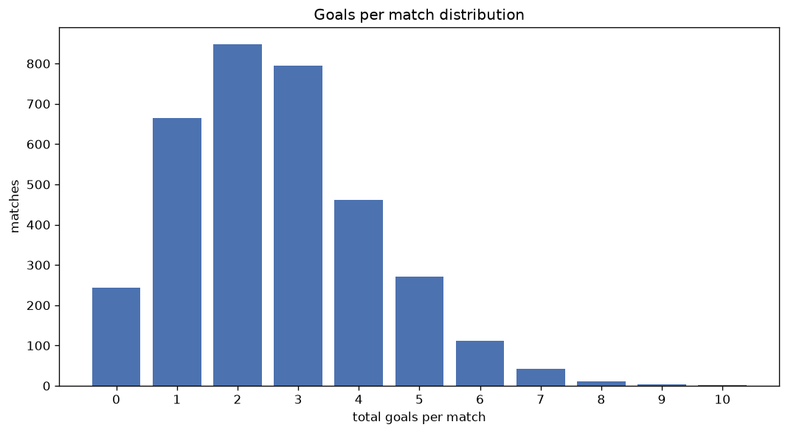
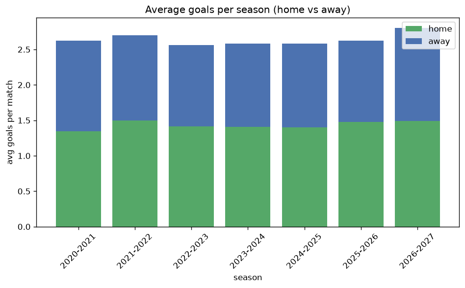

# Goal Analysis
- Report: `goals_analysis`
- Generated: 2026-10-26T01:30:56+00:00
- Script: `backend/scripts/analyze_goals.py` v1.0.0
- League: League One (England)
- Scope: league `eng1`

## 1. Goals per match distribution
| goals | matches | pct |
|---|---|---|
| 0 | 244 | 7.1% |
| 1 | 665 | 19.2% |
| 2 | 848 | 24.5% |
| 3 | 794 | 23.0% |
| 4 | 462 | 13.4% |
| 5 | 271 | 7.8% |
| 6 | 112 | 3.2% |
| 7 | 43 | 1.2% |
| 8 | 11 | 0.3% |
| 9 | 4 | 0.1% |
| 10 | 1 | 0.0% |

## 2. Goals per match per season
| season | matches | total goals | avg home | avg away | avg total |
|---|---|---|---|---|---|
| 2020-2021 | 552 | 1447 | 1.348 | 1.274 | 2.621 |
| 2021-2022 | 552 | 1489 | 1.5 | 1.197 | 2.697 |
| 2022-2023 | 552 | 1414 | 1.415 | 1.147 | 2.562 |
| 2023-2024 | 552 | 1427 | 1.409 | 1.176 | 2.585 |
| 2024-2025 | 552 | 1427 | 1.404 | 1.181 | 2.585 |
| 2025-2026 | 557 | 1462 | 1.478 | 1.147 | 2.625 |
| 2026-2027 | 138 | 387 | 1.493 | 1.312 | 2.804 |

## 3. Home vs away goal share
- Home goals: **4935** (54.5%)
- Away goals: **4118** (45.5%)
- Home/away ratio: **1.198**

| season | home goals | away goals | total | home pct | away pct |
|---|---|---|---|---|---|
| 2020-2021 | 744 | 703 | 1447 | 51.4% | 48.6% |
| 2021-2022 | 828 | 661 | 1489 | 55.6% | 44.4% |
| 2022-2023 | 781 | 633 | 1414 | 55.2% | 44.8% |
| 2023-2024 | 778 | 649 | 1427 | 54.5% | 45.5% |
| 2024-2025 | 775 | 652 | 1427 | 54.3% | 45.7% |
| 2025-2026 | 823 | 639 | 1462 | 56.3% | 43.7% |
| 2026-2027 | 206 | 181 | 387 | 53.2% | 46.8% |

## 4. BTTS (Both Teams To Score)
- Overall: **1764** of `3455` (51.1%)

| season | matches | BTTS | pct |
|---|---|---|---|
| 2020-2021 | 552 | 273 | 49.5% |
| 2021-2022 | 552 | 291 | 52.7% |
| 2022-2023 | 552 | 262 | 47.5% |
| 2023-2024 | 552 | 282 | 51.1% |
| 2024-2025 | 552 | 285 | 51.6% |
| 2025-2026 | 557 | 291 | 52.2% |
| 2026-2027 | 138 | 80 | 58.0% |

## 5. Clean sheets
- Home clean sheets: **1075** (31.1%)
- Away clean sheets: **860** (24.9%)
- Total clean sheets recorded: **1935**
- Matches with at least one clean sheet: **1691** (48.9%)
- Both teams kept clean sheets (0-0): **244**

| season | matches | home CS | away CS | total CS | matches w/ CS |
|---|---|---|---|---|---|
| 2020-2021 | 552 | 155 | 162 | 317 | 279 (50.5%) |
| 2021-2022 | 552 | 178 | 120 | 298 | 261 (47.3%) |
| 2022-2023 | 552 | 186 | 145 | 331 | 290 (52.5%) |
| 2023-2024 | 552 | 173 | 135 | 308 | 270 (48.9%) |
| 2024-2025 | 552 | 168 | 145 | 313 | 267 (48.4%) |
| 2025-2026 | 557 | 175 | 124 | 299 | 266 (47.8%) |
| 2026-2027 | 138 | 40 | 29 | 69 | 58 (42.0%) |

## 6. Scoring intensity
- First-half goals: **4066** (44.9%)
- Second-half goals: **4987** (55.1%)
- Avg first-half goals per match: **1.177**
- Avg second-half goals per match: **1.443**
- Second-half-only scoring (HT 0-0, FT goals >= 1): **787** (22.8%)

| season | matches | 1st half | 2nd half | 1st half pct | 2nd half pct |
|---|---|---|---|---|---|
| 2020-2021 | 552 | 682 | 765 | 47.1% | 52.9% |
| 2021-2022 | 552 | 660 | 829 | 44.3% | 55.7% |
| 2022-2023 | 552 | 658 | 756 | 46.5% | 53.5% |
| 2023-2024 | 552 | 635 | 792 | 44.5% | 55.5% |
| 2024-2025 | 552 | 636 | 791 | 44.6% | 55.4% |
| 2025-2026 | 557 | 639 | 823 | 43.7% | 56.3% |
| 2026-2027 | 138 | 156 | 231 | 40.3% | 59.7% |

## 7. First-goal timing
- Matches with first-goal time recorded: `3211` of `3455` (92.9%)
- Goalless matches: `244`
- Min `1` | Max `110` | Mean `30.93` | Median (p50) `25`

| bucket | count | % of matches | % of scoring matches |
|---|---|---|---|
| 1-15 | 1064 | 30.8% | 33.1% |
| 16-30 | 788 | 22.8% | 24.5% |
| 31-45 | 516 | 14.9% | 16.1% |
| 46-60 | 415 | 12.0% | 12.9% |
| 61-75 | 244 | 7.1% | 7.6% |
| 76-90 | 146 | 4.2% | 4.5% |
| 91-120 | 38 | 1.1% | 1.2% |

---
*All statistics are computed from PostgreSQL tables (read-only). Run with `python backend/scripts/analyze_goals.py` to regenerate.*

## Charts

