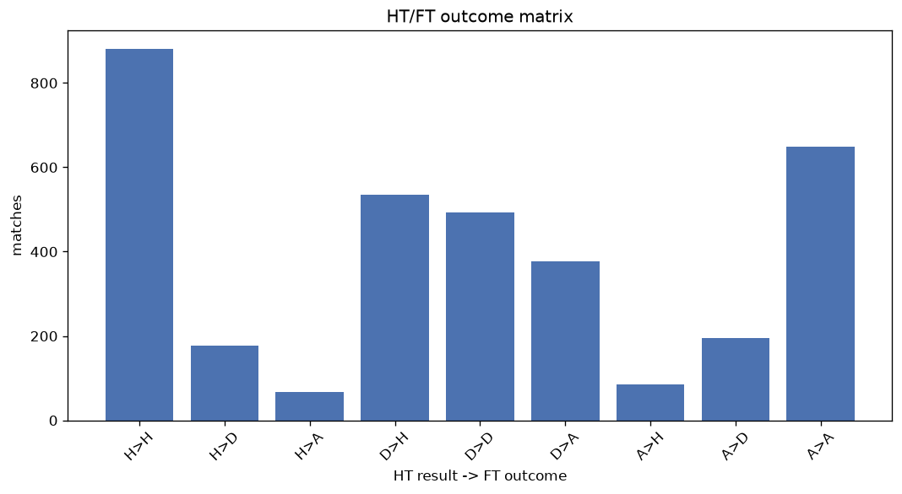
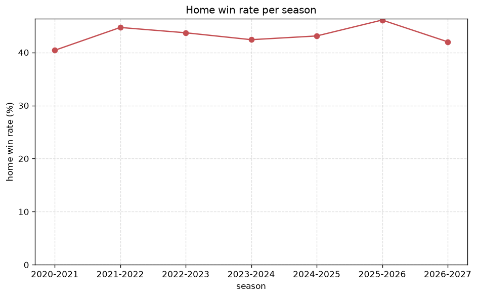

# Match Analysis
- Report: `matches_analysis`
- Generated: 2026-10-27T01:45:56+00:00
- Script: `backend/scripts/analyze_matches.py` v1.0.0
- League: League One (England)
- Scope: league `eng1`

## 1. Overall summary
| metric | value |
|---|---|
| Matches | 3455 |
| Home wins | 1496 (43.3%) |
| Draws | 864 (25.0%) |
| Away wins | 1095 (31.7%) |
| Total goals | 9053 |
| Average goals per match | 2.620 |
| Goalless matches | 244 (7.1%) |

## 2. Per-season breakdown
| season | matches | home wins | draws | away wins | total goals | avg goals | goalless |
|---|---|---|---|---|---|---|---|
| 2020-2021 | 552 | 223 (40.4%) | 132 (23.9%) | 197 (35.7%) | 1447 | 2.621 | 38 (6.9%) |
| 2021-2022 | 552 | 247 (44.7%) | 146 (26.4%) | 159 (28.8%) | 1489 | 2.697 | 37 (6.7%) |
| 2022-2023 | 552 | 241 (43.7%) | 140 (25.4%) | 171 (31.0%) | 1414 | 2.562 | 41 (7.4%) |
| 2023-2024 | 552 | 234 (42.4%) | 135 (24.5%) | 183 (33.2%) | 1427 | 2.585 | 38 (6.9%) |
| 2024-2025 | 552 | 238 (43.1%) | 132 (23.9%) | 182 (33.0%) | 1427 | 2.585 | 46 (8.3%) |
| 2025-2026 | 557 | 257 (46.1%) | 139 (25.0%) | 161 (28.9%) | 1462 | 2.625 | 33 (5.9%) |
| 2026-2027 | 138 | 56 (40.6%) | 40 (29.0%) | 42 (30.4%) | 387 | 2.804 | 11 (8.0%) |

## 3. HT/FT outcome matrix
| HT result \ FT result | Home | Draw | Away | total |
|---|---|---|---|---|
| HT home lead | 877 (78.2%) | 177 (15.8%) | 68 (6.1%) | 1122 |
| HT draw | 533 (38.0%) | 492 (35.1%) | 378 (26.9%) | 1403 |
| HT away lead | 86 (9.2%) | 195 (21.0%) | 649 (69.8%) | 930 |

## 4. Comeback matches
- Home comebacks (trailing at HT, won at FT): **86** (2.5%)
- Away comebacks (trailing at HT, won at FT): **68** (2.0%)

### Home comebacks
| season | home | away | HT | FT |
|---|---|---|---|---|
| 2020-2021 | Peterborough | Swindon | 0-1 | 3-1 |
| 2020-2021 | Ipswich | Shrewsbury | 0-1 | 2-1 |
| 2020-2021 | Doncaster | Blackpool | 0-2 | 3-2 |
| 2020-2021 | Crewe | Swindon | 1-2 | 4-2 |
| 2020-2021 | Crewe | Northampton | 0-1 | 2-1 |
| 2020-2021 | Charlton | AFC Wimbledon | 1-2 | 5-2 |
| 2020-2021 | Peterborough | Charlton | 0-1 | 2-1 |
| 2020-2021 | Shrewsbury | Sunderland | 0-1 | 2-1 |
| 2020-2021 | Fleetwood | Doncaster | 0-1 | 3-1 |
| 2020-2021 | Hull | Fleetwood | 0-1 | 2-1 |
| 2020-2021 | Oxford Utd | Gillingham | 0-1 | 3-2 |
| 2021-2022 | Lincoln | Fleetwood | 0-1 | 2-1 |
| 2021-2022 | Cheltenham | Ipswich | 0-1 | 2-1 |
| 2021-2022 | Shrewsbury | Gillingham | 0-1 | 2-1 |
| 2021-2022 | AFC Wimbledon | Oxford Utd | 0-1 | 3-1 |
| 2021-2022 | Wycombe | Morecambe | 0-2 | 4-3 |
| 2021-2022 | Accrington | Ipswich | 0-1 | 2-1 |
| 2021-2022 | Portsmouth | AFC Wimbledon | 0-1 | 2-1 |
| 2021-2022 | Morecambe | Doncaster | 0-3 | 4-3 |
| 2021-2022 | Cheltenham | Sunderland | 0-1 | 2-1 |
| 2021-2022 | Accrington | Wycombe | 1-2 | 3-2 |
| 2021-2022 | Sunderland | Fleetwood | 0-1 | 3-1 |
| 2021-2022 | Burton | Fleetwood | 0-1 | 3-2 |
| 2021-2022 | Cheltenham | AFC Wimbledon | 0-1 | 3-1 |
| 2021-2022 | Crewe | AFC Wimbledon | 0-1 | 3-1 |
| 2021-2022 | Portsmouth | Wigan | 0-2 | 3-2 |
| 2021-2022 | Lincoln | Crewe | 0-1 | 2-1 |
| 2022-2023 | Cambridge Utd | Exeter | 0-1 | 2-1 |
| 2022-2023 | Cambridge Utd | Burton | 1-2 | 4-3 |
| 2022-2023 | Cheltenham | Cambridge Utd | 0-1 | 2-1 |
| 2022-2023 | Derby | Wycombe | 0-1 | 2-1 |
| 2022-2023 | Plymouth | Ipswich | 0-1 | 2-1 |
| 2022-2023 | Plymouth | Shrewsbury | 0-1 | 2-1 |
| 2022-2023 | Shrewsbury | Forest Green | 0-1 | 2-1 |
| 2022-2023 | Sheffield Wed | MK Dons | 1-2 | 5-2 |
| 2022-2023 | Plymouth | Derby | 0-1 | 2-1 |
| 2022-2023 | Ipswich | Port Vale | 0-1 | 2-1 |
| 2022-2023 | Morecambe | Lincoln | 0-1 | 3-2 |
| 2023-2024 | Wigan | Northampton | 0-1 | 2-1 |
| 2023-2024 | Reading | Bolton | 0-1 | 2-1 |
| 2023-2024 | Portsmouth | Wycombe | 0-1 | 2-1 |
| 2023-2024 | Burton | Wigan | 0-1 | 2-1 |
| 2023-2024 | Carlisle | Burton | 0-1 | 2-1 |
| 2023-2024 | Shrewsbury | Reading | 1-2 | 3-2 |
| 2023-2024 | Oxford Utd | Cambridge Utd | 0-1 | 2-1 |
| 2023-2024 | Barnsley | Carlisle | 0-1 | 2-1 |
| 2023-2024 | Peterborough | Shrewsbury | 0-1 | 2-1 |
| 2023-2024 | Exeter | Peterborough | 0-1 | 2-1 |
| 2023-2024 | Lincoln | Fleetwood | 0-1 | 2-1 |
| 2023-2024 | Barnsley | Leyton Orient | 0-1 | 2-1 |
| 2024-2025 | Northampton | Exeter | 0-1 | 2-1 |
| 2024-2025 | Mansfield | Shrewsbury | 0-1 | 2-1 |
| 2024-2025 | Birmingham | Peterborough | 1-2 | 3-2 |
| 2024-2025 | Rotherham | Reading | 0-1 | 2-1 |
| 2024-2025 | Bolton | Blackpool | 0-1 | 2-1 |
| 2024-2025 | Bolton | Mansfield | 0-1 | 3-1 |
| 2024-2025 | Wycombe | Barnsley | 0-1 | 2-1 |
| 2024-2025 | Shrewsbury | Mansfield | 0-1 | 2-1 |
| 2024-2025 | Birmingham | Rotherham | 0-1 | 2-1 |
| 2024-2025 | Bolton | Leyton Orient | 0-1 | 2-1 |
| 2024-2025 | Stockport County | Blackpool | 0-1 | 2-1 |
| 2024-2025 | Burton | Leyton Orient | 0-1 | 2-1 |
| 2024-2025 | Leyton Orient | Barnsley | 0-2 | 4-3 |
| 2024-2025 | Stockport County | Lincoln | 0-2 | 3-2 |
| 2025-2026 | Cardiff | Peterborough | 0-1 | 2-1 |
| 2025-2026 | Barnsley | Burton | 0-2 | 3-2 |
| 2025-2026 | Stockport County | Burton | 0-1 | 2-1 |
| 2025-2026 | AFC Wimbledon | Rotherham | 0-1 | 2-1 |
| 2025-2026 | Mansfield | Rotherham | 0-1 | 2-1 |
| 2025-2026 | Cardiff | Reading | 0-1 | 2-1 |
| 2025-2026 | Northampton | Mansfield | 0-1 | 2-1 |
| 2025-2026 | Leyton Orient | Exeter | 0-1 | 2-1 |
| 2025-2026 | Bolton | Exeter | 0-1 | 2-1 |
| 2025-2026 | Barnsley | Leyton Orient | 1-2 | 3-2 |
| 2025-2026 | Port Vale | Blackpool | 0-1 | 5-1 |
| 2025-2026 | Rotherham | Northampton | 0-1 | 2-1 |
| 2025-2026 | Stockport County | Plymouth | 0-1 | 2-1 |
| 2025-2026 | Huddersfield | Barnsley | 0-1 | 2-1 |
| 2025-2026 | Bolton | Wycombe | 0-2 | 3-2 |
| 2025-2026 | Blackpool | Port Vale | 0-1 | 3-2 |
| 2025-2026 | Plymouth | Huddersfield | 0-1 | 3-1 |
| 2026-2027 | Notts County | Burton | 0-1 | 2-1 |
| 2026-2027 | Cambridge Utd | Reading | 0-1 | 2-1 |
| 2026-2027 | Stockport County | Barnsley | 0-1 | 3-1 |
| 2026-2027 | Reading | Barnsley | 0-1 | 2-1 |
| 2026-2027 | Burton | Leyton Orient | 0-1 | 2-1 |

### Away comebacks
| season | home | away | HT | FT |
|---|---|---|---|---|
| 2020-2021 | Burton | Portsmouth | 2-1 | 2-4 |
| 2020-2021 | Hull | Peterborough | 1-0 | 1-2 |
| 2020-2021 | Bristol Rovers | Hull | 1-0 | 1-3 |
| 2020-2021 | Oxford Utd | Swindon | 1-0 | 1-2 |
| 2020-2021 | Plymouth | Ipswich | 1-0 | 1-2 |
| 2020-2021 | Rochdale | Oxford Utd | 2-1 | 3-4 |
| 2020-2021 | Gillingham | Peterborough | 1-0 | 1-3 |
| 2020-2021 | Swindon | Gillingham | 1-0 | 1-3 |
| 2020-2021 | Shrewsbury | Oxford Utd | 2-1 | 2-3 |
| 2020-2021 | Wigan | Swindon | 1-0 | 3-4 |
| 2021-2022 | Rotherham | Fleetwood | 2-1 | 2-4 |
| 2021-2022 | Fleetwood | Wigan | 1-0 | 2-3 |
| 2021-2022 | MK Dons | Oxford Utd | 1-0 | 1-2 |
| 2021-2022 | Lincoln | MK Dons | 2-0 | 2-3 |
| 2021-2022 | Morecambe | Crewe | 1-0 | 1-2 |
| 2021-2022 | Gillingham | Burton | 1-0 | 1-3 |
| 2021-2022 | Plymouth | Lincoln | 1-0 | 1-2 |
| 2021-2022 | Crewe | Plymouth | 1-0 | 1-4 |
| 2021-2022 | Doncaster | Sheffield Wed | 1-0 | 1-3 |
| 2021-2022 | Wycombe | Wigan | 1-0 | 1-3 |
| 2021-2022 | Rotherham | MK Dons | 1-0 | 1-2 |
| 2021-2022 | Fleetwood | Accrington | 1-0 | 1-2 |
| 2021-2022 | Fleetwood | Sheffield Wed | 2-1 | 2-3 |
| 2022-2023 | Cheltenham | Peterborough | 2-0 | 2-3 |
| 2022-2023 | Derby | Plymouth | 2-0 | 2-3 |
| 2022-2023 | Morecambe | Ipswich | 1-0 | 1-2 |
| 2022-2023 | Derby | Port Vale | 1-0 | 1-2 |
| 2022-2023 | Accrington | Bolton | 1-0 | 2-3 |
| 2022-2023 | Fleetwood | Bolton | 1-0 | 1-2 |
| 2022-2023 | Charlton | Bristol Rovers | 1-0 | 1-2 |
| 2022-2023 | Forest Green | Port Vale | 1-0 | 1-3 |
| 2022-2023 | Fleetwood | Oxford Utd | 1-0 | 1-2 |
| 2022-2023 | Morecambe | Plymouth | 1-0 | 1-3 |
| 2022-2023 | Fleetwood | Bristol Rovers | 1-0 | 1-2 |
| 2022-2023 | Oxford Utd | Accrington | 1-0 | 1-2 |
| 2023-2024 | Charlton | Port Vale | 1-0 | 2-3 |
| 2023-2024 | Oxford Utd | Derby | 2-1 | 2-3 |
| 2023-2024 | Wigan | Stevenage | 2-1 | 2-3 |
| 2023-2024 | Stevenage | Bristol Rovers | 2-1 | 2-3 |
| 2023-2024 | Peterborough | Blackpool | 1-0 | 1-2 |
| 2023-2024 | Leyton Orient | Burton | 1-0 | 1-2 |
| 2023-2024 | Cambridge Utd | Bolton | 1-0 | 1-2 |
| 2023-2024 | Oxford Utd | Leyton Orient | 1-0 | 1-2 |
| 2023-2024 | Derby | Charlton | 1-0 | 1-2 |
| 2023-2024 | Burton | Barnsley | 1-0 | 1-3 |
| 2023-2024 | Port Vale | Exeter | 2-0 | 2-4 |
| 2023-2024 | Burton | Cheltenham | 1-0 | 1-2 |
| 2024-2025 | Bristol Rovers | Wycombe | 1-0 | 1-2 |
| 2024-2025 | Burton | Bristol Rovers | 1-0 | 1-3 |
| 2024-2025 | Shrewsbury | Blackpool | 1-0 | 1-2 |
| 2024-2025 | Exeter | Barnsley | 1-0 | 1-2 |
| 2024-2025 | Bolton | Barnsley | 1-0 | 1-2 |
| 2024-2025 | Shrewsbury | Bolton | 1-0 | 2-3 |
| 2024-2025 | Barnsley | Huddersfield | 1-0 | 1-2 |
| 2024-2025 | Cambridge Utd | Leyton Orient | 1-0 | 1-2 |
| 2024-2025 | Wycombe | Stockport County | 1-0 | 1-3 |
| 2025-2026 | Stockport County | Bradford City | 1-0 | 1-2 |
| 2025-2026 | Port Vale | Stevenage | 1-0 | 1-2 |
| 2025-2026 | Northampton | Rotherham | 1-0 | 1-2 |
| 2025-2026 | Huddersfield | Bolton | 1-0 | 1-2 |
| 2025-2026 | Doncaster | Northampton | 1-0 | 1-2 |
| 2025-2026 | Barnsley | Mansfield | 2-1 | 2-3 |
| 2025-2026 | Rotherham | Doncaster | 1-0 | 1-2 |
| 2025-2026 | AFC Wimbledon | Leyton Orient | 2-1 | 2-4 |
| 2025-2026 | Wycombe | Bradford City | 1-0 | 1-2 |
| 2025-2026 | Bolton | Luton | 2-1 | 2-3 |
| 2026-2027 | Reading | Luton | 3-1 | 3-4 |
| 2026-2027 | Barnsley | Cambridge Utd | 1-0 | 1-2 |

## 5. HT lead conversion
| HT state | matches | converted to win | held as draw | collapsed to loss |
|---|---|---|---|---|
| Home lead | 1122 | 877 (78.2%) | 177 (15.8%) | 68 (6.1%) |
| Away lead | 930 | 649 (69.8%) | 195 (21.0%) | 86 (9.2%) |

### Matches level at half-time
| FT result | count | pct |
|---|---|---|
| Home win | 533 | 38.0% |
| Draw | 492 | 35.1% |
| Away win | 378 | 26.9% |

## 6. First-goal timing
- Matches with a first-goal time recorded: `3211` of `3455` (92.9%)

Outcome distribution by first-goal timing bucket:
| bucket | matches | % of matches | home | draw | away |
|---|---|---|---|---|---|
| 1-15 | 1064 | 30.8% | 497 (46.7%) | 212 (19.9%) | 355 (33.4%) |
| 16-30 | 788 | 22.8% | 362 (45.9%) | 170 (21.6%) | 256 (32.5%) |
| 31-45 | 516 | 14.9% | 237 (45.9%) | 98 (19.0%) | 181 (35.1%) |
| 46-60 | 415 | 12.0% | 187 (45.1%) | 84 (20.2%) | 144 (34.7%) |
| 61-75 | 244 | 7.1% | 116 (47.5%) | 46 (18.9%) | 82 (33.6%) |
| 76-90 | 146 | 4.2% | 73 (50.0%) | 10 (6.8%) | 63 (43.2%) |
| 91-120 | 38 | 1.1% | 24 (63.2%) | 0 (0.0%) | 14 (36.8%) |

## 7. Goalless matches
- Overall: **244** of `3455` (7.1%)

| season | matches | goalless | pct |
|---|---|---|---|
| 2020-2021 | 552 | 38 | 6.9% |
| 2021-2022 | 552 | 37 | 6.7% |
| 2022-2023 | 552 | 41 | 7.4% |
| 2023-2024 | 552 | 38 | 6.9% |
| 2024-2025 | 552 | 46 | 8.3% |
| 2025-2026 | 557 | 33 | 5.9% |
| 2026-2027 | 138 | 11 | 8.0% |

---
*All statistics are computed from PostgreSQL tables (read-only). Run with `python backend/scripts/analyze_matches.py` to regenerate.*

## Charts

