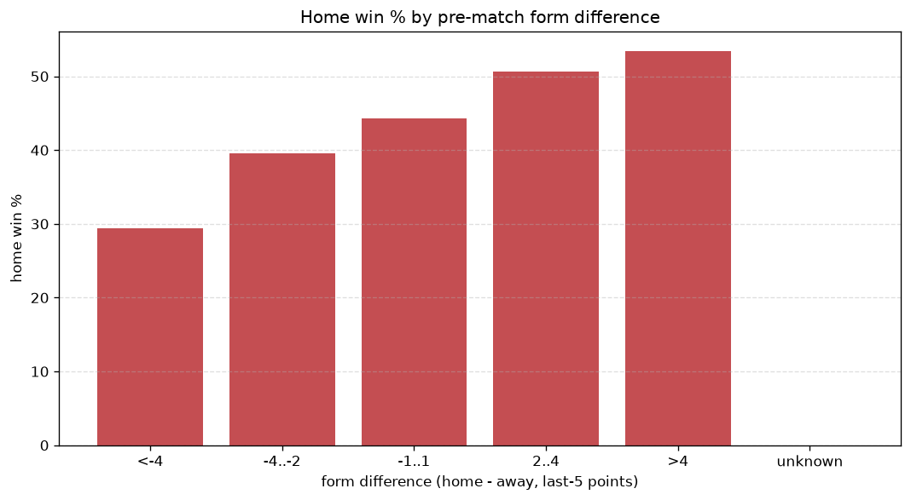
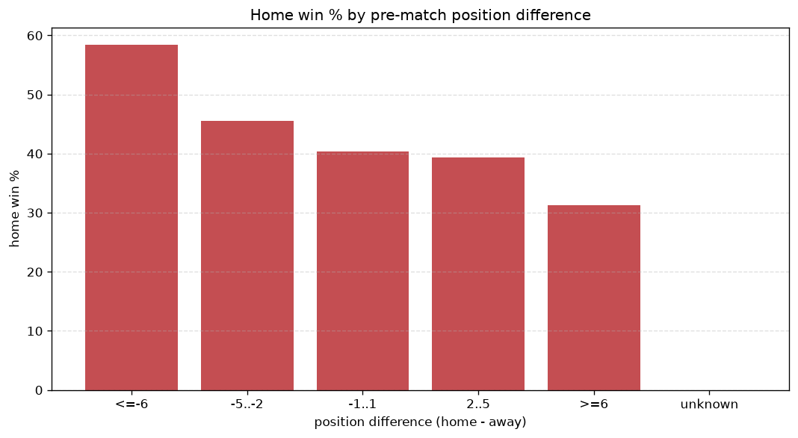

# Relationships Analysis
- Report: `relationships`
- Generated: 2026-10-26T01:31:02+00:00
- Script: `backend/scripts/analyze_relationships.py` v1.0.0
- League: League One (England)
- Scope: league `eng1`

- Matches analysed: **3317** (23 leakage-safe pre-match features).

## 1. Correlation matrix
_Pearson correlation of each pre-match feature with observed goals; sorted by |corr(total goals)|._

| feature | corr(home) | corr(away) | corr(total) |
|---|---|---|---|
| home_team_goals_scored_last_5 | 0.121 | -0.044 | 0.062 |
| away_team_goals_conceded_last_5 | 0.082 | -0.023 | 0.047 |
| home_points_before_match | 0.090 | -0.040 | 0.042 |
| home_team_home_goals_avg | 0.095 | -0.046 | 0.041 |
| away_team_away_conceded_avg | 0.077 | -0.034 | 0.036 |
| home_team_points_last_5 | 0.114 | -0.076 | 0.034 |
| away_team_goals_scored_last_5 | -0.043 | 0.095 | 0.033 |
| home_position_before_match | -0.159 | 0.132 | -0.030 |
| home_team_wins_last_5 | 0.106 | -0.079 | 0.027 |
| points_difference | 0.206 | -0.191 | 0.026 |
| position_difference | -0.197 | 0.181 | -0.026 |
| away_team_away_goals_avg | -0.049 | 0.090 | 0.025 |
| away_points_before_match | -0.051 | 0.090 | 0.024 |
| home_team_goals_conceded_last_5 | -0.078 | 0.109 | 0.015 |
| home_team_home_win_rate | 0.080 | -0.068 | 0.014 |
| home_rest_days | -0.019 | 0.006 | -0.011 |
| away_rest_days | -0.004 | -0.006 | -0.008 |
| away_position_before_match | 0.116 | -0.120 | 0.006 |
| away_team_wins_last_5 | -0.076 | 0.094 | 0.006 |
| home_team_home_conceded_avg | -0.063 | 0.063 | -0.005 |
| away_team_away_win_rate | -0.071 | 0.086 | 0.005 |
| away_team_points_last_5 | -0.082 | 0.097 | 0.004 |
| rest_days_difference | -0.017 | 0.014 | -0.003 |

## 2. Form vs outcome
_Home win/draw/away % per bucket of `home_team_points_last_5 - away_team_points_last_5`._

| bucket | matches | home | draw | away | home % | draw % | away % |
|---|---|---|---|---|---|---|---|
| <-4 | 551 | 162 | 144 | 245 | 29.4% | 26.1% | 44.5% |
| -4..-2 | 727 | 288 | 191 | 248 | 39.6% | 26.3% | 34.1% |
| -1..1 | 881 | 390 | 206 | 285 | 44.3% | 23.4% | 32.3% |
| 2..4 | 671 | 340 | 169 | 162 | 50.7% | 25.2% | 24.1% |
| >4 | 487 | 260 | 114 | 113 | 53.4% | 23.4% | 23.2% |
| unknown | 0 | 0 | 0 | 0 | - | - | - |

## 3. Position vs outcome
_Home win/draw/away % per bucket of `position_difference` (home position - away position; negative favours the home team)._

| bucket | matches | home | draw | away | home % | draw % | away % |
|---|---|---|---|---|---|---|---|
| <=-6 | 976 | 570 | 207 | 199 | 58.4% | 21.2% | 20.4% |
| -5..-2 | 461 | 210 | 124 | 127 | 45.6% | 26.9% | 27.5% |
| -1..1 | 344 | 139 | 104 | 101 | 40.4% | 30.2% | 29.4% |
| 2..5 | 501 | 197 | 126 | 178 | 39.3% | 25.1% | 35.5% |
| >=6 | 1035 | 324 | 263 | 448 | 31.3% | 25.4% | 43.3% |
| unknown | 0 | 0 | 0 | 0 | - | - | - |

## 4. Rest advantage
_Home win/draw/away % per bucket of `rest_days_difference` (home rest - away rest). Matches with unknown rest are bucketed separately._

| bucket | matches | home | draw | away | home % | draw % | away % |
|---|---|---|---|---|---|---|---|
| <-1 | 387 | 162 | 101 | 124 | 41.9% | 26.1% | 32.0% |
| -1..0 | 69 | 29 | 16 | 24 | 42.0% | 23.2% | 34.8% |
| 0 | 2358 | 1031 | 584 | 743 | 43.7% | 24.8% | 31.5% |
| 1..2 | 88 | 41 | 22 | 25 | 46.6% | 25.0% | 28.4% |
| >2 | 343 | 141 | 83 | 119 | 41.1% | 24.2% | 34.7% |
| unknown | 72 | 36 | 18 | 18 | 50.0% | 25.0% | 25.0% |
- *72 match(es) had unknown rest difference (missing rest data on at least one side).*

## 5. Home team quality
_Home win rate by `home_team_home_win_rate` tier (split at 0.5)._

- `< 0.5` tier: **38.4%** home win (736/1918)
- `>= 0.5` tier: **50.3%** home win (704/1399)
- Home-win gap (>= split minus < split): **+11.9 pp**

| tier | label | matches | home | draw | away | home % |
|---|---|---|---|---|---|---|
| low | < 0.5 | 1918 | 736 | 478 | 704 | 38.4% |
| high | >= 0.5 | 1399 | 704 | 346 | 349 | 50.3% |

## 6. Feature averages by result
_Mean feature value per outcome; `range` is home-minus-away spread of the group means._

| feature | home mean | draw mean | away mean | range |
|---|---|---|---|---|
| points_difference | 3.570 | -1.188 | -4.902 | 8.472 |
| position_difference | -2.215 | 0.768 | 3.324 | 5.538 |
| away_points_before_match | 28.733 | 32.383 | 33.782 | 5.048 |
| home_points_before_match | 32.303 | 31.195 | 28.879 | 3.424 |
| home_position_before_match | 11.101 | 12.797 | 14.227 | 3.126 |
| away_position_before_match | 13.315 | 12.029 | 10.903 | 2.412 |
| home_team_points_last_5 | 6.713 | 6.430 | 5.734 | 0.979 |
| home_team_goals_conceded_last_5 | 5.664 | 6.216 | 6.619 | 0.955 |
| away_team_points_last_5 | 6.069 | 6.831 | 6.920 | 0.851 |
| home_team_goals_scored_last_5 | 6.240 | 6.087 | 5.600 | 0.640 |
| away_team_goals_scored_last_5 | 5.771 | 6.288 | 6.393 | 0.622 |
| away_team_goals_conceded_last_5 | 6.197 | 5.883 | 5.773 | 0.423 |
| home_team_wins_last_5 | 1.854 | 1.752 | 1.519 | 0.336 |
| away_team_wins_last_5 | 1.640 | 1.899 | 1.908 | 0.268 |
| rest_days_difference | -0.095 | -0.213 | 0.037 | 0.250 |
| home_rest_days | 5.821 | 5.768 | 5.961 | 0.193 |
| away_team_away_goals_avg | 1.052 | 1.130 | 1.167 | 0.115 |
| home_team_home_conceded_avg | 1.046 | 1.142 | 1.159 | 0.112 |
| home_team_home_goals_avg | 1.390 | 1.359 | 1.280 | 0.111 |
| away_team_away_conceded_avg | 1.382 | 1.356 | 1.298 | 0.083 |
| away_rest_days | 5.916 | 5.981 | 5.925 | 0.065 |
| home_team_home_win_rate | 0.456 | 0.427 | 0.402 | 0.054 |
| away_team_away_win_rate | 0.277 | 0.306 | 0.322 | 0.045 |

---
*All features are leakage-safe pre-match values built by `ml.features.build_features.build_rows` from strictly prior matches. Run with `python backend/scripts/analyze_relationships.py` to regenerate.*

## Charts

