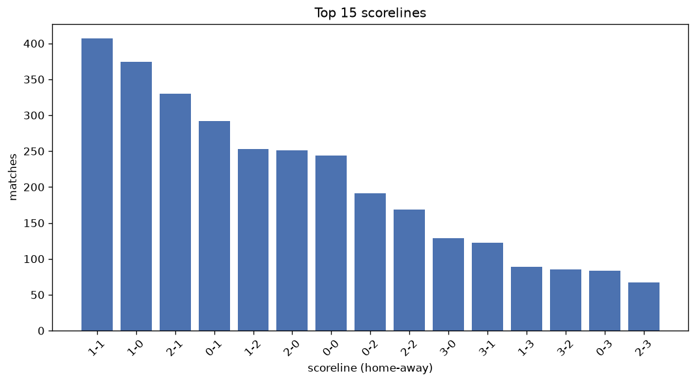
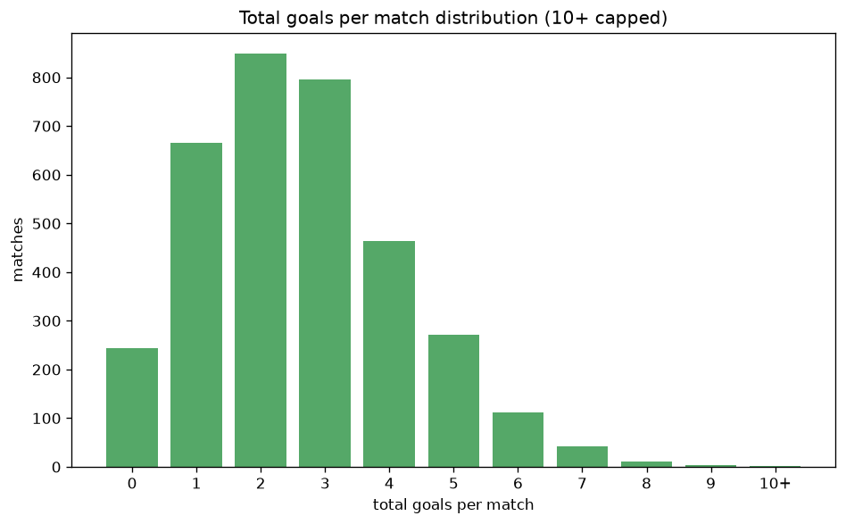

# Scoreline Analysis
- Report: `scoreline_analysis`
- Generated: 2026-10-29T01:58:18+00:00
- Script: `backend/scripts/analyze_scorelines.py` v1.0.0
- League: League One (England)
- Scope: league `eng1`

## 1. Scoreline frequency
- Matches analysed: **3460** across **7** seasons.
- Distinct scorelines seen: **43**.

| scoreline | count | pct |
|---|---|---|
| 1-1 | 407 | 11.8% |
| 1-0 | 374 | 10.8% |
| 2-1 | 330 | 9.5% |
| 0-1 | 292 | 8.4% |
| 1-2 | 253 | 7.3% |
| 2-0 | 251 | 7.3% |
| 0-0 | 244 | 7.1% |
| 0-2 | 191 | 5.5% |
| 2-2 | 169 | 4.9% |
| 3-0 | 129 | 3.7% |
| 3-1 | 122 | 3.5% |
| 1-3 | 89 | 2.6% |
| 3-2 | 85 | 2.5% |
| 0-3 | 83 | 2.4% |
| 2-3 | 67 | 1.9% |
| 4-1 | 55 | 1.6% |
| 4-0 | 45 | 1.3% |
| 0-4 | 38 | 1.1% |
| 3-3 | 36 | 1.0% |
| 1-4 | 31 | 0.9% |

## 2. Scoreline frequency per season

### 2020-2021
| scoreline | count | pct |
|---|---|---|
| 0-1 | 59 | 10.7% |
| 1-1 | 57 | 10.3% |
| 1-0 | 54 | 9.8% |
| 2-1 | 50 | 9.1% |
| 2-0 | 44 | 8.0% |

### 2021-2022
| scoreline | count | pct |
|---|---|---|
| 1-1 | 70 | 12.7% |
| 1-0 | 58 | 10.5% |
| 2-1 | 52 | 9.4% |
| 2-0 | 52 | 9.4% |
| 1-2 | 38 | 6.9% |

### 2022-2023
| scoreline | count | pct |
|---|---|---|
| 1-1 | 70 | 12.7% |
| 1-0 | 66 | 12.0% |
| 2-1 | 47 | 8.5% |
| 0-1 | 43 | 7.8% |
| 0-0 | 41 | 7.4% |

### 2023-2024
| scoreline | count | pct |
|---|---|---|
| 1-1 | 65 | 11.8% |
| 1-0 | 57 | 10.3% |
| 2-1 | 52 | 9.4% |
| 0-1 | 49 | 8.9% |
| 1-2 | 44 | 8.0% |

### 2024-2025
| scoreline | count | pct |
|---|---|---|
| 1-1 | 59 | 10.7% |
| 2-1 | 58 | 10.5% |
| 1-0 | 54 | 9.8% |
| 1-2 | 51 | 9.2% |
| 0-1 | 50 | 9.1% |

### 2025-2026
| scoreline | count | pct |
|---|---|---|
| 1-0 | 73 | 13.1% |
| 1-1 | 67 | 12.0% |
| 2-1 | 54 | 9.7% |
| 0-1 | 48 | 8.6% |
| 1-2 | 37 | 6.6% |

### 2026-2027
| scoreline | count | pct |
|---|---|---|
| 1-1 | 19 | 13.3% |
| 2-1 | 17 | 11.9% |
| 1-0 | 12 | 8.4% |
| 2-0 | 11 | 7.7% |
| 0-0 | 11 | 7.7% |

## 3. Total-goal histogram
_10+ groups all matches with 10 or more total goals._

| total goals | matches | pct |
|---|---|---|
| 0 | 244 | 7.1% |
| 1 | 666 | 19.2% |
| 2 | 849 | 24.5% |
| 3 | 795 | 23.0% |
| 4 | 463 | 13.4% |
| 5 | 272 | 7.9% |
| 6 | 112 | 3.2% |
| 7 | 43 | 1.2% |
| 8 | 11 | 0.3% |
| 9 | 4 | 0.1% |
| 10+ | 1 | 0.0% |

## 4. Extreme scorelines
- Matches with 7+ total goals: **59**

| season | date | scoreline | total goals |
|---|---|---|---|
| 2021-2022 | 2022-02-19 | 5-5 | 10 |
| 2021-2022 | 2022-01-29 | 2-7 | 9 |
| 2022-2023 | 2022-09-17 | 3-6 | 9 |
| 2025-2026 | 2026-05-02 | 5-4 | 9 |
| 2026-2027 | 2026-08-29 | 7-2 | 9 |
| 2020-2021 | 2020-09-19 | 4-4 | 8 |
| 2020-2021 | 2021-01-12 | 4-4 | 8 |
| 2021-2022 | 2022-04-02 | 4-4 | 8 |
| 2022-2023 | 2022-08-13 | 4-4 | 8 |
| 2022-2023 | 2022-10-29 | 4-4 | 8 |
| 2022-2023 | 2023-04-29 | 4-4 | 8 |
| 2024-2025 | 2024-08-24 | 4-4 | 8 |
| 2024-2025 | 2024-10-12 | 3-5 | 8 |
| 2024-2025 | 2024-12-29 | 4-4 | 8 |
| 2024-2025 | 2025-01-28 | 2-6 | 8 |
| 2024-2025 | 2025-04-05 | 6-2 | 8 |
| 2020-2021 | 2020-12-12 | 4-3 | 7 |
| 2020-2021 | 2020-12-12 | 5-2 | 7 |
| 2020-2021 | 2020-12-29 | 3-4 | 7 |
| 2020-2021 | 2021-01-26 | 3-4 | 7 |
| 2020-2021 | 2021-02-02 | 6-1 | 7 |
| 2020-2021 | 2021-02-20 | 4-3 | 7 |
| 2020-2021 | 2021-02-27 | 4-3 | 7 |
| 2020-2021 | 2021-03-27 | 7-0 | 7 |
| 2020-2021 | 2021-04-27 | 5-2 | 7 |
| 2020-2021 | 2021-05-09 | 3-4 | 7 |
| 2021-2022 | 2021-09-11 | 3-4 | 7 |
| 2021-2022 | 2021-09-11 | 2-5 | 7 |
| 2021-2022 | 2021-10-02 | 4-3 | 7 |
| 2021-2022 | 2022-01-02 | 4-3 | 7 |
| 2021-2022 | 2022-03-01 | 5-2 | 7 |
| 2021-2022 | 2022-04-30 | 3-4 | 7 |
| 2022-2023 | 2022-08-27 | 4-3 | 7 |
| 2022-2023 | 2022-12-29 | 3-4 | 7 |
| 2022-2023 | 2023-02-18 | 5-2 | 7 |
| 2022-2023 | 2023-02-25 | 5-2 | 7 |
| 2022-2023 | 2023-03-14 | 2-5 | 7 |
| 2022-2023 | 2023-04-15 | 2-5 | 7 |
| 2023-2024 | 2023-08-05 | 7-0 | 7 |
| 2023-2024 | 2023-11-25 | 7-0 | 7 |
| 2023-2024 | 2024-02-10 | 5-2 | 7 |
| 2023-2024 | 2024-02-13 | 4-3 | 7 |
| 2023-2024 | 2024-04-01 | 5-2 | 7 |
| 2024-2025 | 2024-09-21 | 5-2 | 7 |
| 2024-2025 | 2024-11-09 | 6-1 | 7 |
| 2024-2025 | 2024-12-14 | 4-3 | 7 |
| 2024-2025 | 2025-02-08 | 4-3 | 7 |
| 2024-2025 | 2025-03-01 | 4-3 | 7 |
| 2024-2025 | 2025-04-01 | 3-4 | 7 |
| 2024-2025 | 2025-04-18 | 4-3 | 7 |
| 2025-2026 | 2025-10-04 | 4-3 | 7 |
| 2025-2026 | 2025-12-13 | 4-3 | 7 |
| 2025-2026 | 2026-01-04 | 5-2 | 7 |
| 2025-2026 | 2026-02-07 | 6-1 | 7 |
| 2025-2026 | 2026-02-21 | 5-2 | 7 |
| 2025-2026 | 2026-04-25 | 4-3 | 7 |
| 2026-2027 | 2026-08-15 | 3-4 | 7 |
| 2026-2027 | 2026-08-30 | 5-2 | 7 |
| 2026-2027 | 2026-09-12 | 3-4 | 7 |

## 5. Margin-of-victory distribution (decided matches)
- Decided matches: **2595** (draws: **865**)
- Average winning margin: **1.73**

| margin | matches | pct |
|---|---|---|
| 1 | 1425 | 54.9% |
| 2 | 690 | 26.6% |
| 3+ | 480 | 18.5% |

## 6. Margin by outcome

### Home wins
- Matches: **1500** | avg margin: **1.77** | max margin: **7**
| margin | matches | pct |
|---|---|---|
| 1 | 804 | 53.6% |
| 2 | 396 | 26.4% |
| 3+ | 300 | 20.0% |
- *Full match-by-match list available in `scoreline_analysis.json`.*

### Away wins
- Matches: **1095** | avg margin: **1.67** | max margin: **6**
| margin | matches | pct |
|---|---|---|
| 1 | 621 | 56.7% |
| 2 | 294 | 26.8% |
| 3+ | 180 | 16.4% |
- *Full match-by-match list available in `scoreline_analysis.json`.*

## 7. Most common exact score by outcome type
| outcome | matches | most common score | count | pct |
|---|---|---|---|---|
| home | 1500 | 1-0 | 374 | 24.9% |
| draw | 865 | 1-1 | 407 | 47.1% |
| away | 1095 | 0-1 | 292 | 26.7% |

---
*All statistics are computed from PostgreSQL tables (read-only). Run with `python backend/scripts/analyze_scorelines.py` to regenerate.*

## Charts

