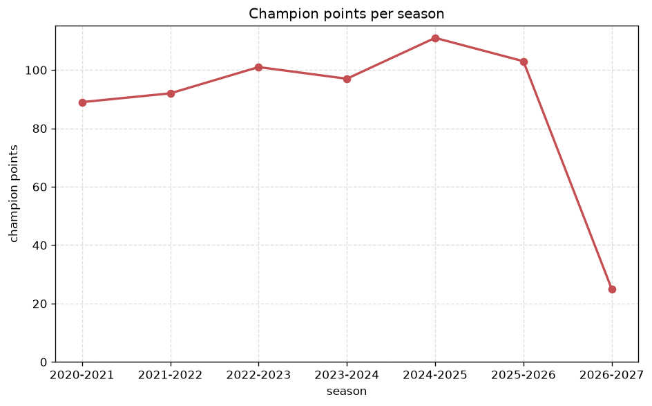
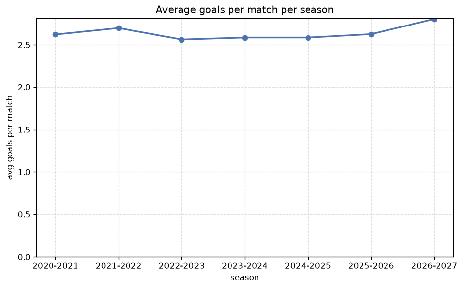

# Season Trends Analysis
- Report: `season_trends`
- Generated: 2026-10-26T01:30:59+00:00
- Script: `backend/scripts/analyze_seasons.py` v1.0.0
- League: League One (England)
- Scope: league `eng1`

## 1. Champions per season
| season | champion | pts | runner-up | margin |
|---|---|---|---|---|
| 2020-2021 | Hull | 89 | Peterborough | 2 pts |
| 2021-2022 | Wigan | 92 | Rotherham | 2 pts |
| 2022-2023 | Plymouth | 101 | Ipswich | 3 pts |
| 2023-2024 | Portsmouth | 97 | Derby | 5 pts |
| 2024-2025 | Birmingham | 111 | Wrexham | 19 pts |
| 2025-2026 | Lincoln | 103 | Cardiff | 12 pts |
| 2026-2027 | Huddersfield | 25 | Stockport County | 2 pts |

## 2. Title-race tightness
- Tight races (margin <= 3 pts): **4** of 7 seasons
- Tightest race: **2020-2021** - Hull beat Peterborough by **2** pts

| season | margin | tight |
|---|---|---|
| 2020-2021 | 2 pts | yes |
| 2021-2022 | 2 pts | yes |
| 2022-2023 | 3 pts | yes |
| 2023-2024 | 5 pts |  |
| 2024-2025 | 19 pts |  |
| 2025-2026 | 12 pts |  |
| 2026-2027 | 2 pts | yes |

## 3. Points thresholds
_Position-specific points per season. Key: 1 = champion, 2 = runner-up, 4 = CL line, 6 = Europa, 21 = last safe, 24 = bottom._

| season | pos 1 | pos 2 | pos 4 | pos 6 | pos 21 | pos 24 |
|---|---|---|---|---|---|---|
| 2020-2021 | 89 | 87 | 77 | 74 | 47 | 38 |
| 2021-2022 | 92 | 90 | 85 | 83 | 40 | 29 |
| 2022-2023 | 101 | 98 | 86 | 77 | 45 | 27 |
| 2023-2024 | 97 | 92 | 84 | 76 | 44 | 30 |
| 2024-2025 | 111 | 92 | 85 | 78 | 46 | 33 |
| 2025-2026 | 103 | 91 | 83 | 75 | 49 | 35 |
| 2026-2027 | 25 | 23 | 22 | 20 | 10 | 7 |

## 4. Relegation battle
| season | safe pos | safe pts | drop pos | drop pts | gap |
|---|---|---|---|---|---|
| 2020-2021 | 21 | 47 | 22 | 45 | 2 pts |
| 2021-2022 | 21 | 40 | 22 | 38 | 2 pts |
| 2022-2023 | 21 | 45 | 22 | 44 | 1 pts |
| 2023-2024 | 21 | 44 | 22 | 43 | 1 pts |
| 2024-2025 | 21 | 46 | 22 | 43 | 3 pts |
| 2025-2026 | 21 | 49 | 22 | 42 | 7 pts |
| 2026-2027 | 21 | 10 | 22 | 9 | 1 pts |

## 5. League-level trends
| season | matches | total goals | avg goals | home win | draw | away win | goalless | avg pts/team |
|---|---|---|---|---|---|---|---|---|
| 2020-2021 | 552 | 1447 | 2.621 | 40.4% | 23.9% | 35.7% | 6.9% | 63.5 |
| 2021-2022 | 552 | 1489 | 2.697 | 44.7% | 26.4% | 28.8% | 6.7% | 62.92 |
| 2022-2023 | 552 | 1414 | 2.562 | 43.7% | 25.4% | 31.0% | 7.4% | 63.17 |
| 2023-2024 | 552 | 1427 | 2.585 | 42.4% | 24.5% | 33.2% | 6.9% | 63.38 |
| 2024-2025 | 552 | 1427 | 2.585 | 43.1% | 23.9% | 33.0% | 8.3% | 63.5 |
| 2025-2026 | 557 | 1462 | 2.625 | 46.1% | 25.0% | 28.9% | 5.9% | 63.83 |
| 2026-2027 | 138 | 387 | 2.804 | 40.6% | 29.0% | 30.4% | 8.0% | 15.58 |

## 6. View divergence
- Largest divergence: **2020-2021** (goals view, avg abs position diff = 9.083)

_Avg absolute position difference between classic view and alternative view per season._

| season | classic vs luck | classic vs goals |
|---|---|---|
| 2020-2021 | 3.833 | 9.083 |
| 2021-2022 | 3.000 | 7.833 |
| 2022-2023 | 4.000 | 7.583 |
| 2023-2024 | 2.917 | 6.833 |
| 2024-2025 | 4.750 | 9.000 |
| 2025-2026 | 3.917 | 6.333 |
| 2026-2027 | 3.000 | 7.000 |

---
*All statistics are computed from PostgreSQL tables (read-only). Run with `python backend/scripts/analyze_seasons.py` to regenerate.*

## Charts

