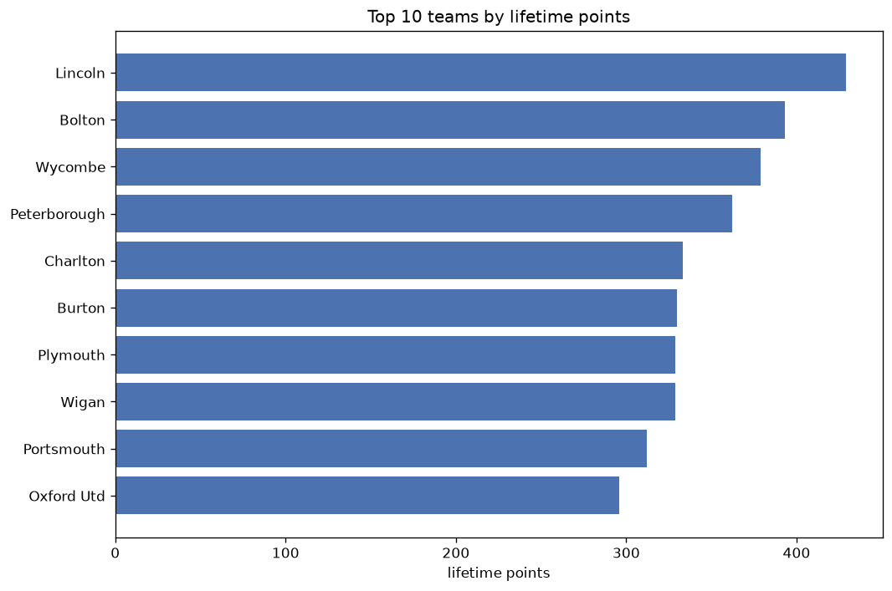
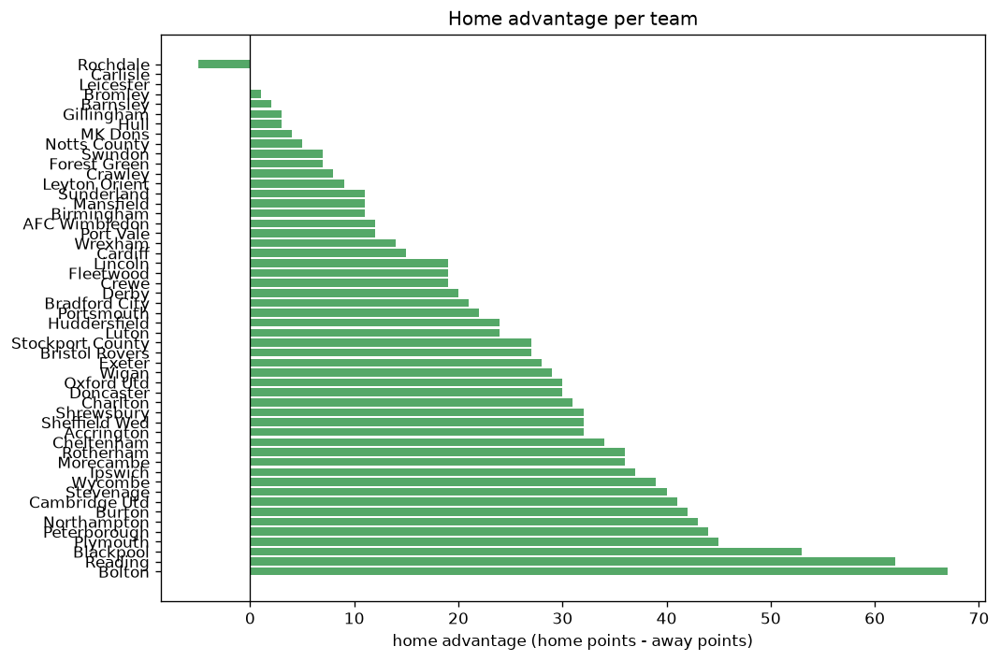

# Team Analysis
- Report: `teams_analysis`
- Generated: 2026-10-29T01:58:15+00:00
- Script: `backend/scripts/analyze_teams.py` v1.0.0
- League: League One (England)
- Scope: league `eng1`

- Teams: **52** | Seasons: **7** | Matches: **3460**

## 1. Team standings (lifetime)
| team | seasons | played | W | D | L | pts | GF | GA | GD | avg pts/season | best pos | worst pos | titles |
|---|---|---|---|---|---|---|---|---|---|---|---|---|---|
| Lincoln | 6 | 276 | 117 | 78 | 81 | 429 | 389 | 297 | 92 | 71.5 | 1 | 17 | 1 |
| Bolton | 5 | 233 | 111 | 60 | 62 | 393 | 365 | 267 | 98 | 78.6 | 3 | 9 | 0 |
| Wycombe | 6 | 242 | 104 | 67 | 71 | 379 | 352 | 283 | 69 | 63.17 | 5 | 15 | 0 |
| Peterborough | 6 | 242 | 105 | 47 | 90 | 362 | 390 | 331 | 59 | 60.33 | 2 | 21 | 0 |
| Charlton | 5 | 230 | 89 | 66 | 75 | 333 | 326 | 289 | 37 | 66.6 | 4 | 17 | 0 |
| Burton | 7 | 289 | 84 | 78 | 127 | 330 | 325 | 431 | -106 | 47.14 | 12 | 20 | 0 |
| Plymouth | 5 | 197 | 97 | 38 | 62 | 329 | 299 | 257 | 42 | 65.8 | 1 | 18 | 1 |
| Wigan | 6 | 242 | 89 | 62 | 91 | 329 | 296 | 297 | -1 | 54.83 | 1 | 24 | 1 |
| Portsmouth | 4 | 184 | 86 | 54 | 44 | 312 | 272 | 193 | 79 | 78.0 | 1 | 10 | 1 |
| Oxford Utd | 5 | 195 | 83 | 47 | 65 | 296 | 306 | 237 | 69 | 59.2 | 3 | 19 | 0 |
| Blackpool | 5 | 195 | 81 | 48 | 66 | 291 | 267 | 230 | 37 | 58.2 | 3 | 20 | 0 |
| Barnsley | 5 | 195 | 81 | 47 | 67 | 290 | 310 | 278 | 32 | 58.0 | 4 | 23 | 0 |
| Shrewsbury | 5 | 230 | 63 | 55 | 112 | 244 | 225 | 315 | -90 | 48.8 | 12 | 24 | 0 |
| Ipswich | 3 | 138 | 65 | 42 | 31 | 237 | 214 | 127 | 87 | 79.0 | 2 | 11 | 0 |
| Exeter | 4 | 184 | 59 | 45 | 80 | 222 | 211 | 255 | -44 | 55.5 | 13 | 21 | 0 |
| Reading | 4 | 150 | 59 | 41 | 50 | 218 | 225 | 200 | 25 | 54.5 | 6 | 15 | 0 |
| Stevenage | 4 | 151 | 59 | 41 | 51 | 218 | 163 | 156 | 7 | 54.5 | 6 | 14 | 0 |
| MK Dons | 4 | 150 | 58 | 40 | 52 | 214 | 202 | 191 | 11 | 53.5 | 3 | 21 | 0 |
| Cambridge Utd | 5 | 197 | 54 | 49 | 94 | 211 | 202 | 294 | -92 | 42.2 | 7 | 23 | 0 |
| Leyton Orient | 4 | 150 | 60 | 29 | 61 | 209 | 200 | 188 | 12 | 52.25 | 6 | 20 | 0 |
| Fleetwood | 4 | 184 | 48 | 57 | 79 | 201 | 213 | 251 | -38 | 50.25 | 13 | 22 | 0 |
| Sheffield Wed | 3 | 104 | 57 | 29 | 18 | 200 | 180 | 100 | 80 | 66.67 | 3 | 9 | 0 |
| Stockport County | 3 | 108 | 56 | 25 | 27 | 193 | 171 | 117 | 54 | 64.33 | 2 | 4 | 0 |
| Northampton | 4 | 184 | 49 | 44 | 91 | 191 | 185 | 273 | -88 | 47.75 | 14 | 24 | 0 |
| Bristol Rovers | 4 | 184 | 52 | 35 | 97 | 191 | 194 | 287 | -93 | 47.75 | 16 | 24 | 0 |
| Rotherham | 3 | 138 | 53 | 31 | 54 | 190 | 165 | 163 | 2 | 63.33 | 2 | 23 | 0 |
| Doncaster | 4 | 150 | 49 | 27 | 74 | 174 | 163 | 234 | -71 | 43.5 | 14 | 22 | 0 |
| Accrington | 3 | 138 | 46 | 34 | 58 | 172 | 164 | 225 | -61 | 57.33 | 11 | 23 | 0 |
| Derby | 2 | 92 | 49 | 21 | 22 | 168 | 145 | 83 | 62 | 84.0 | 2 | 7 | 0 |
| Sunderland | 2 | 92 | 44 | 29 | 19 | 161 | 149 | 95 | 54 | 80.5 | 4 | 5 | 0 |
| Huddersfield | 3 | 104 | 44 | 24 | 36 | 156 | 156 | 130 | 26 | 52.0 | 1 | 10 | 1 |
| Cheltenham | 3 | 138 | 39 | 37 | 62 | 154 | 152 | 206 | -54 | 51.33 | 15 | 21 | 0 |
| AFC Wimbledon | 4 | 150 | 36 | 46 | 68 | 154 | 162 | 236 | -74 | 38.5 | 17 | 23 | 0 |
| Mansfield | 3 | 103 | 36 | 29 | 38 | 137 | 142 | 139 | 3 | 45.67 | 10 | 17 | 0 |
| Port Vale | 3 | 138 | 33 | 33 | 72 | 132 | 125 | 206 | -81 | 44.0 | 18 | 23 | 0 |
| Birmingham | 1 | 46 | 34 | 9 | 3 | 111 | 84 | 31 | 53 | 111.0 | 1 | 1 | 1 |
| Gillingham | 2 | 92 | 27 | 26 | 39 | 107 | 98 | 129 | -31 | 53.5 | 10 | 21 | 0 |
| Bradford City | 2 | 60 | 28 | 15 | 17 | 99 | 68 | 58 | 10 | 49.5 | 4 | 5 | 0 |
| Crewe | 2 | 92 | 25 | 20 | 47 | 95 | 93 | 144 | -51 | 47.5 | 12 | 24 | 0 |
| Luton | 2 | 58 | 27 | 13 | 18 | 94 | 92 | 76 | 16 | 47.0 | 7 | 8 | 0 |
| Wrexham | 1 | 46 | 27 | 11 | 8 | 92 | 67 | 34 | 33 | 92.0 | 2 | 2 | 0 |
| Cardiff | 1 | 46 | 27 | 10 | 9 | 91 | 90 | 50 | 40 | 91.0 | 2 | 2 | 0 |
| Hull | 1 | 46 | 27 | 8 | 11 | 89 | 80 | 38 | 42 | 89.0 | 1 | 1 | 1 |
| Morecambe | 2 | 92 | 20 | 26 | 46 | 86 | 104 | 166 | -62 | 43.0 | 19 | 22 | 0 |
| Rochdale | 1 | 46 | 11 | 14 | 21 | 47 | 61 | 78 | -17 | 47.0 | 21 | 21 | 0 |
| Crawley | 1 | 46 | 12 | 10 | 24 | 46 | 57 | 83 | -26 | 46.0 | 21 | 21 | 0 |
| Swindon | 1 | 46 | 13 | 4 | 29 | 43 | 55 | 89 | -34 | 43.0 | 23 | 23 | 0 |
| Carlisle | 1 | 46 | 7 | 9 | 30 | 30 | 41 | 81 | -40 | 30.0 | 24 | 24 | 0 |
| Forest Green | 1 | 46 | 6 | 9 | 31 | 27 | 31 | 89 | -58 | 27.0 | 24 | 24 | 0 |
| Leicester | 1 | 12 | 5 | 3 | 4 | 18 | 20 | 17 | 3 | 18.0 | 11 | 11 | 0 |
| Notts County | 1 | 11 | 2 | 5 | 4 | 11 | 11 | 14 | -3 | 11.0 | 19 | 19 | 0 |
| Bromley | 1 | 12 | 2 | 3 | 7 | 9 | 11 | 30 | -19 | 9.0 | 22 | 22 | 0 |

## 2. Home vs away split
| team | home P | H-W | H-D | H-L | H-pts | away P | A-W | A-D | A-L | A-pts | adv |
|---|---|---|---|---|---|---|---|---|---|---|---|
| Bolton | 117 | 67 | 29 | 21 | 230 | 116 | 44 | 31 | 41 | 163 | 67 |
| Reading | 76 | 41 | 17 | 18 | 140 | 74 | 18 | 24 | 32 | 78 | 62 |
| Blackpool | 98 | 47 | 31 | 20 | 172 | 97 | 34 | 17 | 46 | 119 | 53 |
| Plymouth | 98 | 58 | 13 | 27 | 187 | 99 | 39 | 25 | 35 | 142 | 45 |
| Peterborough | 120 | 58 | 29 | 33 | 203 | 122 | 47 | 18 | 57 | 159 | 44 |
| Northampton | 92 | 32 | 21 | 39 | 117 | 92 | 17 | 23 | 52 | 74 | 43 |
| Burton | 145 | 50 | 36 | 59 | 186 | 144 | 34 | 42 | 68 | 144 | 42 |
| Cambridge Utd | 99 | 33 | 27 | 39 | 126 | 98 | 21 | 22 | 55 | 85 | 41 |
| Stevenage | 76 | 36 | 21 | 19 | 129 | 75 | 23 | 20 | 32 | 89 | 40 |
| Wycombe | 121 | 60 | 29 | 32 | 209 | 121 | 44 | 38 | 39 | 170 | 39 |
| Ipswich | 69 | 39 | 20 | 10 | 137 | 69 | 26 | 22 | 21 | 100 | 37 |
| Rotherham | 69 | 32 | 17 | 20 | 113 | 69 | 21 | 14 | 34 | 77 | 36 |
| Morecambe | 46 | 15 | 16 | 15 | 61 | 46 | 5 | 10 | 31 | 25 | 36 |
| Cheltenham | 69 | 25 | 19 | 25 | 94 | 69 | 14 | 18 | 37 | 60 | 34 |
| Shrewsbury | 115 | 38 | 24 | 53 | 138 | 115 | 25 | 31 | 59 | 106 | 32 |
| Sheffield Wed | 52 | 34 | 14 | 4 | 116 | 52 | 23 | 15 | 14 | 84 | 32 |
| Accrington | 69 | 28 | 18 | 23 | 102 | 69 | 18 | 16 | 35 | 70 | 32 |
| Charlton | 115 | 50 | 32 | 33 | 182 | 115 | 39 | 34 | 42 | 151 | 31 |
| Oxford Utd | 98 | 46 | 25 | 27 | 163 | 97 | 37 | 22 | 38 | 133 | 30 |
| Doncaster | 75 | 29 | 15 | 31 | 102 | 75 | 20 | 12 | 43 | 72 | 30 |
| Wigan | 120 | 51 | 26 | 43 | 179 | 122 | 38 | 36 | 48 | 150 | 29 |
| Exeter | 92 | 33 | 26 | 33 | 125 | 92 | 26 | 19 | 47 | 97 | 28 |
| Stockport County | 53 | 34 | 8 | 11 | 110 | 55 | 22 | 17 | 16 | 83 | 27 |
| Bristol Rovers | 92 | 30 | 19 | 43 | 109 | 92 | 22 | 16 | 54 | 82 | 27 |
| Huddersfield | 52 | 25 | 15 | 12 | 90 | 52 | 19 | 9 | 24 | 66 | 24 |
| Luton | 30 | 17 | 8 | 5 | 59 | 28 | 10 | 5 | 13 | 35 | 24 |
| Portsmouth | 92 | 47 | 26 | 19 | 167 | 92 | 39 | 28 | 25 | 145 | 22 |
| Bradford City | 29 | 18 | 6 | 5 | 60 | 31 | 10 | 9 | 12 | 39 | 21 |
| Derby | 46 | 28 | 10 | 8 | 94 | 46 | 21 | 11 | 14 | 74 | 20 |
| Lincoln | 138 | 61 | 41 | 36 | 224 | 138 | 56 | 37 | 45 | 205 | 19 |
| Fleetwood | 92 | 27 | 29 | 36 | 110 | 92 | 21 | 28 | 43 | 91 | 19 |
| Crewe | 46 | 15 | 12 | 19 | 57 | 46 | 10 | 8 | 28 | 38 | 19 |
| Cardiff | 23 | 17 | 2 | 4 | 53 | 23 | 10 | 8 | 5 | 38 | 15 |
| Wrexham | 23 | 16 | 5 | 2 | 53 | 23 | 11 | 6 | 6 | 39 | 14 |
| AFC Wimbledon | 75 | 19 | 26 | 30 | 83 | 75 | 17 | 20 | 38 | 71 | 12 |
| Port Vale | 69 | 18 | 18 | 33 | 72 | 69 | 15 | 15 | 39 | 60 | 12 |
| Sunderland | 46 | 25 | 11 | 10 | 86 | 46 | 19 | 18 | 9 | 75 | 11 |
| Mansfield | 51 | 20 | 14 | 17 | 74 | 52 | 16 | 15 | 21 | 63 | 11 |
| Birmingham | 23 | 19 | 4 | 0 | 61 | 23 | 15 | 5 | 3 | 50 | 11 |
| Leyton Orient | 75 | 31 | 16 | 28 | 109 | 75 | 29 | 13 | 33 | 100 | 9 |
| Crawley | 23 | 7 | 6 | 10 | 27 | 23 | 5 | 4 | 14 | 19 | 8 |
| Swindon | 23 | 8 | 1 | 14 | 25 | 23 | 5 | 3 | 15 | 18 | 7 |
| Forest Green | 23 | 5 | 2 | 16 | 17 | 23 | 1 | 7 | 15 | 10 | 7 |
| Notts County | 6 | 2 | 2 | 2 | 8 | 5 | 0 | 3 | 2 | 3 | 5 |
| MK Dons | 75 | 29 | 22 | 24 | 109 | 75 | 29 | 18 | 28 | 105 | 4 |
| Gillingham | 46 | 14 | 13 | 19 | 55 | 46 | 13 | 13 | 20 | 52 | 3 |
| Hull | 23 | 14 | 4 | 5 | 46 | 23 | 13 | 4 | 6 | 43 | 3 |
| Barnsley | 97 | 41 | 23 | 33 | 146 | 98 | 40 | 24 | 34 | 144 | 2 |
| Bromley | 6 | 1 | 2 | 3 | 5 | 6 | 1 | 1 | 4 | 4 | 1 |
| Carlisle | 23 | 3 | 6 | 14 | 15 | 23 | 4 | 3 | 16 | 15 | 0 |
| Leicester | 6 | 3 | 0 | 3 | 9 | 6 | 2 | 3 | 1 | 9 | 0 |
| Rochdale | 23 | 4 | 9 | 10 | 21 | 23 | 7 | 5 | 11 | 26 | -5 |

## 3. Top performers
### Best points per game (PPG)
| rank | team | PPG |
|---|---|---|
| 1 | Birmingham | 2.41 |
| 2 | Wrexham | 2.00 |
| 3 | Cardiff | 1.98 |
| 4 | Hull | 1.94 |
| 5 | Sheffield Wed | 1.92 |

### Most goals scored
| rank | team | goals |
|---|---|---|
| 1 | Peterborough | 390 |
| 2 | Lincoln | 389 |
| 3 | Bolton | 365 |
| 4 | Wycombe | 352 |
| 5 | Charlton | 326 |

### Best goal difference
| rank | team | GD |
|---|---|---|
| 1 | Bolton | 98 |
| 2 | Lincoln | 92 |
| 3 | Ipswich | 87 |
| 4 | Sheffield Wed | 80 |
| 5 | Portsmouth | 79 |

### Best defence (goals against per match, standings)
| rank | team | GA/match |
|---|---|---|
| 1 | Birmingham | 0.674 |
| 2 | Wrexham | 0.739 |
| 3 | Hull | 0.826 |
| 4 | Derby | 0.902 |
| 5 | Ipswich | 0.920 |

## 4. Team consistency
- Teams present in all **7** seasons: **1**

Burton

## 5. Head-to-head dominance
- Distinct fixtures: **911** (showing the 15 most frequent)

| fixture | meetings | home wins | draws | away wins | home pct | draw pct | away pct |
|---|---|---|---|---|---|---|---|
| Lincoln vs Burton | 12 | 3 | 0 | 9 | 25.0% | 0.0% | 75.0% |
| Peterborough vs Burton | 11 | 2 | 5 | 4 | 18.2% | 45.5% | 36.4% |
| Bolton vs Burton | 10 | 6 | 3 | 1 | 60.0% | 30.0% | 10.0% |
| Wycombe vs Bolton | 10 | 6 | 1 | 3 | 60.0% | 10.0% | 30.0% |
| Charlton vs Burton | 10 | 5 | 2 | 3 | 50.0% | 20.0% | 30.0% |
| Charlton vs Lincoln | 10 | 5 | 4 | 1 | 50.0% | 40.0% | 10.0% |
| Lincoln vs Bolton | 10 | 5 | 3 | 2 | 50.0% | 30.0% | 20.0% |
| Lincoln vs Shrewsbury | 10 | 5 | 2 | 3 | 50.0% | 20.0% | 30.0% |
| Wycombe vs Burton | 10 | 5 | 3 | 2 | 50.0% | 30.0% | 20.0% |
| Wycombe vs Lincoln | 10 | 5 | 3 | 2 | 50.0% | 30.0% | 20.0% |
| Burton vs Shrewsbury | 10 | 4 | 1 | 5 | 40.0% | 10.0% | 50.0% |
| Charlton vs Shrewsbury | 10 | 4 | 4 | 2 | 40.0% | 40.0% | 20.0% |
| Peterborough vs Lincoln | 10 | 4 | 4 | 2 | 40.0% | 40.0% | 20.0% |
| Wigan vs Burton | 10 | 3 | 4 | 3 | 30.0% | 40.0% | 30.0% |
| Wigan vs Lincoln | 10 | 1 | 4 | 5 | 10.0% | 40.0% | 50.0% |

## 6. Position per season (classic view)
_Cells show final position; '-' when the team was absent from that season._

| team | 2020-2021 | 2021-2022 | 2022-2023 | 2023-2024 | 2024-2025 | 2025-2026 | 2026-2027 |
|---|---|---|---|---|---|---|---|
| Lincoln | 5 | 17 | 11 | 7 | 11 | 1 | - |
| Bolton | - | 9 | 5 | 3 | 8 | 3 | - |
| Wycombe | - | 6 | 9 | 11 | 5 | 11 | 15 |
| Peterborough | 2 | - | 6 | 4 | 18 | 18 | 21 |
| Charlton | 7 | 13 | 10 | 17 | 4 | - | - |
| Burton | 16 | 16 | 15 | 20 | 20 | 17 | 12 |
| Plymouth | 18 | 7 | 1 | - | - | 8 | 5 |
| Wigan | 20 | 1 | - | 10 | 15 | 16 | 24 |
| Portsmouth | 8 | 10 | 8 | 1 | - | - | - |
| Oxford Utd | 6 | 8 | 19 | 5 | - | - | 3 |
| Blackpool | 3 | - | - | 8 | 9 | 13 | 20 |
| Barnsley | - | - | 4 | 6 | 12 | 15 | 23 |
| Shrewsbury | 17 | 18 | 12 | 19 | 24 | - | - |
| Ipswich | 9 | 11 | 2 | - | - | - | - |
| Exeter | - | - | 14 | 13 | 16 | 21 | - |
| Reading | - | - | - | 15 | 7 | 12 | 6 |
| Stevenage | - | - | - | 9 | 14 | 6 | 13 |
| MK Dons | 13 | 3 | 21 | - | - | - | 14 |
| Cambridge Utd | - | 14 | 20 | 18 | 23 | - | 7 |
| Leyton Orient | - | - | - | 12 | 6 | 20 | 16 |
| Fleetwood | 15 | 20 | 13 | 22 | - | - | - |
| Sheffield Wed | - | 4 | 3 | - | - | - | 9 |
| Stockport County | - | - | - | - | 3 | 4 | 2 |
| Northampton | 22 | - | - | 14 | 19 | 24 | - |
| Bristol Rovers | 24 | - | 17 | 16 | 22 | - | - |
| Rotherham | - | 2 | - | - | 13 | 23 | - |
| Doncaster | 14 | 22 | - | - | - | 14 | 18 |
| Accrington | 11 | 12 | 23 | - | - | - | - |
| Derby | - | - | 7 | 2 | - | - | - |
| Sunderland | 4 | 5 | - | - | - | - | - |
| Huddersfield | - | - | - | - | 10 | 9 | 1 |
| Cheltenham | - | 15 | 16 | 21 | - | - | - |
| AFC Wimbledon | 19 | 23 | - | - | - | 19 | 17 |
| Mansfield | - | - | - | - | 17 | 10 | 10 |
| Port Vale | - | - | 18 | 23 | - | 22 | - |
| Birmingham | - | - | - | - | 1 | - | - |
| Gillingham | 10 | 21 | - | - | - | - | - |
| Bradford City | - | - | - | - | - | 5 | 4 |
| Crewe | 12 | 24 | - | - | - | - | - |
| Luton | - | - | - | - | - | 7 | 8 |
| Wrexham | - | - | - | - | 2 | - | - |
| Cardiff | - | - | - | - | - | 2 | - |
| Hull | 1 | - | - | - | - | - | - |
| Morecambe | - | 19 | 22 | - | - | - | - |
| Rochdale | 21 | - | - | - | - | - | - |
| Crawley | - | - | - | - | 21 | - | - |
| Swindon | 23 | - | - | - | - | - | - |
| Carlisle | - | - | - | 24 | - | - | - |
| Forest Green | - | - | 24 | - | - | - | - |
| Leicester | - | - | - | - | - | - | 11 |
| Notts County | - | - | - | - | - | - | 19 |
| Bromley | - | - | - | - | - | - | 22 |

---
*All statistics are computed from PostgreSQL tables (read-only). Run with `python backend/scripts/analyze_teams.py` to regenerate.*

## Charts

