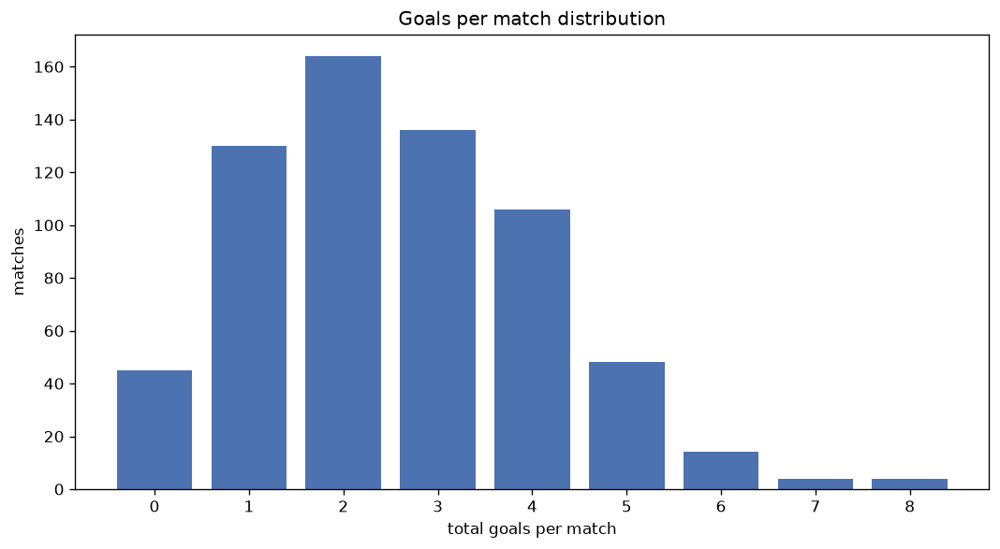
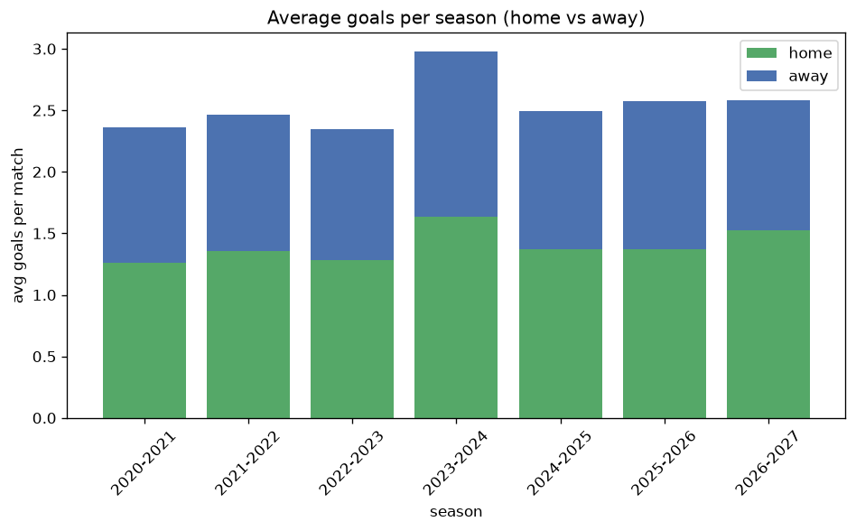

# Goal Analysis
- Report: `goals_analysis`
- Generated: 2026-10-30T03:50:00+00:00
- Script: `backend/scripts/analyze_goals.py` v1.0.0
- League: League Two (England)
- Scope: league `eng2`

## 1. Goals per match distribution
| goals | matches | pct |
|---|---|---|
| 0 | 286 | 8.2% |
| 1 | 690 | 19.9% |
| 2 | 880 | 25.4% |
| 3 | 752 | 21.7% |
| 4 | 459 | 13.2% |
| 5 | 242 | 7.0% |
| 6 | 99 | 2.9% |
| 7 | 34 | 1.0% |
| 8 | 16 | 0.5% |
| 9 | 6 | 0.2% |
| 10 | 3 | 0.1% |
| 11 | 1 | 0.0% |

## 2. Goals per match per season
| season | matches | total goals | avg home | avg away | avg total |
|---|---|---|---|---|---|
| 2020-2021 | 552 | 1303 | 1.261 | 1.1 | 2.361 |
| 2021-2022 | 552 | 1359 | 1.353 | 1.109 | 2.462 |
| 2022-2023 | 552 | 1294 | 1.283 | 1.062 | 2.344 |
| 2023-2024 | 552 | 1645 | 1.632 | 1.348 | 2.98 |
| 2024-2025 | 552 | 1377 | 1.371 | 1.123 | 2.495 |
| 2025-2026 | 557 | 1434 | 1.372 | 1.203 | 2.575 |
| 2026-2027 | 151 | 395 | 1.536 | 1.079 | 2.616 |

## 3. Home vs away goal share
- Home goals: **4805** (54.6%)
- Away goals: **4002** (45.4%)
- Home/away ratio: **1.201**

| season | home goals | away goals | total | home pct | away pct |
|---|---|---|---|---|---|
| 2020-2021 | 696 | 607 | 1303 | 53.4% | 46.6% |
| 2021-2022 | 747 | 612 | 1359 | 55.0% | 45.0% |
| 2022-2023 | 708 | 586 | 1294 | 54.7% | 45.3% |
| 2023-2024 | 901 | 744 | 1645 | 54.8% | 45.2% |
| 2024-2025 | 757 | 620 | 1377 | 55.0% | 45.0% |
| 2025-2026 | 764 | 670 | 1434 | 53.3% | 46.7% |
| 2026-2027 | 232 | 163 | 395 | 58.7% | 41.3% |

## 4. BTTS (Both Teams To Score)
- Overall: **1776** of `3468` (51.2%)

| season | matches | BTTS | pct |
|---|---|---|---|
| 2020-2021 | 552 | 264 | 47.8% |
| 2021-2022 | 552 | 273 | 49.5% |
| 2022-2023 | 552 | 267 | 48.4% |
| 2023-2024 | 552 | 326 | 59.1% |
| 2024-2025 | 552 | 270 | 48.9% |
| 2025-2026 | 557 | 292 | 52.4% |
| 2026-2027 | 151 | 84 | 55.6% |

## 5. Clean sheets
- Home clean sheets: **1124** (32.4%)
- Away clean sheets: **854** (24.6%)
- Total clean sheets recorded: **1978**
- Matches with at least one clean sheet: **1692** (48.8%)
- Both teams kept clean sheets (0-0): **286**

| season | matches | home CS | away CS | total CS | matches w/ CS |
|---|---|---|---|---|---|
| 2020-2021 | 552 | 181 | 164 | 345 | 288 (52.2%) |
| 2021-2022 | 552 | 189 | 141 | 330 | 279 (50.5%) |
| 2022-2023 | 552 | 196 | 143 | 339 | 285 (51.6%) |
| 2023-2024 | 552 | 152 | 101 | 253 | 226 (40.9%) |
| 2024-2025 | 552 | 186 | 144 | 330 | 282 (51.1%) |
| 2025-2026 | 557 | 165 | 137 | 302 | 265 (47.6%) |
| 2026-2027 | 151 | 55 | 24 | 79 | 67 (44.4%) |

## 6. Scoring intensity
- First-half goals: **3986** (45.3%)
- Second-half goals: **4821** (54.7%)
- Avg first-half goals per match: **1.149**
- Avg second-half goals per match: **1.39**
- Second-half-only scoring (HT 0-0, FT goals >= 1): **814** (23.5%)

| season | matches | 1st half | 2nd half | 1st half pct | 2nd half pct |
|---|---|---|---|---|---|
| 2020-2021 | 552 | 620 | 683 | 47.6% | 52.4% |
| 2021-2022 | 552 | 599 | 760 | 44.1% | 55.9% |
| 2022-2023 | 552 | 598 | 696 | 46.2% | 53.8% |
| 2023-2024 | 552 | 757 | 888 | 46.0% | 54.0% |
| 2024-2025 | 552 | 605 | 772 | 43.9% | 56.1% |
| 2025-2026 | 557 | 635 | 799 | 44.3% | 55.7% |
| 2026-2027 | 151 | 172 | 223 | 43.5% | 56.5% |

## 7. First-goal timing
- Matches with first-goal time recorded: `3182` of `3468` (91.8%)
- Goalless matches: `286`
- Min `1` | Max `103` | Mean `31.51` | Median (p50) `26.0`

| bucket | count | % of matches | % of scoring matches |
|---|---|---|---|
| 1-15 | 1029 | 29.7% | 32.3% |
| 16-30 | 752 | 21.7% | 23.6% |
| 31-45 | 520 | 15.0% | 16.3% |
| 46-60 | 440 | 12.7% | 13.8% |
| 61-75 | 244 | 7.0% | 7.7% |
| 76-90 | 151 | 4.4% | 4.7% |
| 91-120 | 46 | 1.3% | 1.4% |

---
*All statistics are computed from PostgreSQL tables (read-only). Run with `python backend/scripts/analyze_goals.py` to regenerate.*

## Charts

