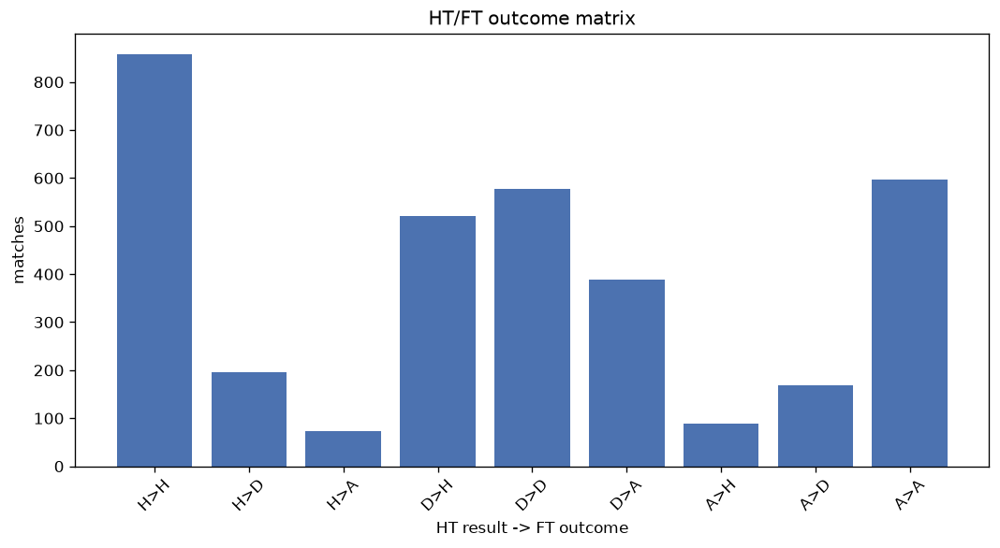
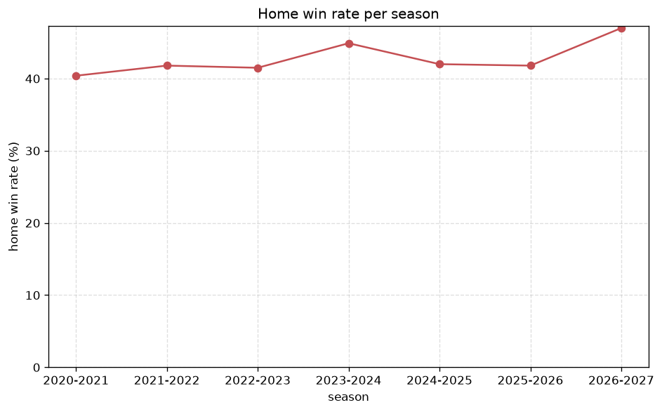

# Match Analysis
- Report: `matches_analysis`
- Generated: 2026-10-30T03:49:58+00:00
- Script: `backend/scripts/analyze_matches.py` v1.0.0
- League: League Two (England)
- Scope: league `eng2`

## 1. Overall summary
| metric | value |
|---|---|
| Matches | 3468 |
| Home wins | 1467 (42.3%) |
| Draws | 943 (27.2%) |
| Away wins | 1058 (30.5%) |
| Total goals | 8807 |
| Average goals per match | 2.540 |
| Goalless matches | 286 (8.2%) |

## 2. Per-season breakdown
| season | matches | home wins | draws | away wins | total goals | avg goals | goalless |
|---|---|---|---|---|---|---|---|
| 2020-2021 | 552 | 223 (40.4%) | 151 (27.4%) | 178 (32.2%) | 1303 | 2.361 | 57 (10.3%) |
| 2021-2022 | 552 | 231 (41.8%) | 152 (27.5%) | 169 (30.6%) | 1359 | 2.462 | 51 (9.2%) |
| 2022-2023 | 552 | 229 (41.5%) | 160 (29.0%) | 163 (29.5%) | 1294 | 2.344 | 54 (9.8%) |
| 2023-2024 | 552 | 248 (44.9%) | 131 (23.7%) | 173 (31.3%) | 1645 | 2.98 | 27 (4.9%) |
| 2024-2025 | 552 | 232 (42.0%) | 158 (28.6%) | 162 (29.3%) | 1377 | 2.495 | 48 (8.7%) |
| 2025-2026 | 557 | 233 (41.8%) | 139 (25.0%) | 185 (33.2%) | 1434 | 2.575 | 37 (6.6%) |
| 2026-2027 | 151 | 71 (47.0%) | 52 (34.4%) | 28 (18.5%) | 395 | 2.616 | 12 (7.9%) |

## 3. HT/FT outcome matrix
| HT result \ FT result | Home | Draw | Away | total |
|---|---|---|---|---|
| HT home lead | 857 (76.0%) | 196 (17.4%) | 74 (6.6%) | 1127 |
| HT draw | 521 (35.0%) | 578 (38.9%) | 388 (26.1%) | 1487 |
| HT away lead | 89 (10.4%) | 169 (19.8%) | 596 (69.8%) | 854 |

## 4. Comeback matches
- Home comebacks (trailing at HT, won at FT): **89** (2.6%)
- Away comebacks (trailing at HT, won at FT): **74** (2.1%)

### Home comebacks
| season | home | away | HT | FT |
|---|---|---|---|---|
| 2020-2021 | Bradford City | Stevenage | 0-1 | 2-1 |
| 2020-2021 | Exeter | Crawley | 0-1 | 2-1 |
| 2020-2021 | Leyton Orient | Newport | 0-1 | 2-1 |
| 2020-2021 | Morecambe | Leyton Orient | 0-1 | 2-1 |
| 2020-2021 | Walsall | Port Vale | 0-2 | 4-3 |
| 2020-2021 | Cambridge Utd | Leyton Orient | 0-1 | 2-1 |
| 2020-2021 | Morecambe | Grimsby | 0-1 | 3-1 |
| 2020-2021 | Cambridge Utd | Harrogate | 0-1 | 2-1 |
| 2020-2021 | Oldham | Salford | 0-1 | 2-1 |
| 2020-2021 | Exeter | Bradford City | 1-2 | 3-2 |
| 2020-2021 | Morecambe | Salford | 0-1 | 2-1 |
| 2020-2021 | Colchester | Carlisle | 0-1 | 2-1 |
| 2020-2021 | Bolton | Walsall | 0-1 | 2-1 |
| 2020-2021 | Barrow | Newport | 0-1 | 2-1 |
| 2020-2021 | Bolton | Harrogate | 0-1 | 2-1 |
| 2021-2022 | Harrogate | Barrow | 0-1 | 2-1 |
| 2021-2022 | Barrow | Newport | 0-1 | 2-1 |
| 2021-2022 | Sutton | Port Vale | 1-2 | 4-3 |
| 2021-2022 | Port Vale | Barrow | 0-1 | 3-1 |
| 2021-2022 | Hartlepool | Harrogate | 0-2 | 3-2 |
| 2021-2022 | Bristol Rovers | Northampton | 0-1 | 2-1 |
| 2021-2022 | Tranmere | Bradford City | 0-1 | 2-1 |
| 2021-2022 | Newport | Sutton | 0-2 | 3-2 |
| 2021-2022 | Newport | Port Vale | 0-1 | 2-1 |
| 2021-2022 | Mansfield | Hartlepool | 0-1 | 3-2 |
| 2021-2022 | Bradford City | Salford | 0-1 | 2-1 |
| 2021-2022 | Sutton | Colchester | 1-2 | 3-2 |
| 2021-2022 | Exeter | Harrogate | 1-2 | 4-3 |
| 2021-2022 | Rochdale | Hartlepool | 0-1 | 2-1 |
| 2022-2023 | Doncaster | Sutton | 0-1 | 2-1 |
| 2022-2023 | Northampton | Stockport County | 0-1 | 2-1 |
| 2022-2023 | AFC Wimbledon | Colchester | 0-1 | 2-1 |
| 2022-2023 | Hartlepool | Grimsby | 0-1 | 2-1 |
| 2022-2023 | Sutton | Swindon | 0-1 | 2-1 |
| 2022-2023 | Barrow | AFC Wimbledon | 0-1 | 2-1 |
| 2022-2023 | Bradford City | Grimsby | 1-2 | 3-2 |
| 2022-2023 | Hartlepool | Swindon | 0-1 | 2-1 |
| 2022-2023 | Crewe | Swindon | 0-1 | 2-1 |
| 2023-2024 | Barrow | Sutton | 0-1 | 2-1 |
| 2023-2024 | Notts Co | Grimsby | 1-2 | 3-2 |
| 2023-2024 | Mansfield | Stockport County | 1-2 | 3-2 |
| 2023-2024 | Crewe | MK Dons | 0-1 | 3-1 |
| 2023-2024 | Crawley | Tranmere | 0-1 | 3-2 |
| 2023-2024 | Wrexham | Salford | 1-2 | 3-2 |
| 2023-2024 | Colchester | Swindon | 0-1 | 3-1 |
| 2023-2024 | Grimsby | Morecambe | 0-1 | 3-2 |
| 2023-2024 | Tranmere | Newport | 0-1 | 2-1 |
| 2023-2024 | Tranmere | Swindon | 0-1 | 2-1 |
| 2023-2024 | Newport | Forest Green | 0-2 | 4-2 |
| 2023-2024 | MK Dons | Accrington | 0-1 | 2-1 |
| 2023-2024 | Crawley | Notts Co | 0-1 | 2-1 |
| 2023-2024 | Colchester | Newport | 0-1 | 2-1 |
| 2023-2024 | Harrogate | Gillingham | 0-1 | 5-1 |
| 2023-2024 | Swindon | AFC Wimbledon | 0-1 | 3-2 |
| 2023-2024 | Mansfield | Gillingham | 0-1 | 2-1 |
| 2023-2024 | Doncaster | Barrow | 0-2 | 4-2 |
| 2023-2024 | Wrexham | Stockport County | 0-1 | 2-1 |
| 2024-2025 | Newport | Doncaster | 0-1 | 3-1 |
| 2024-2025 | Cheltenham | Accrington | 0-1 | 2-1 |
| 2024-2025 | Barrow | Cheltenham | 0-1 | 2-1 |
| 2024-2025 | MK Dons | Cheltenham | 1-2 | 3-2 |
| 2024-2025 | Accrington | Grimsby | 1-2 | 3-2 |
| 2024-2025 | Port Vale | Newport | 1-2 | 3-2 |
| 2024-2025 | Swindon | Tranmere | 0-1 | 3-1 |
| 2024-2025 | Grimsby | Carlisle | 0-1 | 2-1 |
| 2024-2025 | Cheltenham | Barrow | 0-1 | 3-2 |
| 2024-2025 | Walsall | Chesterfield | 0-1 | 3-1 |
| 2024-2025 | Carlisle | Newport | 1-2 | 3-2 |
| 2024-2025 | Swindon | Bradford City | 2-3 | 5-4 |
| 2025-2026 | Fleetwood | Colchester | 1-2 | 4-2 |
| 2025-2026 | Walsall | Bristol Rovers | 0-1 | 2-1 |
| 2025-2026 | Fleetwood | Accrington | 0-1 | 2-1 |
| 2025-2026 | Bromley | MK Dons | 0-1 | 2-1 |
| 2025-2026 | Walsall | Bromley | 0-1 | 3-1 |
| 2025-2026 | Fleetwood | Gillingham | 0-1 | 2-1 |
| 2025-2026 | Bromley | Swindon | 0-1 | 2-1 |
| 2025-2026 | Cambridge Utd | Tranmere | 0-1 | 4-2 |
| 2025-2026 | Fleetwood | Barrow | 0-2 | 3-2 |
| 2025-2026 | Cheltenham | Salford | 0-1 | 3-2 |
| 2025-2026 | Crewe | Tranmere | 0-1 | 2-1 |
| 2025-2026 | Bristol Rovers | Crewe | 0-1 | 2-1 |
| 2025-2026 | Walsall | Newport | 0-1 | 2-1 |
| 2025-2026 | Barrow | Bromley | 0-1 | 2-1 |
| 2025-2026 | Cheltenham | Gillingham | 0-1 | 2-1 |
| 2025-2026 | Newport | Oldham | 1-2 | 3-2 |
| 2026-2027 | York City | Bristol Rovers | 0-1 | 3-2 |
| 2026-2027 | Colchester | Oldham | 0-1 | 2-1 |
| 2026-2027 | Swindon | Colchester | 0-1 | 3-1 |
| 2026-2027 | Barnet | Accrington | 0-1 | 2-1 |

### Away comebacks
| season | home | away | HT | FT |
|---|---|---|---|---|
| 2020-2021 | Cheltenham | Morecambe | 1-0 | 1-2 |
| 2020-2021 | Southend | Morecambe | 1-0 | 1-2 |
| 2020-2021 | Morecambe | Forest Green | 1-0 | 1-2 |
| 2020-2021 | Port Vale | Tranmere | 2-0 | 3-4 |
| 2020-2021 | Newport | Oldham | 2-1 | 2-4 |
| 2020-2021 | Southend | Cambridge Utd | 1-0 | 1-2 |
| 2020-2021 | Carlisle | Oldham | 1-0 | 1-3 |
| 2020-2021 | Bolton | Exeter | 1-0 | 1-2 |
| 2020-2021 | Leyton Orient | Carlisle | 2-1 | 2-3 |
| 2021-2022 | Walsall | Bristol Rovers | 1-0 | 1-2 |
| 2021-2022 | Bristol Rovers | Swindon | 1-0 | 1-3 |
| 2021-2022 | Crawley | Exeter | 1-0 | 1-3 |
| 2021-2022 | Crawley | Port Vale | 1-0 | 1-4 |
| 2021-2022 | Oldham | Scunthorpe | 1-0 | 1-3 |
| 2021-2022 | Bradford City | Crawley | 1-0 | 1-2 |
| 2021-2022 | Scunthorpe | Rochdale | 1-0 | 1-2 |
| 2021-2022 | Colchester | Hartlepool | 1-0 | 1-2 |
| 2021-2022 | Oldham | Carlisle | 1-0 | 1-2 |
| 2021-2022 | Scunthorpe | Colchester | 1-0 | 1-3 |
| 2021-2022 | Oldham | Mansfield | 1-0 | 1-2 |
| 2021-2022 | Barrow | Port Vale | 1-0 | 1-2 |
| 2021-2022 | Newport | Colchester | 1-0 | 1-2 |
| 2021-2022 | Rochdale | Bristol Rovers | 2-0 | 3-4 |
| 2022-2023 | Walsall | Grimsby | 1-0 | 1-2 |
| 2022-2023 | Crewe | Stevenage | 1-0 | 1-2 |
| 2022-2023 | Hartlepool | Carlisle | 1-0 | 1-3 |
| 2022-2023 | Newport | Stockport County | 1-0 | 1-2 |
| 2022-2023 | Crewe | Newport | 1-0 | 1-2 |
| 2022-2023 | Hartlepool | Mansfield | 1-0 | 1-2 |
| 2022-2023 | Mansfield | Barrow | 2-1 | 2-3 |
| 2022-2023 | Bradford City | Rochdale | 1-0 | 1-2 |
| 2022-2023 | Stevenage | Bradford City | 1-0 | 2-3 |
| 2022-2023 | Northampton | Grimsby | 1-0 | 1-2 |
| 2022-2023 | AFC Wimbledon | Stevenage | 1-0 | 2-3 |
| 2022-2023 | Doncaster | Grimsby | 1-0 | 1-2 |
| 2022-2023 | AFC Wimbledon | Salford | 1-0 | 2-3 |
| 2022-2023 | Doncaster | Newport | 1-0 | 1-3 |
| 2023-2024 | Forest Green | Swindon | 1-0 | 1-2 |
| 2023-2024 | Tranmere | Salford | 2-1 | 3-4 |
| 2023-2024 | Colchester | MK Dons | 2-1 | 2-3 |
| 2023-2024 | Salford | Walsall | 1-0 | 1-2 |
| 2023-2024 | Forest Green | Crewe | 1-0 | 1-4 |
| 2023-2024 | AFC Wimbledon | Stockport County | 1-0 | 1-2 |
| 2023-2024 | Crawley | Crewe | 2-1 | 2-4 |
| 2023-2024 | Swindon | Stockport County | 1-0 | 2-4 |
| 2023-2024 | Colchester | Barrow | 1-0 | 1-4 |
| 2023-2024 | Salford | MK Dons | 2-1 | 2-4 |
| 2023-2024 | Notts Co | Walsall | 1-0 | 1-2 |
| 2023-2024 | MK Dons | Morecambe | 1-0 | 1-2 |
| 2023-2024 | Crewe | Salford | 2-1 | 2-3 |
| 2023-2024 | Tranmere | Morecambe | 2-1 | 2-3 |
| 2023-2024 | Crewe | Morecambe | 1-0 | 2-3 |
| 2023-2024 | Harrogate | Crawley | 1-0 | 1-2 |
| 2024-2025 | Bromley | Crewe | 1-0 | 1-2 |
| 2024-2025 | Bromley | Notts Co | 2-1 | 2-4 |
| 2024-2025 | Carlisle | Grimsby | 2-1 | 2-3 |
| 2024-2025 | Walsall | Fleetwood | 2-1 | 2-6 |
| 2024-2025 | Grimsby | MK Dons | 1-0 | 1-3 |
| 2024-2025 | Notts Co | Walsall | 1-0 | 1-2 |
| 2024-2025 | Salford | Bradford City | 1-0 | 1-2 |
| 2024-2025 | Notts Co | Cheltenham | 1-0 | 1-2 |
| 2025-2026 | Tranmere | Notts Co | 1-0 | 1-2 |
| 2025-2026 | Bristol Rovers | Bromley | 2-0 | 2-3 |
| 2025-2026 | Barnet | Swindon | 1-0 | 1-2 |
| 2025-2026 | Salford | Shrewsbury | 1-0 | 1-2 |
| 2025-2026 | Walsall | Notts Co | 1-0 | 1-2 |
| 2025-2026 | Barnet | Newport | 1-0 | 1-2 |
| 2025-2026 | Gillingham | Bristol Rovers | 1-0 | 1-2 |
| 2025-2026 | Harrogate | Bristol Rovers | 1-0 | 2-3 |
| 2025-2026 | Cheltenham | Tranmere | 1-0 | 1-3 |
| 2025-2026 | Barrow | Newport | 1-0 | 1-2 |
| 2026-2027 | Bristol Rovers | Barnet | 1-0 | 1-3 |
| 2026-2027 | Tranmere | Barnet | 1-0 | 1-2 |
| 2026-2027 | Crawley | Shrewsbury | 1-0 | 2-3 |

## 5. HT lead conversion
| HT state | matches | converted to win | held as draw | collapsed to loss |
|---|---|---|---|---|
| Home lead | 1127 | 857 (76.0%) | 196 (17.4%) | 74 (6.6%) |
| Away lead | 854 | 596 (69.8%) | 169 (19.8%) | 89 (10.4%) |

### Matches level at half-time
| FT result | count | pct |
|---|---|---|
| Home win | 521 | 35.0% |
| Draw | 578 | 38.9% |
| Away win | 388 | 26.1% |

## 6. First-goal timing
- Matches with a first-goal time recorded: `3182` of `3468` (91.8%)

Outcome distribution by first-goal timing bucket:
| bucket | matches | % of matches | home | draw | away |
|---|---|---|---|---|---|
| 1-15 | 1029 | 29.7% | 487 (47.3%) | 217 (21.1%) | 325 (31.6%) |
| 16-30 | 752 | 21.7% | 335 (44.5%) | 164 (21.8%) | 253 (33.6%) |
| 31-45 | 520 | 15.0% | 233 (44.8%) | 124 (23.8%) | 163 (31.3%) |
| 46-60 | 440 | 12.7% | 204 (46.4%) | 91 (20.7%) | 145 (33.0%) |
| 61-75 | 244 | 7.0% | 106 (43.4%) | 48 (19.7%) | 90 (36.9%) |
| 76-90 | 151 | 4.4% | 71 (47.0%) | 13 (8.6%) | 67 (44.4%) |
| 91-120 | 46 | 1.3% | 31 (67.4%) | 0 (0.0%) | 15 (32.6%) |

## 7. Goalless matches
- Overall: **286** of `3468` (8.2%)

| season | matches | goalless | pct |
|---|---|---|---|
| 2020-2021 | 552 | 57 | 10.3% |
| 2021-2022 | 552 | 51 | 9.2% |
| 2022-2023 | 552 | 54 | 9.8% |
| 2023-2024 | 552 | 27 | 4.9% |
| 2024-2025 | 552 | 48 | 8.7% |
| 2025-2026 | 557 | 37 | 6.6% |
| 2026-2027 | 151 | 12 | 7.9% |

---
*All statistics are computed from PostgreSQL tables (read-only). Run with `python backend/scripts/analyze_matches.py` to regenerate.*

## Charts

