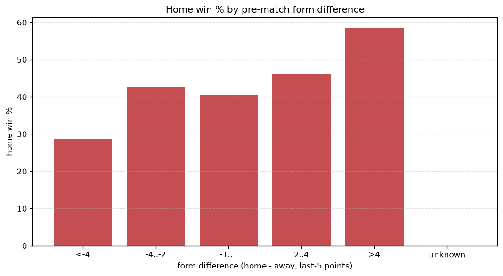
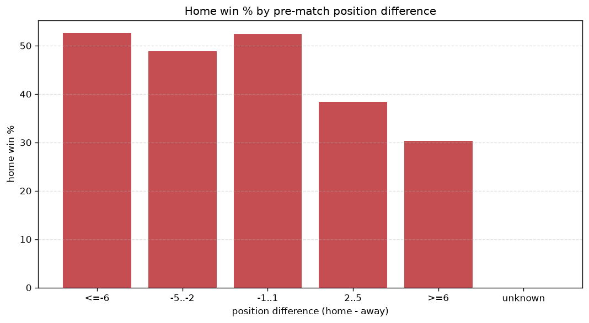

# Relationships Analysis
- Report: `relationships`
- Generated: 2026-10-27T01:46:31+00:00
- Script: `backend/scripts/analyze_relationships.py` v1.0.0
- League: League Two (England)
- Scope: league `eng2`

- Matches analysed: **3317** (23 leakage-safe pre-match features).

## 1. Correlation matrix
_Pearson correlation of each pre-match feature with observed goals; sorted by |corr(total goals)|._

| feature | corr(home) | corr(away) | corr(total) |
|---|---|---|---|
| away_team_goals_scored_last_5 | -0.002 | 0.103 | 0.068 |
| home_team_goals_scored_last_5 | 0.061 | 0.007 | 0.049 |
| away_team_away_goals_avg | -0.013 | 0.073 | 0.040 |
| home_team_points_last_5 | 0.079 | -0.031 | 0.037 |
| away_team_away_conceded_avg | 0.062 | -0.012 | 0.037 |
| home_team_wins_last_5 | 0.069 | -0.023 | 0.035 |
| away_team_goals_conceded_last_5 | 0.061 | -0.014 | 0.035 |
| home_team_home_goals_avg | 0.066 | -0.019 | 0.035 |
| away_rest_days | 0.030 | 0.013 | 0.031 |
| home_team_home_conceded_avg | -0.018 | 0.053 | 0.023 |
| away_team_wins_last_5 | -0.042 | 0.077 | 0.021 |
| home_rest_days | 0.017 | 0.011 | 0.020 |
| away_team_points_last_5 | -0.049 | 0.082 | 0.019 |
| away_team_away_win_rate | -0.027 | 0.051 | 0.015 |
| rest_days_difference | -0.014 | -0.003 | -0.012 |
| home_team_goals_conceded_last_5 | -0.072 | 0.063 | -0.011 |
| away_position_before_match | 0.079 | -0.100 | -0.009 |
| home_team_home_win_rate | 0.055 | -0.047 | 0.009 |
| position_difference | -0.125 | 0.146 | 0.007 |
| home_points_before_match | 0.031 | -0.038 | -0.003 |
| points_difference | 0.124 | -0.138 | -0.002 |
| away_points_before_match | -0.045 | 0.046 | -0.002 |
| home_position_before_match | -0.093 | 0.101 | -0.000 |

## 2. Form vs outcome
_Home win/draw/away % per bucket of `home_team_points_last_5 - away_team_points_last_5`._

| bucket | matches | home | draw | away | home % | draw % | away % |
|---|---|---|---|---|---|---|---|
| <-4 | 499 | 175 | 132 | 192 | 35.1% | 26.5% | 38.5% |
| -4..-2 | 744 | 282 | 207 | 255 | 37.9% | 27.8% | 34.3% |
| -1..1 | 936 | 390 | 250 | 296 | 41.7% | 26.7% | 31.6% |
| 2..4 | 661 | 298 | 179 | 184 | 45.1% | 27.1% | 27.8% |
| >4 | 477 | 251 | 123 | 103 | 52.6% | 25.8% | 21.6% |
| unknown | 0 | 0 | 0 | 0 | - | - | - |

## 3. Position vs outcome
_Home win/draw/away % per bucket of `position_difference` (home position - away position; negative favours the home team)._

| bucket | matches | home | draw | away | home % | draw % | away % |
|---|---|---|---|---|---|---|---|
| <=-6 | 921 | 479 | 238 | 204 | 52.0% | 25.8% | 22.1% |
| -5..-2 | 507 | 224 | 132 | 151 | 44.2% | 26.0% | 29.8% |
| -1..1 | 357 | 155 | 86 | 116 | 43.4% | 24.1% | 32.5% |
| 2..5 | 516 | 192 | 159 | 165 | 37.2% | 30.8% | 32.0% |
| >=6 | 1016 | 346 | 276 | 394 | 34.1% | 27.2% | 38.8% |
| unknown | 0 | 0 | 0 | 0 | - | - | - |

## 4. Rest advantage
_Home win/draw/away % per bucket of `rest_days_difference` (home rest - away rest). Matches with unknown rest are bucketed separately._

| bucket | matches | home | draw | away | home % | draw % | away % |
|---|---|---|---|---|---|---|---|
| <-1 | 322 | 138 | 82 | 102 | 42.9% | 25.5% | 31.7% |
| -1..0 | 82 | 34 | 23 | 25 | 41.5% | 28.0% | 30.5% |
| 0 | 2485 | 1045 | 666 | 774 | 42.1% | 26.8% | 31.1% |
| 1..2 | 95 | 39 | 26 | 30 | 41.1% | 27.4% | 31.6% |
| >2 | 260 | 107 | 74 | 79 | 41.2% | 28.5% | 30.4% |
| unknown | 73 | 33 | 20 | 20 | 45.2% | 27.4% | 27.4% |
- *73 match(es) had unknown rest difference (missing rest data on at least one side).*

## 5. Home team quality
_Home win rate by `home_team_home_win_rate` tier (split at 0.5)._

- `< 0.5` tier: **39.7%** home win (805/2028)
- `>= 0.5` tier: **45.8%** home win (591/1289)
- Home-win gap (>= split minus < split): **+6.1 pp**

| tier | label | matches | home | draw | away | home % |
|---|---|---|---|---|---|---|
| low | < 0.5 | 2028 | 805 | 545 | 678 | 39.7% |
| high | >= 0.5 | 1289 | 591 | 346 | 352 | 45.8% |

## 6. Feature averages by result
_Mean feature value per outcome; `range` is home-minus-away spread of the group means._

| feature | home mean | draw mean | away mean | range |
|---|---|---|---|---|
| points_difference | 1.979 | -0.742 | -2.523 | 4.502 |
| position_difference | -1.429 | 0.504 | 2.286 | 3.715 |
| away_points_before_match | 29.577 | 31.101 | 32.430 | 2.853 |
| home_position_before_match | 11.634 | 12.644 | 13.564 | 1.930 |
| away_position_before_match | 13.063 | 12.140 | 11.278 | 1.785 |
| home_points_before_match | 31.555 | 30.359 | 29.907 | 1.648 |
| home_team_goals_conceded_last_5 | 5.592 | 5.929 | 6.341 | 0.749 |
| away_team_points_last_5 | 6.203 | 6.393 | 6.846 | 0.642 |
| home_team_points_last_5 | 6.624 | 6.196 | 6.038 | 0.586 |
| away_team_goals_scored_last_5 | 5.766 | 5.838 | 6.177 | 0.410 |
| away_team_goals_conceded_last_5 | 5.940 | 5.783 | 5.685 | 0.254 |
| rest_days_difference | -0.038 | 0.072 | -0.144 | 0.216 |
| home_team_goals_scored_last_5 | 5.963 | 5.750 | 5.771 | 0.214 |
| away_team_wins_last_5 | 1.658 | 1.696 | 1.858 | 0.200 |
| away_rest_days | 5.930 | 5.838 | 6.039 | 0.200 |
| home_team_wins_last_5 | 1.783 | 1.629 | 1.612 | 0.171 |
| home_team_home_goals_avg | 1.364 | 1.321 | 1.290 | 0.074 |
| home_team_home_conceded_avg | 1.075 | 1.082 | 1.145 | 0.069 |
| away_team_away_goals_avg | 1.081 | 1.083 | 1.141 | 0.059 |
| away_team_away_conceded_avg | 1.358 | 1.315 | 1.303 | 0.055 |
| home_team_home_win_rate | 0.427 | 0.407 | 0.386 | 0.041 |
| away_team_away_win_rate | 0.282 | 0.289 | 0.302 | 0.020 |
| home_rest_days | 5.893 | 5.909 | 5.895 | 0.016 |

---
*All features are leakage-safe pre-match values built by `ml.features.build_features.build_rows` from strictly prior matches. Run with `python backend/scripts/analyze_relationships.py` to regenerate.*

## Charts

