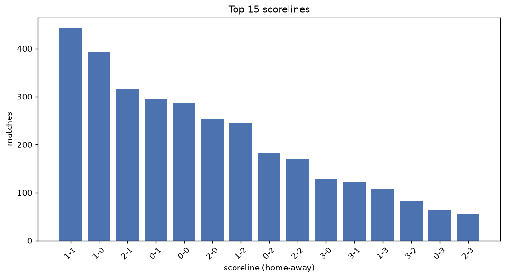
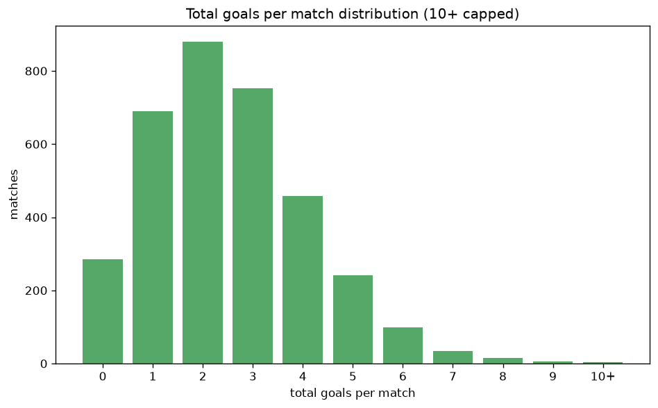

# Scoreline Analysis
- Report: `scoreline_analysis`
- Generated: 2026-10-26T01:31:17+00:00
- Script: `backend/scripts/analyze_scorelines.py` v1.0.0
- League: League Two (England)
- Scope: league `eng2`

## 1. Scoreline frequency
- Matches analysed: **3466** across **7** seasons.
- Distinct scorelines seen: **46**.

| scoreline | count | pct |
|---|---|---|
| 1-1 | 443 | 12.8% |
| 1-0 | 394 | 11.4% |
| 2-1 | 316 | 9.1% |
| 0-1 | 296 | 8.5% |
| 0-0 | 286 | 8.3% |
| 2-0 | 254 | 7.3% |
| 1-2 | 246 | 7.1% |
| 0-2 | 183 | 5.3% |
| 2-2 | 170 | 4.9% |
| 3-0 | 127 | 3.7% |
| 3-1 | 121 | 3.5% |
| 1-3 | 107 | 3.1% |
| 3-2 | 82 | 2.4% |
| 0-3 | 63 | 1.8% |
| 2-3 | 56 | 1.6% |
| 4-1 | 42 | 1.2% |
| 4-0 | 40 | 1.2% |
| 3-3 | 39 | 1.1% |
| 1-4 | 38 | 1.1% |
| 4-2 | 23 | 0.7% |

## 2. Scoreline frequency per season

### 2020-2021
| scoreline | count | pct |
|---|---|---|
| 1-1 | 70 | 12.7% |
| 1-0 | 66 | 12.0% |
| 0-1 | 63 | 11.4% |
| 2-1 | 58 | 10.5% |
| 0-0 | 57 | 10.3% |

### 2021-2022
| scoreline | count | pct |
|---|---|---|
| 1-1 | 67 | 12.1% |
| 1-0 | 56 | 10.1% |
| 0-0 | 51 | 9.2% |
| 2-1 | 51 | 9.2% |
| 2-0 | 50 | 9.1% |

### 2022-2023
| scoreline | count | pct |
|---|---|---|
| 1-1 | 76 | 13.8% |
| 1-0 | 70 | 12.7% |
| 0-0 | 54 | 9.8% |
| 2-1 | 50 | 9.1% |
| 0-1 | 48 | 8.7% |

### 2023-2024
| scoreline | count | pct |
|---|---|---|
| 1-1 | 67 | 12.1% |
| 2-1 | 54 | 9.8% |
| 1-0 | 53 | 9.6% |
| 1-2 | 41 | 7.4% |
| 2-0 | 40 | 7.2% |

### 2024-2025
| scoreline | count | pct |
|---|---|---|
| 1-1 | 72 | 13.0% |
| 1-0 | 63 | 11.4% |
| 0-1 | 52 | 9.4% |
| 0-0 | 48 | 8.7% |
| 2-1 | 46 | 8.3% |

### 2025-2026
| scoreline | count | pct |
|---|---|---|
| 1-0 | 68 | 12.2% |
| 1-1 | 66 | 11.8% |
| 0-1 | 48 | 8.6% |
| 2-1 | 46 | 8.3% |
| 1-2 | 46 | 8.3% |

### 2026-2027
| scoreline | count | pct |
|---|---|---|
| 1-1 | 25 | 16.8% |
| 2-0 | 18 | 12.1% |
| 1-0 | 18 | 12.1% |
| 0-0 | 12 | 8.1% |
| 2-2 | 12 | 8.1% |

## 3. Total-goal histogram
_10+ groups all matches with 10 or more total goals._

| total goals | matches | pct |
|---|---|---|
| 0 | 286 | 8.3% |
| 1 | 690 | 19.9% |
| 2 | 880 | 25.4% |
| 3 | 752 | 21.7% |
| 4 | 458 | 13.2% |
| 5 | 242 | 7.0% |
| 6 | 98 | 2.8% |
| 7 | 34 | 1.0% |
| 8 | 16 | 0.5% |
| 9 | 6 | 0.2% |
| 10+ | 4 | 0.1% |

## 4. Extreme scorelines
- Matches with 7+ total goals: **60**

| season | date | scoreline | total goals |
|---|---|---|---|
| 2023-2024 | 2024-02-13 | 9-2 | 11 |
| 2021-2022 | 2021-12-11 | 5-5 | 10 |
| 2023-2024 | 2023-08-19 | 5-5 | 10 |
| 2023-2024 | 2024-01-13 | 5-5 | 10 |
| 2020-2021 | 2020-12-05 | 3-6 | 9 |
| 2020-2021 | 2021-04-30 | 5-4 | 9 |
| 2021-2022 | 2021-08-21 | 6-3 | 9 |
| 2023-2024 | 2023-09-30 | 5-4 | 9 |
| 2024-2025 | 2024-12-21 | 6-3 | 9 |
| 2024-2025 | 2025-04-12 | 5-4 | 9 |
| 2020-2021 | 2020-12-05 | 5-3 | 8 |
| 2022-2023 | 2023-03-18 | 4-4 | 8 |
| 2023-2024 | 2023-08-05 | 3-5 | 8 |
| 2023-2024 | 2023-09-09 | 5-3 | 8 |
| 2023-2024 | 2023-12-16 | 8-0 | 8 |
| 2023-2024 | 2023-12-29 | 5-3 | 8 |
| 2023-2024 | 2024-02-17 | 5-3 | 8 |
| 2023-2024 | 2024-03-12 | 5-3 | 8 |
| 2023-2024 | 2024-04-20 | 3-5 | 8 |
| 2023-2024 | 2024-04-27 | 4-4 | 8 |
| 2024-2025 | 2024-10-01 | 2-6 | 8 |
| 2024-2025 | 2024-12-29 | 3-5 | 8 |
| 2025-2026 | 2025-09-27 | 7-1 | 8 |
| 2025-2026 | 2025-10-04 | 6-2 | 8 |
| 2025-2026 | 2026-04-25 | 6-2 | 8 |
| 2026-2027 | 2026-08-22 | 5-3 | 8 |
| 2020-2021 | 2020-11-14 | 3-4 | 7 |
| 2020-2021 | 2020-11-24 | 3-4 | 7 |
| 2020-2021 | 2020-11-24 | 6-1 | 7 |
| 2020-2021 | 2020-12-01 | 2-5 | 7 |
| 2020-2021 | 2020-12-19 | 4-3 | 7 |
| 2020-2021 | 2021-02-16 | 4-3 | 7 |
| 2020-2021 | 2021-04-09 | 5-2 | 7 |
| 2020-2021 | 2021-04-17 | 4-3 | 7 |
| 2021-2022 | 2021-10-09 | 4-3 | 7 |
| 2021-2022 | 2021-10-09 | 6-1 | 7 |
| 2021-2022 | 2022-01-01 | 5-2 | 7 |
| 2021-2022 | 2022-02-15 | 4-3 | 7 |
| 2021-2022 | 2022-04-30 | 3-4 | 7 |
| 2021-2022 | 2022-05-07 | 7-0 | 7 |
| 2022-2023 | 2022-08-16 | 5-2 | 7 |
| 2022-2023 | 2022-10-29 | 2-5 | 7 |
| 2022-2023 | 2022-12-29 | 4-3 | 7 |
| 2022-2023 | 2023-02-25 | 2-5 | 7 |
| 2022-2023 | 2023-02-25 | 2-5 | 7 |
| 2022-2023 | 2023-03-10 | 4-3 | 7 |
| 2023-2024 | 2023-08-19 | 3-4 | 7 |
| 2023-2024 | 2023-09-23 | 4-3 | 7 |
| 2023-2024 | 2023-11-28 | 3-4 | 7 |
| 2023-2024 | 2024-01-01 | 1-6 | 7 |
| 2023-2024 | 2024-02-27 | 3-4 | 7 |
| 2023-2024 | 2024-04-16 | 2-5 | 7 |
| 2024-2025 | 2024-10-26 | 2-5 | 7 |
| 2024-2025 | 2024-12-03 | 5-2 | 7 |
| 2024-2025 | 2024-12-26 | 5-2 | 7 |
| 2024-2025 | 2025-02-06 | 5-2 | 7 |
| 2025-2026 | 2025-11-29 | 4-3 | 7 |
| 2025-2026 | 2025-12-13 | 4-3 | 7 |
| 2025-2026 | 2026-03-21 | 5-2 | 7 |
| 2025-2026 | 2026-04-06 | 2-5 | 7 |

## 5. Margin-of-victory distribution (decided matches)
- Decided matches: **2523** (draws: **943**)
- Average winning margin: **1.66**

| margin | matches | pct |
|---|---|---|
| 1 | 1409 | 55.8% |
| 2 | 712 | 28.2% |
| 3+ | 402 | 15.9% |

## 6. Margin by outcome

### Home wins
- Matches: **1466** | avg margin: **1.71** | max margin: **8**
| margin | matches | pct |
|---|---|---|
| 1 | 805 | 54.9% |
| 2 | 404 | 27.6% |
| 3+ | 257 | 17.5% |
- *Full match-by-match list available in `scoreline_analysis.json`.*

### Away wins
- Matches: **1057** | avg margin: **1.61** | max margin: **5**
| margin | matches | pct |
|---|---|---|
| 1 | 604 | 57.1% |
| 2 | 308 | 29.1% |
| 3+ | 145 | 13.7% |
- *Full match-by-match list available in `scoreline_analysis.json`.*

## 7. Most common exact score by outcome type
| outcome | matches | most common score | count | pct |
|---|---|---|---|---|
| home | 1466 | 1-0 | 394 | 26.9% |
| draw | 943 | 1-1 | 443 | 47.0% |
| away | 1057 | 0-1 | 296 | 28.0% |

---
*All statistics are computed from PostgreSQL tables (read-only). Run with `python backend/scripts/analyze_scorelines.py` to regenerate.*

## Charts

