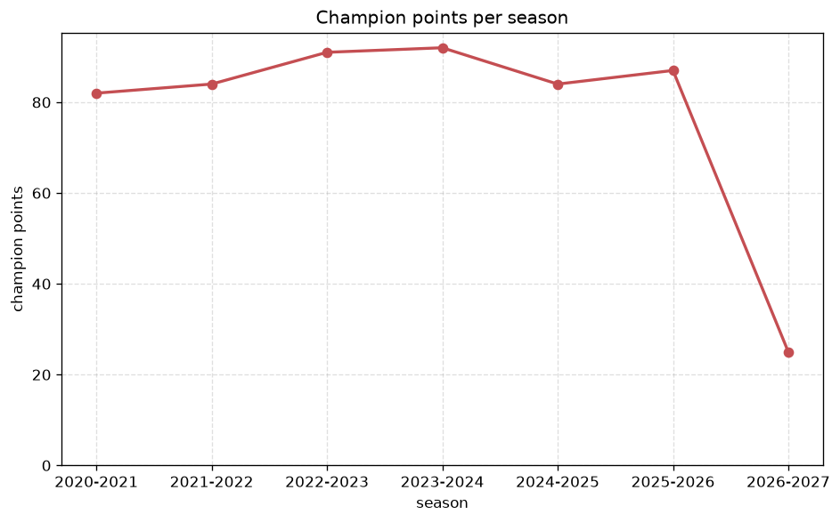
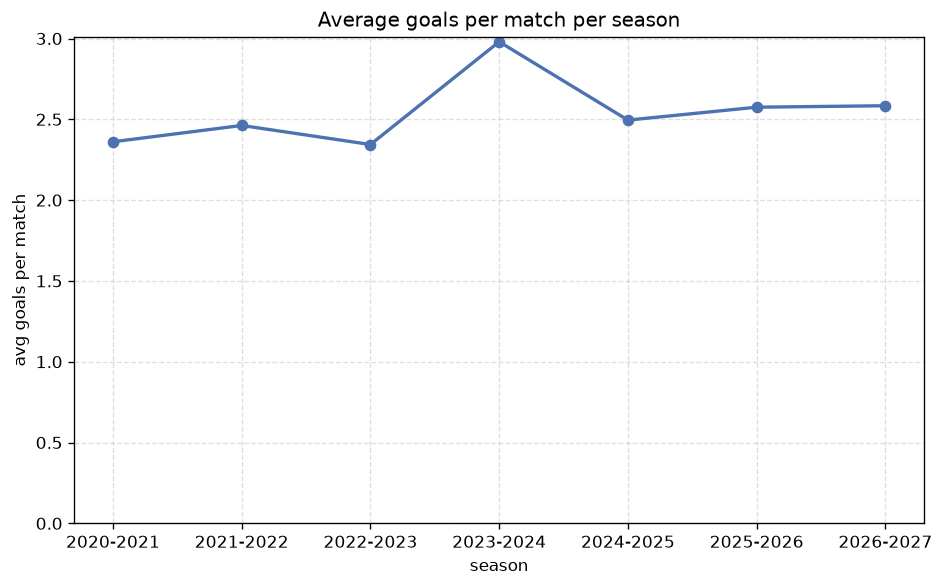

# Season Trends Analysis
- Report: `season_trends`
- Generated: 2026-10-27T01:46:27+00:00
- Script: `backend/scripts/analyze_seasons.py` v1.0.0
- League: League Two (England)
- Scope: league `eng2`

## 1. Champions per season
| season | champion | pts | runner-up | margin |
|---|---|---|---|---|
| 2020-2021 | Cheltenham | 82 | Cambridge Utd | 2 pts |
| 2021-2022 | Forest Green | 84 | Exeter | 0 pts |
| 2022-2023 | Leyton Orient | 91 | Stevenage | 6 pts |
| 2023-2024 | Stockport County | 92 | Wrexham | 4 pts |
| 2024-2025 | Doncaster | 84 | Port Vale | 4 pts |
| 2025-2026 | Notts Co | 87 | Bromley | 0 pts |
| 2026-2027 | Salford | 25 | Barnet | 3 pts |

## 2. Title-race tightness
- Tight races (margin <= 3 pts): **4** of 7 seasons
- Tightest race: **2021-2022** - Forest Green beat Exeter by **0** pts

| season | margin | tight |
|---|---|---|
| 2020-2021 | 2 pts | yes |
| 2021-2022 | 0 pts | yes |
| 2022-2023 | 6 pts |  |
| 2023-2024 | 4 pts |  |
| 2024-2025 | 4 pts |  |
| 2025-2026 | 0 pts | yes |
| 2026-2027 | 3 pts | yes |

## 3. Points thresholds
_Position-specific points per season. Key: 1 = champion, 2 = runner-up, 4 = CL line, 6 = Europa, 21 = last safe, 24 = bottom._

| season | pos 1 | pos 2 | pos 4 | pos 6 | pos 21 | pos 24 |
|---|---|---|---|---|---|---|
| 2020-2021 | 82 | 80 | 78 | 73 | 50 | 43 |
| 2021-2022 | 84 | 84 | 80 | 77 | 47 | 26 |
| 2022-2023 | 91 | 85 | 79 | 76 | 48 | 38 |
| 2023-2024 | 92 | 88 | 78 | 71 | 49 | 42 |
| 2024-2025 | 84 | 80 | 77 | 72 | 50 | 36 |
| 2025-2026 | 87 | 87 | 84 | 80 | 41 | 36 |
| 2026-2027 | 25 | 22 | 21 | 19 | 12 | 6 |

## 4. Relegation battle
| season | safe pos | safe pts | drop pos | drop pts | gap |
|---|---|---|---|---|---|
| 2020-2021 | 21 | 50 | 22 | 48 | 2 pts |
| 2021-2022 | 21 | 47 | 22 | 44 | 3 pts |
| 2022-2023 | 21 | 48 | 22 | 46 | 2 pts |
| 2023-2024 | 21 | 49 | 22 | 45 | 4 pts |
| 2024-2025 | 21 | 50 | 22 | 49 | 1 pts |
| 2025-2026 | 21 | 41 | 22 | 40 | 1 pts |
| 2026-2027 | 21 | 12 | 22 | 12 | 0 pts |

## 5. League-level trends
| season | matches | total goals | avg goals | home win | draw | away win | goalless | avg pts/team |
|---|---|---|---|---|---|---|---|---|
| 2020-2021 | 552 | 1303 | 2.361 | 40.4% | 27.4% | 32.2% | 10.3% | 62.71 |
| 2021-2022 | 552 | 1359 | 2.462 | 41.8% | 27.5% | 30.6% | 9.2% | 62.67 |
| 2022-2023 | 552 | 1294 | 2.344 | 41.5% | 29.0% | 29.5% | 9.8% | 62.33 |
| 2023-2024 | 552 | 1645 | 2.98 | 44.9% | 23.7% | 31.3% | 4.9% | 63.54 |
| 2024-2025 | 552 | 1377 | 2.495 | 42.0% | 28.6% | 29.3% | 8.7% | 62.42 |
| 2025-2026 | 557 | 1434 | 2.575 | 41.8% | 25.0% | 33.2% | 6.6% | 63.75 |
| 2026-2027 | 149 | 385 | 2.584 | 47.0% | 34.9% | 18.1% | 8.1% | 16.46 |

## 6. View divergence
- Largest divergence: **2022-2023** (goals view, avg abs position diff = 9.250)

_Avg absolute position difference between classic view and alternative view per season._

| season | classic vs luck | classic vs goals |
|---|---|---|
| 2020-2021 | 4.000 | 7.250 |
| 2021-2022 | 2.500 | 7.167 |
| 2022-2023 | 3.917 | 9.250 |
| 2023-2024 | 4.167 | 8.250 |
| 2024-2025 | 5.333 | 7.917 |
| 2025-2026 | 2.500 | 7.333 |
| 2026-2027 | 3.500 | 6.083 |

---
*All statistics are computed from PostgreSQL tables (read-only). Run with `python backend/scripts/analyze_seasons.py` to regenerate.*

## Charts

