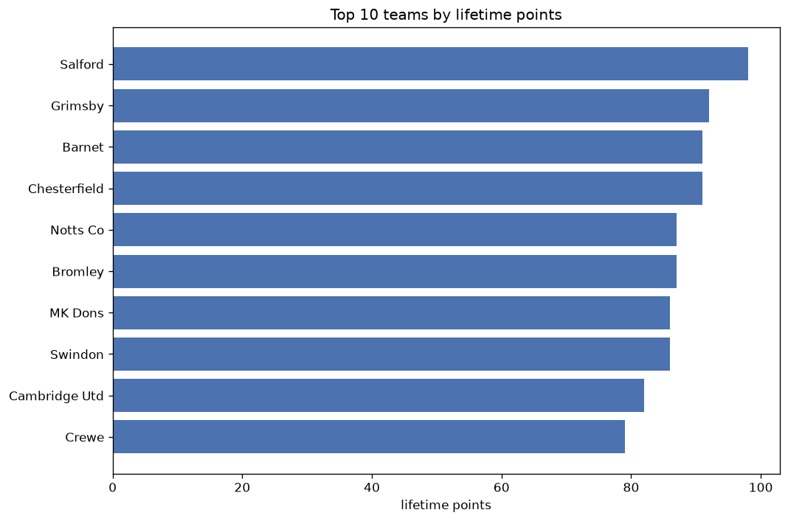
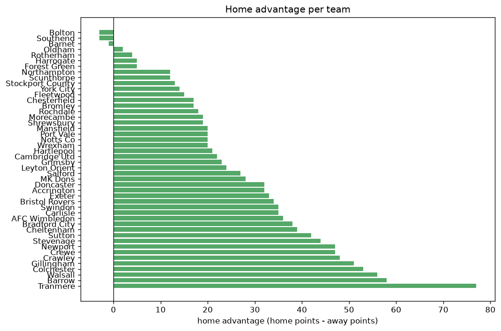

# Team Analysis
- Report: `teams_analysis`
- Generated: 2026-10-30T03:50:02+00:00
- Script: `backend/scripts/analyze_teams.py` v1.0.0
- League: League Two (England)
- Scope: league `eng2`

- Teams: **46** | Seasons: **7** | Matches: **3468**

## 1. Team standings (lifetime)
| team | seasons | played | W | D | L | pts | GF | GA | GD | avg pts/season | best pos | worst pos | titles |
|---|---|---|---|---|---|---|---|---|---|---|---|---|---|
| Salford | 7 | 292 | 126 | 71 | 95 | 449 | 404 | 341 | 63 | 64.14 | 1 | 20 | 1 |
| Walsall | 7 | 288 | 98 | 94 | 96 | 388 | 356 | 356 | 0 | 55.43 | 4 | 19 | 0 |
| Tranmere | 7 | 289 | 98 | 77 | 114 | 371 | 335 | 368 | -33 | 53.0 | 7 | 21 | 0 |
| Newport | 7 | 289 | 97 | 70 | 122 | 361 | 355 | 401 | -46 | 51.57 | 5 | 22 | 0 |
| Swindon | 6 | 243 | 93 | 66 | 84 | 345 | 369 | 330 | 39 | 57.5 | 6 | 19 | 0 |
| Colchester | 7 | 288 | 84 | 93 | 111 | 345 | 320 | 364 | -44 | 49.29 | 10 | 22 | 0 |
| Bradford City | 5 | 230 | 91 | 67 | 72 | 340 | 287 | 255 | 32 | 68.0 | 3 | 15 | 0 |
| Barrow | 6 | 276 | 83 | 71 | 122 | 320 | 303 | 353 | -50 | 53.33 | 8 | 24 | 0 |
| Grimsby | 6 | 245 | 83 | 68 | 94 | 317 | 300 | 336 | -36 | 52.83 | 7 | 24 | 0 |
| Harrogate | 6 | 276 | 83 | 68 | 125 | 317 | 317 | 402 | -85 | 52.83 | 13 | 23 | 0 |
| Mansfield | 4 | 184 | 80 | 56 | 48 | 296 | 286 | 209 | 77 | 74.0 | 3 | 16 | 0 |
| Crawley | 6 | 241 | 74 | 62 | 105 | 284 | 289 | 355 | -66 | 47.33 | 7 | 24 | 0 |
| Crewe | 5 | 197 | 72 | 63 | 62 | 279 | 246 | 247 | -1 | 55.8 | 4 | 13 | 0 |
| Gillingham | 5 | 197 | 63 | 58 | 76 | 247 | 194 | 242 | -48 | 49.4 | 12 | 17 | 0 |
| Carlisle | 4 | 184 | 62 | 51 | 71 | 237 | 209 | 227 | -18 | 59.25 | 5 | 23 | 0 |
| Port Vale | 4 | 149 | 64 | 38 | 47 | 230 | 195 | 161 | 34 | 57.5 | 2 | 23 | 0 |
| Notts Co | 3 | 141 | 64 | 28 | 49 | 220 | 235 | 187 | 48 | 73.33 | 1 | 14 | 1 |
| MK Dons | 3 | 138 | 61 | 33 | 44 | 216 | 221 | 179 | 42 | 72.0 | 3 | 19 | 0 |
| Cheltenham | 4 | 151 | 60 | 35 | 56 | 215 | 196 | 210 | -14 | 53.75 | 1 | 18 | 1 |
| Leyton Orient | 3 | 138 | 57 | 39 | 42 | 210 | 176 | 136 | 40 | 70.0 | 1 | 13 | 1 |
| Doncaster | 3 | 138 | 61 | 27 | 50 | 210 | 192 | 183 | 9 | 70.0 | 1 | 18 | 1 |
| Forest Green | 3 | 138 | 54 | 37 | 47 | 199 | 178 | 173 | 5 | 66.33 | 1 | 24 | 1 |
| Stevenage | 3 | 138 | 49 | 45 | 44 | 192 | 147 | 148 | -1 | 64.0 | 2 | 21 | 0 |
| AFC Wimbledon | 3 | 138 | 48 | 42 | 48 | 186 | 168 | 146 | 22 | 62.0 | 5 | 21 | 0 |
| Accrington | 4 | 151 | 46 | 40 | 65 | 178 | 185 | 214 | -29 | 44.5 | 9 | 21 | 0 |
| Northampton | 3 | 103 | 49 | 29 | 25 | 176 | 130 | 88 | 42 | 58.67 | 3 | 19 | 0 |
| Sutton | 3 | 138 | 46 | 38 | 54 | 176 | 174 | 195 | -21 | 58.67 | 8 | 23 | 0 |
| Morecambe | 3 | 138 | 50 | 25 | 63 | 175 | 176 | 211 | -35 | 58.33 | 4 | 24 | 0 |
| Exeter | 3 | 105 | 46 | 35 | 24 | 173 | 146 | 98 | 48 | 57.67 | 2 | 9 | 0 |
| Oldham | 4 | 150 | 45 | 37 | 68 | 172 | 192 | 218 | -26 | 43.0 | 10 | 23 | 0 |
| Stockport County | 2 | 92 | 49 | 24 | 19 | 171 | 161 | 85 | 76 | 85.5 | 1 | 4 | 1 |
| Chesterfield | 3 | 107 | 45 | 34 | 28 | 169 | 167 | 128 | 39 | 56.33 | 6 | 7 | 0 |
| Cambridge Utd | 2 | 92 | 46 | 24 | 22 | 162 | 139 | 82 | 57 | 81.0 | 2 | 5 | 0 |
| Bristol Rovers | 3 | 105 | 47 | 17 | 41 | 158 | 143 | 134 | 9 | 52.67 | 3 | 15 | 0 |
| Bromley | 2 | 92 | 41 | 30 | 21 | 153 | 135 | 105 | 30 | 76.5 | 2 | 11 | 0 |
| Fleetwood | 3 | 105 | 33 | 36 | 36 | 135 | 132 | 135 | -3 | 45.0 | 14 | 18 | 0 |
| Rochdale | 3 | 105 | 25 | 31 | 49 | 106 | 112 | 151 | -39 | 35.33 | 17 | 24 | 0 |
| Barnet | 2 | 58 | 28 | 17 | 13 | 101 | 97 | 70 | 27 | 50.5 | 2 | 8 | 0 |
| Hartlepool | 2 | 92 | 23 | 28 | 41 | 97 | 96 | 142 | -46 | 48.5 | 17 | 23 | 0 |
| Wrexham | 1 | 46 | 26 | 10 | 10 | 88 | 89 | 52 | 37 | 88.0 | 2 | 2 | 0 |
| Bolton | 1 | 46 | 23 | 10 | 13 | 79 | 59 | 50 | 9 | 79.0 | 3 | 3 | 0 |
| Scunthorpe | 2 | 92 | 17 | 23 | 52 | 74 | 70 | 154 | -84 | 37.0 | 22 | 24 | 0 |
| Shrewsbury | 2 | 59 | 18 | 13 | 28 | 67 | 58 | 89 | -31 | 33.5 | 10 | 19 | 0 |
| Southend | 1 | 46 | 10 | 15 | 21 | 45 | 29 | 58 | -29 | 45.0 | 23 | 23 | 0 |
| York City | 1 | 13 | 5 | 5 | 3 | 20 | 22 | 16 | 6 | 20.0 | 5 | 5 | 0 |
| Rotherham | 1 | 13 | 2 | 6 | 5 | 12 | 17 | 23 | -6 | 12.0 | 22 | 22 | 0 |

## 2. Home vs away split
| team | home P | H-W | H-D | H-L | H-pts | away P | A-W | A-D | A-L | A-pts | adv |
|---|---|---|---|---|---|---|---|---|---|---|---|
| Tranmere | 144 | 63 | 35 | 46 | 224 | 145 | 35 | 42 | 68 | 147 | 77 |
| Barrow | 138 | 50 | 39 | 49 | 189 | 138 | 33 | 32 | 73 | 131 | 58 |
| Walsall | 144 | 61 | 39 | 44 | 222 | 144 | 37 | 55 | 52 | 166 | 56 |
| Colchester | 143 | 50 | 49 | 44 | 199 | 145 | 34 | 44 | 67 | 146 | 53 |
| Gillingham | 99 | 40 | 29 | 30 | 149 | 98 | 23 | 29 | 46 | 98 | 51 |
| Crawley | 121 | 44 | 34 | 43 | 166 | 120 | 30 | 28 | 62 | 118 | 48 |
| Newport | 144 | 56 | 36 | 52 | 204 | 145 | 41 | 34 | 70 | 157 | 47 |
| Crewe | 98 | 46 | 25 | 27 | 163 | 99 | 26 | 38 | 35 | 116 | 47 |
| Stevenage | 69 | 34 | 16 | 19 | 118 | 69 | 15 | 29 | 25 | 74 | 44 |
| Sutton | 69 | 30 | 19 | 20 | 109 | 69 | 16 | 19 | 34 | 67 | 42 |
| Cheltenham | 76 | 37 | 16 | 23 | 127 | 75 | 23 | 19 | 33 | 88 | 39 |
| Bradford City | 115 | 50 | 39 | 26 | 189 | 115 | 41 | 28 | 46 | 151 | 38 |
| AFC Wimbledon | 69 | 31 | 18 | 20 | 111 | 69 | 17 | 24 | 28 | 75 | 36 |
| Swindon | 121 | 52 | 34 | 35 | 190 | 122 | 41 | 32 | 49 | 155 | 35 |
| Carlisle | 92 | 36 | 28 | 28 | 136 | 92 | 26 | 23 | 43 | 101 | 35 |
| Bristol Rovers | 53 | 30 | 6 | 17 | 96 | 52 | 17 | 11 | 24 | 62 | 34 |
| Exeter | 53 | 29 | 16 | 8 | 103 | 52 | 17 | 19 | 16 | 70 | 33 |
| Doncaster | 69 | 37 | 10 | 22 | 121 | 69 | 24 | 17 | 28 | 89 | 32 |
| Accrington | 75 | 27 | 24 | 24 | 105 | 76 | 19 | 16 | 41 | 73 | 32 |
| MK Dons | 69 | 35 | 17 | 17 | 122 | 69 | 26 | 16 | 27 | 94 | 28 |
| Salford | 145 | 65 | 43 | 37 | 238 | 147 | 61 | 28 | 58 | 211 | 27 |
| Leyton Orient | 69 | 33 | 18 | 18 | 117 | 69 | 24 | 21 | 24 | 93 | 24 |
| Grimsby | 122 | 46 | 32 | 44 | 170 | 123 | 37 | 36 | 50 | 147 | 23 |
| Cambridge Utd | 46 | 27 | 11 | 8 | 92 | 46 | 19 | 13 | 14 | 70 | 22 |
| Hartlepool | 46 | 14 | 17 | 15 | 59 | 46 | 9 | 11 | 26 | 38 | 21 |
| Mansfield | 92 | 43 | 29 | 20 | 158 | 92 | 37 | 27 | 28 | 138 | 20 |
| Port Vale | 74 | 35 | 20 | 19 | 125 | 75 | 29 | 18 | 28 | 105 | 20 |
| Notts Co | 71 | 36 | 12 | 23 | 120 | 70 | 28 | 16 | 26 | 100 | 20 |
| Wrexham | 23 | 17 | 3 | 3 | 54 | 23 | 9 | 7 | 7 | 34 | 20 |
| Morecambe | 69 | 27 | 16 | 26 | 97 | 69 | 23 | 9 | 37 | 78 | 19 |
| Shrewsbury | 29 | 12 | 7 | 10 | 43 | 30 | 6 | 6 | 18 | 24 | 19 |
| Rochdale | 53 | 15 | 17 | 21 | 62 | 52 | 10 | 14 | 28 | 44 | 18 |
| Chesterfield | 54 | 24 | 21 | 9 | 93 | 53 | 21 | 13 | 19 | 76 | 17 |
| Bromley | 46 | 23 | 16 | 7 | 85 | 46 | 18 | 14 | 14 | 68 | 17 |
| Fleetwood | 52 | 17 | 24 | 11 | 75 | 53 | 16 | 12 | 25 | 60 | 15 |
| York City | 7 | 5 | 2 | 0 | 17 | 6 | 0 | 3 | 3 | 3 | 14 |
| Stockport County | 46 | 26 | 14 | 6 | 92 | 46 | 23 | 10 | 13 | 79 | 13 |
| Northampton | 52 | 27 | 13 | 12 | 94 | 51 | 22 | 16 | 13 | 82 | 12 |
| Scunthorpe | 46 | 10 | 13 | 23 | 43 | 46 | 7 | 10 | 29 | 31 | 12 |
| Harrogate | 138 | 43 | 32 | 63 | 161 | 138 | 40 | 36 | 62 | 156 | 5 |
| Forest Green | 69 | 29 | 15 | 25 | 102 | 69 | 25 | 22 | 22 | 97 | 5 |
| Rotherham | 7 | 1 | 5 | 1 | 8 | 6 | 1 | 1 | 4 | 4 | 4 |
| Oldham | 75 | 24 | 15 | 36 | 87 | 75 | 21 | 22 | 32 | 85 | 2 |
| Barnet | 30 | 14 | 8 | 8 | 50 | 28 | 14 | 9 | 5 | 51 | -1 |
| Bolton | 23 | 11 | 5 | 7 | 38 | 23 | 12 | 5 | 6 | 41 | -3 |
| Southend | 23 | 5 | 6 | 12 | 21 | 23 | 5 | 9 | 9 | 24 | -3 |

## 3. Top performers
### Best points per game (PPG)
| rank | team | PPG |
|---|---|---|
| 1 | Wrexham | 1.91 |
| 2 | Stockport County | 1.86 |
| 3 | Cambridge Utd | 1.76 |
| 4 | Barnet | 1.74 |
| 5 | Bolton | 1.72 |

### Most goals scored
| rank | team | goals |
|---|---|---|
| 1 | Salford | 404 |
| 2 | Swindon | 369 |
| 3 | Walsall | 356 |
| 4 | Newport | 355 |
| 5 | Tranmere | 335 |

### Best goal difference
| rank | team | GD |
|---|---|---|
| 1 | Mansfield | 77 |
| 2 | Stockport County | 76 |
| 3 | Salford | 63 |
| 4 | Cambridge Utd | 57 |
| 5 | Notts Co | 48 |

### Best defence (goals against per match, standings)
| rank | team | GA/match |
|---|---|---|
| 1 | Northampton | 0.854 |
| 2 | Cambridge Utd | 0.891 |
| 3 | Stockport County | 0.924 |
| 4 | Exeter | 0.933 |
| 5 | Leyton Orient | 0.986 |

## 4. Team consistency
- Teams present in all **7** seasons: **5**

Colchester, Newport, Salford, Tranmere, Walsall

## 5. Head-to-head dominance
- Distinct fixtures: **801** (showing the 15 most frequent)

| fixture | meetings | home wins | draws | away wins | home pct | draw pct | away pct |
|---|---|---|---|---|---|---|---|
| Newport vs Tranmere | 13 | 7 | 2 | 4 | 53.8% | 15.4% | 30.8% |
| Salford vs Walsall | 13 | 7 | 1 | 5 | 53.8% | 7.7% | 38.5% |
| Tranmere vs Walsall | 13 | 7 | 2 | 4 | 53.8% | 15.4% | 30.8% |
| Newport vs Colchester | 13 | 6 | 3 | 4 | 46.2% | 23.1% | 30.8% |
| Newport vs Salford | 13 | 5 | 3 | 5 | 38.5% | 23.1% | 38.5% |
| Harrogate vs Colchester | 12 | 7 | 1 | 4 | 58.3% | 8.3% | 33.3% |
| Newport vs Barrow | 12 | 7 | 2 | 3 | 58.3% | 16.7% | 25.0% |
| Newport vs Harrogate | 12 | 6 | 1 | 5 | 50.0% | 8.3% | 41.7% |
| Harrogate vs Barrow | 12 | 5 | 2 | 5 | 41.7% | 16.7% | 41.7% |
| Tranmere vs Colchester | 12 | 5 | 5 | 2 | 41.7% | 41.7% | 16.7% |
| Tranmere vs Harrogate | 12 | 5 | 3 | 4 | 41.7% | 25.0% | 33.3% |
| Walsall vs Colchester | 12 | 5 | 6 | 1 | 41.7% | 50.0% | 8.3% |
| Salford vs Barrow | 12 | 4 | 5 | 3 | 33.3% | 41.7% | 25.0% |
| Salford vs Colchester | 12 | 4 | 3 | 5 | 33.3% | 25.0% | 41.7% |
| Salford vs Harrogate | 12 | 4 | 3 | 5 | 33.3% | 25.0% | 41.7% |

## 6. Position per season (classic view)
_Cells show final position; '-' when the team was absent from that season._

| team | 2020-2021 | 2021-2022 | 2022-2023 | 2023-2024 | 2024-2025 | 2025-2026 | 2026-2027 |
|---|---|---|---|---|---|---|---|
| Salford | 8 | 10 | 7 | 20 | 8 | 4 | 1 |
| Walsall | 19 | 16 | 16 | 11 | 4 | 13 | 6 |
| Tranmere | 7 | 9 | 12 | 16 | 20 | 21 | 13 |
| Newport | 5 | 11 | 15 | 18 | 22 | 20 | 16 |
| Swindon | - | 6 | 10 | 19 | 12 | 9 | 14 |
| Colchester | 20 | 15 | 20 | 22 | 10 | 12 | 21 |
| Bradford City | 15 | 14 | 6 | 9 | 3 | - | - |
| Barrow | 21 | 22 | 9 | 8 | 16 | 24 | - |
| Grimsby | 24 | - | 11 | 21 | 9 | 7 | 11 |
| Harrogate | 17 | 19 | 19 | 13 | 18 | 23 | - |
| Mansfield | 16 | 7 | 8 | 3 | - | - | - |
| Crawley | 12 | 12 | 22 | 7 | - | 22 | 24 |
| Crewe | - | - | 13 | 6 | 13 | 11 | 4 |
| Gillingham | - | - | 17 | 12 | 17 | 17 | 12 |
| Carlisle | 10 | 20 | 5 | - | 23 | - | - |
| Port Vale | 13 | 5 | - | - | 2 | - | 23 |
| Notts Co | - | - | - | 14 | 6 | 1 | - |
| MK Dons | - | - | - | 4 | 19 | 3 | - |
| Cheltenham | 1 | - | - | - | 15 | 18 | 3 |
| Leyton Orient | 11 | 13 | 1 | - | - | - | - |
| Doncaster | - | - | 18 | 5 | 1 | - | - |
| Forest Green | 6 | 1 | - | 24 | - | - | - |
| Stevenage | 14 | 21 | 2 | - | - | - | - |
| AFC Wimbledon | - | - | 21 | 10 | 5 | - | - |
| Accrington | - | - | - | 17 | 21 | 16 | 9 |
| Northampton | - | 4 | 3 | - | - | - | 19 |
| Sutton | - | 8 | 14 | 23 | - | - | - |
| Morecambe | 4 | - | - | 15 | 24 | - | - |
| Exeter | 9 | 2 | - | - | - | - | 8 |
| Oldham | 18 | 23 | - | - | - | 10 | 20 |
| Stockport County | - | - | 4 | 1 | - | - | - |
| Chesterfield | - | - | - | - | 7 | 6 | 7 |
| Cambridge Utd | 2 | - | - | - | - | 5 | - |
| Bristol Rovers | - | 3 | - | - | - | 14 | 15 |
| Bromley | - | - | - | - | 11 | 2 | - |
| Fleetwood | - | - | - | - | 14 | 15 | 18 |
| Rochdale | - | 18 | 24 | - | - | - | 17 |
| Barnet | - | - | - | - | - | 8 | 2 |
| Hartlepool | - | 17 | 23 | - | - | - | - |
| Wrexham | - | - | - | 2 | - | - | - |
| Bolton | 3 | - | - | - | - | - | - |
| Scunthorpe | 22 | 24 | - | - | - | - | - |
| Shrewsbury | - | - | - | - | - | 19 | 10 |
| Southend | 23 | - | - | - | - | - | - |
| York City | - | - | - | - | - | - | 5 |
| Rotherham | - | - | - | - | - | - | 22 |

---
*All statistics are computed from PostgreSQL tables (read-only). Run with `python backend/scripts/analyze_teams.py` to regenerate.*

## Charts

