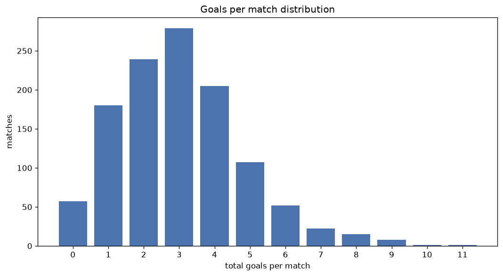
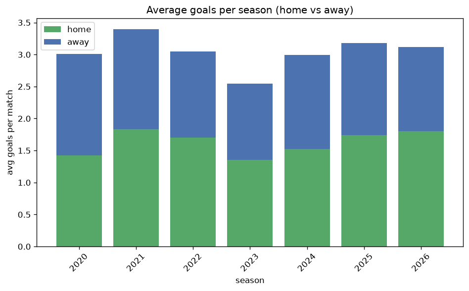

# Goal Analysis
- Report: `goals_analysis`
- Generated: 2026-10-26T01:31:27+00:00
- Script: `backend/scripts/analyze_goals.py` v1.0.0
- League: Meistriliiga (Estonia)
- Scope: league `estonia`

## 1. Goals per match distribution
| goals | matches | pct |
|---|---|---|
| 0 | 57 | 4.9% |
| 1 | 180 | 15.4% |
| 2 | 239 | 20.5% |
| 3 | 279 | 23.9% |
| 4 | 205 | 17.6% |
| 5 | 107 | 9.2% |
| 6 | 52 | 4.5% |
| 7 | 22 | 1.9% |
| 8 | 15 | 1.3% |
| 9 | 8 | 0.7% |
| 10 | 1 | 0.1% |
| 11 | 1 | 0.1% |

## 2. Goals per match per season
| season | matches | total goals | avg home | avg away | avg total |
|---|---|---|---|---|---|
| 2020 | 147 | 442 | 1.422 | 1.585 | 3.007 |
| 2021 | 134 | 455 | 1.836 | 1.56 | 3.396 |
| 2022 | 180 | 549 | 1.706 | 1.344 | 3.05 |
| 2023 | 180 | 458 | 1.356 | 1.189 | 2.544 |
| 2024 | 180 | 539 | 1.528 | 1.467 | 2.994 |
| 2025 | 180 | 572 | 1.739 | 1.439 | 3.178 |
| 2026 | 165 | 514 | 1.806 | 1.309 | 3.115 |

## 3. Home vs away goal share
- Home goals: **1892** (53.6%)
- Away goals: **1637** (46.4%)
- Home/away ratio: **1.156**

| season | home goals | away goals | total | home pct | away pct |
|---|---|---|---|---|---|
| 2020 | 209 | 233 | 442 | 47.3% | 52.7% |
| 2021 | 246 | 209 | 455 | 54.1% | 45.9% |
| 2022 | 307 | 242 | 549 | 55.9% | 44.1% |
| 2023 | 244 | 214 | 458 | 53.3% | 46.7% |
| 2024 | 275 | 264 | 539 | 51.0% | 49.0% |
| 2025 | 313 | 259 | 572 | 54.7% | 45.3% |
| 2026 | 298 | 216 | 514 | 58.0% | 42.0% |

## 4. BTTS (Both Teams To Score)
- Overall: **603** of `1166` (51.7%)

| season | matches | BTTS | pct |
|---|---|---|---|
| 2020 | 147 | 69 | 46.9% |
| 2021 | 134 | 76 | 56.7% |
| 2022 | 180 | 91 | 50.6% |
| 2023 | 180 | 84 | 46.7% |
| 2024 | 180 | 90 | 50.0% |
| 2025 | 180 | 99 | 55.0% |
| 2026 | 165 | 94 | 57.0% |

## 5. Clean sheets
- Home clean sheets: **334** (28.6%)
- Away clean sheets: **286** (24.5%)
- Total clean sheets recorded: **620**
- Matches with at least one clean sheet: **563** (48.3%)
- Both teams kept clean sheets (0-0): **57**

| season | matches | home CS | away CS | total CS | matches w/ CS |
|---|---|---|---|---|---|
| 2020 | 147 | 41 | 47 | 88 | 78 (53.1%) |
| 2021 | 134 | 31 | 32 | 63 | 58 (43.3%) |
| 2022 | 180 | 59 | 36 | 95 | 89 (49.4%) |
| 2023 | 180 | 60 | 53 | 113 | 96 (53.3%) |
| 2024 | 180 | 47 | 53 | 100 | 90 (50.0%) |
| 2025 | 180 | 49 | 36 | 85 | 81 (45.0%) |
| 2026 | 165 | 47 | 29 | 76 | 71 (43.0%) |

## 6. Scoring intensity
- First-half goals: **1619** (46.9%)
- Second-half goals: **1834** (53.1%)
- Avg first-half goals per match: **1.416**
- Avg second-half goals per match: **1.605**
- Second-half-only scoring (HT 0-0, FT goals >= 1): **225** (19.3%)
- *23 match(es) excluded (no HT score recorded).*

| season | matches | 1st half | 2nd half | 1st half pct | 2nd half pct |
|---|---|---|---|---|---|
| 2020 | 147 | 212 | 230 | 48.0% | 52.0% |
| 2021 | 134 | 201 | 254 | 44.2% | 55.8% |
| 2022 | 180 | 247 | 302 | 45.0% | 55.0% |
| 2023 | 180 | 212 | 246 | 46.3% | 53.7% |
| 2024 | 180 | 256 | 283 | 47.5% | 52.5% |
| 2025 | 180 | 243 | 253 | 49.0% | 51.0% |
| 2026 | 165 | 248 | 266 | 48.2% | 51.8% |

## 7. First-goal timing
- Matches with first-goal time recorded: `1109` of `1166` (95.1%)
- Goalless matches: `57`
- Min `1` | Max `97` | Mean `29.03` | Median (p50) `23`

| bucket | count | % of matches | % of scoring matches |
|---|---|---|---|
| 1-15 | 387 | 33.2% | 34.9% |
| 16-30 | 295 | 25.3% | 26.6% |
| 31-45 | 182 | 15.6% | 16.4% |
| 46-60 | 118 | 10.1% | 10.6% |
| 61-75 | 72 | 6.2% | 6.5% |
| 76-90 | 40 | 3.4% | 3.6% |
| 91-120 | 15 | 1.3% | 1.4% |

---
*All statistics are computed from PostgreSQL tables (read-only). Run with `python backend/scripts/analyze_goals.py` to regenerate.*

## Charts

