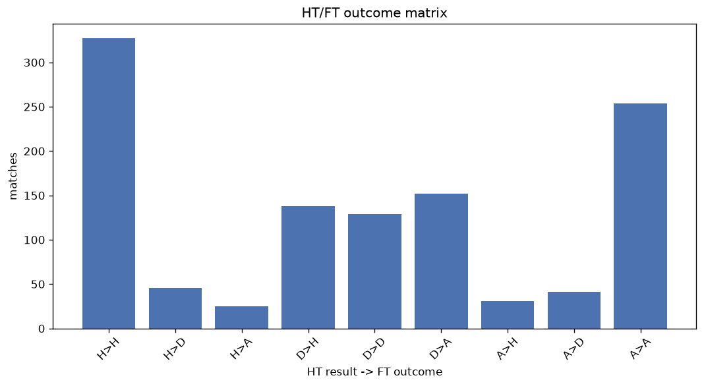
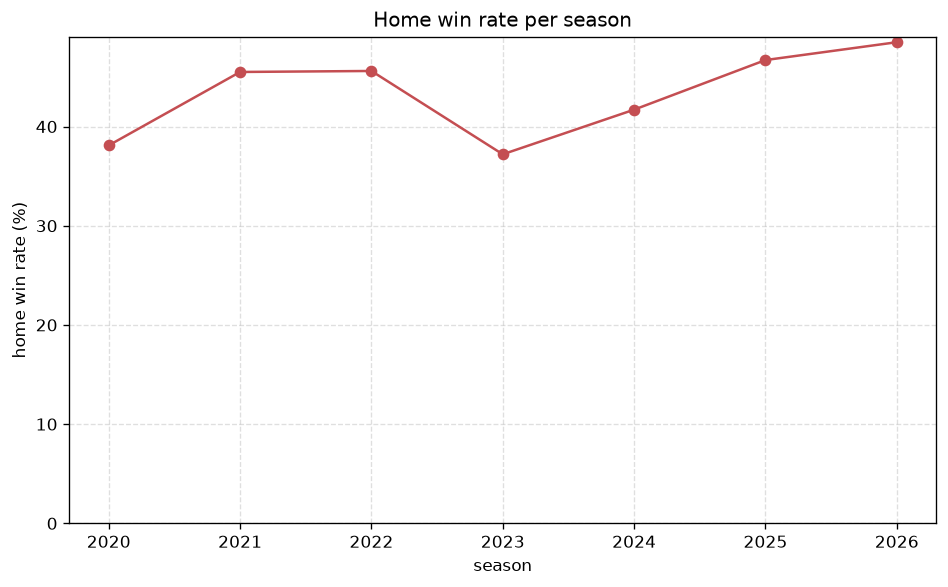

# Match Analysis
- Report: `matches_analysis`
- Generated: 2026-10-26T01:31:25+00:00
- Script: `backend/scripts/analyze_matches.py` v1.0.0
- League: Meistriliiga (Estonia)
- Scope: league `estonia`

## 1. Overall summary
| metric | value |
|---|---|
| Matches | 1166 |
| Home wins | 505 (43.3%) |
| Draws | 219 (18.8%) |
| Away wins | 442 (37.9%) |
| Total goals | 3529 |
| Average goals per match | 3.027 |
| Goalless matches | 57 (4.9%) |

## 2. Per-season breakdown
| season | matches | home wins | draws | away wins | total goals | avg goals | goalless |
|---|---|---|---|---|---|---|---|
| 2020 | 147 | 56 (38.1%) | 28 (19.0%) | 63 (42.9%) | 442 | 3.007 | 10 (6.8%) |
| 2021 | 134 | 61 (45.5%) | 22 (16.4%) | 51 (38.1%) | 455 | 3.396 | 5 (3.7%) |
| 2022 | 180 | 82 (45.6%) | 35 (19.4%) | 63 (35.0%) | 549 | 3.05 | 6 (3.3%) |
| 2023 | 180 | 67 (37.2%) | 50 (27.8%) | 63 (35.0%) | 458 | 2.544 | 17 (9.4%) |
| 2024 | 180 | 75 (41.7%) | 40 (22.2%) | 65 (36.1%) | 539 | 2.994 | 10 (5.6%) |
| 2025 | 180 | 84 (46.7%) | 24 (13.3%) | 72 (40.0%) | 572 | 3.178 | 4 (2.2%) |
| 2026 | 165 | 80 (48.5%) | 20 (12.1%) | 65 (39.4%) | 514 | 3.115 | 5 (3.0%) |

## 3. HT/FT outcome matrix
| HT result \ FT result | Home | Draw | Away | total |
|---|---|---|---|---|
| HT home lead | 327 (82.2%) | 46 (11.6%) | 25 (6.3%) | 398 |
| HT draw | 138 (32.9%) | 129 (30.8%) | 152 (36.3%) | 419 |
| HT away lead | 31 (9.5%) | 41 (12.6%) | 254 (77.9%) | 326 |
- *23 match(es) excluded (no HT score recorded).*

## 4. Comeback matches
- Home comebacks (trailing at HT, won at FT): **31** (2.7%)
- Away comebacks (trailing at HT, won at FT): **25** (2.1%)

### Home comebacks
| season | home | away | HT | FT |
|---|---|---|---|---|
| 2020 | Tammeka | Tulevik | 0-1 | 2-1 |
| 2020 | Kuressaare | Narva | 1-2 | 3-2 |
| 2020 | Legion | Narva | 0-1 | 2-1 |
| 2020 | Tammeka | Kuressaare | 1-2 | 4-2 |
| 2021 | Paide | Kalju | 0-1 | 2-1 |
| 2021 | Narva | Tammeka | 0-1 | 2-1 |
| 2021 | Legion | Parnu JK Vaprus | 0-1 | 2-1 |
| 2022 | Kalju | Tammeka | 0-1 | 3-1 |
| 2022 | Kalju | Kuressaare | 0-1 | 3-1 |
| 2023 | Narva | Tallinna Kalev | 0-1 | 2-1 |
| 2023 | Harju JK Laagri | Levadia | 0-1 | 2-1 |
| 2023 | Tallinna Kalev | Harju JK Laagri | 0-1 | 2-1 |
| 2023 | Flora | Paide | 0-1 | 2-1 |
| 2024 | Parnu JK Vaprus | Kuressaare | 0-1 | 3-2 |
| 2024 | Nomme Utd | Tammeka | 0-1 | 2-1 |
| 2024 | Paide | Kuressaare | 2-3 | 4-3 |
| 2024 | Levadia | Parnu JK Vaprus | 0-1 | 3-1 |
| 2024 | Tammeka | Kuressaare | 0-1 | 2-1 |
| 2024 | Flora | Kalju | 0-1 | 3-2 |
| 2025 | Levadia | Kuressaare | 0-1 | 2-1 |
| 2025 | Harju JK Laagri | Tammeka | 0-1 | 4-1 |
| 2025 | Paide | Levadia | 0-1 | 2-1 |
| 2025 | Flora | Tammeka | 0-1 | 3-1 |
| 2025 | Tallinna Kalev | Tammeka | 1-2 | 3-2 |
| 2025 | Kuressaare | Parnu JK Vaprus | 0-1 | 2-1 |
| 2025 | Kuressaare | Tallinna Kalev | 0-1 | 2-1 |
| 2025 | Tammeka | Tallinna Kalev | 0-1 | 5-2 |
| 2025 | Kalju | Tammeka | 0-1 | 2-1 |
| 2026 | Kuressaare | Tammeka | 1-2 | 3-2 |
| 2026 | Kalju | Narva | 0-1 | 2-1 |
| 2026 | Nomme Utd | Kuressaare | 0-1 | 3-2 |

### Away comebacks
| season | home | away | HT | FT |
|---|---|---|---|---|
| 2020 | Tulevik | Levadia | 1-0 | 1-3 |
| 2020 | Kalju | Flora | 1-0 | 1-2 |
| 2020 | Tallinna Kalev | Flora | 1-0 | 1-4 |
| 2022 | Kalju | Flora | 1-0 | 1-2 |
| 2022 | Legion | Paide | 1-0 | 1-2 |
| 2022 | Parnu JK Vaprus | Narva | 2-1 | 3-5 |
| 2022 | Kuressaare | Levadia | 2-0 | 2-3 |
| 2022 | Parnu JK Vaprus | Tallinna Kalev | 1-0 | 2-3 |
| 2022 | Kalju | Paide | 1-0 | 1-2 |
| 2022 | Paide | Tallinna Kalev | 1-0 | 1-2 |
| 2022 | Parnu JK Vaprus | Levadia | 1-0 | 2-3 |
| 2023 | Harju JK Laagri | Parnu JK Vaprus | 1-0 | 1-2 |
| 2023 | Kuressaare | Tallinna Kalev | 1-0 | 1-2 |
| 2023 | Kalju | Tammeka | 1-0 | 1-2 |
| 2023 | Kalju | Tallinna Kalev | 1-0 | 1-2 |
| 2023 | Tammeka | Flora | 1-0 | 1-2 |
| 2025 | Narva | Flora | 1-0 | 1-2 |
| 2025 | Flora | Levadia | 2-0 | 2-3 |
| 2025 | Harju JK Laagri | Kalju | 1-0 | 1-3 |
| 2026 | Paide | Flora | 1-0 | 1-2 |
| 2026 | Kuressaare | Levadia | 1-0 | 1-2 |
| 2026 | Harju JK Laagri | Nomme Utd | 1-0 | 1-3 |
| 2026 | Levadia | Flora | 1-0 | 1-2 |
| 2026 | Kalju | Levadia | 2-0 | 2-3 |
| 2026 | Nomme Utd | Flora | 1-0 | 2-3 |

## 5. HT lead conversion
| HT state | matches | converted to win | held as draw | collapsed to loss |
|---|---|---|---|---|
| Home lead | 398 | 327 (82.2%) | 46 (11.6%) | 25 (6.3%) |
| Away lead | 326 | 254 (77.9%) | 41 (12.6%) | 31 (9.5%) |

### Matches level at half-time
| FT result | count | pct |
|---|---|---|
| Home win | 138 | 32.9% |
| Draw | 129 | 30.8% |
| Away win | 152 | 36.3% |
- *23 match(es) excluded (no HT score recorded).*

## 6. First-goal timing
- Matches with a first-goal time recorded: `1109` of `1166` (95.1%)

Outcome distribution by first-goal timing bucket:
| bucket | matches | % of matches | home | draw | away |
|---|---|---|---|---|---|
| 1-15 | 387 | 33.2% | 189 (48.8%) | 56 (14.5%) | 142 (36.7%) |
| 16-30 | 295 | 25.3% | 135 (45.8%) | 41 (13.9%) | 119 (40.3%) |
| 31-45 | 182 | 15.6% | 85 (46.7%) | 28 (15.4%) | 69 (37.9%) |
| 46-60 | 118 | 10.1% | 45 (38.1%) | 17 (14.4%) | 56 (47.5%) |
| 61-75 | 72 | 6.2% | 31 (43.1%) | 13 (18.1%) | 28 (38.9%) |
| 76-90 | 40 | 3.4% | 14 (35.0%) | 6 (15.0%) | 20 (50.0%) |
| 91-120 | 15 | 1.3% | 6 (40.0%) | 1 (6.7%) | 8 (53.3%) |

## 7. Goalless matches
- Overall: **57** of `1166` (4.9%)

| season | matches | goalless | pct |
|---|---|---|---|
| 2020 | 147 | 10 | 6.8% |
| 2021 | 134 | 5 | 3.7% |
| 2022 | 180 | 6 | 3.3% |
| 2023 | 180 | 17 | 9.4% |
| 2024 | 180 | 10 | 5.6% |
| 2025 | 180 | 4 | 2.2% |
| 2026 | 165 | 5 | 3.0% |

---
*All statistics are computed from PostgreSQL tables (read-only). Run with `python backend/scripts/analyze_matches.py` to regenerate.*

## Charts

