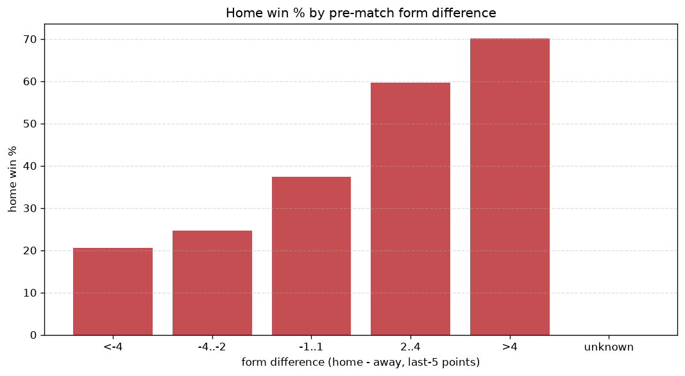
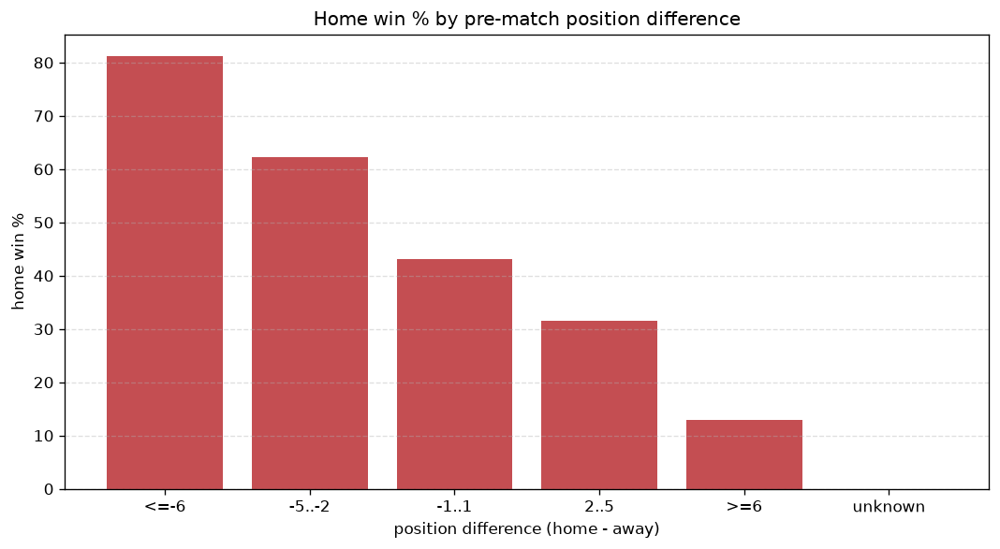

# Relationships Analysis
- Report: `relationships`
- Generated: 2026-10-29T01:58:56+00:00
- Script: `backend/scripts/analyze_relationships.py` v1.0.0
- League: Meistriliiga (Estonia)
- Scope: league `estonia`

- Matches analysed: **1001** (23 leakage-safe pre-match features).

## 1. Correlation matrix
_Pearson correlation of each pre-match feature with observed goals; sorted by |corr(total goals)|._

| feature | corr(home) | corr(away) | corr(total) |
|---|---|---|---|
| away_team_away_conceded_avg | 0.276 | -0.228 | 0.056 |
| away_team_away_goals_avg | -0.214 | 0.171 | -0.047 |
| position_difference | -0.424 | 0.412 | -0.037 |
| home_team_goals_conceded_last_5 | -0.137 | 0.195 | 0.035 |
| away_team_goals_conceded_last_5 | 0.252 | -0.231 | 0.033 |
| home_position_before_match | -0.286 | 0.267 | -0.033 |
| points_difference | 0.387 | -0.382 | 0.030 |
| home_points_before_match | 0.202 | -0.182 | 0.029 |
| home_team_points_last_5 | 0.190 | -0.243 | -0.028 |
| away_team_points_last_5 | -0.239 | 0.228 | -0.025 |
| home_team_home_conceded_avg | -0.149 | 0.194 | 0.024 |
| home_team_wins_last_5 | 0.187 | -0.233 | -0.022 |
| away_team_away_win_rate | -0.245 | 0.238 | -0.022 |
| away_position_before_match | 0.318 | -0.320 | 0.020 |
| away_team_goals_scored_last_5 | -0.193 | 0.184 | -0.020 |
| home_team_home_goals_avg | 0.200 | -0.197 | 0.015 |
| home_team_goals_scored_last_5 | 0.193 | -0.192 | 0.013 |
| away_team_wins_last_5 | -0.225 | 0.229 | -0.012 |
| home_team_home_win_rate | 0.207 | -0.213 | 0.009 |
| away_rest_days | -0.023 | 0.030 | 0.003 |
| rest_days_difference | -0.008 | 0.005 | -0.003 |
| home_rest_days | -0.027 | 0.031 | 0.001 |
| away_points_before_match | -0.165 | 0.181 | 0.001 |

## 2. Form vs outcome
_Home win/draw/away % per bucket of `home_team_points_last_5 - away_team_points_last_5`._

| bucket | matches | home | draw | away | home % | draw % | away % |
|---|---|---|---|---|---|---|---|
| <-4 | 195 | 40 | 33 | 122 | 20.5% | 16.9% | 62.6% |
| -4..-2 | 183 | 45 | 47 | 91 | 24.6% | 25.7% | 49.7% |
| -1..1 | 235 | 88 | 52 | 95 | 37.4% | 22.1% | 40.4% |
| 2..4 | 191 | 114 | 33 | 44 | 59.7% | 17.3% | 23.0% |
| >4 | 197 | 138 | 34 | 25 | 70.1% | 17.3% | 12.7% |
| unknown | 0 | 0 | 0 | 0 | - | - | - |

## 3. Position vs outcome
_Home win/draw/away % per bucket of `position_difference` (home position - away position; negative favours the home team)._

| bucket | matches | home | draw | away | home % | draw % | away % |
|---|---|---|---|---|---|---|---|
| <=-6 | 93 | 80 | 8 | 5 | 86.0% | 8.6% | 5.4% |
| -5..-2 | 288 | 178 | 54 | 56 | 61.8% | 18.8% | 19.4% |
| -1..1 | 241 | 98 | 61 | 82 | 40.7% | 25.3% | 34.0% |
| 2..5 | 291 | 59 | 63 | 169 | 20.3% | 21.6% | 58.1% |
| >=6 | 88 | 10 | 13 | 65 | 11.4% | 14.8% | 73.9% |
| unknown | 0 | 0 | 0 | 0 | - | - | - |

## 4. Rest advantage
_Home win/draw/away % per bucket of `rest_days_difference` (home rest - away rest). Matches with unknown rest are bucketed separately._

| bucket | matches | home | draw | away | home % | draw % | away % |
|---|---|---|---|---|---|---|---|
| <-1 | 85 | 40 | 17 | 28 | 47.1% | 20.0% | 32.9% |
| -1..0 | 230 | 109 | 44 | 77 | 47.4% | 19.1% | 33.5% |
| 0 | 324 | 136 | 64 | 124 | 42.0% | 19.8% | 38.3% |
| 1..2 | 266 | 97 | 55 | 114 | 36.5% | 20.7% | 42.9% |
| >2 | 63 | 29 | 14 | 20 | 46.0% | 22.2% | 31.7% |
| unknown | 33 | 14 | 5 | 14 | 42.4% | 15.2% | 42.4% |
- *33 match(es) had unknown rest difference (missing rest data on at least one side).*

## 5. Home team quality
_Home win rate by `home_team_home_win_rate` tier (split at 0.5)._

- `< 0.5` tier: **32.0%** home win (203/635)
- `>= 0.5` tier: **60.7%** home win (222/366)
- Home-win gap (>= split minus < split): **+28.7 pp**

| tier | label | matches | home | draw | away | home % |
|---|---|---|---|---|---|---|
| low | < 0.5 | 635 | 203 | 128 | 304 | 32.0% |
| high | >= 0.5 | 366 | 222 | 71 | 73 | 60.7% |

## 6. Feature averages by result
_Mean feature value per outcome; `range` is home-minus-away spread of the group means._

| feature | home mean | draw mean | away mean | range |
|---|---|---|---|---|
| points_difference | 8.713 | -0.447 | -9.735 | 18.448 |
| home_points_before_match | 27.732 | 24.719 | 16.891 | 10.841 |
| away_points_before_match | 19.019 | 25.166 | 26.626 | 7.607 |
| position_difference | -2.176 | 0.126 | 2.342 | 4.519 |
| away_team_goals_conceded_last_5 | 8.162 | 6.588 | 5.297 | 2.865 |
| away_team_points_last_5 | 5.181 | 6.538 | 7.658 | 2.477 |
| away_position_before_match | 6.729 | 5.568 | 4.281 | 2.448 |
| home_team_points_last_5 | 7.544 | 6.447 | 5.127 | 2.416 |
| home_team_goals_scored_last_5 | 7.953 | 6.543 | 5.682 | 2.271 |
| home_position_before_match | 4.553 | 5.693 | 6.623 | 2.070 |
| away_team_goals_scored_last_5 | 5.814 | 7.020 | 7.867 | 2.053 |
| home_team_goals_conceded_last_5 | 6.104 | 6.678 | 7.737 | 1.634 |
| away_team_wins_last_5 | 1.428 | 1.879 | 2.265 | 0.837 |
| home_team_wins_last_5 | 2.233 | 1.839 | 1.419 | 0.814 |
| home_rest_days | 7.513 | 8.216 | 7.770 | 0.703 |
| away_team_away_conceded_avg | 1.737 | 1.406 | 1.077 | 0.660 |
| home_team_home_goals_avg | 1.722 | 1.386 | 1.134 | 0.588 |
| away_team_away_goals_avg | 1.155 | 1.358 | 1.657 | 0.502 |
| rest_days_difference | -0.056 | 0.340 | 0.050 | 0.396 |
| home_team_home_conceded_avg | 1.227 | 1.305 | 1.568 | 0.341 |
| away_rest_days | 7.564 | 7.856 | 7.733 | 0.292 |
| away_team_away_win_rate | 0.302 | 0.395 | 0.503 | 0.201 |
| home_team_home_win_rate | 0.460 | 0.385 | 0.278 | 0.182 |

---
*All features are leakage-safe pre-match values built by `ml.features.build_features.build_rows` from strictly prior matches. Run with `python backend/scripts/analyze_relationships.py` to regenerate.*

## Charts

