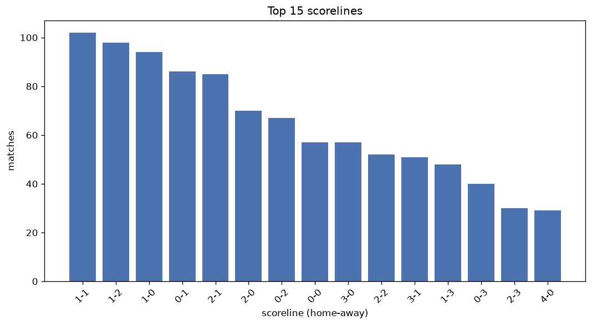
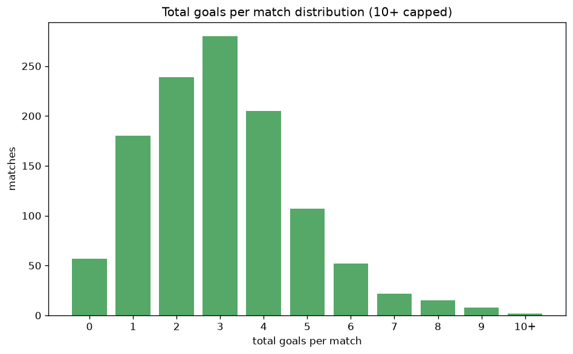

# Scoreline Analysis
- Report: `scoreline_analysis`
- Generated: 2026-10-27T01:46:50+00:00
- Script: `backend/scripts/analyze_scorelines.py` v1.0.0
- League: Meistriliiga (Estonia)
- Scope: league `estonia`

## 1. Scoreline frequency
- Matches analysed: **1167** across **7** seasons.
- Distinct scorelines seen: **52**.

| scoreline | count | pct |
|---|---|---|
| 1-1 | 102 | 8.7% |
| 1-2 | 98 | 8.4% |
| 1-0 | 94 | 8.1% |
| 0-1 | 86 | 7.4% |
| 2-1 | 85 | 7.3% |
| 2-0 | 70 | 6.0% |
| 0-2 | 67 | 5.7% |
| 0-0 | 57 | 4.9% |
| 3-0 | 57 | 4.9% |
| 2-2 | 52 | 4.5% |
| 3-1 | 51 | 4.4% |
| 1-3 | 48 | 4.1% |
| 0-3 | 40 | 3.4% |
| 2-3 | 30 | 2.6% |
| 4-0 | 29 | 2.5% |
| 0-4 | 25 | 2.1% |
| 3-2 | 23 | 2.0% |
| 4-1 | 22 | 1.9% |
| 5-0 | 16 | 1.4% |
| 1-4 | 14 | 1.2% |

## 2. Scoreline frequency per season

### 2020
| scoreline | count | pct |
|---|---|---|
| 0-2 | 15 | 10.2% |
| 0-1 | 11 | 7.5% |
| 1-0 | 10 | 6.8% |
| 1-1 | 10 | 6.8% |
| 0-0 | 10 | 6.8% |

### 2021
| scoreline | count | pct |
|---|---|---|
| 2-1 | 12 | 9.0% |
| 1-2 | 11 | 8.2% |
| 0-1 | 10 | 7.5% |
| 1-0 | 9 | 6.7% |
| 1-1 | 8 | 6.0% |

### 2022
| scoreline | count | pct |
|---|---|---|
| 1-1 | 24 | 13.3% |
| 1-0 | 23 | 12.8% |
| 1-2 | 14 | 7.8% |
| 0-1 | 13 | 7.2% |
| 2-0 | 12 | 6.7% |

### 2023
| scoreline | count | pct |
|---|---|---|
| 1-1 | 26 | 14.4% |
| 0-0 | 17 | 9.4% |
| 0-1 | 15 | 8.3% |
| 2-1 | 14 | 7.8% |
| 0-2 | 14 | 7.8% |

### 2024
| scoreline | count | pct |
|---|---|---|
| 1-1 | 16 | 8.9% |
| 0-1 | 15 | 8.3% |
| 2-1 | 14 | 7.8% |
| 2-0 | 13 | 7.2% |
| 2-2 | 13 | 7.2% |

### 2025
| scoreline | count | pct |
|---|---|---|
| 1-2 | 21 | 11.7% |
| 2-1 | 17 | 9.4% |
| 1-0 | 15 | 8.3% |
| 2-2 | 11 | 6.1% |
| 0-1 | 11 | 6.1% |

### 2026
| scoreline | count | pct |
|---|---|---|
| 1-2 | 22 | 13.3% |
| 1-0 | 15 | 9.0% |
| 2-1 | 12 | 7.2% |
| 0-1 | 11 | 6.6% |
| 2-0 | 10 | 6.0% |

## 3. Total-goal histogram
_10+ groups all matches with 10 or more total goals._

| total goals | matches | pct |
|---|---|---|
| 0 | 57 | 4.9% |
| 1 | 180 | 15.4% |
| 2 | 239 | 20.5% |
| 3 | 280 | 24.0% |
| 4 | 205 | 17.6% |
| 5 | 107 | 9.2% |
| 6 | 52 | 4.5% |
| 7 | 22 | 1.9% |
| 8 | 15 | 1.3% |
| 9 | 8 | 0.7% |
| 10+ | 2 | 0.2% |

## 4. Extreme scorelines
- Matches with 7+ total goals: **47**

| season | date | scoreline | total goals |
|---|---|---|---|
| 2020 | 2020-12-06 | 7-4 | 11 |
| 2022 | 2022-09-18 | 10-0 | 10 |
| 2020 | 2020-03-07 | 1-8 | 9 |
| 2021 | 2021-10-27 | 9-0 | 9 |
| 2022 | 2022-08-20 | 2-7 | 9 |
| 2023 | 2023-08-19 | 6-3 | 9 |
| 2023 | 2023-10-27 | 2-7 | 9 |
| 2024 | 2024-09-14 | 7-2 | 9 |
| 2025 | 2025-04-19 | 0-9 | 9 |
| 2025 | 2025-08-15 | 8-1 | 9 |
| 2020 | 2020-06-27 | 4-4 | 8 |
| 2020 | 2020-11-01 | 6-2 | 8 |
| 2020 | 2020-11-29 | 1-7 | 8 |
| 2021 | 2021-04-11 | 6-2 | 8 |
| 2021 | 2021-05-11 | 7-1 | 8 |
| 2021 | 2021-05-19 | 1-7 | 8 |
| 2021 | 2021-07-31 | 5-3 | 8 |
| 2022 | 2022-03-05 | 0-8 | 8 |
| 2022 | 2022-03-06 | 7-1 | 8 |
| 2022 | 2022-04-27 | 6-2 | 8 |
| 2022 | 2022-07-09 | 3-5 | 8 |
| 2022 | 2022-10-09 | 1-7 | 8 |
| 2025 | 2025-07-20 | 6-2 | 8 |
| 2026 | 2026-03-14 | 7-1 | 8 |
| 2026 | 2026-04-22 | 7-1 | 8 |
| 2021 | 2021-03-20 | 4-3 | 7 |
| 2021 | 2021-09-19 | 2-5 | 7 |
| 2021 | 2021-09-22 | 5-2 | 7 |
| 2022 | 2022-05-01 | 7-0 | 7 |
| 2022 | 2022-06-29 | 6-1 | 7 |
| 2022 | 2022-07-22 | 0-7 | 7 |
| 2022 | 2022-07-30 | 5-2 | 7 |
| 2022 | 2022-08-13 | 2-5 | 7 |
| 2022 | 2022-09-11 | 6-1 | 7 |
| 2023 | 2023-04-15 | 6-1 | 7 |
| 2023 | 2023-10-28 | 4-3 | 7 |
| 2024 | 2024-04-06 | 4-3 | 7 |
| 2024 | 2024-06-15 | 2-5 | 7 |
| 2024 | 2024-09-14 | 3-4 | 7 |
| 2024 | 2024-09-21 | 4-3 | 7 |
| 2025 | 2025-04-22 | 6-1 | 7 |
| 2025 | 2025-05-19 | 2-5 | 7 |
| 2025 | 2025-08-17 | 1-6 | 7 |
| 2025 | 2025-10-25 | 5-2 | 7 |
| 2026 | 2026-04-26 | 7-0 | 7 |
| 2026 | 2026-05-24 | 1-6 | 7 |
| 2026 | 2026-07-19 | 5-2 | 7 |

## 5. Margin-of-victory distribution (decided matches)
- Decided matches: **948** (draws: **219**)
- Average winning margin: **2.09**

| margin | matches | pct |
|---|---|---|
| 1 | 421 | 44.4% |
| 2 | 254 | 26.8% |
| 3+ | 273 | 28.8% |

## 6. Margin by outcome

### Home wins
- Matches: **506** | avg margin: **2.21** | max margin: **10**
| margin | matches | pct |
|---|---|---|
| 1 | 206 | 40.7% |
| 2 | 133 | 26.3% |
| 3+ | 167 | 33.0% |
- *Full match-by-match list available in `scoreline_analysis.json`.*

### Away wins
- Matches: **442** | avg margin: **1.95** | max margin: **9**
| margin | matches | pct |
|---|---|---|
| 1 | 215 | 48.6% |
| 2 | 121 | 27.4% |
| 3+ | 106 | 24.0% |
- *Full match-by-match list available in `scoreline_analysis.json`.*

## 7. Most common exact score by outcome type
| outcome | matches | most common score | count | pct |
|---|---|---|---|---|
| home | 506 | 1-0 | 94 | 18.6% |
| draw | 219 | 1-1 | 102 | 46.6% |
| away | 442 | 1-2 | 98 | 22.2% |

---
*All statistics are computed from PostgreSQL tables (read-only). Run with `python backend/scripts/analyze_scorelines.py` to regenerate.*

## Charts

