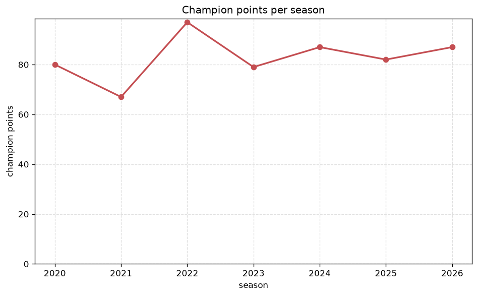
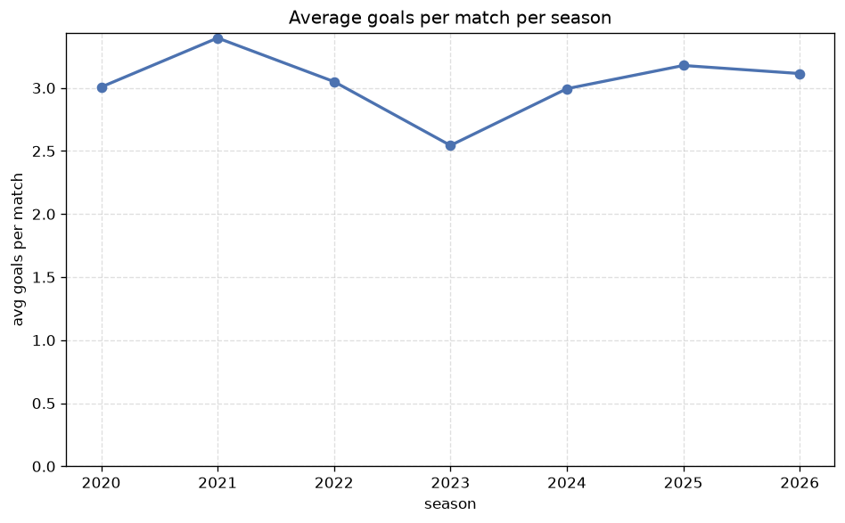

# Season Trends Analysis
- Report: `season_trends`
- Generated: 2026-10-27T01:46:48+00:00
- Script: `backend/scripts/analyze_seasons.py` v1.0.0
- League: Meistriliiga (Estonia)
- Scope: league `estonia`

## 1. Champions per season
| season | champion | pts | runner-up | margin |
|---|---|---|---|---|
| 2020 | Flora | 80 | Paide | 16 pts |
| 2021 | Levadia | 67 | Flora | 3 pts |
| 2022 | Flora | 97 | Levadia | 18 pts |
| 2023 | Flora | 79 | Levadia | 2 pts |
| 2024 | Levadia | 87 | Kalju | 15 pts |
| 2025 | Flora | 82 | Levadia | 3 pts |
| 2026 | Levadia | 84 | Paide | 24 pts |

## 2. Title-race tightness
- Tight races (margin <= 3 pts): **3** of 7 seasons
- Tightest race: **2023** - Flora beat Levadia by **2** pts

| season | margin | tight |
|---|---|---|
| 2020 | 16 pts |  |
| 2021 | 3 pts | yes |
| 2022 | 18 pts |  |
| 2023 | 2 pts | yes |
| 2024 | 15 pts |  |
| 2025 | 3 pts | yes |
| 2026 | 24 pts |  |

## 3. Points thresholds
_Position-specific points per season. Key: 1 = champion, 2 = runner-up, 4 = CL line, 6 = Europa, 7 = last safe, 10 = bottom._

| season | pos 1 | pos 2 | pos 4 | pos 6 | pos 7 | pos 10 |
|---|---|---|---|---|---|---|
| 2020 | 80 | 64 | 49 | 31 | 31 | 20 |
| 2021 | 67 | 64 | 43 | 29 | 28 | 12 |
| 2022 | 97 | 79 | 65 | 39 | 38 | 11 |
| 2023 | 79 | 77 | 53 | 48 | 43 | 23 |
| 2024 | 87 | 72 | 70 | 42 | 35 | 15 |
| 2025 | 82 | 79 | 70 | 49 | 36 | 17 |
| 2026 | 84 | 60 | 54 | 47 | 36 | 20 |

## 4. Relegation battle
| season | safe pos | safe pts | drop pos | drop pts | gap |
|---|---|---|---|---|---|
| 2020 | 7 | 31 | 8 | 25 | 6 pts |
| 2021 | 7 | 28 | 8 | 27 | 1 pts |
| 2022 | 7 | 38 | 8 | 35 | 3 pts |
| 2023 | 7 | 43 | 8 | 38 | 5 pts |
| 2024 | 7 | 35 | 8 | 34 | 1 pts |
| 2025 | 7 | 36 | 8 | 30 | 6 pts |
| 2026 | 7 | 36 | 8 | 35 | 1 pts |

## 5. League-level trends
| season | matches | total goals | avg goals | home win | draw | away win | goalless | avg pts/team |
|---|---|---|---|---|---|---|---|---|
| 2020 | 147 | 442 | 3.007 | 38.1% | 19.0% | 42.9% | 6.8% | 41.3 |
| 2021 | 134 | 455 | 3.396 | 45.5% | 16.4% | 38.1% | 3.7% | 38.0 |
| 2022 | 180 | 549 | 3.05 | 45.6% | 19.4% | 35.0% | 3.3% | 50.5 |
| 2023 | 180 | 458 | 2.544 | 37.2% | 27.8% | 35.0% | 9.4% | 49.0 |
| 2024 | 180 | 539 | 2.994 | 41.7% | 22.2% | 36.1% | 5.6% | 50.0 |
| 2025 | 180 | 572 | 3.178 | 46.7% | 13.3% | 40.0% | 2.2% | 51.6 |
| 2026 | 166 | 517 | 3.114 | 48.8% | 12.0% | 39.2% | 3.0% | 47.8 |

## 6. View divergence
- Largest divergence: **2022** (goals view, avg abs position diff = 4.200)

_Avg absolute position difference between classic view and alternative view per season._

| season | classic vs luck | classic vs goals |
|---|---|---|
| 2020 | 2.600 | 2.400 |
| 2021 | 2.600 | 3.200 |
| 2022 | 2.600 | 4.200 |
| 2023 | 3.200 | 3.400 |
| 2024 | 1.000 | 2.400 |
| 2025 | 1.400 | 3.600 |
| 2026 | 2.800 | 3.400 |

---
*All statistics are computed from PostgreSQL tables (read-only). Run with `python backend/scripts/analyze_seasons.py` to regenerate.*

## Charts

