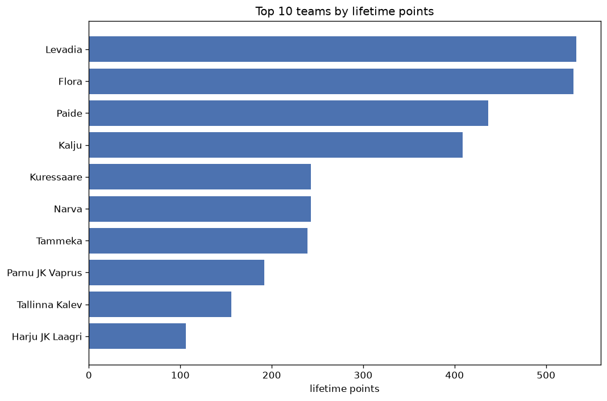
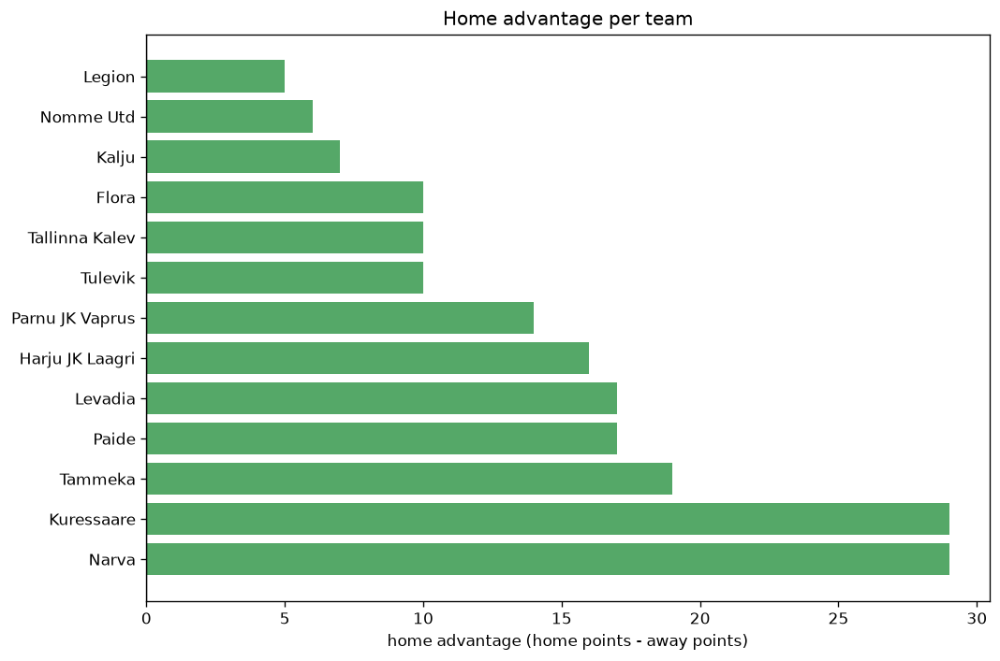

# Team Analysis
- Report: `teams_analysis`
- Generated: 2026-10-30T03:50:21+00:00
- Script: `backend/scripts/analyze_teams.py` v1.0.0
- League: Meistriliiga (Estonia)
- Scope: league `estonia`

- Teams: **13** | Seasons: **7** | Matches: **1171**

## 1. Team standings (lifetime)
| team | seasons | played | W | D | L | pts | GF | GA | GD | avg pts/season | best pos | worst pos | titles |
|---|---|---|---|---|---|---|---|---|---|---|---|---|---|
| Levadia | 7 | 234 | 164 | 41 | 29 | 533 | 544 | 198 | 346 | 76.14 | 1 | 3 | 3 |
| Flora | 7 | 234 | 165 | 35 | 34 | 530 | 541 | 206 | 335 | 75.71 | 1 | 4 | 4 |
| Paide | 7 | 235 | 130 | 47 | 58 | 437 | 456 | 253 | 203 | 62.43 | 2 | 4 | 0 |
| Kalju | 7 | 235 | 119 | 52 | 64 | 409 | 418 | 252 | 166 | 58.43 | 2 | 5 | 0 |
| Kuressaare | 7 | 235 | 64 | 51 | 120 | 243 | 259 | 407 | -148 | 34.71 | 5 | 9 | 0 |
| Narva | 7 | 235 | 66 | 45 | 124 | 243 | 266 | 414 | -148 | 34.71 | 5 | 10 | 0 |
| Tammeka | 7 | 233 | 64 | 47 | 122 | 239 | 275 | 426 | -151 | 34.14 | 5 | 9 | 0 |
| Parnu JK Vaprus | 6 | 204 | 51 | 39 | 114 | 192 | 227 | 395 | -168 | 32.0 | 6 | 10 | 0 |
| Tallinna Kalev | 5 | 174 | 42 | 30 | 102 | 156 | 180 | 388 | -208 | 31.2 | 4 | 10 | 0 |
| Harju JK Laagri | 3 | 106 | 30 | 16 | 60 | 106 | 125 | 181 | -56 | 35.33 | 6 | 10 | 0 |
| Legion | 3 | 93 | 25 | 20 | 48 | 95 | 105 | 162 | -57 | 31.67 | 5 | 9 | 0 |
| Tulevik | 2 | 54 | 17 | 7 | 30 | 58 | 67 | 103 | -36 | 29.0 | 6 | 8 | 0 |
| Nomme Utd | 2 | 70 | 14 | 10 | 46 | 52 | 77 | 155 | -78 | 26.0 | 7 | 10 | 0 |

## 2. Home vs away split
| team | home P | H-W | H-D | H-L | H-pts | away P | A-W | A-D | A-L | A-pts | adv |
|---|---|---|---|---|---|---|---|---|---|---|---|
| Kuressaare | 119 | 36 | 28 | 55 | 136 | 116 | 28 | 23 | 65 | 107 | 29 |
| Narva | 117 | 37 | 25 | 55 | 136 | 118 | 29 | 20 | 69 | 107 | 29 |
| Tammeka | 115 | 35 | 24 | 56 | 129 | 118 | 29 | 23 | 66 | 110 | 19 |
| Levadia | 119 | 84 | 23 | 12 | 275 | 115 | 80 | 18 | 17 | 258 | 17 |
| Paide | 119 | 69 | 20 | 30 | 227 | 116 | 61 | 27 | 28 | 210 | 17 |
| Harju JK Laagri | 54 | 18 | 7 | 29 | 61 | 52 | 12 | 9 | 31 | 45 | 16 |
| Parnu JK Vaprus | 101 | 27 | 22 | 52 | 103 | 103 | 24 | 17 | 62 | 89 | 14 |
| Flora | 115 | 85 | 15 | 15 | 270 | 119 | 80 | 20 | 19 | 260 | 10 |
| Tallinna Kalev | 88 | 23 | 14 | 51 | 83 | 86 | 19 | 16 | 51 | 73 | 10 |
| Tulevik | 27 | 10 | 4 | 13 | 34 | 27 | 7 | 3 | 17 | 24 | 10 |
| Kalju | 116 | 62 | 22 | 32 | 208 | 119 | 57 | 30 | 32 | 201 | 7 |
| Nomme Utd | 35 | 8 | 5 | 22 | 29 | 35 | 6 | 5 | 24 | 23 | 6 |
| Legion | 46 | 13 | 11 | 22 | 50 | 47 | 12 | 9 | 26 | 45 | 5 |

## 3. Top performers
### Best points per game (PPG)
| rank | team | PPG |
|---|---|---|
| 1 | Levadia | 2.28 |
| 2 | Flora | 2.27 |
| 3 | Paide | 1.86 |
| 4 | Kalju | 1.74 |
| 5 | Tulevik | 1.07 |

### Most goals scored
| rank | team | goals |
|---|---|---|
| 1 | Levadia | 544 |
| 2 | Flora | 541 |
| 3 | Paide | 456 |
| 4 | Kalju | 418 |
| 5 | Tammeka | 275 |

### Best goal difference
| rank | team | GD |
|---|---|---|
| 1 | Levadia | 346 |
| 2 | Flora | 335 |
| 3 | Paide | 203 |
| 4 | Kalju | 166 |
| 5 | Tulevik | -36 |

### Best defence (goals against per match, standings)
| rank | team | GA/match |
|---|---|---|
| 1 | Levadia | 0.846 |
| 2 | Flora | 0.880 |
| 3 | Kalju | 1.072 |
| 4 | Paide | 1.077 |
| 5 | Harju JK Laagri | 1.708 |

## 4. Team consistency
- Teams present in all **7** seasons: **7**

Flora, Kalju, Kuressaare, Levadia, Narva, Paide, Tammeka

## 5. Head-to-head dominance
- Distinct fixtures: **74** (showing the 15 most frequent)

| fixture | meetings | home wins | draws | away wins | home pct | draw pct | away pct |
|---|---|---|---|---|---|---|---|
| Flora vs Kalju | 27 | 13 | 6 | 8 | 48.1% | 22.2% | 29.6% |
| Paide vs Levadia | 27 | 12 | 5 | 10 | 44.4% | 18.5% | 37.0% |
| Narva vs Kuressaare | 27 | 11 | 5 | 11 | 40.7% | 18.5% | 40.7% |
| Paide vs Kalju | 27 | 9 | 9 | 9 | 33.3% | 33.3% | 33.3% |
| Flora vs Tammeka | 26 | 14 | 3 | 9 | 53.8% | 11.5% | 34.6% |
| Tammeka vs Narva | 26 | 14 | 5 | 7 | 53.8% | 19.2% | 26.9% |
| Levadia vs Tammeka | 26 | 13 | 5 | 8 | 50.0% | 19.2% | 30.8% |
| Paide vs Narva | 26 | 13 | 5 | 8 | 50.0% | 19.2% | 30.8% |
| Flora vs Kuressaare | 26 | 12 | 2 | 12 | 46.2% | 7.7% | 46.2% |
| Kalju vs Narva | 26 | 12 | 6 | 8 | 46.2% | 23.1% | 30.8% |
| Levadia vs Kalju | 26 | 12 | 6 | 8 | 46.2% | 23.1% | 30.8% |
| Levadia vs Kuressaare | 26 | 12 | 3 | 11 | 46.2% | 11.5% | 42.3% |
| Levadia vs Narva | 26 | 11 | 4 | 11 | 42.3% | 15.4% | 42.3% |
| Flora vs Levadia | 26 | 10 | 5 | 11 | 38.5% | 19.2% | 42.3% |
| Paide vs Kuressaare | 26 | 10 | 7 | 9 | 38.5% | 26.9% | 34.6% |

## 6. Position per season (classic view)
_Cells show final position; '-' when the team was absent from that season._

| team | 2020 | 2021 | 2022 | 2023 | 2024 | 2025 | 2026 |
|---|---|---|---|---|---|---|---|
| Levadia | 3 | 1 | 2 | 2 | 1 | 2 | 1 |
| Flora | 1 | 2 | 1 | 1 | 4 | 1 | 3 |
| Paide | 2 | 3 | 3 | 3 | 3 | 4 | 2 |
| Kalju | 4 | 4 | 4 | 5 | 2 | 3 | 4 |
| Kuressaare | 9 | 7 | 5 | 7 | 8 | 9 | 9 |
| Narva | 8 | 6 | 7 | 8 | 6 | 5 | 10 |
| Tammeka | 5 | 9 | 6 | 9 | 5 | 8 | 5 |
| Parnu JK Vaprus | - | 10 | 10 | 6 | 7 | 6 | 8 |
| Tallinna Kalev | 10 | - | 8 | 4 | 9 | 10 | - |
| Harju JK Laagri | - | - | - | 10 | - | 7 | 6 |
| Legion | 7 | 5 | 9 | - | - | - | - |
| Tulevik | 6 | 8 | - | - | - | - | - |
| Nomme Utd | - | - | - | - | 10 | - | 7 |

---
*All statistics are computed from PostgreSQL tables (read-only). Run with `python backend/scripts/analyze_teams.py` to regenerate.*

## Charts

