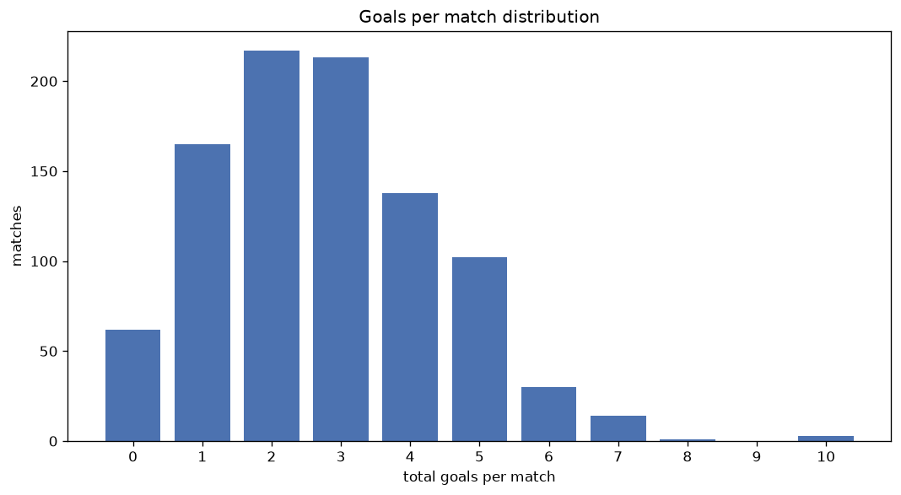
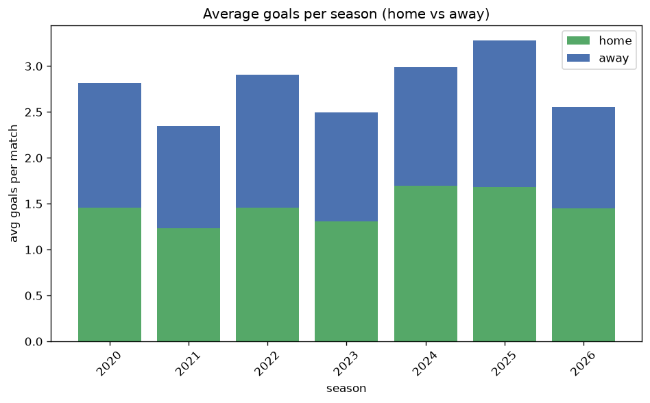

# Goal Analysis
- Report: `goals_analysis`
- Generated: 2026-10-29T01:59:05+00:00
- Script: `backend/scripts/analyze_goals.py` v1.0.0
- League: Veikkausliiga (Finland)
- Scope: league `finland1`

## 1. Goals per match distribution
| goals | matches | pct |
|---|---|---|
| 0 | 62 | 6.6% |
| 1 | 165 | 17.5% |
| 2 | 217 | 23.0% |
| 3 | 213 | 22.5% |
| 4 | 138 | 14.6% |
| 5 | 102 | 10.8% |
| 6 | 30 | 3.2% |
| 7 | 14 | 1.5% |
| 8 | 1 | 0.1% |
| 9 | 0 | 0.0% |
| 10 | 3 | 0.3% |

## 2. Goals per match per season
| season | matches | total goals | avg home | avg away | avg total |
|---|---|---|---|---|---|
| 2020 | 132 | 372 | 1.455 | 1.364 | 2.818 |
| 2021 | 132 | 310 | 1.235 | 1.114 | 2.348 |
| 2022 | 132 | 384 | 1.455 | 1.455 | 2.909 |
| 2023 | 132 | 329 | 1.311 | 1.182 | 2.492 |
| 2024 | 132 | 395 | 1.697 | 1.295 | 2.992 |
| 2025 | 132 | 433 | 1.682 | 1.598 | 3.28 |
| 2026 | 153 | 393 | 1.451 | 1.118 | 2.569 |

## 3. Home vs away goal share
- Home goals: **1388** (53.1%)
- Away goals: **1228** (46.9%)
- Home/away ratio: **1.13**

| season | home goals | away goals | total | home pct | away pct |
|---|---|---|---|---|---|
| 2020 | 192 | 180 | 372 | 51.6% | 48.4% |
| 2021 | 163 | 147 | 310 | 52.6% | 47.4% |
| 2022 | 192 | 192 | 384 | 50.0% | 50.0% |
| 2023 | 173 | 156 | 329 | 52.6% | 47.4% |
| 2024 | 224 | 171 | 395 | 56.7% | 43.3% |
| 2025 | 222 | 211 | 433 | 51.3% | 48.7% |
| 2026 | 222 | 171 | 393 | 56.5% | 43.5% |

## 4. BTTS (Both Teams To Score)
- Overall: **499** of `945` (52.8%)

| season | matches | BTTS | pct |
|---|---|---|---|
| 2020 | 132 | 68 | 51.5% |
| 2021 | 132 | 53 | 40.2% |
| 2022 | 132 | 77 | 58.3% |
| 2023 | 132 | 68 | 51.5% |
| 2024 | 132 | 77 | 58.3% |
| 2025 | 132 | 83 | 62.9% |
| 2026 | 153 | 73 | 47.7% |

## 5. Clean sheets
- Home clean sheets: **263** (27.8%)
- Away clean sheets: **245** (25.9%)
- Total clean sheets recorded: **508**
- Matches with at least one clean sheet: **446** (47.2%)
- Both teams kept clean sheets (0-0): **62**

| season | matches | home CS | away CS | total CS | matches w/ CS |
|---|---|---|---|---|---|
| 2020 | 132 | 36 | 38 | 74 | 64 (48.5%) |
| 2021 | 132 | 45 | 43 | 88 | 79 (59.8%) |
| 2022 | 132 | 25 | 36 | 61 | 55 (41.7%) |
| 2023 | 132 | 40 | 35 | 75 | 64 (48.5%) |
| 2024 | 132 | 36 | 26 | 62 | 55 (41.7%) |
| 2025 | 132 | 24 | 33 | 57 | 49 (37.1%) |
| 2026 | 153 | 57 | 34 | 91 | 80 (52.3%) |

## 6. Scoring intensity
- First-half goals: **1133** (43.4%)
- Second-half goals: **1480** (56.6%)
- Avg first-half goals per match: **1.2**
- Avg second-half goals per match: **1.568**
- Second-half-only scoring (HT 0-0, FT goals >= 1): **208** (22.0%)
- *1 match(es) excluded (no HT score recorded).*

| season | matches | 1st half | 2nd half | 1st half pct | 2nd half pct |
|---|---|---|---|---|---|
| 2020 | 132 | 151 | 221 | 40.6% | 59.4% |
| 2021 | 132 | 140 | 170 | 45.2% | 54.8% |
| 2022 | 132 | 166 | 215 | 43.6% | 56.4% |
| 2023 | 132 | 143 | 186 | 43.5% | 56.5% |
| 2024 | 132 | 177 | 218 | 44.8% | 55.2% |
| 2025 | 132 | 165 | 268 | 38.1% | 61.9% |
| 2026 | 153 | 191 | 202 | 48.6% | 51.4% |

## 7. First-goal timing
- Matches with first-goal time recorded: `882` of `945` (93.3%)
- Goalless matches: `63`
- Min `1` | Max `96` | Mean `30.08` | Median (p50) `25.0`

| bucket | count | % of matches | % of scoring matches |
|---|---|---|---|
| 1-15 | 292 | 30.9% | 33.1% |
| 16-30 | 225 | 23.8% | 25.5% |
| 31-45 | 138 | 14.6% | 15.6% |
| 46-60 | 124 | 13.1% | 14.1% |
| 61-75 | 59 | 6.2% | 6.7% |
| 76-90 | 37 | 3.9% | 4.2% |
| 91-120 | 7 | 0.7% | 0.8% |

---
*All statistics are computed from PostgreSQL tables (read-only). Run with `python backend/scripts/analyze_goals.py` to regenerate.*

## Charts

