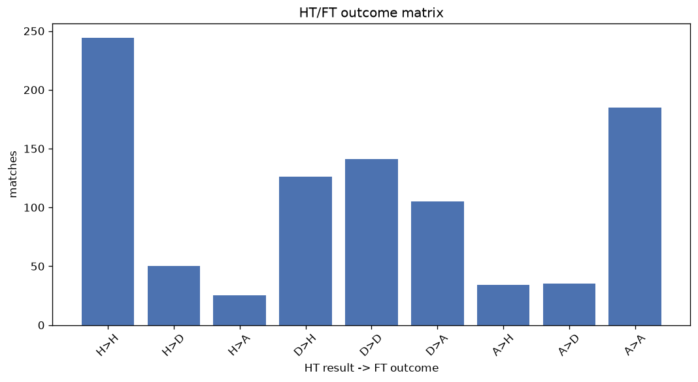
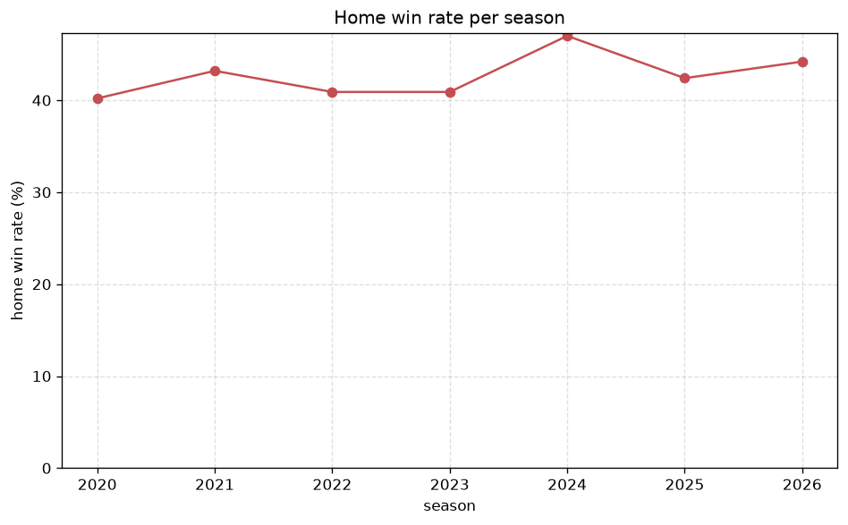

# Match Analysis
- Report: `matches_analysis`
- Generated: 2026-10-30T03:50:35+00:00
- Script: `backend/scripts/analyze_matches.py` v1.0.0
- League: Veikkausliiga (Finland)
- Scope: league `finland1`

## 1. Overall summary
| metric | value |
|---|---|
| Matches | 946 |
| Home wins | 404 (42.7%) |
| Draws | 226 (23.9%) |
| Away wins | 316 (33.4%) |
| Total goals | 2616 |
| Average goals per match | 2.765 |
| Goalless matches | 63 (6.7%) |

## 2. Per-season breakdown
| season | matches | home wins | draws | away wins | total goals | avg goals | goalless |
|---|---|---|---|---|---|---|---|
| 2020 | 132 | 53 (40.2%) | 33 (25.0%) | 46 (34.8%) | 372 | 2.818 | 10 (7.6%) |
| 2021 | 132 | 57 (43.2%) | 25 (18.9%) | 50 (37.9%) | 310 | 2.348 | 9 (6.8%) |
| 2022 | 132 | 54 (40.9%) | 31 (23.5%) | 47 (35.6%) | 384 | 2.909 | 6 (4.5%) |
| 2023 | 132 | 54 (40.9%) | 34 (25.8%) | 44 (33.3%) | 329 | 2.492 | 11 (8.3%) |
| 2024 | 132 | 62 (47.0%) | 33 (25.0%) | 37 (28.0%) | 395 | 2.992 | 7 (5.3%) |
| 2025 | 132 | 56 (42.4%) | 29 (22.0%) | 47 (35.6%) | 433 | 3.28 | 8 (6.1%) |
| 2026 | 154 | 68 (44.2%) | 41 (26.6%) | 45 (29.2%) | 393 | 2.552 | 12 (7.8%) |

## 3. HT/FT outcome matrix
| HT result \ FT result | Home | Draw | Away | total |
|---|---|---|---|---|
| HT home lead | 244 (76.5%) | 50 (15.7%) | 25 (7.8%) | 319 |
| HT draw | 126 (33.9%) | 141 (37.9%) | 105 (28.2%) | 372 |
| HT away lead | 34 (13.4%) | 35 (13.8%) | 185 (72.8%) | 254 |
- *1 match(es) excluded (no HT score recorded).*

## 4. Comeback matches
- Home comebacks (trailing at HT, won at FT): **34** (3.6%)
- Away comebacks (trailing at HT, won at FT): **25** (2.6%)

### Home comebacks
| season | home | away | HT | FT |
|---|---|---|---|---|
| 2020 | Ilves | Mariehamn | 0-1 | 4-3 |
| 2020 | Lahti | Mariehamn | 0-1 | 3-1 |
| 2021 | KuPS | Honka | 0-1 | 2-1 |
| 2021 | Honka | Haka | 0-1 | 2-1 |
| 2021 | Lahti | SJK | 0-1 | 2-1 |
| 2021 | SJK | Honka | 0-1 | 3-2 |
| 2021 | Honka | KTP | 0-1 | 3-1 |
| 2022 | HJK | Ilves | 0-1 | 2-1 |
| 2022 | HJK | Lahti | 0-1 | 3-2 |
| 2022 | KuPS | AC Oulu | 0-1 | 2-1 |
| 2022 | SJK | Honka | 0-1 | 3-2 |
| 2022 | Haka | Honka | 0-1 | 2-1 |
| 2023 | Haka | KTP | 1-2 | 4-2 |
| 2023 | AC Oulu | VPS | 0-1 | 2-1 |
| 2023 | HJK | Inter Turku | 0-1 | 4-1 |
| 2023 | SJK | Mariehamn | 0-1 | 3-2 |
| 2023 | Lahti | Ilves | 0-1 | 3-2 |
| 2024 | Mariehamn | Inter Turku | 0-1 | 3-1 |
| 2024 | HJK | KuPS | 0-1 | 3-1 |
| 2024 | Haka | Ilves | 1-2 | 4-3 |
| 2024 | Ilves | VPS | 1-2 | 3-2 |
| 2024 | Gnistan | Mariehamn | 0-1 | 2-1 |
| 2024 | Mariehamn | AC Oulu | 0-1 | 2-1 |
| 2025 | Ilves | HJK | 1-2 | 3-2 |
| 2025 | VPS | AC Oulu | 0-2 | 4-3 |
| 2025 | Haka | AC Oulu | 0-1 | 2-1 |
| 2025 | Gnistan | KTP | 0-1 | 2-1 |
| 2025 | AC Oulu | KTP | 0-1 | 3-2 |
| 2025 | SJK | Gnistan | 0-1 | 3-1 |
| 2025 | VPS | KTP | 1-2 | 3-2 |
| 2026 | Inter Turku | Ilves | 0-1 | 2-1 |
| 2026 | VPS | HJK | 0-1 | 2-1 |
| 2026 | TPS | Jaro | 1-2 | 3-2 |
| 2026 | HJK | Inter Turku | 0-1 | 2-1 |

### Away comebacks
| season | home | away | HT | FT |
|---|---|---|---|---|
| 2020 | Lahti | KuPS | 1-0 | 1-2 |
| 2020 | KuPS | Haka | 1-0 | 2-3 |
| 2021 | HIFK | KuPS | 1-0 | 1-5 |
| 2022 | Ilves | HJK | 1-0 | 1-2 |
| 2022 | Inter Turku | KuPS | 1-0 | 1-2 |
| 2023 | Mariehamn | Lahti | 1-0 | 2-3 |
| 2023 | Ilves | AC Oulu | 1-0 | 1-2 |
| 2023 | Lahti | AC Oulu | 1-0 | 1-2 |
| 2023 | Lahti | HJK | 1-0 | 1-2 |
| 2023 | SJK | HJK | 1-0 | 1-2 |
| 2023 | SJK | KTP | 1-0 | 2-3 |
| 2023 | Inter Turku | HJK | 1-0 | 1-3 |
| 2023 | KTP | Honka | 1-0 | 1-2 |
| 2024 | Ilves | Gnistan | 2-0 | 4-6 |
| 2024 | Ekenas | KuPS | 1-0 | 1-2 |
| 2024 | Ekenas | Haka | 1-0 | 1-2 |
| 2025 | Mariehamn | SJK | 1-0 | 1-2 |
| 2025 | Gnistan | KuPS | 1-0 | 1-2 |
| 2025 | HJK | Jaro | 1-0 | 2-3 |
| 2025 | VPS | SJK | 1-0 | 1-2 |
| 2025 | Haka | HJK | 1-0 | 1-2 |
| 2026 | Jaro | HJK | 2-1 | 2-5 |
| 2026 | SJK | VPS | 1-0 | 1-2 |
| 2026 | AC Oulu | Inter Turku | 2-0 | 2-3 |
| 2026 | HJK | Gnistan | 2-0 | 2-3 |

## 5. HT lead conversion
| HT state | matches | converted to win | held as draw | collapsed to loss |
|---|---|---|---|---|
| Home lead | 319 | 244 (76.5%) | 50 (15.7%) | 25 (7.8%) |
| Away lead | 254 | 185 (72.8%) | 35 (13.8%) | 34 (13.4%) |

### Matches level at half-time
| FT result | count | pct |
|---|---|---|
| Home win | 126 | 33.9% |
| Draw | 141 | 37.9% |
| Away win | 105 | 28.2% |
- *1 match(es) excluded (no HT score recorded).*

## 6. First-goal timing
- Matches with a first-goal time recorded: `882` of `946` (93.2%)

Outcome distribution by first-goal timing bucket:
| bucket | matches | % of matches | home | draw | away |
|---|---|---|---|---|---|
| 1-15 | 292 | 30.9% | 141 (48.3%) | 58 (19.9%) | 93 (31.8%) |
| 16-30 | 225 | 23.8% | 107 (47.6%) | 41 (18.2%) | 77 (34.2%) |
| 31-45 | 138 | 14.6% | 61 (44.2%) | 24 (17.4%) | 53 (38.4%) |
| 46-60 | 124 | 13.1% | 47 (37.9%) | 25 (20.2%) | 52 (41.9%) |
| 61-75 | 59 | 6.2% | 25 (42.4%) | 10 (16.9%) | 24 (40.7%) |
| 76-90 | 37 | 3.9% | 21 (56.8%) | 4 (10.8%) | 12 (32.4%) |
| 91-120 | 7 | 0.7% | 2 (28.6%) | 1 (14.3%) | 4 (57.1%) |

## 7. Goalless matches
- Overall: **63** of `946` (6.7%)

| season | matches | goalless | pct |
|---|---|---|---|
| 2020 | 132 | 10 | 7.6% |
| 2021 | 132 | 9 | 6.8% |
| 2022 | 132 | 6 | 4.5% |
| 2023 | 132 | 11 | 8.3% |
| 2024 | 132 | 7 | 5.3% |
| 2025 | 132 | 8 | 6.1% |
| 2026 | 154 | 12 | 7.8% |

---
*All statistics are computed from PostgreSQL tables (read-only). Run with `python backend/scripts/analyze_matches.py` to regenerate.*

## Charts

