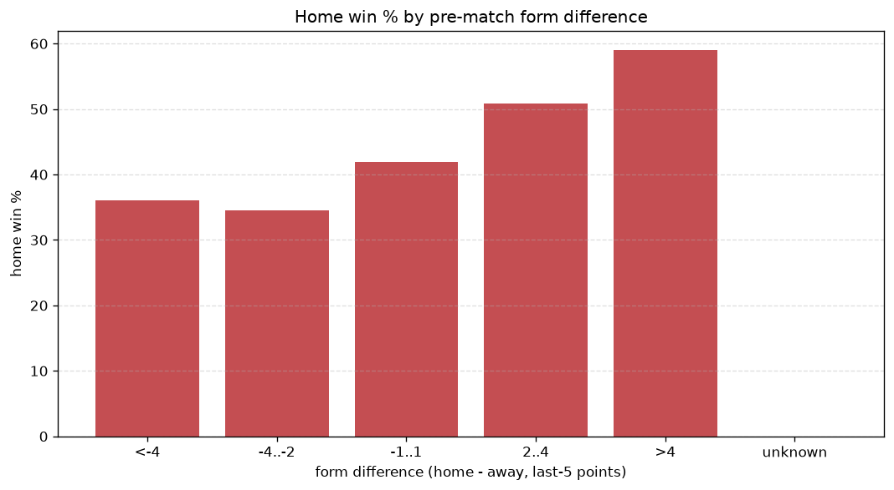
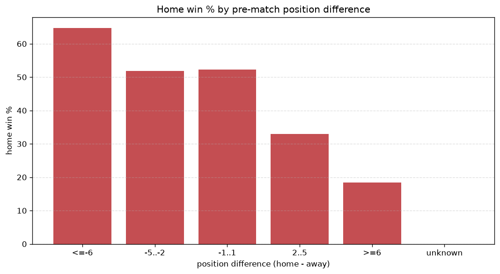

# Relationships Analysis
- Report: `relationships`
- Generated: 2026-10-30T03:50:44+00:00
- Script: `backend/scripts/analyze_relationships.py` v1.0.0
- League: Veikkausliiga (Finland)
- Scope: league `finland1`

- Matches analysed: **792** (23 leakage-safe pre-match features).

## 1. Correlation matrix
_Pearson correlation of each pre-match feature with observed goals; sorted by |corr(total goals)|._

| feature | corr(home) | corr(away) | corr(total) |
|---|---|---|---|
| away_rest_days | -0.006 | 0.117 | 0.079 |
| home_rest_days | -0.012 | 0.115 | 0.072 |
| position_difference | -0.288 | 0.216 | -0.070 |
| away_position_before_match | 0.188 | -0.110 | 0.068 |
| away_team_wins_last_5 | -0.152 | 0.070 | -0.068 |
| away_team_goals_conceded_last_5 | 0.147 | -0.066 | 0.067 |
| home_points_before_match | 0.169 | -0.100 | 0.060 |
| points_difference | 0.283 | -0.226 | 0.060 |
| away_team_points_last_5 | -0.140 | 0.072 | -0.058 |
| away_team_away_conceded_avg | 0.127 | -0.061 | 0.055 |
| home_team_goals_scored_last_5 | 0.173 | -0.117 | 0.051 |
| home_team_wins_last_5 | 0.196 | -0.153 | 0.043 |
| home_team_points_last_5 | 0.193 | -0.153 | 0.041 |
| away_team_away_goals_avg | 0.025 | 0.027 | 0.038 |
| home_team_home_conceded_avg | -0.119 | 0.086 | -0.031 |
| home_position_before_match | -0.213 | 0.192 | -0.030 |
| home_team_goals_conceded_last_5 | -0.115 | 0.105 | -0.015 |
| away_team_away_win_rate | -0.033 | 0.022 | -0.010 |
| away_points_before_match | -0.084 | 0.102 | 0.007 |
| home_team_home_goals_avg | 0.155 | -0.162 | 0.006 |
| home_team_home_win_rate | 0.164 | -0.182 | -0.001 |
| away_team_goals_scored_last_5 | -0.064 | 0.069 | -0.001 |
| rest_days_difference | -0.007 | 0.006 | -0.001 |

## 2. Form vs outcome
_Home win/draw/away % per bucket of `home_team_points_last_5 - away_team_points_last_5`._

| bucket | matches | home | draw | away | home % | draw % | away % |
|---|---|---|---|---|---|---|---|
| <-4 | 133 | 32 | 25 | 76 | 24.1% | 18.8% | 57.1% |
| -4..-2 | 160 | 53 | 44 | 63 | 33.1% | 27.5% | 39.4% |
| -1..1 | 226 | 103 | 59 | 64 | 45.6% | 26.1% | 28.3% |
| 2..4 | 148 | 66 | 40 | 42 | 44.6% | 27.0% | 28.4% |
| >4 | 125 | 82 | 17 | 26 | 65.6% | 13.6% | 20.8% |
| unknown | 0 | 0 | 0 | 0 | - | - | - |

## 3. Position vs outcome
_Home win/draw/away % per bucket of `position_difference` (home position - away position; negative favours the home team)._

| bucket | matches | home | draw | away | home % | draw % | away % |
|---|---|---|---|---|---|---|---|
| <=-6 | 102 | 73 | 11 | 18 | 71.6% | 10.8% | 17.6% |
| -5..-2 | 206 | 100 | 50 | 56 | 48.5% | 24.3% | 27.2% |
| -1..1 | 154 | 72 | 37 | 45 | 46.8% | 24.0% | 29.2% |
| 2..5 | 216 | 59 | 63 | 94 | 27.3% | 29.2% | 43.5% |
| >=6 | 114 | 32 | 24 | 58 | 28.1% | 21.1% | 50.9% |
| unknown | 0 | 0 | 0 | 0 | - | - | - |

## 4. Rest advantage
_Home win/draw/away % per bucket of `rest_days_difference` (home rest - away rest). Matches with unknown rest are bucketed separately._

| bucket | matches | home | draw | away | home % | draw % | away % |
|---|---|---|---|---|---|---|---|
| <-1 | 96 | 46 | 14 | 36 | 47.9% | 14.6% | 37.5% |
| -1..0 | 125 | 48 | 32 | 45 | 38.4% | 25.6% | 36.0% |
| 0 | 310 | 133 | 79 | 98 | 42.9% | 25.5% | 31.6% |
| 1..2 | 160 | 62 | 37 | 61 | 38.8% | 23.1% | 38.1% |
| >2 | 64 | 27 | 15 | 22 | 42.2% | 23.4% | 34.4% |
| unknown | 37 | 20 | 8 | 9 | 54.1% | 21.6% | 24.3% |
- *37 match(es) had unknown rest difference (missing rest data on at least one side).*

## 5. Home team quality
_Home win rate by `home_team_home_win_rate` tier (split at 0.5)._

- `< 0.5` tier: **36.0%** home win (174/484)
- `>= 0.5` tier: **52.6%** home win (162/308)
- Home-win gap (>= split minus < split): **+16.6 pp**

| tier | label | matches | home | draw | away | home % |
|---|---|---|---|---|---|---|
| low | < 0.5 | 484 | 174 | 109 | 201 | 36.0% |
| high | >= 0.5 | 308 | 162 | 76 | 70 | 52.6% |

## 6. Feature averages by result
_Mean feature value per outcome; `range` is home-minus-away spread of the group means._

| feature | home mean | draw mean | away mean | range |
|---|---|---|---|---|
| points_difference | 2.848 | -0.541 | -4.011 | 6.859 |
| away_points_before_match | 13.030 | 14.254 | 16.572 | 3.542 |
| position_difference | -1.533 | 0.789 | 1.875 | 3.407 |
| home_points_before_match | 15.878 | 13.714 | 12.561 | 3.317 |
| home_position_before_match | 5.628 | 6.762 | 7.720 | 2.092 |
| home_team_points_last_5 | 6.673 | 5.735 | 4.948 | 1.724 |
| home_team_goals_conceded_last_5 | 5.384 | 6.195 | 6.793 | 1.409 |
| away_team_points_last_5 | 5.414 | 6.076 | 6.749 | 1.335 |
| away_position_before_match | 7.161 | 5.973 | 5.845 | 1.316 |
| home_team_goals_scored_last_5 | 6.432 | 5.951 | 5.269 | 1.162 |
| away_team_goals_conceded_last_5 | 6.378 | 5.865 | 5.565 | 0.813 |
| away_team_goals_scored_last_5 | 5.762 | 6.059 | 6.528 | 0.766 |
| home_team_wins_last_5 | 1.881 | 1.584 | 1.277 | 0.604 |
| home_rest_days | 7.057 | 6.780 | 7.262 | 0.483 |
| away_rest_days | 7.032 | 6.655 | 7.126 | 0.471 |
| away_team_wins_last_5 | 1.446 | 1.676 | 1.915 | 0.469 |
| home_team_home_goals_avg | 1.408 | 1.314 | 1.079 | 0.330 |
| home_team_home_conceded_avg | 1.101 | 1.202 | 1.351 | 0.250 |
| away_team_away_conceded_avg | 1.399 | 1.267 | 1.187 | 0.213 |
| home_team_home_win_rate | 0.444 | 0.376 | 0.292 | 0.152 |
| rest_days_difference | 0.032 | 0.124 | 0.130 | 0.098 |
| away_team_away_goals_avg | 1.214 | 1.182 | 1.197 | 0.031 |
| away_team_away_win_rate | 0.285 | 0.298 | 0.311 | 0.026 |

---
*All features are leakage-safe pre-match values built by `ml.features.build_features.build_rows` from strictly prior matches. Run with `python backend/scripts/analyze_relationships.py` to regenerate.*

## Charts

