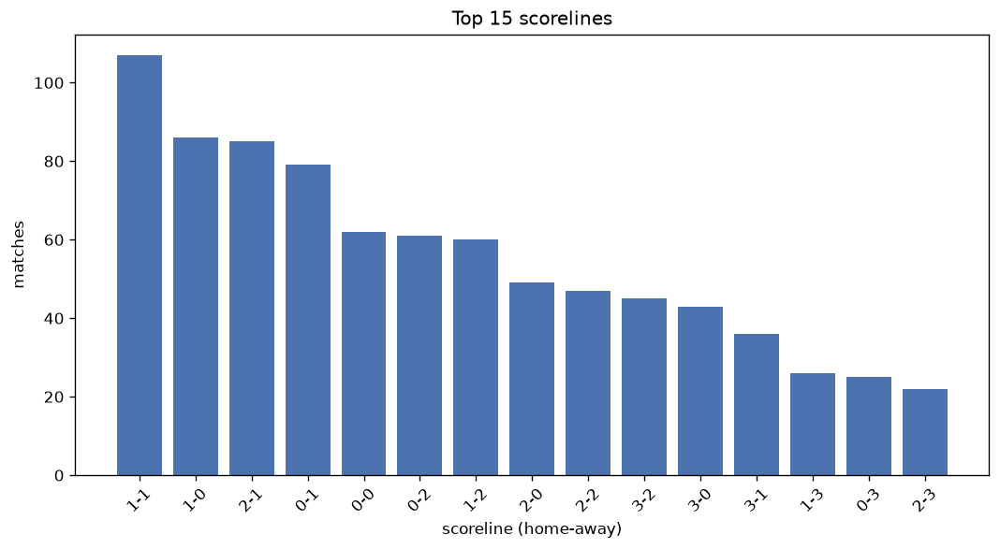
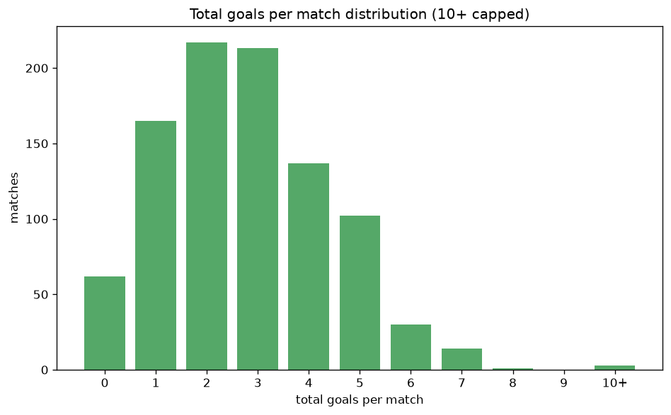

# Scoreline Analysis
- Report: `scoreline_analysis`
- Generated: 2026-10-26T01:31:46+00:00
- Script: `backend/scripts/analyze_scorelines.py` v1.0.0
- League: Veikkausliiga (Finland)
- Scope: league `finland1`

## 1. Scoreline frequency
- Matches analysed: **944** across **7** seasons.
- Distinct scorelines seen: **38**.

| scoreline | count | pct |
|---|---|---|
| 1-1 | 107 | 11.3% |
| 1-0 | 86 | 9.1% |
| 2-1 | 85 | 9.0% |
| 0-1 | 79 | 8.4% |
| 0-0 | 62 | 6.6% |
| 0-2 | 61 | 6.5% |
| 1-2 | 60 | 6.4% |
| 2-0 | 49 | 5.2% |
| 2-2 | 47 | 5.0% |
| 3-2 | 45 | 4.8% |
| 3-0 | 43 | 4.6% |
| 3-1 | 36 | 3.8% |
| 1-3 | 26 | 2.8% |
| 0-3 | 25 | 2.6% |
| 2-3 | 22 | 2.3% |
| 4-1 | 16 | 1.7% |
| 4-0 | 15 | 1.6% |
| 0-4 | 13 | 1.4% |
| 1-4 | 9 | 1.0% |
| 5-0 | 7 | 0.7% |

## 2. Scoreline frequency per season

### 2020
| scoreline | count | pct |
|---|---|---|
| 1-1 | 14 | 10.6% |
| 0-2 | 13 | 9.8% |
| 1-0 | 11 | 8.3% |
| 0-0 | 10 | 7.6% |
| 2-2 | 9 | 6.8% |

### 2021
| scoreline | count | pct |
|---|---|---|
| 0-1 | 18 | 13.6% |
| 1-0 | 16 | 12.1% |
| 2-0 | 12 | 9.1% |
| 1-1 | 12 | 9.1% |
| 0-2 | 10 | 7.6% |

### 2022
| scoreline | count | pct |
|---|---|---|
| 2-1 | 17 | 12.9% |
| 1-1 | 17 | 12.9% |
| 0-1 | 13 | 9.8% |
| 3-2 | 9 | 6.8% |
| 0-2 | 9 | 6.8% |

### 2023
| scoreline | count | pct |
|---|---|---|
| 1-1 | 16 | 12.1% |
| 2-1 | 15 | 11.4% |
| 1-0 | 14 | 10.6% |
| 0-2 | 13 | 9.8% |
| 1-2 | 12 | 9.1% |

### 2024
| scoreline | count | pct |
|---|---|---|
| 1-1 | 16 | 12.1% |
| 1-2 | 14 | 10.6% |
| 2-1 | 13 | 9.8% |
| 3-1 | 10 | 7.6% |
| 3-0 | 10 | 7.6% |

### 2025
| scoreline | count | pct |
|---|---|---|
| 3-2 | 12 | 9.1% |
| 0-1 | 11 | 8.3% |
| 2-2 | 11 | 8.3% |
| 2-1 | 11 | 8.3% |
| 1-1 | 10 | 7.6% |

### 2026
| scoreline | count | pct |
|---|---|---|
| 1-1 | 22 | 14.5% |
| 1-0 | 21 | 13.8% |
| 0-1 | 13 | 8.6% |
| 2-1 | 12 | 7.9% |
| 0-0 | 11 | 7.2% |

## 3. Total-goal histogram
_10+ groups all matches with 10 or more total goals._

| total goals | matches | pct |
|---|---|---|
| 0 | 62 | 6.6% |
| 1 | 165 | 17.5% |
| 2 | 217 | 23.0% |
| 3 | 213 | 22.6% |
| 4 | 137 | 14.5% |
| 5 | 102 | 10.8% |
| 6 | 30 | 3.2% |
| 7 | 14 | 1.5% |
| 8 | 1 | 0.1% |
| 9 | 0 | 0.0% |
| 10+ | 3 | 0.3% |

## 4. Extreme scorelines
- Matches with 7+ total goals: **18**

| season | date | scoreline | total goals |
|---|---|---|---|
| 2024 | 2024-04-13 | 4-6 | 10 |
| 2024 | 2024-07-27 | 5-5 | 10 |
| 2025 | 2025-08-24 | 8-2 | 10 |
| 2025 | 2025-07-01 | 6-2 | 8 |
| 2020 | 2020-07-01 | 4-3 | 7 |
| 2020 | 2020-08-30 | 6-1 | 7 |
| 2020 | 2020-09-10 | 4-3 | 7 |
| 2022 | 2022-09-11 | 1-6 | 7 |
| 2023 | 2023-07-01 | 3-4 | 7 |
| 2024 | 2024-05-24 | 4-3 | 7 |
| 2024 | 2024-07-14 | 0-7 | 7 |
| 2024 | 2024-07-15 | 4-3 | 7 |
| 2025 | 2025-04-05 | 4-3 | 7 |
| 2025 | 2025-08-09 | 2-5 | 7 |
| 2026 | 2026-06-13 | 2-5 | 7 |
| 2026 | 2026-06-23 | 4-3 | 7 |
| 2026 | 2026-10-12 | 3-4 | 7 |
| 2026 | 2026-10-24 | 3-4 | 7 |

## 5. Margin-of-victory distribution (decided matches)
- Decided matches: **720** (draws: **224**)
- Average winning margin: **1.78**

| margin | matches | pct |
|---|---|---|
| 1 | 386 | 53.6% |
| 2 | 183 | 25.4% |
| 3+ | 151 | 21.0% |

## 6. Margin by outcome

### Home wins
- Matches: **404** | avg margin: **1.78** | max margin: **6**
| margin | matches | pct |
|---|---|---|
| 1 | 222 | 55.0% |
| 2 | 91 | 22.5% |
| 3+ | 91 | 22.5% |
- *Full match-by-match list available in `scoreline_analysis.json`.*

### Away wins
- Matches: **316** | avg margin: **1.78** | max margin: **7**
| margin | matches | pct |
|---|---|---|
| 1 | 164 | 51.9% |
| 2 | 92 | 29.1% |
| 3+ | 60 | 19.0% |
- *Full match-by-match list available in `scoreline_analysis.json`.*

## 7. Most common exact score by outcome type
| outcome | matches | most common score | count | pct |
|---|---|---|---|---|
| home | 404 | 1-0 | 86 | 21.3% |
| draw | 224 | 1-1 | 107 | 47.8% |
| away | 316 | 0-1 | 79 | 25.0% |

---
*All statistics are computed from PostgreSQL tables (read-only). Run with `python backend/scripts/analyze_scorelines.py` to regenerate.*

## Charts

