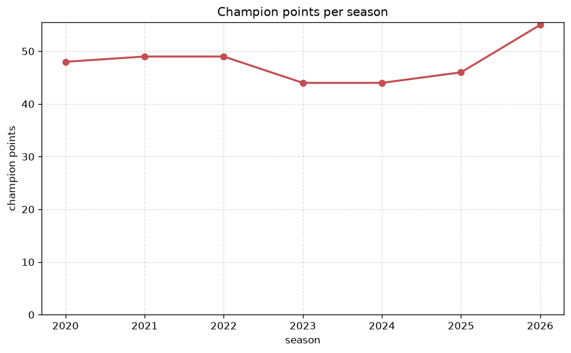
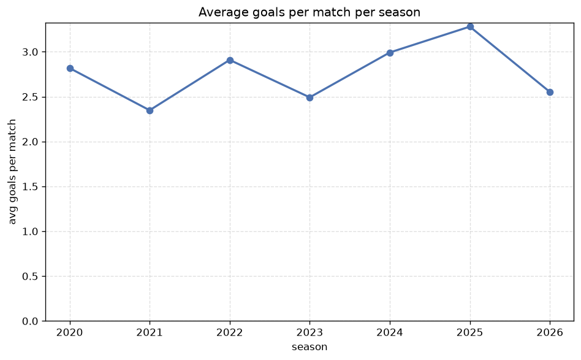

# Season Trends Analysis
- Report: `season_trends`
- Generated: 2026-10-29T01:59:08+00:00
- Script: `backend/scripts/analyze_seasons.py` v1.0.0
- League: Veikkausliiga (Finland)
- Scope: league `finland1`

## 1. Champions per season
| season | champion | pts | runner-up | margin |
|---|---|---|---|---|
| 2020 | HJK | 48 | Inter Turku | 7 pts |
| 2021 | KuPS | 49 | HJK | 0 pts |
| 2022 | HJK | 49 | KuPS | 2 pts |
| 2023 | HJK | 44 | KuPS | 1 pts |
| 2024 | KuPS | 44 | HJK | 1 pts |
| 2025 | Inter Turku | 46 | Ilves | 1 pts |
| 2026 | Inter Turku | 55 | HJK | 3 pts |

## 2. Title-race tightness
- Tight races (margin <= 3 pts): **6** of 7 seasons
- Tightest race: **2021** - KuPS beat HJK by **0** pts

| season | margin | tight |
|---|---|---|
| 2020 | 7 pts |  |
| 2021 | 0 pts | yes |
| 2022 | 2 pts | yes |
| 2023 | 1 pts | yes |
| 2024 | 1 pts | yes |
| 2025 | 1 pts | yes |
| 2026 | 3 pts | yes |

## 3. Points thresholds
_Position-specific points per season. Key: 1 = champion, 2 = runner-up, 4 = CL line, 6 = Europa, 9 = last safe, 12 = bottom._

| season | pos 1 | pos 2 | pos 4 | pos 6 | pos 9 | pos 12 |
|---|---|---|---|---|---|---|
| 2020 | 48 | 41 | 37 | 32 | 23 | 5 |
| 2021 | 49 | 49 | 37 | 33 | 24 | 8 |
| 2022 | 49 | 47 | 37 | 31 | 24 | 9 |
| 2023 | 44 | 43 | 36 | 34 | 22 | 15 |
| 2024 | 44 | 43 | 36 | 32 | 21 | 13 |
| 2025 | 46 | 45 | 44 | 28 | 21 | 14 |
| 2026 | 55 | 52 | 43 | 39 | 25 | 14 |

## 4. Relegation battle
| season | safe pos | safe pts | drop pos | drop pts | gap |
|---|---|---|---|---|---|
| 2020 | 9 | 23 | 10 | 22 | 1 pts |
| 2021 | 9 | 24 | 10 | 23 | 1 pts |
| 2022 | 9 | 24 | 10 | 22 | 2 pts |
| 2023 | 9 | 22 | 10 | 20 | 2 pts |
| 2024 | 9 | 21 | 10 | 20 | 1 pts |
| 2025 | 9 | 21 | 10 | 18 | 3 pts |
| 2026 | 9 | 25 | 10 | 19 | 6 pts |

## 5. League-level trends
| season | matches | total goals | avg goals | home win | draw | away win | goalless | avg pts/team |
|---|---|---|---|---|---|---|---|---|
| 2020 | 132 | 372 | 2.818 | 40.2% | 25.0% | 34.8% | 7.6% | 30.25 |
| 2021 | 132 | 310 | 2.348 | 43.2% | 18.9% | 37.9% | 6.8% | 30.92 |
| 2022 | 132 | 384 | 2.909 | 40.9% | 23.5% | 35.6% | 4.5% | 30.42 |
| 2023 | 132 | 329 | 2.492 | 40.9% | 25.8% | 33.3% | 8.3% | 30.17 |
| 2024 | 132 | 395 | 2.992 | 47.0% | 25.0% | 28.0% | 5.3% | 30.25 |
| 2025 | 132 | 433 | 3.28 | 42.4% | 22.0% | 35.6% | 6.1% | 30.58 |
| 2026 | 153 | 393 | 2.569 | 44.4% | 26.1% | 29.4% | 7.2% | 34.92 |

## 6. View divergence
- Largest divergence: **2026** (goals view, avg abs position diff = 4.667)

_Avg absolute position difference between classic view and alternative view per season._

| season | classic vs luck | classic vs goals |
|---|---|---|
| 2020 | 2.667 | 4.167 |
| 2021 | 1.667 | 4.000 |
| 2022 | 1.500 | 4.500 |
| 2023 | 1.500 | 4.167 |
| 2024 | 1.833 | 3.333 |
| 2025 | 2.167 | 4.167 |
| 2026 | 2.333 | 4.667 |

---
*All statistics are computed from PostgreSQL tables (read-only). Run with `python backend/scripts/analyze_seasons.py` to regenerate.*

## Charts

