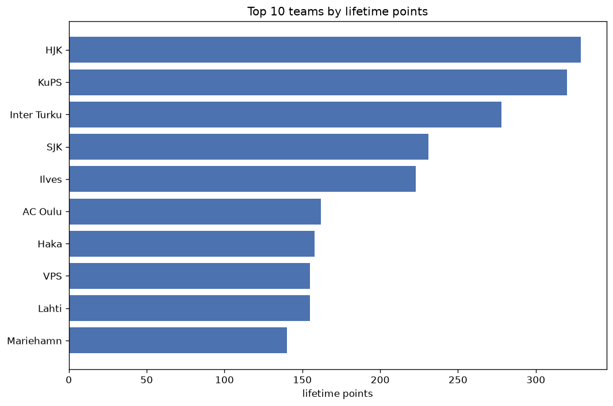
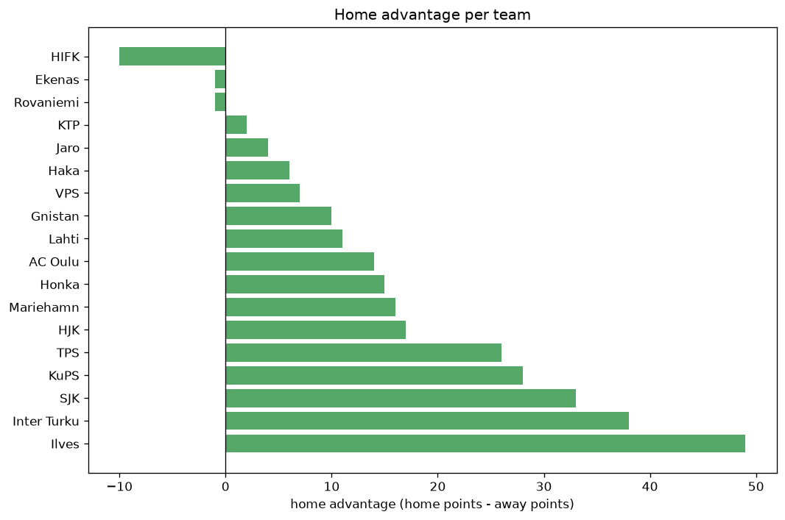

# Team Analysis
- Report: `teams_analysis`
- Generated: 2026-10-30T03:50:38+00:00
- Script: `backend/scripts/analyze_teams.py` v1.0.0
- League: Veikkausliiga (Finland)
- Scope: league `finland1`

- Teams: **18** | Seasons: **7** | Matches: **946**

## 1. Team standings (lifetime)
| team | seasons | played | W | D | L | pts | GF | GA | GD | avg pts/season | best pos | worst pos | titles |
|---|---|---|---|---|---|---|---|---|---|---|---|---|---|
| HJK | 7 | 161 | 98 | 35 | 28 | 329 | 313 | 150 | 163 | 47.0 | 1 | 3 | 3 |
| KuPS | 7 | 161 | 94 | 38 | 29 | 320 | 270 | 144 | 126 | 45.71 | 1 | 4 | 2 |
| Inter Turku | 7 | 161 | 80 | 38 | 43 | 278 | 264 | 167 | 97 | 39.71 | 1 | 7 | 2 |
| SJK | 7 | 154 | 65 | 36 | 53 | 231 | 224 | 206 | 18 | 33.0 | 3 | 10 | 0 |
| Ilves | 7 | 154 | 62 | 37 | 55 | 223 | 235 | 204 | 31 | 31.86 | 2 | 10 | 0 |
| AC Oulu | 6 | 140 | 45 | 27 | 68 | 162 | 176 | 228 | -52 | 27.0 | 4 | 11 | 0 |
| Haka | 6 | 132 | 42 | 32 | 58 | 158 | 171 | 217 | -46 | 26.33 | 4 | 11 | 0 |
| VPS | 5 | 118 | 43 | 26 | 49 | 155 | 166 | 163 | 3 | 31.0 | 4 | 10 | 0 |
| Lahti | 6 | 132 | 37 | 44 | 51 | 155 | 152 | 187 | -35 | 25.83 | 6 | 11 | 0 |
| Mariehamn | 7 | 154 | 35 | 35 | 84 | 140 | 157 | 271 | -114 | 20.0 | 9 | 12 | 0 |
| Honka | 4 | 88 | 38 | 25 | 25 | 139 | 122 | 84 | 38 | 34.75 | 3 | 8 | 0 |
| Gnistan | 3 | 73 | 26 | 22 | 25 | 100 | 109 | 114 | -5 | 33.33 | 5 | 8 | 0 |
| HIFK | 3 | 66 | 18 | 16 | 32 | 70 | 67 | 104 | -37 | 23.33 | 5 | 12 | 0 |
| TPS | 2 | 44 | 14 | 10 | 20 | 52 | 51 | 62 | -11 | 26.0 | 8 | 11 | 0 |
| KTP | 3 | 66 | 9 | 15 | 42 | 42 | 62 | 133 | -71 | 14.0 | 11 | 12 | 0 |
| Jaro | 2 | 44 | 10 | 10 | 24 | 40 | 43 | 80 | -37 | 20.0 | 8 | 11 | 0 |
| Ekenas | 1 | 22 | 3 | 4 | 15 | 13 | 19 | 51 | -32 | 13.0 | 12 | 12 | 0 |
| Rovaniemi | 1 | 22 | 1 | 2 | 19 | 5 | 15 | 51 | -36 | 5.0 | 12 | 12 | 0 |

## 2. Home vs away split
| team | home P | H-W | H-D | H-L | H-pts | away P | A-W | A-D | A-L | A-pts | adv |
|---|---|---|---|---|---|---|---|---|---|---|---|
| Ilves | 77 | 40 | 16 | 21 | 136 | 77 | 22 | 21 | 34 | 87 | 49 |
| Inter Turku | 80 | 46 | 20 | 14 | 158 | 81 | 34 | 18 | 29 | 120 | 38 |
| SJK | 77 | 38 | 18 | 21 | 132 | 77 | 27 | 18 | 32 | 99 | 33 |
| KuPS | 80 | 54 | 12 | 14 | 174 | 81 | 40 | 26 | 15 | 146 | 28 |
| TPS | 22 | 12 | 3 | 7 | 39 | 22 | 2 | 7 | 13 | 13 | 26 |
| HJK | 81 | 52 | 17 | 12 | 173 | 80 | 46 | 18 | 16 | 156 | 17 |
| Mariehamn | 77 | 19 | 21 | 37 | 78 | 77 | 16 | 14 | 47 | 62 | 16 |
| Honka | 44 | 22 | 11 | 11 | 77 | 44 | 16 | 14 | 14 | 62 | 15 |
| AC Oulu | 70 | 24 | 16 | 30 | 88 | 70 | 21 | 11 | 38 | 74 | 14 |
| Lahti | 66 | 21 | 20 | 25 | 83 | 66 | 16 | 24 | 26 | 72 | 11 |
| Gnistan | 37 | 15 | 10 | 12 | 55 | 36 | 11 | 12 | 13 | 45 | 10 |
| VPS | 59 | 22 | 15 | 22 | 81 | 59 | 21 | 11 | 27 | 74 | 7 |
| Haka | 66 | 21 | 19 | 26 | 82 | 66 | 21 | 13 | 32 | 76 | 6 |
| Jaro | 22 | 5 | 7 | 10 | 22 | 22 | 5 | 3 | 14 | 18 | 4 |
| KTP | 33 | 4 | 10 | 19 | 22 | 33 | 5 | 5 | 23 | 20 | 2 |
| Ekenas | 11 | 1 | 3 | 7 | 6 | 11 | 2 | 1 | 8 | 7 | -1 |
| Rovaniemi | 11 | 0 | 2 | 9 | 2 | 11 | 1 | 0 | 10 | 3 | -1 |
| HIFK | 33 | 8 | 6 | 19 | 30 | 33 | 10 | 10 | 13 | 40 | -10 |

## 3. Top performers
### Best points per game (PPG)
| rank | team | PPG |
|---|---|---|
| 1 | HJK | 2.04 |
| 2 | KuPS | 1.99 |
| 3 | Inter Turku | 1.73 |
| 4 | Honka | 1.58 |
| 5 | SJK | 1.50 |

### Most goals scored
| rank | team | goals |
|---|---|---|
| 1 | HJK | 313 |
| 2 | KuPS | 270 |
| 3 | Inter Turku | 264 |
| 4 | Ilves | 235 |
| 5 | SJK | 224 |

### Best goal difference
| rank | team | GD |
|---|---|---|
| 1 | HJK | 163 |
| 2 | KuPS | 126 |
| 3 | Inter Turku | 97 |
| 4 | Honka | 38 |
| 5 | Ilves | 31 |

### Best defence (goals against per match, standings)
| rank | team | GA/match |
|---|---|---|
| 1 | KuPS | 0.894 |
| 2 | HJK | 0.932 |
| 3 | Honka | 0.955 |
| 4 | Inter Turku | 1.037 |
| 5 | Ilves | 1.325 |

## 4. Team consistency
- Teams present in all **7** seasons: **6**

HJK, Ilves, Inter Turku, KuPS, Mariehamn, SJK

## 5. Head-to-head dominance
- Distinct fixtures: **137** (showing the 15 most frequent)

| fixture | meetings | home wins | draws | away wins | home pct | draw pct | away pct |
|---|---|---|---|---|---|---|---|
| HJK vs KuPS | 16 | 4 | 10 | 2 | 25.0% | 62.5% | 12.5% |
| Inter Turku vs KuPS | 15 | 8 | 4 | 3 | 53.3% | 26.7% | 20.0% |
| HJK vs Inter Turku | 15 | 4 | 4 | 7 | 26.7% | 26.7% | 46.7% |
| Inter Turku vs Ilves | 14 | 9 | 2 | 3 | 64.3% | 14.3% | 21.4% |
| HJK vs Mariehamn | 14 | 8 | 1 | 5 | 57.1% | 7.1% | 35.7% |
| Ilves vs Mariehamn | 14 | 8 | 3 | 3 | 57.1% | 21.4% | 21.4% |
| KuPS vs SJK | 14 | 8 | 4 | 2 | 57.1% | 28.6% | 14.3% |
| HJK vs Ilves | 14 | 7 | 3 | 4 | 50.0% | 21.4% | 28.6% |
| HJK vs SJK | 14 | 7 | 3 | 4 | 50.0% | 21.4% | 28.6% |
| Inter Turku vs Mariehamn | 14 | 7 | 3 | 4 | 50.0% | 21.4% | 28.6% |
| Inter Turku vs SJK | 14 | 7 | 3 | 4 | 50.0% | 21.4% | 28.6% |
| SJK vs Mariehamn | 14 | 7 | 0 | 7 | 50.0% | 0.0% | 50.0% |
| Inter Turku vs AC Oulu | 14 | 6 | 3 | 5 | 42.9% | 21.4% | 35.7% |
| KuPS vs Ilves | 14 | 6 | 3 | 5 | 42.9% | 21.4% | 35.7% |
| KuPS vs Mariehamn | 14 | 6 | 3 | 5 | 42.9% | 21.4% | 35.7% |

## 6. Position per season (classic view)
_Cells show final position; '-' when the team was absent from that season._

| team | 2020 | 2021 | 2022 | 2023 | 2024 | 2025 | 2026 |
|---|---|---|---|---|---|---|---|
| HJK | 1 | 2 | 1 | 1 | 2 | 3 | 2 |
| KuPS | 3 | 1 | 2 | 2 | 1 | 4 | 3 |
| Inter Turku | 2 | 3 | 5 | 6 | 7 | 1 | 1 |
| SJK | 7 | 4 | 6 | 3 | 4 | 5 | 10 |
| Ilves | 5 | 6 | 8 | 10 | 3 | 2 | 9 |
| AC Oulu | - | 11 | 7 | 7 | 9 | 10 | 4 |
| Haka | 10 | 9 | 4 | 8 | 5 | 11 | - |
| VPS | - | - | 10 | 4 | 6 | 7 | 6 |
| Lahti | 6 | 7 | 11 | 9 | 11 | - | 7 |
| Mariehamn | 9 | 10 | 9 | 12 | 10 | 9 | 12 |
| Honka | 4 | 8 | 3 | 5 | - | - | - |
| Gnistan | - | - | - | - | 8 | 6 | 5 |
| HIFK | 8 | 5 | 12 | - | - | - | - |
| TPS | 11 | - | - | - | - | - | 8 |
| KTP | - | 12 | - | 11 | - | 12 | - |
| Jaro | - | - | - | - | - | 8 | 11 |
| Ekenas | - | - | - | - | 12 | - | - |
| Rovaniemi | 12 | - | - | - | - | - | - |

---
*All statistics are computed from PostgreSQL tables (read-only). Run with `python backend/scripts/analyze_teams.py` to regenerate.*

## Charts

