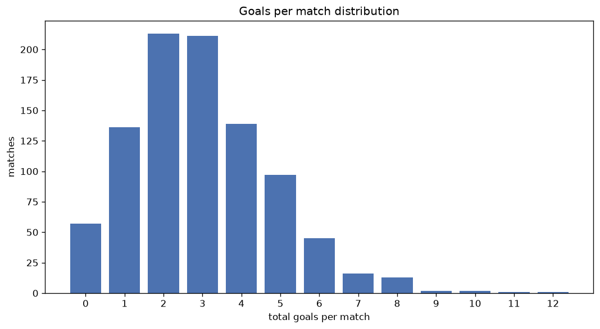
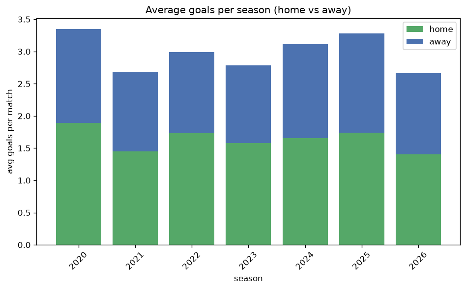

# Goal Analysis
- Report: `goals_analysis`
- Generated: 2026-10-29T01:59:21+00:00
- Script: `backend/scripts/analyze_goals.py` v1.0.0
- League: Ykkosliiga (Finland)
- Scope: league `finland2`

## 1. Goals per match distribution
| goals | matches | pct |
|---|---|---|
| 0 | 57 | 6.1% |
| 1 | 136 | 14.6% |
| 2 | 213 | 22.8% |
| 3 | 211 | 22.6% |
| 4 | 139 | 14.9% |
| 5 | 97 | 10.4% |
| 6 | 45 | 4.8% |
| 7 | 16 | 1.7% |
| 8 | 13 | 1.4% |
| 9 | 2 | 0.2% |
| 10 | 2 | 0.2% |
| 11 | 1 | 0.1% |
| 12 | 1 | 0.1% |

## 2. Goals per match per season
| season | matches | total goals | avg home | avg away | avg total |
|---|---|---|---|---|---|
| 2020 | 132 | 442 | 1.894 | 1.455 | 3.348 |
| 2021 | 132 | 355 | 1.447 | 1.242 | 2.689 |
| 2022 | 132 | 395 | 1.735 | 1.258 | 2.992 |
| 2023 | 132 | 368 | 1.583 | 1.205 | 2.788 |
| 2024 | 135 | 420 | 1.659 | 1.452 | 3.111 |
| 2025 | 135 | 443 | 1.741 | 1.541 | 3.281 |
| 2026 | 135 | 360 | 1.407 | 1.259 | 2.667 |

## 3. Home vs away goal share
- Home goals: **1528** (54.9%)
- Away goals: **1255** (45.1%)
- Home/away ratio: **1.218**

| season | home goals | away goals | total | home pct | away pct |
|---|---|---|---|---|---|
| 2020 | 250 | 192 | 442 | 56.6% | 43.4% |
| 2021 | 191 | 164 | 355 | 53.8% | 46.2% |
| 2022 | 229 | 166 | 395 | 58.0% | 42.0% |
| 2023 | 209 | 159 | 368 | 56.8% | 43.2% |
| 2024 | 224 | 196 | 420 | 53.3% | 46.7% |
| 2025 | 235 | 208 | 443 | 53.0% | 47.0% |
| 2026 | 190 | 170 | 360 | 52.8% | 47.2% |

## 4. BTTS (Both Teams To Score)
- Overall: **519** of `933` (55.6%)

| season | matches | BTTS | pct |
|---|---|---|---|
| 2020 | 132 | 78 | 59.1% |
| 2021 | 132 | 70 | 53.0% |
| 2022 | 132 | 72 | 54.5% |
| 2023 | 132 | 67 | 50.8% |
| 2024 | 135 | 76 | 56.3% |
| 2025 | 135 | 93 | 68.9% |
| 2026 | 135 | 63 | 46.7% |

## 5. Clean sheets
- Home clean sheets: **259** (27.8%)
- Away clean sheets: **212** (22.7%)
- Total clean sheets recorded: **471**
- Matches with at least one clean sheet: **414** (44.4%)
- Both teams kept clean sheets (0-0): **57**

| season | matches | home CS | away CS | total CS | matches w/ CS |
|---|---|---|---|---|---|
| 2020 | 132 | 33 | 27 | 60 | 54 (40.9%) |
| 2021 | 132 | 38 | 34 | 72 | 62 (47.0%) |
| 2022 | 132 | 38 | 27 | 65 | 60 (45.5%) |
| 2023 | 132 | 47 | 29 | 76 | 65 (49.2%) |
| 2024 | 135 | 40 | 29 | 69 | 59 (43.7%) |
| 2025 | 135 | 24 | 23 | 47 | 42 (31.1%) |
| 2026 | 135 | 39 | 43 | 82 | 72 (53.3%) |

## 6. Scoring intensity
- First-half goals: **1231** (44.2%)
- Second-half goals: **1552** (55.8%)
- Avg first-half goals per match: **1.319**
- Avg second-half goals per match: **1.663**
- Second-half-only scoring (HT 0-0, FT goals >= 1): **191** (20.5%)

| season | matches | 1st half | 2nd half | 1st half pct | 2nd half pct |
|---|---|---|---|---|---|
| 2020 | 132 | 202 | 240 | 45.7% | 54.3% |
| 2021 | 132 | 155 | 200 | 43.7% | 56.3% |
| 2022 | 132 | 176 | 219 | 44.6% | 55.4% |
| 2023 | 132 | 160 | 208 | 43.5% | 56.5% |
| 2024 | 135 | 186 | 234 | 44.3% | 55.7% |
| 2025 | 135 | 195 | 248 | 44.0% | 56.0% |
| 2026 | 135 | 157 | 203 | 43.6% | 56.4% |

## 7. First-goal timing
- Matches with first-goal time recorded: `876` of `933` (93.9%)
- Goalless matches: `57`
- Min `1` | Max `95` | Mean `29.56` | Median (p50) `23.0`

| bucket | count | % of matches | % of scoring matches |
|---|---|---|---|
| 1-15 | 313 | 33.5% | 35.7% |
| 16-30 | 222 | 23.8% | 25.3% |
| 31-45 | 132 | 14.1% | 15.1% |
| 46-60 | 101 | 10.8% | 11.5% |
| 61-75 | 69 | 7.4% | 7.9% |
| 76-90 | 31 | 3.3% | 3.5% |
| 91-120 | 8 | 0.9% | 0.9% |

---
*All statistics are computed from PostgreSQL tables (read-only). Run with `python backend/scripts/analyze_goals.py` to regenerate.*

## Charts

