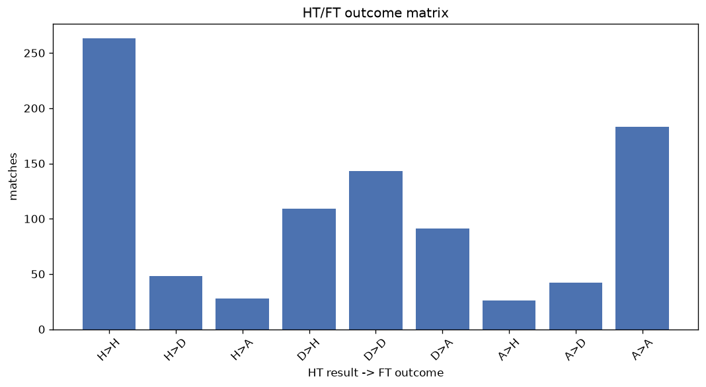
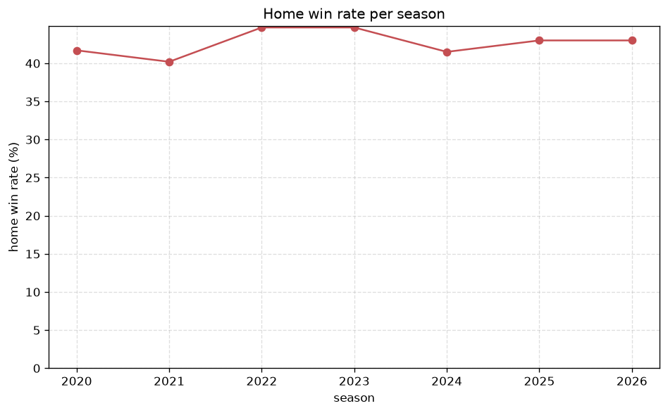

# Match Analysis
- Report: `matches_analysis`
- Generated: 2026-10-26T01:31:54+00:00
- Script: `backend/scripts/analyze_matches.py` v1.0.0
- League: Ykkosliiga (Finland)
- Scope: league `finland2`

## 1. Overall summary
| metric | value |
|---|---|
| Matches | 933 |
| Home wins | 398 (42.7%) |
| Draws | 233 (25.0%) |
| Away wins | 302 (32.4%) |
| Total goals | 2783 |
| Average goals per match | 2.983 |
| Goalless matches | 57 (6.1%) |

## 2. Per-season breakdown
| season | matches | home wins | draws | away wins | total goals | avg goals | goalless |
|---|---|---|---|---|---|---|---|
| 2020 | 132 | 55 (41.7%) | 29 (22.0%) | 48 (36.4%) | 442 | 3.348 | 6 (4.5%) |
| 2021 | 132 | 53 (40.2%) | 35 (26.5%) | 44 (33.3%) | 355 | 2.689 | 10 (7.6%) |
| 2022 | 132 | 59 (44.7%) | 34 (25.8%) | 39 (29.5%) | 395 | 2.992 | 5 (3.8%) |
| 2023 | 132 | 59 (44.7%) | 35 (26.5%) | 38 (28.8%) | 368 | 2.788 | 11 (8.3%) |
| 2024 | 135 | 56 (41.5%) | 34 (25.2%) | 45 (33.3%) | 420 | 3.111 | 10 (7.4%) |
| 2025 | 135 | 58 (43.0%) | 35 (25.9%) | 42 (31.1%) | 443 | 3.281 | 5 (3.7%) |
| 2026 | 135 | 58 (43.0%) | 31 (23.0%) | 46 (34.1%) | 360 | 2.667 | 10 (7.4%) |

## 3. HT/FT outcome matrix
| HT result \ FT result | Home | Draw | Away | total |
|---|---|---|---|---|
| HT home lead | 263 (77.6%) | 48 (14.2%) | 28 (8.3%) | 339 |
| HT draw | 109 (31.8%) | 143 (41.7%) | 91 (26.5%) | 343 |
| HT away lead | 26 (10.4%) | 42 (16.7%) | 183 (72.9%) | 251 |

## 4. Comeback matches
- Home comebacks (trailing at HT, won at FT): **26** (2.8%)
- Away comebacks (trailing at HT, won at FT): **28** (3.0%)

### Home comebacks
| season | home | away | HT | FT |
|---|---|---|---|---|
| 2021 | Mikkeli | KPV Kokkola | 0-1 | 2-1 |
| 2021 | Rovaniemi | Jaro | 0-1 | 3-1 |
| 2021 | Ekenas | Rovaniemi | 1-2 | 3-2 |
| 2021 | Mikkeli | Gnistan | 0-1 | 2-1 |
| 2022 | Ekenas | PEPO | 0-1 | 2-1 |
| 2022 | TPS | SJK Akatemia | 0-1 | 2-1 |
| 2022 | PEPO | Mikkeli | 0-1 | 2-1 |
| 2023 | TPS | SalPa | 0-1 | 2-1 |
| 2023 | Mikkeli | JJK Jyvaskyla | 1-3 | 4-3 |
| 2023 | KaPa | JaPS | 0-1 | 3-1 |
| 2023 | Mikkeli | HIFK | 0-1 | 2-1 |
| 2023 | Gnistan | SalPa | 1-2 | 3-2 |
| 2024 | SJK Akatemia | JaPS | 0-1 | 2-1 |
| 2024 | TPS | KaPa | 0-1 | 2-1 |
| 2024 | PK-35 | JaPS | 0-1 | 4-1 |
| 2024 | Jippo | JaPS | 0-2 | 3-2 |
| 2024 | KaPa | Mikkeli | 0-2 | 3-2 |
| 2025 | KaPa | SalPa | 0-1 | 3-1 |
| 2025 | TPS | SJK Akatemia | 1-2 | 3-2 |
| 2025 | Lahti | Jippo | 1-2 | 3-2 |
| 2025 | Jippo | Ekenas | 1-2 | 3-2 |
| 2026 | Haka | Jippo | 0-1 | 2-1 |
| 2026 | KTP | JaPS | 0-1 | 4-1 |
| 2026 | Jippo | Klubi 04 | 0-1 | 3-1 |
| 2026 | KaPa | Haka | 0-2 | 3-2 |
| 2026 | SJK Akatemia | KTP | 0-1 | 4-3 |

### Away comebacks
| season | home | away | HT | FT |
|---|---|---|---|---|
| 2020 | Mikkeli | Jaro | 1-0 | 1-2 |
| 2020 | KTP | AC Oulu | 1-0 | 1-2 |
| 2020 | Mikkeli | KTP | 1-0 | 2-3 |
| 2020 | VPS | Gnistan | 3-2 | 3-5 |
| 2020 | VPS | KTP | 2-1 | 2-4 |
| 2021 | Jippo | Rovaniemi | 1-0 | 1-2 |
| 2021 | PK-35 | Ekenas | 1-0 | 2-3 |
| 2021 | Ekenas | Klubi 04 | 1-0 | 1-2 |
| 2021 | Ekenas | TPS | 1-0 | 1-2 |
| 2022 | PIF Pargas | Ekenas | 2-1 | 2-3 |
| 2022 | PEPO | JaPS | 2-0 | 2-4 |
| 2022 | Mikkeli | PIF Pargas | 2-0 | 2-3 |
| 2022 | Mikkeli | PK-35 | 1-0 | 1-2 |
| 2023 | KaPa | SalPa | 2-1 | 2-3 |
| 2023 | KPV Kokkola | JaPS | 1-0 | 1-2 |
| 2023 | JJK Jyvaskyla | KaPa | 1-0 | 1-2 |
| 2023 | JJK Jyvaskyla | Gnistan | 1-0 | 2-3 |
| 2023 | KPV Kokkola | Ekenas | 1-0 | 2-3 |
| 2024 | SJK Akatemia | Jippo | 1-0 | 1-2 |
| 2024 | TPS | SalPa | 1-0 | 2-3 |
| 2025 | Klubi 04 | JaPS | 2-1 | 4-6 |
| 2025 | TPS | PK-35 | 1-0 | 1-2 |
| 2025 | TPS | PK-35 | 1-0 | 1-3 |
| 2025 | Ekenas | SJK Akatemia | 1-0 | 2-3 |
| 2025 | Klubi 04 | TPS | 1-0 | 2-3 |
| 2026 | Ekenas | Jippo | 1-0 | 1-2 |
| 2026 | Mikkeli | Jippo | 1-0 | 1-3 |
| 2026 | SJK Akatemia | JaPS | 1-0 | 2-3 |

## 5. HT lead conversion
| HT state | matches | converted to win | held as draw | collapsed to loss |
|---|---|---|---|---|
| Home lead | 339 | 263 (77.6%) | 48 (14.2%) | 28 (8.3%) |
| Away lead | 251 | 183 (72.9%) | 42 (16.7%) | 26 (10.4%) |

### Matches level at half-time
| FT result | count | pct |
|---|---|---|
| Home win | 109 | 31.8% |
| Draw | 143 | 41.7% |
| Away win | 91 | 26.5% |

## 6. First-goal timing
- Matches with a first-goal time recorded: `876` of `933` (93.9%)

Outcome distribution by first-goal timing bucket:
| bucket | matches | % of matches | home | draw | away |
|---|---|---|---|---|---|
| 1-15 | 313 | 33.5% | 144 (46.0%) | 55 (17.6%) | 114 (36.4%) |
| 16-30 | 222 | 23.8% | 114 (51.4%) | 39 (17.6%) | 69 (31.1%) |
| 31-45 | 132 | 14.1% | 58 (43.9%) | 32 (24.2%) | 42 (31.8%) |
| 46-60 | 101 | 10.8% | 37 (36.6%) | 23 (22.8%) | 41 (40.6%) |
| 61-75 | 69 | 7.4% | 23 (33.3%) | 22 (31.9%) | 24 (34.8%) |
| 76-90 | 31 | 3.3% | 18 (58.1%) | 5 (16.1%) | 8 (25.8%) |
| 91-120 | 8 | 0.9% | 4 (50.0%) | 0 (0.0%) | 4 (50.0%) |

## 7. Goalless matches
- Overall: **57** of `933` (6.1%)

| season | matches | goalless | pct |
|---|---|---|---|
| 2020 | 132 | 6 | 4.5% |
| 2021 | 132 | 10 | 7.6% |
| 2022 | 132 | 5 | 3.8% |
| 2023 | 132 | 11 | 8.3% |
| 2024 | 135 | 10 | 7.4% |
| 2025 | 135 | 5 | 3.7% |
| 2026 | 135 | 10 | 7.4% |

---
*All statistics are computed from PostgreSQL tables (read-only). Run with `python backend/scripts/analyze_matches.py` to regenerate.*

## Charts

