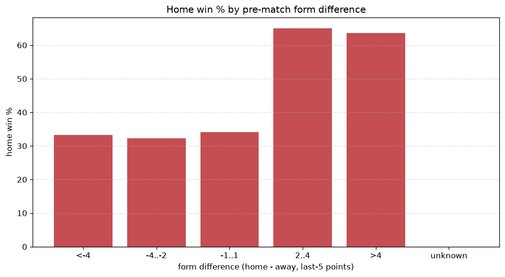
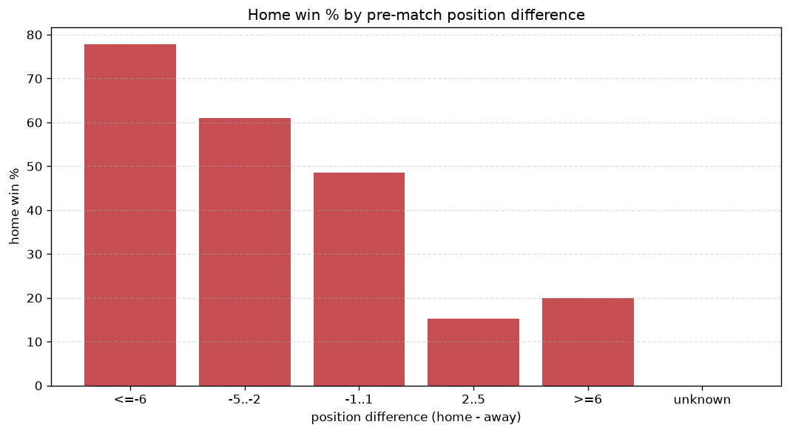

# Relationships Analysis
- Report: `relationships`
- Generated: 2026-10-27T01:47:33+00:00
- Script: `backend/scripts/analyze_relationships.py` v1.0.0
- League: Ykkosliiga (Finland)
- Scope: league `finland2`

- Matches analysed: **798** (23 leakage-safe pre-match features).

## 1. Correlation matrix
_Pearson correlation of each pre-match feature with observed goals; sorted by |corr(total goals)|._

| feature | corr(home) | corr(away) | corr(total) |
|---|---|---|---|
| away_team_away_conceded_avg | 0.189 | -0.001 | 0.147 |
| away_team_goals_conceded_last_5 | 0.188 | -0.057 | 0.109 |
| away_team_goals_scored_last_5 | 0.011 | 0.148 | 0.109 |
| home_team_goals_conceded_last_5 | -0.001 | 0.147 | 0.098 |
| home_team_goals_scored_last_5 | 0.125 | -0.000 | 0.098 |
| home_points_before_match | 0.140 | -0.021 | 0.095 |
| away_team_away_goals_avg | -0.037 | 0.141 | 0.066 |
| away_points_before_match | -0.060 | 0.165 | 0.064 |
| away_rest_days | -0.059 | -0.010 | -0.053 |
| away_team_wins_last_5 | -0.079 | 0.159 | 0.045 |
| away_team_points_last_5 | -0.086 | 0.165 | 0.044 |
| home_team_home_goals_avg | 0.067 | -0.019 | 0.039 |
| away_team_away_win_rate | -0.139 | 0.104 | -0.039 |
| home_team_points_last_5 | 0.106 | -0.065 | 0.039 |
| points_difference | 0.235 | -0.217 | 0.038 |
| home_rest_days | -0.015 | -0.036 | -0.037 |
| home_team_home_win_rate | 0.103 | -0.066 | 0.036 |
| home_team_home_conceded_avg | -0.045 | 0.098 | 0.030 |
| home_team_wins_last_5 | 0.099 | -0.077 | 0.026 |
| rest_days_difference | 0.052 | -0.026 | 0.024 |
| away_position_before_match | 0.188 | -0.190 | 0.019 |
| position_difference | -0.232 | 0.248 | -0.015 |
| home_position_before_match | -0.125 | 0.145 | -0.001 |

## 2. Form vs outcome
_Home win/draw/away % per bucket of `home_team_points_last_5 - away_team_points_last_5`._

| bucket | matches | home | draw | away | home % | draw % | away % |
|---|---|---|---|---|---|---|---|
| <-4 | 121 | 42 | 25 | 54 | 34.7% | 20.7% | 44.6% |
| -4..-2 | 154 | 46 | 45 | 63 | 29.9% | 29.2% | 40.9% |
| -1..1 | 246 | 96 | 65 | 85 | 39.0% | 26.4% | 34.6% |
| 2..4 | 147 | 77 | 37 | 33 | 52.4% | 25.2% | 22.4% |
| >4 | 130 | 79 | 30 | 21 | 60.8% | 23.1% | 16.2% |
| unknown | 0 | 0 | 0 | 0 | - | - | - |

## 3. Position vs outcome
_Home win/draw/away % per bucket of `position_difference` (home position - away position; negative favours the home team)._

| bucket | matches | home | draw | away | home % | draw % | away % |
|---|---|---|---|---|---|---|---|
| <=-6 | 90 | 56 | 22 | 12 | 62.2% | 24.4% | 13.3% |
| -5..-2 | 217 | 117 | 55 | 45 | 53.9% | 25.3% | 20.7% |
| -1..1 | 182 | 81 | 48 | 53 | 44.5% | 26.4% | 29.1% |
| 2..5 | 212 | 61 | 55 | 96 | 28.8% | 25.9% | 45.3% |
| >=6 | 97 | 25 | 22 | 50 | 25.8% | 22.7% | 51.5% |
| unknown | 0 | 0 | 0 | 0 | - | - | - |

## 4. Rest advantage
_Home win/draw/away % per bucket of `rest_days_difference` (home rest - away rest). Matches with unknown rest are bucketed separately._

| bucket | matches | home | draw | away | home % | draw % | away % |
|---|---|---|---|---|---|---|---|
| <-1 | 97 | 25 | 31 | 41 | 25.8% | 32.0% | 42.3% |
| -1..0 | 128 | 62 | 29 | 37 | 48.4% | 22.7% | 28.9% |
| 0 | 333 | 148 | 78 | 107 | 44.4% | 23.4% | 32.1% |
| 1..2 | 137 | 60 | 35 | 42 | 43.8% | 25.5% | 30.7% |
| >2 | 66 | 30 | 19 | 17 | 45.5% | 28.8% | 25.8% |
| unknown | 37 | 15 | 10 | 12 | 40.5% | 27.0% | 32.4% |
- *37 match(es) had unknown rest difference (missing rest data on at least one side).*

## 5. Home team quality
_Home win rate by `home_team_home_win_rate` tier (split at 0.5)._

- `< 0.5` tier: **38.1%** home win (181/475)
- `>= 0.5` tier: **49.2%** home win (159/323)
- Home-win gap (>= split minus < split): **+11.1 pp**

| tier | label | matches | home | draw | away | home % |
|---|---|---|---|---|---|---|
| low | < 0.5 | 475 | 181 | 120 | 174 | 38.1% |
| high | >= 0.5 | 323 | 159 | 82 | 82 | 49.2% |

## 6. Feature averages by result
_Mean feature value per outcome; `range` is home-minus-away spread of the group means._

| feature | home mean | draw mean | away mean | range |
|---|---|---|---|---|
| points_difference | 2.997 | -0.272 | -3.645 | 6.642 |
| away_points_before_match | 13.841 | 14.723 | 18.184 | 4.342 |
| position_difference | -1.312 | -0.005 | 1.844 | 3.156 |
| home_points_before_match | 16.838 | 14.450 | 14.539 | 2.388 |
| away_position_before_match | 6.929 | 6.089 | 5.156 | 1.773 |
| away_team_points_last_5 | 5.371 | 6.059 | 6.801 | 1.430 |
| home_position_before_match | 5.618 | 6.084 | 7.000 | 1.382 |
| away_team_goals_conceded_last_5 | 7.174 | 6.094 | 5.855 | 1.318 |
| home_team_points_last_5 | 6.306 | 5.980 | 5.379 | 0.927 |
| away_team_goals_scored_last_5 | 6.379 | 6.129 | 7.027 | 0.899 |
| home_team_goals_conceded_last_5 | 6.306 | 6.465 | 7.039 | 0.733 |
| home_team_goals_scored_last_5 | 6.874 | 6.272 | 6.203 | 0.670 |
| away_team_wins_last_5 | 1.421 | 1.653 | 1.875 | 0.454 |
| home_team_wins_last_5 | 1.732 | 1.634 | 1.371 | 0.361 |
| away_rest_days | 6.457 | 6.818 | 6.806 | 0.361 |
| rest_days_difference | 0.135 | -0.203 | -0.217 | 0.353 |
| away_team_away_conceded_avg | 1.567 | 1.383 | 1.321 | 0.246 |
| home_team_home_conceded_avg | 1.093 | 1.194 | 1.268 | 0.175 |
| away_team_away_goals_avg | 1.118 | 1.126 | 1.271 | 0.154 |
| away_team_away_win_rate | 0.237 | 0.281 | 0.333 | 0.097 |
| home_team_home_win_rate | 0.426 | 0.394 | 0.337 | 0.089 |
| home_team_home_goals_avg | 1.485 | 1.437 | 1.409 | 0.076 |
| home_rest_days | 6.604 | 6.617 | 6.582 | 0.035 |

---
*All features are leakage-safe pre-match values built by `ml.features.build_features.build_rows` from strictly prior matches. Run with `python backend/scripts/analyze_relationships.py` to regenerate.*

## Charts

