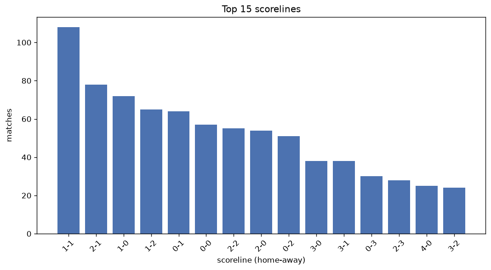
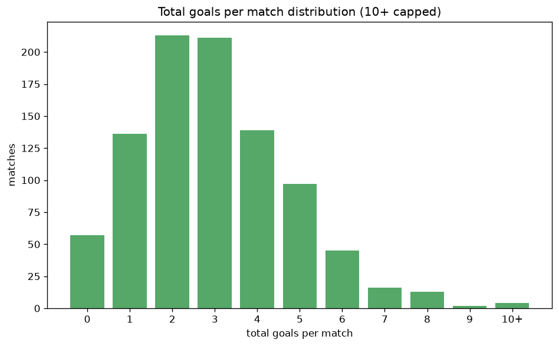

# Scoreline Analysis
- Report: `scoreline_analysis`
- Generated: 2026-10-26T01:32:00+00:00
- Script: `backend/scripts/analyze_scorelines.py` v1.0.0
- League: Ykkosliiga (Finland)
- Scope: league `finland2`

## 1. Scoreline frequency
- Matches analysed: **933** across **7** seasons.
- Distinct scorelines seen: **45**.

| scoreline | count | pct |
|---|---|---|
| 1-1 | 108 | 11.6% |
| 2-1 | 78 | 8.4% |
| 1-0 | 72 | 7.7% |
| 1-2 | 65 | 7.0% |
| 0-1 | 64 | 6.9% |
| 0-0 | 57 | 6.1% |
| 2-2 | 55 | 5.9% |
| 2-0 | 54 | 5.8% |
| 0-2 | 51 | 5.5% |
| 3-0 | 38 | 4.1% |
| 3-1 | 38 | 4.1% |
| 0-3 | 30 | 3.2% |
| 2-3 | 28 | 3.0% |
| 4-0 | 25 | 2.7% |
| 3-2 | 24 | 2.6% |
| 4-1 | 18 | 1.9% |
| 1-3 | 16 | 1.7% |
| 1-4 | 15 | 1.6% |
| 4-2 | 13 | 1.4% |
| 3-3 | 11 | 1.2% |

## 2. Scoreline frequency per season

### 2020
| scoreline | count | pct |
|---|---|---|
| 1-1 | 16 | 12.1% |
| 1-2 | 12 | 9.1% |
| 0-1 | 10 | 7.6% |
| 1-0 | 8 | 6.1% |
| 2-2 | 6 | 4.5% |

### 2021
| scoreline | count | pct |
|---|---|---|
| 1-1 | 15 | 11.4% |
| 0-1 | 13 | 9.8% |
| 1-2 | 11 | 8.3% |
| 0-0 | 10 | 7.6% |
| 1-0 | 10 | 7.6% |

### 2022
| scoreline | count | pct |
|---|---|---|
| 1-1 | 17 | 12.9% |
| 2-1 | 15 | 11.4% |
| 0-2 | 11 | 8.3% |
| 2-2 | 10 | 7.6% |
| 1-0 | 9 | 6.8% |

### 2023
| scoreline | count | pct |
|---|---|---|
| 2-0 | 14 | 10.6% |
| 1-0 | 13 | 9.8% |
| 1-1 | 13 | 9.8% |
| 0-0 | 11 | 8.3% |
| 2-1 | 10 | 7.6% |

### 2024
| scoreline | count | pct |
|---|---|---|
| 1-1 | 16 | 11.9% |
| 2-1 | 13 | 9.6% |
| 0-0 | 10 | 7.4% |
| 1-0 | 9 | 6.7% |
| 0-1 | 9 | 6.7% |

### 2025
| scoreline | count | pct |
|---|---|---|
| 1-1 | 19 | 14.1% |
| 2-1 | 12 | 8.9% |
| 1-2 | 11 | 8.1% |
| 3-1 | 11 | 8.1% |
| 2-2 | 9 | 6.7% |

### 2026
| scoreline | count | pct |
|---|---|---|
| 1-0 | 15 | 11.1% |
| 0-1 | 15 | 11.1% |
| 2-1 | 12 | 8.9% |
| 1-1 | 12 | 8.9% |
| 0-2 | 12 | 8.9% |

## 3. Total-goal histogram
_10+ groups all matches with 10 or more total goals._

| total goals | matches | pct |
|---|---|---|
| 0 | 57 | 6.1% |
| 1 | 136 | 14.6% |
| 2 | 213 | 22.8% |
| 3 | 211 | 22.6% |
| 4 | 139 | 14.9% |
| 5 | 97 | 10.4% |
| 6 | 45 | 4.8% |
| 7 | 16 | 1.7% |
| 8 | 13 | 1.4% |
| 9 | 2 | 0.2% |
| 10+ | 4 | 0.4% |

## 4. Extreme scorelines
- Matches with 7+ total goals: **35**

| season | date | scoreline | total goals |
|---|---|---|---|
| 2020 | 2020-10-21 | 10-2 | 12 |
| 2022 | 2022-05-08 | 10-1 | 11 |
| 2020 | 2020-10-10 | 8-2 | 10 |
| 2025 | 2025-04-23 | 4-6 | 10 |
| 2020 | 2020-09-12 | 3-6 | 9 |
| 2024 | 2024-09-27 | 7-2 | 9 |
| 2020 | 2020-10-25 | 3-5 | 8 |
| 2021 | 2021-08-01 | 2-6 | 8 |
| 2021 | 2021-08-21 | 5-3 | 8 |
| 2023 | 2023-05-06 | 5-3 | 8 |
| 2023 | 2023-06-28 | 6-2 | 8 |
| 2023 | 2023-07-15 | 4-4 | 8 |
| 2023 | 2023-09-02 | 4-4 | 8 |
| 2024 | 2024-07-11 | 2-6 | 8 |
| 2024 | 2024-08-17 | 5-3 | 8 |
| 2024 | 2024-10-19 | 3-5 | 8 |
| 2025 | 2025-05-25 | 5-3 | 8 |
| 2025 | 2025-06-18 | 5-3 | 8 |
| 2026 | 2026-08-30 | 2-6 | 8 |
| 2020 | 2020-08-05 | 6-1 | 7 |
| 2020 | 2020-08-22 | 6-1 | 7 |
| 2020 | 2020-08-23 | 5-2 | 7 |
| 2022 | 2022-08-06 | 3-4 | 7 |
| 2023 | 2023-06-07 | 4-3 | 7 |
| 2023 | 2023-06-11 | 5-2 | 7 |
| 2024 | 2024-07-14 | 5-2 | 7 |
| 2024 | 2024-09-22 | 2-5 | 7 |
| 2025 | 2025-04-22 | 3-4 | 7 |
| 2025 | 2025-05-10 | 3-4 | 7 |
| 2025 | 2025-07-04 | 4-3 | 7 |
| 2026 | 2026-05-03 | 5-2 | 7 |
| 2026 | 2026-05-08 | 4-3 | 7 |
| 2026 | 2026-08-22 | 4-3 | 7 |
| 2026 | 2026-10-09 | 7-0 | 7 |
| 2026 | 2026-10-11 | 4-3 | 7 |

## 5. Margin-of-victory distribution (decided matches)
- Decided matches: **700** (draws: **233**)
- Average winning margin: **1.92**

| margin | matches | pct |
|---|---|---|
| 1 | 339 | 48.4% |
| 2 | 187 | 26.7% |
| 3+ | 174 | 24.9% |

## 6. Margin by outcome

### Home wins
- Matches: **398** | avg margin: **2.03** | max margin: **9**
| margin | matches | pct |
|---|---|---|
| 1 | 179 | 45.0% |
| 2 | 110 | 27.6% |
| 3+ | 109 | 27.4% |
- *Full match-by-match list available in `scoreline_analysis.json`.*

### Away wins
- Matches: **302** | avg margin: **1.77** | max margin: **6**
| margin | matches | pct |
|---|---|---|
| 1 | 160 | 53.0% |
| 2 | 77 | 25.5% |
| 3+ | 65 | 21.5% |
- *Full match-by-match list available in `scoreline_analysis.json`.*

## 7. Most common exact score by outcome type
| outcome | matches | most common score | count | pct |
|---|---|---|---|---|
| home | 398 | 2-1 | 78 | 19.6% |
| draw | 233 | 1-1 | 108 | 46.4% |
| away | 302 | 1-2 | 65 | 21.5% |

---
*All statistics are computed from PostgreSQL tables (read-only). Run with `python backend/scripts/analyze_scorelines.py` to regenerate.*

## Charts

