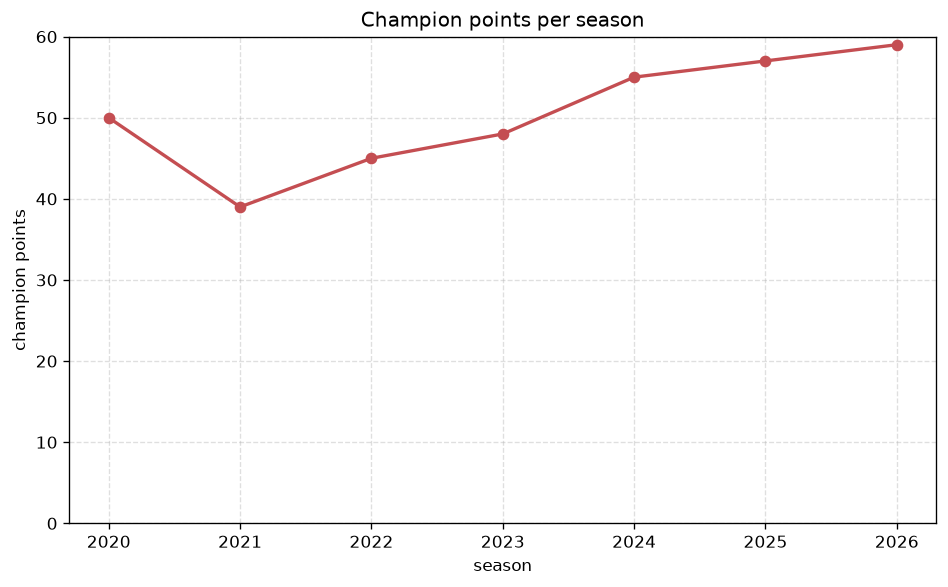
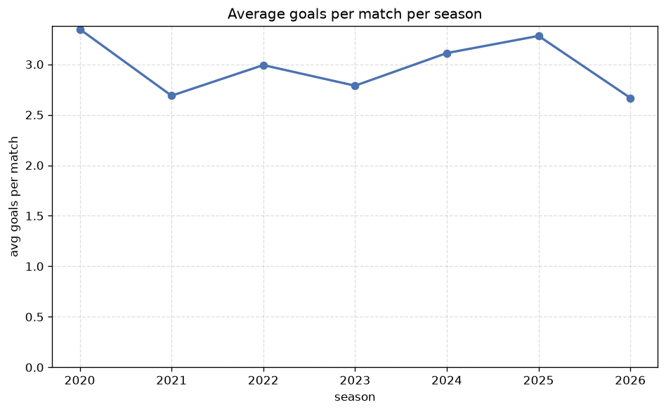

# Season Trends Analysis
- Report: `season_trends`
- Generated: 2026-10-26T01:31:58+00:00
- Script: `backend/scripts/analyze_seasons.py` v1.0.0
- League: Ykkosliiga (Finland)
- Scope: league `finland2`

## 1. Champions per season
| season | champion | pts | runner-up | margin |
|---|---|---|---|---|
| 2020 | AC Oulu | 50 | KTP | 3 pts |
| 2021 | TPS | 39 | Rovaniemi | 0 pts |
| 2022 | TPS | 45 | KTP | 2 pts |
| 2023 | Ekenas | 48 | Gnistan | 0 pts |
| 2024 | KTP | 55 | Jaro | 4 pts |
| 2025 | Lahti | 57 | TPS | 7 pts |
| 2026 | KTP | 59 | PK-35 | 7 pts |

## 2. Title-race tightness
- Tight races (margin <= 3 pts): **4** of 7 seasons
- Tightest race: **2021** - TPS beat Rovaniemi by **0** pts

| season | margin | tight |
|---|---|---|
| 2020 | 3 pts | yes |
| 2021 | 0 pts | yes |
| 2022 | 2 pts | yes |
| 2023 | 0 pts | yes |
| 2024 | 4 pts |  |
| 2025 | 7 pts |  |
| 2026 | 7 pts |  |

## 3. Points thresholds
_Position-specific points per season. Key: 1 = champion, 2 = runner-up, 4 = CL line, 6 = Europa, 7 = last safe, 10 = bottom._

| season | pos 1 | pos 2 | pos 4 | pos 6 | pos 7 | pos 10 |
|---|---|---|---|---|---|---|
| 2020 | 50 | 47 | 36 | 33 | 29 | 23 |
| 2021 | 39 | 39 | 34 | 29 | 27 | - |
| 2022 | 45 | 43 | 32 | 30 | 29 | 21 |
| 2023 | 48 | 48 | 40 | 30 | 26 | 20 |
| 2024 | 55 | 51 | 42 | 28 | 28 | 14 |
| 2025 | 57 | 50 | 37 | 31 | 29 | 19 |
| 2026 | 59 | 52 | 47 | 32 | 30 | 17 |

## 4. Relegation battle
| season | safe pos | safe pts | drop pos | drop pts | gap |
|---|---|---|---|---|---|
| 2020 | 7 | 29 | 8 | 28 | 1 pts |
| 2021 | 7 | 27 | 8 | 25 | 2 pts |
| 2022 | 7 | 29 | 8 | 27 | 2 pts |
| 2023 | 7 | 26 | 8 | 21 | 5 pts |
| 2024 | 7 | 28 | 8 | 22 | 6 pts |
| 2025 | 7 | 29 | 8 | 22 | 7 pts |
| 2026 | 7 | 30 | 8 | 27 | 3 pts |

## 5. League-level trends
| season | matches | total goals | avg goals | home win | draw | away win | goalless | avg pts/team |
|---|---|---|---|---|---|---|---|---|
| 2020 | 132 | 442 | 3.348 | 41.7% | 22.0% | 36.4% | 4.5% | 30.58 |
| 2021 | 132 | 355 | 2.689 | 40.2% | 26.5% | 33.3% | 7.6% | 27.5 |
| 2022 | 132 | 395 | 2.992 | 44.7% | 25.8% | 29.5% | 3.8% | 27.75 |
| 2023 | 132 | 368 | 2.788 | 44.7% | 26.5% | 28.8% | 8.3% | 30.08 |
| 2024 | 135 | 420 | 3.111 | 41.5% | 25.2% | 33.3% | 7.4% | 33.6 |
| 2025 | 135 | 443 | 3.281 | 43.0% | 25.9% | 31.1% | 3.7% | 33.3 |
| 2026 | 135 | 360 | 2.667 | 43.0% | 23.0% | 34.1% | 7.4% | 37.4 |

## 6. View divergence
- Largest divergence: **2021** (goals view, avg abs position diff = 8.583)

_Avg absolute position difference between classic view and alternative view per season._

| season | classic vs luck | classic vs goals |
|---|---|---|
| 2020 | 1.833 | 4.000 |
| 2021 | 8.500 | 8.583 |
| 2022 | 7.667 | 7.917 |
| 2023 | 0.667 | 4.500 |
| 2024 | 6.000 | 4.000 |
| 2025 | 5.900 | 4.300 |
| 2026 | 1.200 | 3.800 |

---
*All statistics are computed from PostgreSQL tables (read-only). Run with `python backend/scripts/analyze_seasons.py` to regenerate.*

## Charts

