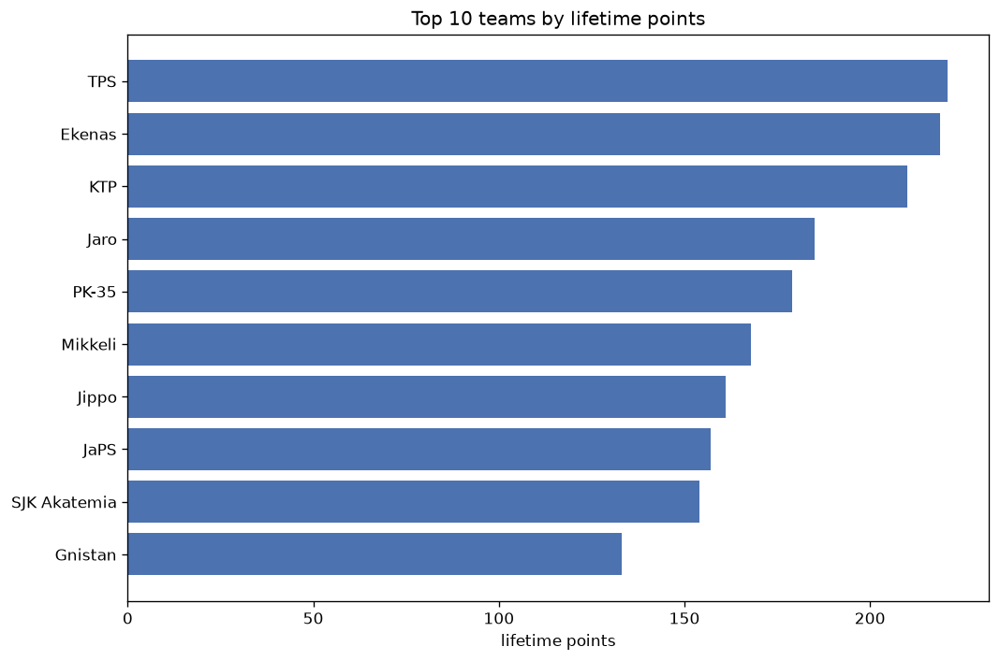
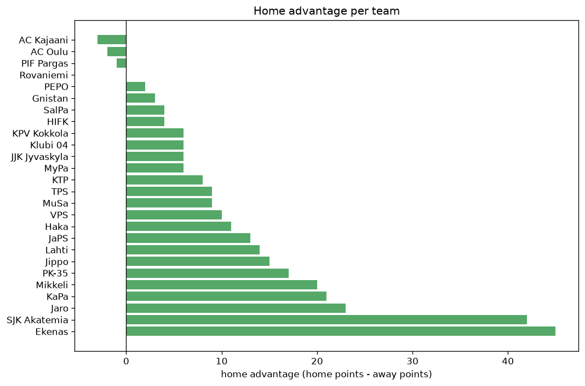

# Team Analysis
- Report: `teams_analysis`
- Generated: 2026-10-26T01:31:57+00:00
- Script: `backend/scripts/analyze_teams.py` v1.0.0
- League: Ykkosliiga (Finland)
- Scope: league `finland2`

- Teams: **26** | Seasons: **7** | Matches: **933**

## 1. Team standings (lifetime)
| team | seasons | played | W | D | L | pts | GF | GA | GD | avg pts/season | best pos | worst pos | titles |
|---|---|---|---|---|---|---|---|---|---|---|---|---|---|
| TPS | 5 | 120 | 64 | 29 | 27 | 221 | 217 | 133 | 84 | 44.2 | 1 | 4 | 2 |
| Ekenas | 6 | 142 | 61 | 36 | 45 | 219 | 242 | 199 | 43 | 36.5 | 1 | 7 | 1 |
| KTP | 4 | 98 | 64 | 18 | 16 | 210 | 218 | 101 | 117 | 52.5 | 1 | 2 | 2 |
| Jaro | 5 | 115 | 52 | 29 | 34 | 185 | 197 | 145 | 52 | 37.0 | 2 | 9 | 0 |
| PK-35 | 5 | 125 | 47 | 38 | 40 | 179 | 166 | 161 | 5 | 35.8 | 2 | 13 | 0 |
| Mikkeli | 6 | 142 | 44 | 36 | 62 | 168 | 177 | 223 | -46 | 28.0 | 3 | 11 | 0 |
| Jippo | 4 | 103 | 45 | 26 | 32 | 161 | 139 | 106 | 33 | 40.25 | 3 | 12 | 0 |
| JaPS | 5 | 125 | 42 | 31 | 52 | 157 | 167 | 220 | -53 | 31.4 | 5 | 8 | 0 |
| SJK Akatemia | 6 | 147 | 39 | 37 | 71 | 154 | 194 | 253 | -59 | 25.67 | 5 | 11 | 0 |
| Gnistan | 4 | 88 | 38 | 19 | 31 | 133 | 141 | 129 | 12 | 33.25 | 2 | 9 | 0 |
| KPV Kokkola | 4 | 88 | 25 | 29 | 34 | 104 | 108 | 125 | -17 | 26.0 | 5 | 11 | 0 |
| KaPa | 4 | 103 | 20 | 27 | 56 | 87 | 155 | 231 | -76 | 21.75 | 8 | 10 | 0 |
| Klubi 04 | 3 | 76 | 23 | 17 | 36 | 86 | 112 | 120 | -8 | 28.67 | 3 | 11 | 0 |
| VPS | 2 | 44 | 20 | 12 | 12 | 72 | 76 | 63 | 13 | 36.0 | 3 | 6 | 0 |
| SalPa | 3 | 76 | 18 | 16 | 42 | 70 | 83 | 127 | -44 | 23.33 | 7 | 11 | 0 |
| Lahti | 1 | 27 | 17 | 7 | 3 | 58 | 54 | 30 | 24 | 58.0 | 1 | 1 | 1 |
| MuSa | 2 | 44 | 14 | 13 | 17 | 55 | 60 | 79 | -19 | 27.5 | 5 | 9 | 0 |
| AC Oulu | 1 | 22 | 15 | 5 | 2 | 50 | 38 | 16 | 22 | 50.0 | 1 | 1 | 1 |
| Haka | 1 | 27 | 14 | 5 | 8 | 47 | 51 | 31 | 20 | 47.0 | 3 | 3 | 0 |
| Rovaniemi | 1 | 22 | 12 | 6 | 4 | 42 | 39 | 25 | 14 | 42.0 | 2 | 2 | 0 |
| HIFK | 1 | 22 | 8 | 6 | 8 | 30 | 27 | 29 | -2 | 30.0 | 6 | 6 | 0 |
| PEPO | 1 | 22 | 6 | 6 | 10 | 24 | 25 | 38 | -13 | 24.0 | 10 | 10 | 0 |
| AC Kajaani | 1 | 22 | 5 | 8 | 9 | 23 | 35 | 37 | -2 | 23.0 | 10 | 10 | 0 |
| PIF Pargas | 1 | 22 | 4 | 1 | 17 | 13 | 21 | 51 | -30 | 13.0 | 12 | 12 | 0 |
| JJK Jyvaskyla | 1 | 22 | 2 | 6 | 14 | 12 | 20 | 42 | -22 | 12.0 | 12 | 12 | 0 |
| MyPa | 1 | 22 | 1 | 3 | 18 | 6 | 21 | 69 | -48 | 6.0 | 12 | 12 | 0 |

## 2. Home vs away split
| team | home P | H-W | H-D | H-L | H-pts | away P | A-W | A-D | A-L | A-pts | adv |
|---|---|---|---|---|---|---|---|---|---|---|---|
| Ekenas | 72 | 40 | 12 | 20 | 132 | 70 | 21 | 24 | 25 | 87 | 45 |
| SJK Akatemia | 73 | 27 | 17 | 29 | 98 | 74 | 12 | 20 | 42 | 56 | 42 |
| Jaro | 58 | 28 | 20 | 10 | 104 | 57 | 24 | 9 | 24 | 81 | 23 |
| KaPa | 50 | 13 | 15 | 22 | 54 | 53 | 7 | 12 | 34 | 33 | 21 |
| Mikkeli | 70 | 25 | 19 | 26 | 94 | 72 | 19 | 17 | 36 | 74 | 20 |
| PK-35 | 63 | 26 | 20 | 17 | 98 | 62 | 21 | 18 | 23 | 81 | 17 |
| Jippo | 52 | 25 | 13 | 14 | 88 | 51 | 20 | 13 | 18 | 73 | 15 |
| Lahti | 14 | 11 | 3 | 0 | 36 | 13 | 6 | 4 | 3 | 22 | 14 |
| JaPS | 61 | 22 | 19 | 20 | 85 | 64 | 20 | 12 | 32 | 72 | 13 |
| Haka | 14 | 9 | 2 | 3 | 29 | 13 | 5 | 3 | 5 | 18 | 11 |
| VPS | 22 | 12 | 5 | 5 | 41 | 22 | 8 | 7 | 7 | 31 | 10 |
| TPS | 61 | 35 | 10 | 16 | 115 | 59 | 29 | 19 | 11 | 106 | 9 |
| MuSa | 22 | 9 | 5 | 8 | 32 | 22 | 5 | 8 | 9 | 23 | 9 |
| KTP | 50 | 33 | 10 | 7 | 109 | 48 | 31 | 8 | 9 | 101 | 8 |
| KPV Kokkola | 44 | 14 | 13 | 17 | 55 | 44 | 11 | 16 | 17 | 49 | 6 |
| Klubi 04 | 38 | 13 | 7 | 18 | 46 | 38 | 10 | 10 | 18 | 40 | 6 |
| JJK Jyvaskyla | 11 | 2 | 3 | 6 | 9 | 11 | 0 | 3 | 8 | 3 | 6 |
| MyPa | 11 | 1 | 3 | 7 | 6 | 11 | 0 | 0 | 11 | 0 | 6 |
| SalPa | 37 | 9 | 10 | 18 | 37 | 39 | 9 | 6 | 24 | 33 | 4 |
| HIFK | 11 | 5 | 2 | 4 | 17 | 11 | 3 | 4 | 4 | 13 | 4 |
| Gnistan | 44 | 19 | 11 | 14 | 68 | 44 | 19 | 8 | 17 | 65 | 3 |
| PEPO | 11 | 3 | 4 | 4 | 13 | 11 | 3 | 2 | 6 | 11 | 2 |
| Rovaniemi | 11 | 6 | 3 | 2 | 21 | 11 | 6 | 3 | 2 | 21 | 0 |
| PIF Pargas | 11 | 2 | 0 | 9 | 6 | 11 | 2 | 1 | 8 | 7 | -1 |
| AC Oulu | 11 | 7 | 3 | 1 | 24 | 11 | 8 | 2 | 1 | 26 | -2 |
| AC Kajaani | 11 | 2 | 4 | 5 | 10 | 11 | 3 | 4 | 4 | 13 | -3 |

## 3. Top performers
### Best points per game (PPG)
| rank | team | PPG |
|---|---|---|
| 1 | AC Oulu | 2.27 |
| 2 | Lahti | 2.15 |
| 3 | KTP | 2.14 |
| 4 | Rovaniemi | 1.91 |
| 5 | TPS | 1.84 |

### Most goals scored
| rank | team | goals |
|---|---|---|
| 1 | Ekenas | 242 |
| 2 | KTP | 218 |
| 3 | TPS | 217 |
| 4 | Jaro | 197 |
| 5 | SJK Akatemia | 194 |

### Best goal difference
| rank | team | GD |
|---|---|---|
| 1 | KTP | 117 |
| 2 | TPS | 84 |
| 3 | Jaro | 52 |
| 4 | Ekenas | 43 |
| 5 | Jippo | 33 |

### Best defence (goals against per match, standings)
| rank | team | GA/match |
|---|---|---|
| 1 | AC Oulu | 0.727 |
| 2 | KTP | 1.042 |
| 3 | Jippo | 1.061 |
| 4 | TPS | 1.103 |
| 5 | Rovaniemi | 1.143 |

## 4. Team consistency
- Teams present in all **7** seasons: **0**

## 5. Head-to-head dominance
- Distinct fixtures: **215** (showing the 15 most frequent)

| fixture | meetings | home wins | draws | away wins | home pct | draw pct | away pct |
|---|---|---|---|---|---|---|---|
| SJK Akatemia vs JaPS | 13 | 5 | 4 | 4 | 38.5% | 30.8% | 30.8% |
| Mikkeli vs SJK Akatemia | 12 | 6 | 5 | 1 | 50.0% | 41.7% | 8.3% |
| Ekenas vs SJK Akatemia | 12 | 5 | 2 | 5 | 41.7% | 16.7% | 41.7% |
| Ekenas vs Mikkeli | 11 | 6 | 4 | 1 | 54.5% | 36.4% | 9.1% |
| Jaro vs Mikkeli | 11 | 6 | 1 | 4 | 54.5% | 9.1% | 36.4% |
| PK-35 vs JaPS | 11 | 6 | 3 | 2 | 54.5% | 27.3% | 18.2% |
| SJK Akatemia vs KaPa | 11 | 5 | 4 | 2 | 45.5% | 36.4% | 18.2% |
| SJK Akatemia vs PK-35 | 11 | 5 | 3 | 3 | 45.5% | 27.3% | 27.3% |
| JaPS vs KaPa | 11 | 3 | 5 | 3 | 27.3% | 45.5% | 27.3% |
| Jippo vs PK-35 | 11 | 1 | 4 | 6 | 9.1% | 36.4% | 54.5% |
| KTP vs SJK Akatemia | 10 | 6 | 2 | 2 | 60.0% | 20.0% | 20.0% |
| TPS vs SJK Akatemia | 10 | 6 | 1 | 3 | 60.0% | 10.0% | 30.0% |
| Ekenas vs JaPS | 10 | 5 | 3 | 2 | 50.0% | 30.0% | 20.0% |
| Mikkeli vs PK-35 | 10 | 5 | 2 | 3 | 50.0% | 20.0% | 30.0% |
| TPS vs JaPS | 10 | 5 | 1 | 4 | 50.0% | 10.0% | 40.0% |

## 6. Position per season (classic view)
_Cells show final position; '-' when the team was absent from that season._

| team | 2020 | 2021 | 2022 | 2023 | 2024 | 2025 | 2026 |
|---|---|---|---|---|---|---|---|
| TPS | - | 1 | 1 | 4 | 4 | 2 | - |
| Ekenas | 4 | 7 | 4 | 1 | - | 5 | 6 |
| KTP | 2 | - | 2 | - | 1 | - | 1 |
| Jaro | 3 | 4 | 3 | 9 | 2 | - | - |
| PK-35 | - | 13 | 13 | - | 10 | 8 | 2 |
| Mikkeli | 7 | 8 | 8 | 3 | 11 | - | 7 |
| Jippo | - | 12 | - | - | 3 | 4 | 4 |
| JaPS | - | - | 6 | 8 | 5 | 6 | 5 |
| SJK Akatemia | 11 | - | 9 | 5 | 6 | 7 | 10 |
| Gnistan | 9 | 5 | 7 | 2 | - | - | - |
| KPV Kokkola | 8 | 6 | 5 | 11 | - | - | - |
| KaPa | - | - | - | 10 | 8 | 10 | 9 |
| Klubi 04 | - | 11 | - | - | - | 3 | 8 |
| VPS | 6 | 3 | - | - | - | - | - |
| SalPa | - | - | - | 7 | 7 | 11 | - |
| Lahti | - | - | - | - | - | 1 | - |
| MuSa | 5 | 9 | - | - | - | - | - |
| AC Oulu | 1 | - | - | - | - | - | - |
| Haka | - | - | - | - | - | - | 3 |
| Rovaniemi | - | 2 | - | - | - | - | - |
| HIFK | - | - | - | 6 | - | - | - |
| PEPO | - | - | 10 | - | - | - | - |
| AC Kajaani | 10 | - | - | - | - | - | - |
| PIF Pargas | - | - | 12 | - | - | - | - |
| JJK Jyvaskyla | - | - | - | 12 | - | - | - |
| MyPa | 12 | - | - | - | - | - | - |

---
*All statistics are computed from PostgreSQL tables (read-only). Run with `python backend/scripts/analyze_teams.py` to regenerate.*

## Charts

