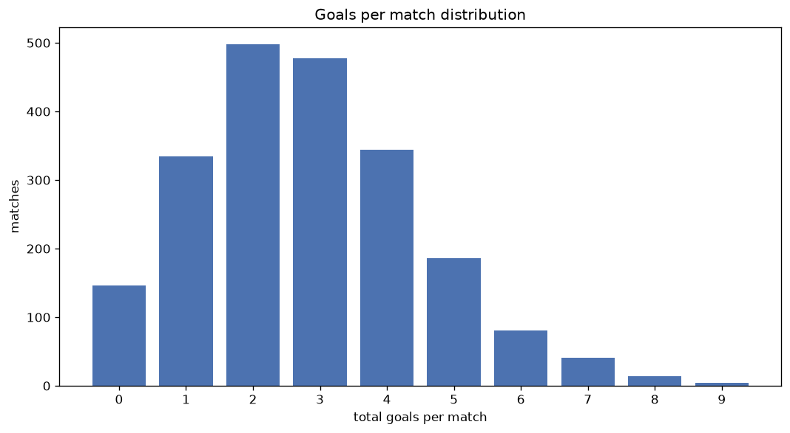
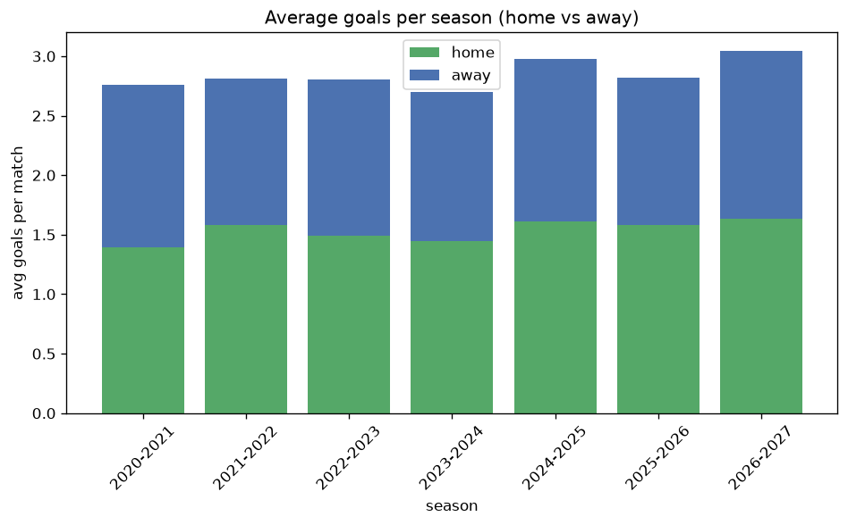

# Goal Analysis
- Report: `goals_analysis`
- Generated: 2026-10-26T01:32:12+00:00
- Script: `backend/scripts/analyze_goals.py` v1.0.0
- League: Ligue 1 (France)
- Scope: league `france1`

## 1. Goals per match distribution
| goals | matches | pct |
|---|---|---|
| 0 | 146 | 6.9% |
| 1 | 335 | 15.7% |
| 2 | 498 | 23.4% |
| 3 | 478 | 22.5% |
| 4 | 344 | 16.2% |
| 5 | 186 | 8.7% |
| 6 | 81 | 3.8% |
| 7 | 41 | 1.9% |
| 8 | 14 | 0.7% |
| 9 | 4 | 0.2% |

## 2. Goals per match per season
| season | matches | total goals | avg home | avg away | avg total |
|---|---|---|---|---|---|
| 2020-2021 | 380 | 1049 | 1.397 | 1.363 | 2.761 |
| 2021-2022 | 380 | 1067 | 1.582 | 1.226 | 2.808 |
| 2022-2023 | 380 | 1067 | 1.489 | 1.318 | 2.808 |
| 2023-2024 | 306 | 826 | 1.448 | 1.252 | 2.699 |
| 2024-2025 | 306 | 911 | 1.608 | 1.369 | 2.977 |
| 2025-2026 | 310 | 874 | 1.584 | 1.235 | 2.819 |
| 2026-2027 | 65 | 198 | 1.631 | 1.415 | 3.046 |

## 3. Home vs away goal share
- Home goals: **3230** (53.9%)
- Away goals: **2762** (46.1%)
- Home/away ratio: **1.169**

| season | home goals | away goals | total | home pct | away pct |
|---|---|---|---|---|---|
| 2020-2021 | 531 | 518 | 1049 | 50.6% | 49.4% |
| 2021-2022 | 601 | 466 | 1067 | 56.3% | 43.7% |
| 2022-2023 | 566 | 501 | 1067 | 53.0% | 47.0% |
| 2023-2024 | 443 | 383 | 826 | 53.6% | 46.4% |
| 2024-2025 | 492 | 419 | 911 | 54.0% | 46.0% |
| 2025-2026 | 491 | 383 | 874 | 56.2% | 43.8% |
| 2026-2027 | 106 | 92 | 198 | 53.5% | 46.5% |

## 4. BTTS (Both Teams To Score)
- Overall: **1175** of `2127` (55.2%)

| season | matches | BTTS | pct |
|---|---|---|---|
| 2020-2021 | 380 | 206 | 54.2% |
| 2021-2022 | 380 | 210 | 55.3% |
| 2022-2023 | 380 | 221 | 58.2% |
| 2023-2024 | 306 | 165 | 53.9% |
| 2024-2025 | 306 | 174 | 56.9% |
| 2025-2026 | 310 | 157 | 50.6% |
| 2026-2027 | 65 | 42 | 64.6% |

## 5. Clean sheets
- Home clean sheets: **598** (28.1%)
- Away clean sheets: **500** (23.5%)
- Total clean sheets recorded: **1098**
- Matches with at least one clean sheet: **952** (44.8%)
- Both teams kept clean sheets (0-0): **146**

| season | matches | home CS | away CS | total CS | matches w/ CS |
|---|---|---|---|---|---|
| 2020-2021 | 380 | 94 | 106 | 200 | 174 (45.8%) |
| 2021-2022 | 380 | 110 | 84 | 194 | 170 (44.7%) |
| 2022-2023 | 380 | 95 | 90 | 185 | 159 (41.8%) |
| 2023-2024 | 306 | 96 | 72 | 168 | 141 (46.1%) |
| 2024-2025 | 306 | 82 | 64 | 146 | 132 (43.1%) |
| 2025-2026 | 310 | 106 | 72 | 178 | 153 (49.4%) |
| 2026-2027 | 65 | 15 | 12 | 27 | 23 (35.4%) |

## 6. Scoring intensity
- First-half goals: **2693** (44.9%)
- Second-half goals: **3299** (55.1%)
- Avg first-half goals per match: **1.267**
- Avg second-half goals per match: **1.552**
- Second-half-only scoring (HT 0-0, FT goals >= 1): **444** (20.9%)
- *1 match(es) excluded (no HT score recorded).*

| season | matches | 1st half | 2nd half | 1st half pct | 2nd half pct |
|---|---|---|---|---|---|
| 2020-2021 | 380 | 484 | 565 | 46.1% | 53.9% |
| 2021-2022 | 380 | 485 | 582 | 45.5% | 54.5% |
| 2022-2023 | 380 | 497 | 570 | 46.6% | 53.4% |
| 2023-2024 | 306 | 369 | 457 | 44.7% | 55.3% |
| 2024-2025 | 306 | 401 | 510 | 44.0% | 56.0% |
| 2025-2026 | 310 | 375 | 499 | 42.9% | 57.1% |
| 2026-2027 | 65 | 82 | 116 | 41.4% | 58.6% |

## 7. First-goal timing
- Matches with first-goal time recorded: `1981` of `2127` (93.1%)
- Goalless matches: `146`
- Min `1` | Max `98` | Mean `30.04` | Median (p50) `24`

| bucket | count | % of matches | % of scoring matches |
|---|---|---|---|
| 1-15 | 667 | 31.4% | 33.7% |
| 16-30 | 509 | 23.9% | 25.7% |
| 31-45 | 322 | 15.1% | 16.3% |
| 46-60 | 256 | 12.0% | 12.9% |
| 61-75 | 123 | 5.8% | 6.2% |
| 76-90 | 84 | 3.9% | 4.2% |
| 91-120 | 20 | 0.9% | 1.0% |

---
*All statistics are computed from PostgreSQL tables (read-only). Run with `python backend/scripts/analyze_goals.py` to regenerate.*

## Charts

