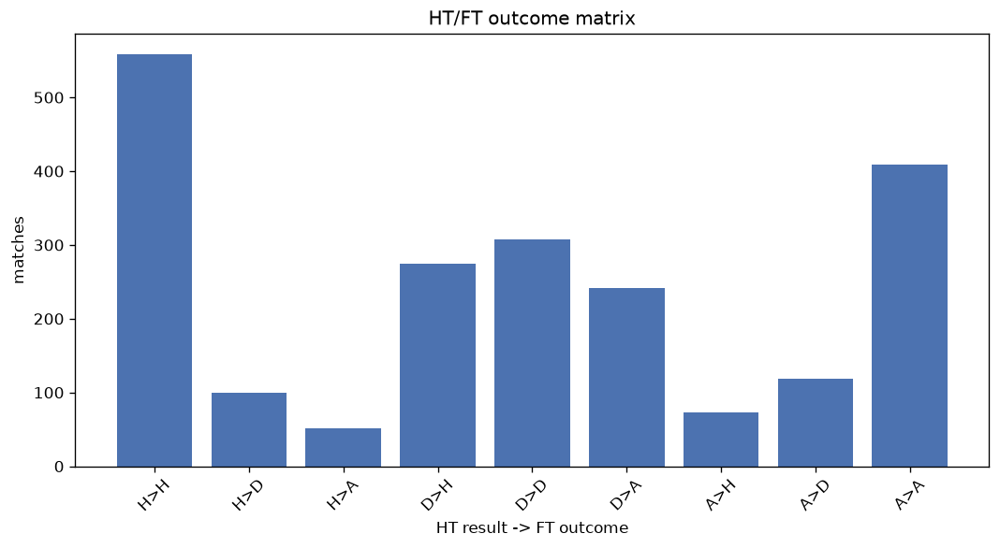
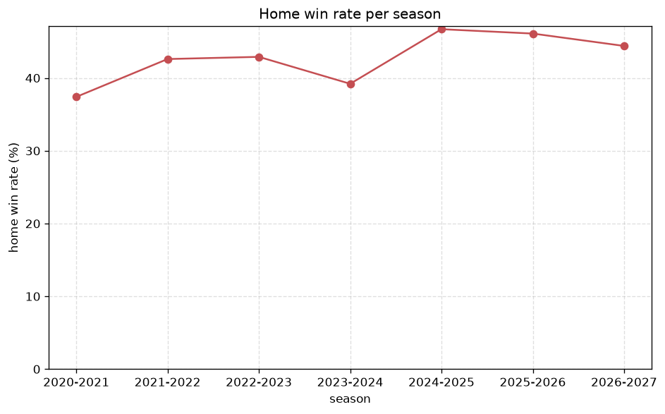

# Match Analysis
- Report: `matches_analysis`
- Generated: 2026-10-29T01:59:37+00:00
- Script: `backend/scripts/analyze_matches.py` v1.0.0
- League: Ligue 1 (France)
- Scope: league `france1`

## 1. Overall summary
| metric | value |
|---|---|
| Matches | 2134 |
| Home wins | 905 (42.4%) |
| Draws | 527 (24.7%) |
| Away wins | 702 (32.9%) |
| Total goals | 6008 |
| Average goals per match | 2.815 |
| Goalless matches | 148 (6.9%) |

## 2. Per-season breakdown
| season | matches | home wins | draws | away wins | total goals | avg goals | goalless |
|---|---|---|---|---|---|---|---|
| 2020-2021 | 380 | 142 (37.4%) | 95 (25.0%) | 143 (37.6%) | 1049 | 2.761 | 26 (6.8%) |
| 2021-2022 | 380 | 162 (42.6%) | 102 (26.8%) | 116 (30.5%) | 1067 | 2.808 | 24 (6.3%) |
| 2022-2023 | 380 | 163 (42.9%) | 92 (24.2%) | 125 (32.9%) | 1067 | 2.808 | 26 (6.8%) |
| 2023-2024 | 306 | 120 (39.2%) | 81 (26.5%) | 105 (34.3%) | 826 | 2.699 | 27 (8.8%) |
| 2024-2025 | 306 | 143 (46.7%) | 62 (20.3%) | 101 (33.0%) | 911 | 2.977 | 14 (4.6%) |
| 2025-2026 | 310 | 143 (46.1%) | 76 (24.5%) | 91 (29.4%) | 874 | 2.819 | 25 (8.1%) |
| 2026-2027 | 72 | 32 (44.4%) | 19 (26.4%) | 21 (29.2%) | 214 | 2.972 | 6 (8.3%) |

## 3. HT/FT outcome matrix
| HT result \ FT result | Home | Draw | Away | total |
|---|---|---|---|---|
| HT home lead | 558 (78.7%) | 100 (14.1%) | 51 (7.2%) | 709 |
| HT draw | 274 (33.3%) | 307 (37.3%) | 242 (29.4%) | 823 |
| HT away lead | 73 (12.1%) | 119 (19.8%) | 409 (68.1%) | 601 |
- *1 match(es) excluded (no HT score recorded).*

## 4. Comeback matches
- Home comebacks (trailing at HT, won at FT): **73** (3.4%)
- Away comebacks (trailing at HT, won at FT): **51** (2.4%)

### Home comebacks
| season | home | away | HT | FT |
|---|---|---|---|---|
| 2020-2021 | Lorient | Strasbourg | 0-1 | 3-1 |
| 2020-2021 | Rennes | Monaco | 0-1 | 2-1 |
| 2020-2021 | Angers | Brest | 1-2 | 3-2 |
| 2020-2021 | Lyon | St Etienne | 0-1 | 2-1 |
| 2020-2021 | Monaco | PSG | 0-2 | 3-2 |
| 2020-2021 | Reims | Nantes | 0-1 | 3-2 |
| 2020-2021 | Rennes | Marseille | 0-1 | 2-1 |
| 2020-2021 | Lille | Reims | 0-1 | 2-1 |
| 2020-2021 | Monaco | Marseille | 0-1 | 3-1 |
| 2020-2021 | Lorient | Dijon | 1-2 | 3-2 |
| 2020-2021 | Montpellier | Dijon | 0-1 | 4-2 |
| 2020-2021 | Lorient | St Etienne | 0-1 | 2-1 |
| 2020-2021 | Marseille | Lorient | 0-1 | 3-2 |
| 2020-2021 | Nice | Brest | 1-2 | 3-2 |
| 2021-2022 | Montpellier | Lorient | 0-1 | 3-1 |
| 2021-2022 | Lyon | Troyes | 0-1 | 3-1 |
| 2021-2022 | Angers | Metz | 0-1 | 3-2 |
| 2021-2022 | PSG | Angers | 0-1 | 2-1 |
| 2021-2022 | Nice | Lyon | 0-1 | 3-2 |
| 2021-2022 | PSG | Lille | 0-1 | 2-1 |
| 2021-2022 | Bordeaux | Reims | 0-1 | 3-2 |
| 2021-2022 | Lille | Troyes | 0-1 | 2-1 |
| 2021-2022 | Nantes | Lens | 0-2 | 3-2 |
| 2021-2022 | Nice | Lens | 0-1 | 2-1 |
| 2021-2022 | Strasbourg | Montpellier | 0-1 | 3-1 |
| 2021-2022 | Clermont | Rennes | 0-1 | 2-1 |
| 2021-2022 | Lyon | Marseille | 0-1 | 2-1 |
| 2021-2022 | St Etienne | Montpellier | 0-1 | 3-1 |
| 2021-2022 | Bordeaux | Metz | 0-1 | 3-1 |
| 2021-2022 | Marseille | Nantes | 1-2 | 3-2 |
| 2021-2022 | Nantes | Bordeaux | 0-2 | 5-3 |
| 2021-2022 | Nice | St Etienne | 0-2 | 4-2 |
| 2021-2022 | Monaco | Brest | 1-2 | 4-2 |
| 2022-2023 | Nantes | Toulouse | 0-1 | 3-1 |
| 2022-2023 | Lens | Clermont | 0-1 | 2-1 |
| 2022-2023 | Reims | Lorient | 1-2 | 4-2 |
| 2022-2023 | Auxerre | Lyon | 0-1 | 2-1 |
| 2022-2023 | Lille | Brest | 0-1 | 2-1 |
| 2022-2023 | AC Ajaccio | Troyes | 0-1 | 2-1 |
| 2022-2023 | Montpellier | Clermont | 0-1 | 2-1 |
| 2022-2023 | Clermont | AC Ajaccio | 0-1 | 2-1 |
| 2022-2023 | Monaco | Strasbourg | 1-2 | 4-3 |
| 2022-2023 | Lyon | Rennes | 0-1 | 3-1 |
| 2022-2023 | Lille | Montpellier | 0-1 | 2-1 |
| 2022-2023 | Marseille | Auxerre | 0-1 | 2-1 |
| 2022-2023 | Lyon | Montpellier | 1-2 | 5-4 |
| 2022-2023 | Lille | Marseille | 0-1 | 2-1 |
| 2022-2023 | Lille | Nantes | 0-1 | 2-1 |
| 2023-2024 | Brest | Lens | 1-2 | 3-2 |
| 2023-2024 | Toulouse | Lille | 0-1 | 3-1 |
| 2023-2024 | Toulouse | Nice | 0-1 | 2-1 |
| 2024-2025 | Montpellier | Auxerre | 0-1 | 3-2 |
| 2024-2025 | Lille | Toulouse | 0-1 | 2-1 |
| 2024-2025 | Nice | Strasbourg | 0-1 | 2-1 |
| 2024-2025 | Marseille | Monaco | 0-1 | 2-1 |
| 2024-2025 | St Etienne | Reims | 0-1 | 3-1 |
| 2024-2025 | Montpellier | Monaco | 0-1 | 2-1 |
| 2024-2025 | Lille | Nice | 0-1 | 2-1 |
| 2024-2025 | Strasbourg | Lille | 0-1 | 2-1 |
| 2024-2025 | Monaco | Auxerre | 1-2 | 4-2 |
| 2024-2025 | Lyon | Le Havre | 1-2 | 4-2 |
| 2024-2025 | Strasbourg | Toulouse | 0-1 | 2-1 |
| 2024-2025 | Monaco | Nice | 0-1 | 2-1 |
| 2024-2025 | PSG | Auxerre | 0-1 | 3-1 |
| 2025-2026 | Lens | Brest | 0-1 | 3-1 |
| 2025-2026 | Rennes | Lyon | 0-1 | 3-1 |
| 2025-2026 | Metz | Nice | 0-1 | 2-1 |
| 2025-2026 | Marseille | Lyon | 0-1 | 3-2 |
| 2025-2026 | Lens | Toulouse | 0-2 | 3-2 |
| 2025-2026 | Strasbourg | Monaco | 1-3 | 5-4 |
| 2026-2027 | Strasbourg | Lens | 0-1 | 2-1 |
| 2026-2027 | Auxerre | Brest | 0-1 | 2-1 |
| 2026-2027 | Lens | Paris FC | 0-1 | 2-1 |

### Away comebacks
| season | home | away | HT | FT |
|---|---|---|---|---|
| 2020-2021 | Reims | Lorient | 1-0 | 1-3 |
| 2020-2021 | Nimes | Dijon | 1-0 | 1-3 |
| 2020-2021 | Bordeaux | Metz | 1-0 | 1-2 |
| 2020-2021 | PSG | Nantes | 1-0 | 1-2 |
| 2020-2021 | St Etienne | Brest | 1-0 | 1-2 |
| 2020-2021 | Strasbourg | Nantes | 1-0 | 1-2 |
| 2020-2021 | Lyon | Lille | 2-1 | 2-3 |
| 2020-2021 | Monaco | Lyon | 1-0 | 2-3 |
| 2020-2021 | Lyon | Nice | 2-1 | 2-3 |
| 2021-2022 | Montpellier | Marseille | 2-0 | 2-3 |
| 2021-2022 | Angers | Nice | 1-0 | 1-2 |
| 2021-2022 | Lorient | Brest | 1-0 | 1-2 |
| 2021-2022 | Clermont | Nice | 1-0 | 1-2 |
| 2021-2022 | Bordeaux | Brest | 1-0 | 1-2 |
| 2021-2022 | Marseille | Brest | 1-0 | 1-2 |
| 2021-2022 | Bordeaux | Lille | 2-1 | 2-3 |
| 2021-2022 | St Etienne | Lens | 1-0 | 1-2 |
| 2021-2022 | Clermont | St Etienne | 1-0 | 1-2 |
| 2021-2022 | Reims | Lens | 1-0 | 1-2 |
| 2021-2022 | Nice | Lille | 1-0 | 1-3 |
| 2021-2022 | Reims | Nice | 2-0 | 2-3 |
| 2022-2023 | Reims | Clermont | 2-0 | 2-4 |
| 2022-2023 | Montpellier | Auxerre | 1-0 | 1-2 |
| 2022-2023 | Lorient | Nice | 1-0 | 1-2 |
| 2022-2023 | Angers | Lorient | 1-0 | 1-2 |
| 2022-2023 | Angers | AC Ajaccio | 1-0 | 1-2 |
| 2022-2023 | Rennes | Lille | 1-0 | 1-3 |
| 2022-2023 | Toulouse | Marseille | 1-0 | 2-3 |
| 2022-2023 | Montpellier | Nice | 2-0 | 2-3 |
| 2022-2023 | Reims | Montpellier | 1-0 | 1-3 |
| 2023-2024 | Nantes | Toulouse | 1-0 | 1-2 |
| 2023-2024 | Reims | Brest | 1-0 | 1-2 |
| 2023-2024 | Lorient | Metz | 2-1 | 2-3 |
| 2023-2024 | Clermont | Rennes | 1-0 | 1-3 |
| 2023-2024 | Montpellier | Lyon | 1-0 | 1-2 |
| 2023-2024 | Nantes | Lyon | 1-0 | 1-3 |
| 2023-2024 | Lorient | Toulouse | 1-0 | 1-2 |
| 2023-2024 | Rennes | Brest | 2-1 | 4-5 |
| 2023-2024 | Metz | Rennes | 2-1 | 2-3 |
| 2023-2024 | Lille | Lyon | 2-0 | 3-4 |
| 2024-2025 | Strasbourg | Monaco | 1-0 | 1-3 |
| 2024-2025 | Lens | PSG | 1-0 | 1-2 |
| 2025-2026 | Lyon | Toulouse | 1-0 | 1-2 |
| 2025-2026 | Strasbourg | Brest | 1-0 | 1-2 |
| 2025-2026 | Lens | Monaco | 1-0 | 2-3 |
| 2025-2026 | Lyon | Monaco | 1-0 | 1-2 |
| 2025-2026 | Marseille | Lille | 1-0 | 1-2 |
| 2025-2026 | Lorient | Strasbourg | 1-0 | 2-3 |
| 2026-2027 | PSG | Monaco | 1-0 | 1-2 |
| 2026-2027 | Strasbourg | PSG | 1-0 | 1-3 |
| 2026-2027 | Brest | Nice | 1-0 | 1-2 |

## 5. HT lead conversion
| HT state | matches | converted to win | held as draw | collapsed to loss |
|---|---|---|---|---|
| Home lead | 709 | 558 (78.7%) | 100 (14.1%) | 51 (7.2%) |
| Away lead | 601 | 409 (68.1%) | 119 (19.8%) | 73 (12.1%) |

### Matches level at half-time
| FT result | count | pct |
|---|---|---|
| Home win | 274 | 33.3% |
| Draw | 307 | 37.3% |
| Away win | 242 | 29.4% |
- *1 match(es) excluded (no HT score recorded).*

## 6. First-goal timing
- Matches with a first-goal time recorded: `1986` of `2134` (93.1%)

Outcome distribution by first-goal timing bucket:
| bucket | matches | % of matches | home | draw | away |
|---|---|---|---|---|---|
| 1-15 | 668 | 31.3% | 321 (48.1%) | 127 (19.0%) | 220 (32.9%) |
| 16-30 | 510 | 23.9% | 235 (46.1%) | 92 (18.0%) | 183 (35.9%) |
| 31-45 | 323 | 15.1% | 148 (45.8%) | 61 (18.9%) | 114 (35.3%) |
| 46-60 | 257 | 12.0% | 106 (41.2%) | 59 (23.0%) | 92 (35.8%) |
| 61-75 | 124 | 5.8% | 41 (33.1%) | 34 (27.4%) | 49 (39.5%) |
| 76-90 | 84 | 3.9% | 39 (46.4%) | 5 (6.0%) | 40 (47.6%) |
| 91-120 | 20 | 0.9% | 15 (75.0%) | 1 (5.0%) | 4 (20.0%) |

## 7. Goalless matches
- Overall: **148** of `2134` (6.9%)

| season | matches | goalless | pct |
|---|---|---|---|
| 2020-2021 | 380 | 26 | 6.8% |
| 2021-2022 | 380 | 24 | 6.3% |
| 2022-2023 | 380 | 26 | 6.8% |
| 2023-2024 | 306 | 27 | 8.8% |
| 2024-2025 | 306 | 14 | 4.6% |
| 2025-2026 | 310 | 25 | 8.1% |
| 2026-2027 | 72 | 6 | 8.3% |

---
*All statistics are computed from PostgreSQL tables (read-only). Run with `python backend/scripts/analyze_matches.py` to regenerate.*

## Charts

