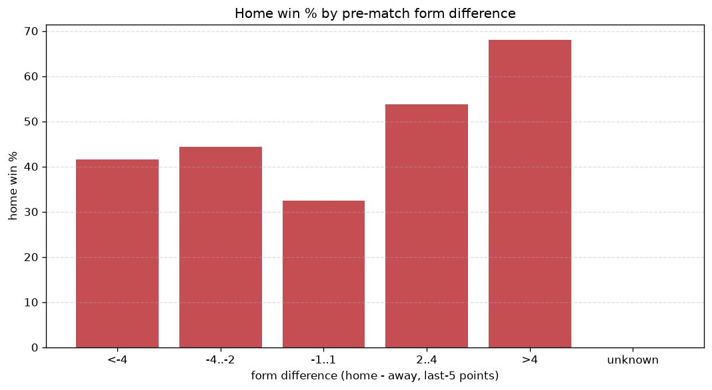
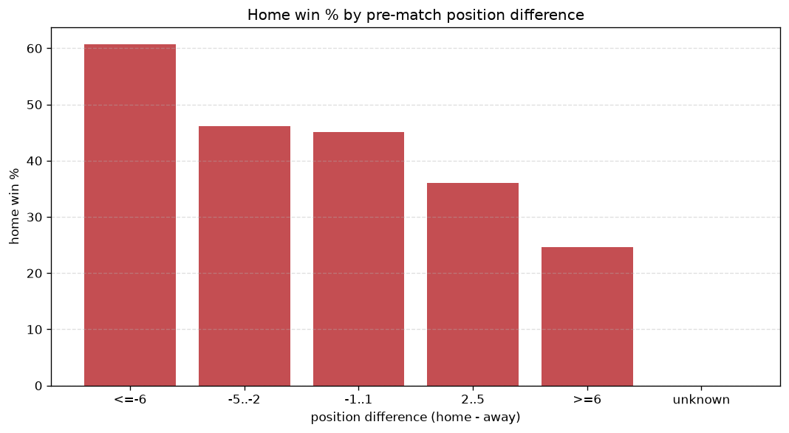

# Relationships Analysis
- Report: `relationships`
- Generated: 2026-10-29T01:59:46+00:00
- Script: `backend/scripts/analyze_relationships.py` v1.0.0
- League: Ligue 1 (France)
- Scope: league `france1`

- Matches analysed: **2062** (23 leakage-safe pre-match features).

## 1. Correlation matrix
_Pearson correlation of each pre-match feature with observed goals; sorted by |corr(total goals)|._

| feature | corr(home) | corr(away) | corr(total) |
|---|---|---|---|
| home_position_before_match | -0.203 | 0.143 | -0.055 |
| home_points_before_match | 0.108 | -0.044 | 0.051 |
| home_team_home_goals_avg | 0.130 | -0.072 | 0.050 |
| home_team_goals_scored_last_5 | 0.133 | -0.076 | 0.049 |
| home_team_home_win_rate | 0.148 | -0.094 | 0.048 |
| home_team_wins_last_5 | 0.126 | -0.083 | 0.038 |
| points_difference | 0.260 | -0.230 | 0.038 |
| home_team_points_last_5 | 0.122 | -0.088 | 0.031 |
| position_difference | -0.260 | 0.240 | -0.031 |
| rest_days_difference | 0.037 | -0.002 | 0.027 |
| home_team_home_conceded_avg | -0.087 | 0.062 | -0.024 |
| away_points_before_match | -0.096 | 0.136 | 0.022 |
| away_team_away_goals_avg | -0.083 | 0.118 | 0.019 |
| away_team_away_conceded_avg | 0.111 | -0.095 | 0.019 |
| away_team_goals_scored_last_5 | -0.101 | 0.134 | 0.017 |
| home_team_goals_conceded_last_5 | -0.095 | 0.084 | -0.013 |
| away_position_before_match | 0.160 | -0.192 | -0.012 |
| away_team_goals_conceded_last_5 | 0.078 | -0.101 | -0.011 |
| away_rest_days | -0.009 | -0.000 | -0.007 |
| away_team_points_last_5 | -0.122 | 0.125 | -0.006 |
| away_team_wins_last_5 | -0.115 | 0.134 | 0.005 |
| away_team_away_win_rate | -0.111 | 0.127 | 0.003 |
| home_rest_days | 0.007 | -0.003 | 0.003 |

## 2. Form vs outcome
_Home win/draw/away % per bucket of `home_team_points_last_5 - away_team_points_last_5`._

| bucket | matches | home | draw | away | home % | draw % | away % |
|---|---|---|---|---|---|---|---|
| <-4 | 340 | 94 | 92 | 154 | 27.6% | 27.1% | 45.3% |
| -4..-2 | 407 | 150 | 104 | 153 | 36.9% | 25.6% | 37.6% |
| -1..1 | 584 | 228 | 155 | 201 | 39.0% | 26.5% | 34.4% |
| 2..4 | 404 | 201 | 88 | 115 | 49.8% | 21.8% | 28.5% |
| >4 | 327 | 200 | 69 | 58 | 61.2% | 21.1% | 17.7% |
| unknown | 0 | 0 | 0 | 0 | - | - | - |

## 3. Position vs outcome
_Home win/draw/away % per bucket of `position_difference` (home position - away position; negative favours the home team)._

| bucket | matches | home | draw | away | home % | draw % | away % |
|---|---|---|---|---|---|---|---|
| <=-6 | 516 | 313 | 107 | 96 | 60.7% | 20.7% | 18.6% |
| -5..-2 | 362 | 167 | 93 | 102 | 46.1% | 25.7% | 28.2% |
| -1..1 | 277 | 125 | 65 | 87 | 45.1% | 23.5% | 31.4% |
| 2..5 | 391 | 141 | 117 | 133 | 36.1% | 29.9% | 34.0% |
| >=6 | 516 | 127 | 126 | 263 | 24.6% | 24.4% | 51.0% |
| unknown | 0 | 0 | 0 | 0 | - | - | - |

## 4. Rest advantage
_Home win/draw/away % per bucket of `rest_days_difference` (home rest - away rest). Matches with unknown rest are bucketed separately._

| bucket | matches | home | draw | away | home % | draw % | away % |
|---|---|---|---|---|---|---|---|
| <-1 | 181 | 70 | 46 | 65 | 38.7% | 25.4% | 35.9% |
| -1..0 | 363 | 143 | 90 | 130 | 39.4% | 24.8% | 35.8% |
| 0 | 923 | 380 | 235 | 308 | 41.2% | 25.5% | 33.4% |
| 1..2 | 474 | 228 | 109 | 137 | 48.1% | 23.0% | 28.9% |
| >2 | 59 | 28 | 11 | 20 | 47.5% | 18.6% | 33.9% |
| unknown | 62 | 24 | 17 | 21 | 38.7% | 27.4% | 33.9% |
- *62 match(es) had unknown rest difference (missing rest data on at least one side).*

## 5. Home team quality
_Home win rate by `home_team_home_win_rate` tier (split at 0.5)._

- `< 0.5` tier: **35.4%** home win (426/1202)
- `>= 0.5` tier: **52.0%** home win (447/860)
- Home-win gap (>= split minus < split): **+16.6 pp**

| tier | label | matches | home | draw | away | home % |
|---|---|---|---|---|---|---|
| low | < 0.5 | 1202 | 426 | 309 | 467 | 35.4% |
| high | >= 0.5 | 860 | 447 | 199 | 214 | 52.0% |

## 6. Feature averages by result
_Mean feature value per outcome; `range` is home-minus-away spread of the group means._

| feature | home mean | draw mean | away mean | range |
|---|---|---|---|---|
| points_difference | 4.179 | -0.917 | -5.000 | 9.179 |
| away_points_before_match | 22.016 | 22.953 | 27.836 | 5.819 |
| position_difference | -2.449 | 0.754 | 2.840 | 5.289 |
| home_points_before_match | 26.195 | 22.035 | 22.836 | 4.159 |
| home_position_before_match | 8.847 | 10.929 | 11.706 | 2.860 |
| away_position_before_match | 11.296 | 10.175 | 8.866 | 2.429 |
| away_team_points_last_5 | 5.821 | 6.313 | 7.031 | 1.210 |
| home_team_points_last_5 | 6.853 | 5.953 | 5.709 | 1.144 |
| home_team_goals_scored_last_5 | 6.881 | 6.004 | 5.824 | 1.057 |
| away_team_goals_scored_last_5 | 6.008 | 6.344 | 7.057 | 1.049 |
| home_team_goals_conceded_last_5 | 5.989 | 6.376 | 6.924 | 0.935 |
| away_team_goals_conceded_last_5 | 6.739 | 6.159 | 6.013 | 0.726 |
| away_team_wins_last_5 | 1.558 | 1.730 | 1.962 | 0.404 |
| home_team_wins_last_5 | 1.906 | 1.596 | 1.515 | 0.391 |
| home_team_home_goals_avg | 1.576 | 1.424 | 1.338 | 0.238 |
| away_rest_days | 7.901 | 8.120 | 7.968 | 0.219 |
| away_team_away_conceded_avg | 1.558 | 1.427 | 1.354 | 0.204 |
| rest_days_difference | 0.144 | -0.059 | -0.020 | 0.203 |
| away_team_away_goals_avg | 1.152 | 1.157 | 1.321 | 0.169 |
| home_team_home_conceded_avg | 1.142 | 1.243 | 1.267 | 0.125 |
| home_rest_days | 8.065 | 8.061 | 7.949 | 0.116 |
| home_team_home_win_rate | 0.457 | 0.385 | 0.358 | 0.098 |
| away_team_away_win_rate | 0.260 | 0.283 | 0.332 | 0.072 |

---
*All features are leakage-safe pre-match values built by `ml.features.build_features.build_rows` from strictly prior matches. Run with `python backend/scripts/analyze_relationships.py` to regenerate.*

## Charts

