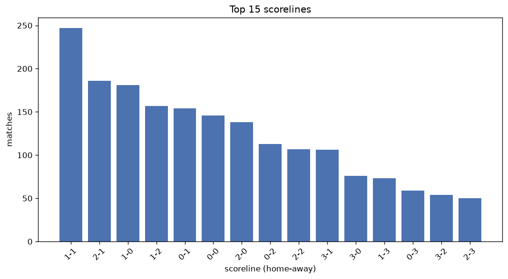
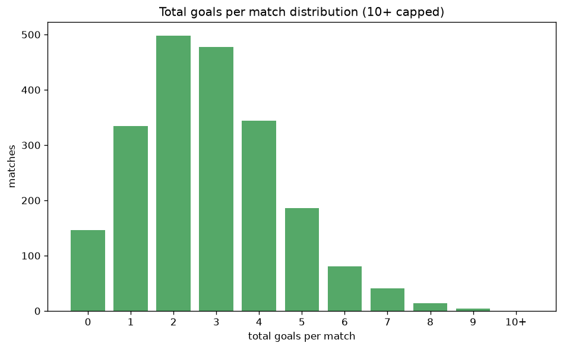

# Scoreline Analysis
- Report: `scoreline_analysis`
- Generated: 2026-10-26T01:32:18+00:00
- Script: `backend/scripts/analyze_scorelines.py` v1.0.0
- League: Ligue 1 (France)
- Scope: league `france1`

## 1. Scoreline frequency
- Matches analysed: **2127** across **7** seasons.
- Distinct scorelines seen: **45**.

| scoreline | count | pct |
|---|---|---|
| 1-1 | 247 | 11.6% |
| 2-1 | 186 | 8.7% |
| 1-0 | 181 | 8.5% |
| 1-2 | 157 | 7.4% |
| 0-1 | 154 | 7.2% |
| 0-0 | 146 | 6.9% |
| 2-0 | 138 | 6.5% |
| 0-2 | 113 | 5.3% |
| 2-2 | 107 | 5.0% |
| 3-1 | 106 | 5.0% |
| 3-0 | 76 | 3.6% |
| 1-3 | 73 | 3.4% |
| 0-3 | 59 | 2.8% |
| 3-2 | 54 | 2.5% |
| 2-3 | 50 | 2.4% |
| 4-1 | 40 | 1.9% |
| 4-0 | 38 | 1.8% |
| 1-4 | 21 | 1.0% |
| 3-3 | 21 | 1.0% |
| 0-4 | 20 | 0.9% |

## 2. Scoreline frequency per season

### 2020-2021
| scoreline | count | pct |
|---|---|---|
| 1-1 | 48 | 12.6% |
| 0-1 | 35 | 9.2% |
| 2-1 | 34 | 8.9% |
| 0-0 | 26 | 6.8% |
| 1-2 | 25 | 6.6% |

### 2021-2022
| scoreline | count | pct |
|---|---|---|
| 1-1 | 52 | 13.7% |
| 1-0 | 32 | 8.4% |
| 2-0 | 32 | 8.4% |
| 0-1 | 31 | 8.2% |
| 1-2 | 30 | 7.9% |

### 2022-2023
| scoreline | count | pct |
|---|---|---|
| 1-1 | 49 | 12.9% |
| 2-1 | 45 | 11.8% |
| 1-0 | 33 | 8.7% |
| 1-2 | 30 | 7.9% |
| 0-0 | 26 | 6.8% |

### 2023-2024
| scoreline | count | pct |
|---|---|---|
| 1-1 | 32 | 10.5% |
| 1-2 | 29 | 9.5% |
| 0-0 | 27 | 8.8% |
| 1-0 | 25 | 8.2% |
| 2-0 | 23 | 7.5% |

### 2024-2025
| scoreline | count | pct |
|---|---|---|
| 1-1 | 33 | 10.8% |
| 2-1 | 29 | 9.5% |
| 1-0 | 26 | 8.5% |
| 2-0 | 26 | 8.5% |
| 0-2 | 23 | 7.5% |

### 2025-2026
| scoreline | count | pct |
|---|---|---|
| 1-0 | 38 | 12.3% |
| 1-1 | 29 | 9.4% |
| 0-0 | 25 | 8.1% |
| 0-1 | 23 | 7.4% |
| 2-0 | 21 | 6.8% |

### 2026-2027
| scoreline | count | pct |
|---|---|---|
| 2-1 | 10 | 15.4% |
| 2-2 | 7 | 10.8% |
| 1-2 | 6 | 9.2% |
| 1-0 | 5 | 7.7% |
| 0-0 | 4 | 6.2% |

## 3. Total-goal histogram
_10+ groups all matches with 10 or more total goals._

| total goals | matches | pct |
|---|---|---|
| 0 | 146 | 6.9% |
| 1 | 335 | 15.7% |
| 2 | 498 | 23.4% |
| 3 | 478 | 22.5% |
| 4 | 344 | 16.2% |
| 5 | 186 | 8.7% |
| 6 | 81 | 3.8% |
| 7 | 41 | 1.9% |
| 8 | 14 | 0.7% |
| 9 | 4 | 0.2% |
| 10+ | 0 | 0.0% |

## 4. Extreme scorelines
- Matches with 7+ total goals: **59**

| season | date | scoreline | total goals |
|---|---|---|---|
| 2022-2023 | 2023-05-07 | 5-4 | 9 |
| 2023-2024 | 2024-04-28 | 4-5 | 9 |
| 2025-2026 | 2025-08-30 | 3-6 | 9 |
| 2025-2026 | 2026-05-17 | 5-4 | 9 |
| 2020-2021 | 2020-11-08 | 4-4 | 8 |
| 2021-2022 | 2022-04-08 | 6-2 | 8 |
| 2021-2022 | 2022-04-24 | 5-3 | 8 |
| 2022-2023 | 2022-08-21 | 1-7 | 8 |
| 2022-2023 | 2023-01-15 | 7-1 | 8 |
| 2023-2024 | 2023-09-23 | 5-3 | 8 |
| 2023-2024 | 2024-03-17 | 2-6 | 8 |
| 2024-2025 | 2024-09-20 | 8-0 | 8 |
| 2024-2025 | 2025-02-15 | 7-1 | 8 |
| 2025-2026 | 2025-08-30 | 1-7 | 8 |
| 2025-2026 | 2025-10-18 | 6-2 | 8 |
| 2025-2026 | 2025-10-29 | 3-5 | 8 |
| 2025-2026 | 2026-04-26 | 4-4 | 8 |
| 2026-2027 | 2026-09-06 | 2-6 | 8 |
| 2020-2021 | 2020-10-02 | 6-1 | 7 |
| 2020-2021 | 2020-11-22 | 4-3 | 7 |
| 2020-2021 | 2021-01-06 | 2-5 | 7 |
| 2020-2021 | 2021-02-07 | 3-4 | 7 |
| 2020-2021 | 2021-05-16 | 2-5 | 7 |
| 2021-2022 | 2021-12-01 | 5-2 | 7 |
| 2021-2022 | 2022-01-23 | 4-3 | 7 |
| 2021-2022 | 2022-02-04 | 5-2 | 7 |
| 2021-2022 | 2022-03-20 | 6-1 | 7 |
| 2021-2022 | 2022-04-09 | 1-6 | 7 |
| 2021-2022 | 2022-04-17 | 6-1 | 7 |
| 2021-2022 | 2022-04-23 | 5-2 | 7 |
| 2022-2023 | 2022-08-13 | 5-2 | 7 |
| 2022-2023 | 2022-08-28 | 0-7 | 7 |
| 2022-2023 | 2022-08-31 | 5-2 | 7 |
| 2022-2023 | 2022-10-23 | 4-3 | 7 |
| 2022-2023 | 2022-10-29 | 4-3 | 7 |
| 2022-2023 | 2022-12-29 | 6-1 | 7 |
| 2022-2023 | 2023-01-11 | 6-1 | 7 |
| 2022-2023 | 2023-02-19 | 4-3 | 7 |
| 2022-2023 | 2023-04-02 | 4-3 | 7 |
| 2023-2024 | 2023-11-24 | 5-2 | 7 |
| 2023-2024 | 2024-03-30 | 2-5 | 7 |
| 2023-2024 | 2024-04-07 | 4-3 | 7 |
| 2023-2024 | 2024-04-14 | 4-3 | 7 |
| 2023-2024 | 2024-05-06 | 3-4 | 7 |
| 2024-2025 | 2024-08-30 | 4-3 | 7 |
| 2024-2025 | 2025-02-01 | 2-5 | 7 |
| 2024-2025 | 2025-03-01 | 3-4 | 7 |
| 2024-2025 | 2025-03-29 | 1-6 | 7 |
| 2025-2026 | 2025-08-23 | 5-2 | 7 |
| 2025-2026 | 2025-09-21 | 5-2 | 7 |
| 2025-2026 | 2025-10-26 | 6-1 | 7 |
| 2025-2026 | 2025-12-14 | 3-4 | 7 |
| 2025-2026 | 2026-01-17 | 2-5 | 7 |
| 2025-2026 | 2026-01-25 | 2-5 | 7 |
| 2025-2026 | 2026-03-15 | 3-4 | 7 |
| 2025-2026 | 2026-04-04 | 3-4 | 7 |
| 2026-2027 | 2026-08-22 | 5-2 | 7 |
| 2026-2027 | 2026-10-18 | 2-5 | 7 |
| 2026-2027 | 2026-10-18 | 4-3 | 7 |

## 5. Margin-of-victory distribution (decided matches)
- Decided matches: **1604** (draws: **523**)
- Average winning margin: **1.82**

| margin | matches | pct |
|---|---|---|
| 1 | 801 | 49.9% |
| 2 | 470 | 29.3% |
| 3+ | 333 | 20.8% |

## 6. Margin by outcome

### Home wins
- Matches: **902** | avg margin: **1.87** | max margin: **8**
| margin | matches | pct |
|---|---|---|
| 1 | 433 | 48.0% |
| 2 | 265 | 29.4% |
| 3+ | 204 | 22.6% |
- *Full match-by-match list available in `scoreline_analysis.json`.*

### Away wins
- Matches: **702** | avg margin: **1.74** | max margin: **7**
| margin | matches | pct |
|---|---|---|
| 1 | 368 | 52.4% |
| 2 | 205 | 29.2% |
| 3+ | 129 | 18.4% |
- *Full match-by-match list available in `scoreline_analysis.json`.*

## 7. Most common exact score by outcome type
| outcome | matches | most common score | count | pct |
|---|---|---|---|---|
| home | 902 | 2-1 | 186 | 20.6% |
| draw | 523 | 1-1 | 247 | 47.2% |
| away | 702 | 1-2 | 157 | 22.4% |

---
*All statistics are computed from PostgreSQL tables (read-only). Run with `python backend/scripts/analyze_scorelines.py` to regenerate.*

## Charts

