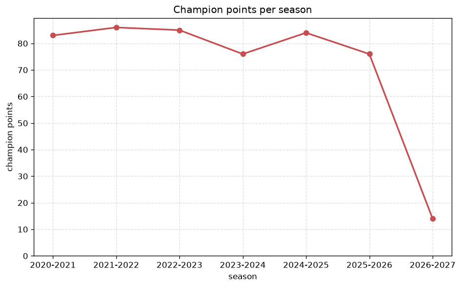
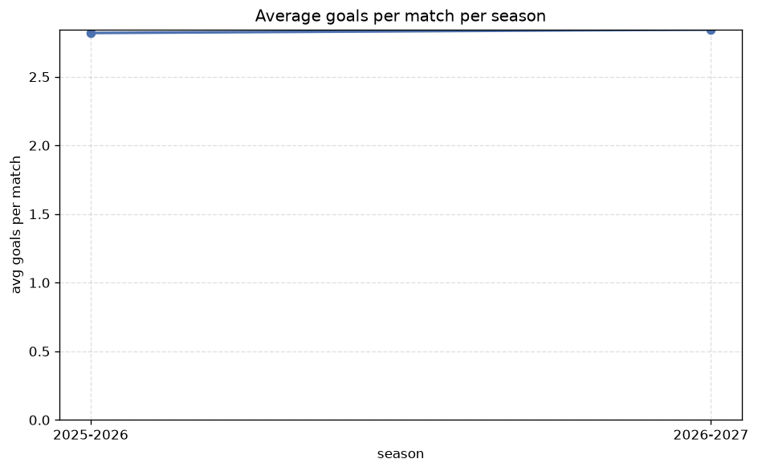

# Season Trends Analysis
- Report: `season_trends`
- Generated: 2026-10-30T03:51:18+00:00
- Script: `backend/scripts/analyze_seasons.py` v1.0.0
- League: Ligue 1 (France)
- Scope: league `france1`

## 1. Champions per season
| season | champion | pts | runner-up | margin |
|---|---|---|---|---|
| 2020-2021 | Lille | 83 | PSG | 1 pts |
| 2021-2022 | PSG | 86 | Marseille | 15 pts |
| 2022-2023 | PSG | 85 | Lens | 1 pts |
| 2023-2024 | PSG | 76 | Monaco | 9 pts |
| 2024-2025 | PSG | 84 | Marseille | 19 pts |
| 2025-2026 | PSG | 76 | Lens | 6 pts |
| 2026-2027 | PSG | 17 | Rennes | 1 pts |

## 2. Title-race tightness
- Tight races (margin <= 3 pts): **3** of 7 seasons
- Tightest race: **2020-2021** - Lille beat PSG by **1** pts

| season | margin | tight |
|---|---|---|
| 2020-2021 | 1 pts | yes |
| 2021-2022 | 15 pts |  |
| 2022-2023 | 1 pts | yes |
| 2023-2024 | 9 pts |  |
| 2024-2025 | 19 pts |  |
| 2025-2026 | 6 pts |  |
| 2026-2027 | 1 pts | yes |

## 3. Points thresholds
_Position-specific points per season. Key: 1 = champion, 2 = runner-up, 4 = CL line, 6 = Europa, 15 = last safe, 18 = bottom._

| season | pos 1 | pos 2 | pos 4 | pos 6 | pos 15 | pos 18 |
|---|---|---|---|---|---|---|
| 2020-2021 | 83 | 82 | 76 | 58 | 42 | 40 |
| 2021-2022 | 86 | 71 | 67 | 63 | 38 | 32 |
| 2022-2023 | 85 | 84 | 68 | 65 | 40 | 26 |
| 2023-2024 | 76 | 67 | 59 | 53 | 32 | 25 |
| 2024-2025 | 84 | 65 | 60 | 57 | 34 | 16 |
| 2025-2026 | 76 | 70 | 60 | 59 | 35 | 17 |
| 2026-2027 | 17 | 16 | 15 | 14 | 7 | 2 |

## 4. Relegation battle
| season | safe pos | safe pts | drop pos | drop pts | gap |
|---|---|---|---|---|---|
| 2020-2021 | 15 | 42 | 16 | 42 | 0 pts |
| 2021-2022 | 15 | 38 | 16 | 36 | 2 pts |
| 2022-2023 | 15 | 40 | 16 | 36 | 4 pts |
| 2023-2024 | 15 | 32 | 16 | 29 | 3 pts |
| 2024-2025 | 15 | 34 | 16 | 33 | 1 pts |
| 2025-2026 | 15 | 35 | 16 | 34 | 1 pts |
| 2026-2027 | 15 | 7 | 16 | 7 | 0 pts |

## 5. League-level trends
| season | matches | total goals | avg goals | home win | draw | away win | goalless | avg pts/team |
|---|---|---|---|---|---|---|---|---|
| 2020-2021 | 380 | 1049 | 2.761 | 37.4% | 25.0% | 37.6% | 6.8% | 52.25 |
| 2021-2022 | 380 | 1067 | 2.808 | 42.6% | 26.8% | 30.5% | 6.3% | 51.9 |
| 2022-2023 | 380 | 1067 | 2.808 | 42.9% | 24.2% | 32.9% | 6.8% | 52.4 |
| 2023-2024 | 306 | 826 | 2.699 | 39.2% | 26.5% | 34.3% | 8.8% | 46.5 |
| 2024-2025 | 306 | 911 | 2.977 | 46.7% | 20.3% | 33.0% | 4.6% | 47.56 |
| 2025-2026 | 310 | 874 | 2.819 | 46.1% | 24.5% | 29.4% | 8.1% | 40.52 |
| 2026-2027 | 72 | 214 | 2.972 | 44.4% | 26.4% | 29.2% | 8.3% | 10.94 |

## 6. View divergence
- Largest divergence: **2026-2027** (goals view, avg abs position diff = 6.889)

_Avg absolute position difference between classic view and alternative view per season._

| season | classic vs luck | classic vs goals |
|---|---|---|
| 2020-2021 | 3.400 | 6.300 |
| 2021-2022 | 3.800 | 6.400 |
| 2022-2023 | 3.500 | 6.100 |
| 2023-2024 | 3.111 | 4.778 |
| 2024-2025 | 4.222 | 4.444 |
| 2025-2026 | 4.857 | 5.810 |
| 2026-2027 | 2.667 | 6.889 |

---
*All statistics are computed from PostgreSQL tables (read-only). Run with `python backend/scripts/analyze_seasons.py` to regenerate.*

## Charts

