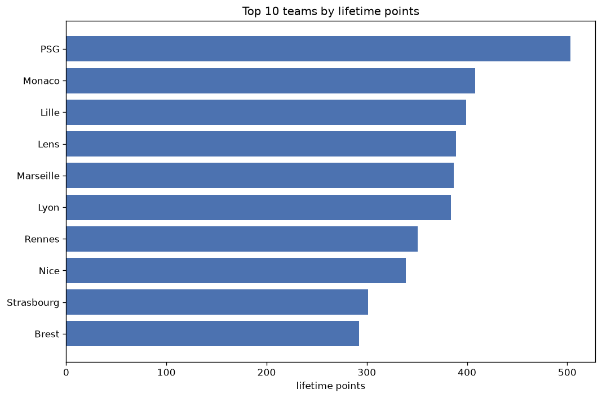
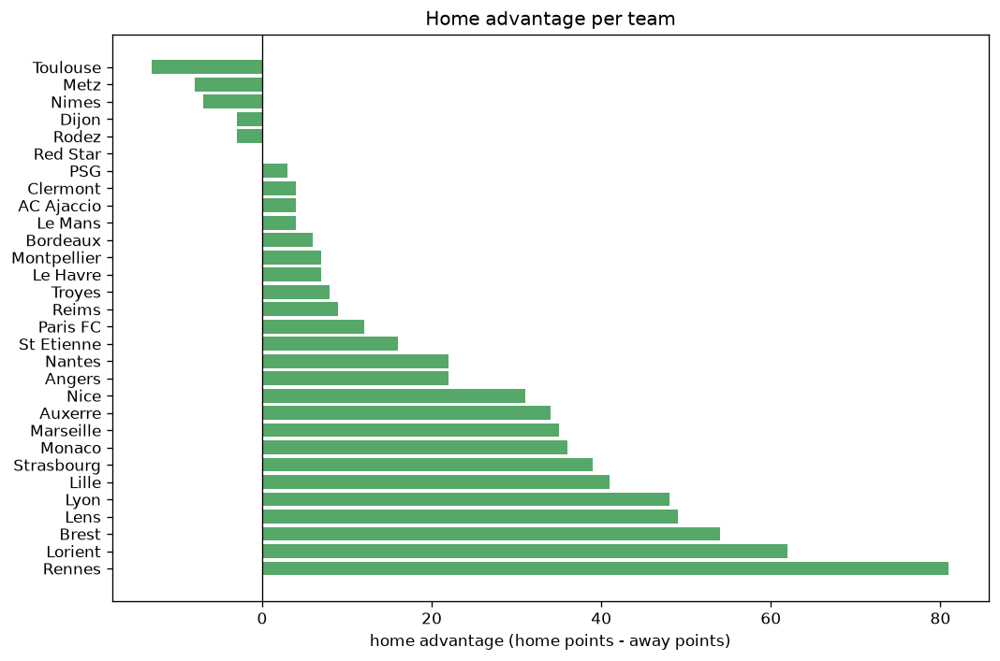

# Team Analysis
- Report: `teams_analysis`
- Generated: 2026-10-26T01:32:14+00:00
- Script: `backend/scripts/analyze_teams.py` v1.0.0
- League: Ligue 1 (France)
- Scope: league `france1`

- Teams: **30** | Seasons: **7** | Matches: **2127**

## 1. Team standings (lifetime)
| team | seasons | played | W | D | L | pts | GF | GA | GD | avg pts/season | best pos | worst pos | titles |
|---|---|---|---|---|---|---|---|---|---|---|---|---|---|
| PSG | 7 | 223 | 155 | 38 | 30 | 503 | 526 | 210 | 316 | 71.86 | 1 | 2 | 5 |
| Monaco | 7 | 223 | 121 | 45 | 57 | 408 | 412 | 283 | 129 | 58.29 | 2 | 7 | 0 |
| Lille | 7 | 223 | 112 | 63 | 48 | 399 | 343 | 227 | 116 | 57.0 | 1 | 10 | 1 |
| Lens | 7 | 224 | 112 | 53 | 59 | 389 | 354 | 254 | 100 | 55.57 | 2 | 8 | 0 |
| Marseille | 7 | 223 | 113 | 48 | 62 | 387 | 387 | 268 | 119 | 55.29 | 2 | 10 | 0 |
| Lyon | 7 | 223 | 112 | 48 | 63 | 384 | 392 | 287 | 105 | 54.86 | 1 | 7 | 1 |
| Rennes | 7 | 223 | 103 | 42 | 78 | 351 | 381 | 279 | 102 | 50.14 | 4 | 12 | 0 |
| Nice | 7 | 226 | 93 | 60 | 73 | 339 | 305 | 267 | 38 | 48.43 | 4 | 14 | 0 |
| Strasbourg | 7 | 223 | 80 | 61 | 82 | 301 | 324 | 316 | 8 | 43.0 | 6 | 15 | 0 |
| Brest | 7 | 224 | 79 | 55 | 90 | 292 | 305 | 337 | -32 | 41.71 | 3 | 17 | 0 |
| Nantes | 6 | 216 | 53 | 65 | 98 | 224 | 237 | 317 | -80 | 37.33 | 9 | 18 | 0 |
| Reims | 5 | 182 | 53 | 60 | 69 | 219 | 205 | 233 | -28 | 43.8 | 9 | 16 | 0 |
| Lorient | 6 | 189 | 55 | 53 | 81 | 218 | 235 | 307 | -72 | 36.33 | 8 | 16 | 0 |
| Montpellier | 5 | 182 | 55 | 40 | 87 | 205 | 240 | 312 | -72 | 41.0 | 8 | 18 | 0 |
| Toulouse | 5 | 147 | 49 | 40 | 58 | 187 | 196 | 203 | -7 | 37.4 | 9 | 13 | 0 |
| Angers | 6 | 189 | 47 | 41 | 101 | 182 | 187 | 310 | -123 | 30.33 | 13 | 20 | 0 |
| Metz | 4 | 144 | 29 | 37 | 78 | 124 | 146 | 251 | -105 | 31.0 | 10 | 19 | 0 |
| Auxerre | 4 | 113 | 30 | 30 | 53 | 120 | 128 | 175 | -47 | 30.0 | 11 | 17 | 0 |
| Clermont | 3 | 110 | 31 | 27 | 52 | 120 | 109 | 178 | -69 | 40.0 | 8 | 18 | 0 |
| St Etienne | 4 | 113 | 28 | 28 | 57 | 112 | 125 | 212 | -87 | 28.0 | 11 | 20 | 0 |
| Le Havre | 4 | 109 | 24 | 31 | 54 | 103 | 111 | 171 | -60 | 25.75 | 15 | 18 | 0 |
| Bordeaux | 2 | 76 | 19 | 19 | 38 | 76 | 94 | 147 | -53 | 38.0 | 12 | 20 | 0 |
| Troyes | 3 | 83 | 14 | 24 | 45 | 66 | 87 | 150 | -63 | 22.0 | 15 | 19 | 0 |
| Paris FC | 2 | 42 | 15 | 13 | 14 | 58 | 60 | 59 | 1 | 29.0 | 4 | 11 | 0 |
| Nimes | 1 | 38 | 9 | 8 | 21 | 35 | 40 | 71 | -31 | 35.0 | 19 | 19 | 0 |
| AC Ajaccio | 1 | 38 | 7 | 5 | 26 | 26 | 23 | 74 | -51 | 26.0 | 18 | 18 | 0 |
| Dijon | 1 | 38 | 4 | 9 | 25 | 21 | 25 | 73 | -48 | 21.0 | 20 | 20 | 0 |
| Le Mans | 1 | 7 | 1 | 3 | 3 | 6 | 10 | 15 | -5 | 6.0 | 16 | 16 | 0 |
| Rodez | 1 | 2 | 1 | 0 | 1 | 3 | 3 | 3 | 0 | 3.0 | 19 | 19 | 0 |
| Red Star | 1 | 1 | 0 | 0 | 1 | 0 | 2 | 3 | -1 | 0.0 | 21 | 21 | 0 |

## 2. Home vs away split
| team | home P | H-W | H-D | H-L | H-pts | away P | A-W | A-D | A-L | A-pts | adv |
|---|---|---|---|---|---|---|---|---|---|---|---|
| Rennes | 112 | 67 | 15 | 30 | 216 | 111 | 36 | 27 | 48 | 135 | 81 |
| Lorient | 95 | 39 | 23 | 33 | 140 | 94 | 16 | 30 | 48 | 78 | 62 |
| Brest | 112 | 48 | 29 | 35 | 173 | 112 | 31 | 26 | 55 | 119 | 54 |
| Lens | 112 | 66 | 21 | 25 | 219 | 112 | 46 | 32 | 34 | 170 | 49 |
| Lyon | 112 | 65 | 21 | 26 | 216 | 111 | 47 | 27 | 37 | 168 | 48 |
| Lille | 112 | 62 | 34 | 16 | 220 | 111 | 50 | 29 | 32 | 179 | 41 |
| Strasbourg | 111 | 47 | 29 | 35 | 170 | 112 | 33 | 32 | 47 | 131 | 39 |
| Monaco | 111 | 67 | 21 | 23 | 222 | 112 | 54 | 24 | 34 | 186 | 36 |
| Marseille | 111 | 61 | 28 | 22 | 211 | 112 | 52 | 20 | 40 | 176 | 35 |
| Auxerre | 56 | 20 | 17 | 19 | 77 | 57 | 10 | 13 | 34 | 43 | 34 |
| Nice | 113 | 51 | 32 | 30 | 185 | 113 | 42 | 28 | 43 | 154 | 31 |
| Nantes | 108 | 30 | 33 | 45 | 123 | 108 | 23 | 32 | 53 | 101 | 22 |
| Angers | 95 | 29 | 15 | 51 | 102 | 94 | 18 | 26 | 50 | 80 | 22 |
| St Etienne | 57 | 16 | 16 | 25 | 64 | 56 | 12 | 12 | 32 | 48 | 16 |
| Paris FC | 21 | 10 | 5 | 6 | 35 | 21 | 5 | 8 | 8 | 23 | 12 |
| Reims | 91 | 29 | 27 | 35 | 114 | 91 | 24 | 33 | 34 | 105 | 9 |
| Troyes | 42 | 6 | 19 | 17 | 37 | 41 | 8 | 5 | 28 | 29 | 8 |
| Montpellier | 91 | 27 | 25 | 39 | 106 | 91 | 28 | 15 | 48 | 99 | 7 |
| Le Havre | 55 | 14 | 13 | 28 | 55 | 54 | 10 | 18 | 26 | 48 | 7 |
| Bordeaux | 38 | 10 | 11 | 17 | 41 | 38 | 9 | 8 | 21 | 35 | 6 |
| Clermont | 55 | 16 | 14 | 25 | 62 | 55 | 15 | 13 | 27 | 58 | 4 |
| AC Ajaccio | 19 | 4 | 3 | 12 | 15 | 19 | 3 | 2 | 14 | 11 | 4 |
| Le Mans | 4 | 1 | 2 | 1 | 5 | 3 | 0 | 1 | 2 | 1 | 4 |
| PSG | 110 | 79 | 16 | 15 | 253 | 113 | 76 | 22 | 15 | 250 | 3 |
| Red Star | 1 | 0 | 0 | 1 | 0 | 0 | 0 | 0 | 0 | 0 | 0 |
| Dijon | 19 | 1 | 6 | 12 | 9 | 19 | 3 | 3 | 13 | 12 | -3 |
| Rodez | 0 | 0 | 0 | 0 | 0 | 2 | 1 | 0 | 1 | 3 | -3 |
| Nimes | 19 | 3 | 5 | 11 | 14 | 19 | 6 | 3 | 10 | 21 | -7 |
| Metz | 72 | 13 | 19 | 40 | 58 | 72 | 16 | 18 | 38 | 66 | -8 |
| Toulouse | 73 | 21 | 24 | 28 | 87 | 74 | 28 | 16 | 30 | 100 | -13 |

## 3. Top performers
### Best points per game (PPG)
| rank | team | PPG |
|---|---|---|
| 1 | PSG | 2.26 |
| 2 | Monaco | 1.83 |
| 3 | Lille | 1.79 |
| 4 | Lens | 1.74 |
| 5 | Marseille | 1.74 |

### Most goals scored
| rank | team | goals |
|---|---|---|
| 1 | PSG | 526 |
| 2 | Monaco | 412 |
| 3 | Lyon | 392 |
| 4 | Marseille | 387 |
| 5 | Rennes | 381 |

### Best goal difference
| rank | team | GD |
|---|---|---|
| 1 | PSG | 316 |
| 2 | Monaco | 129 |
| 3 | Marseille | 119 |
| 4 | Lille | 116 |
| 5 | Lyon | 105 |

### Best defence (goals against per match, standings)
| rank | team | GA/match |
|---|---|---|
| 1 | PSG | 0.942 |
| 2 | Lille | 1.018 |
| 3 | Lens | 1.134 |
| 4 | Nice | 1.181 |
| 5 | Marseille | 1.202 |

## 4. Team consistency
- Teams present in all **7** seasons: **10**

Brest, Lens, Lille, Lyon, Marseille, Monaco, Nice, PSG, Rennes, Strasbourg

## 5. Head-to-head dominance
- Distinct fixtures: **332** (showing the 15 most frequent)

| fixture | meetings | home wins | draws | away wins | home pct | draw pct | away pct |
|---|---|---|---|---|---|---|---|
| Marseille vs Rennes | 13 | 10 | 1 | 2 | 76.9% | 7.7% | 15.4% |
| Lyon vs Rennes | 13 | 9 | 1 | 3 | 69.2% | 7.7% | 23.1% |
| Lyon vs Nice | 13 | 8 | 2 | 3 | 61.5% | 15.4% | 23.1% |
| Monaco vs Marseille | 13 | 8 | 2 | 3 | 61.5% | 15.4% | 23.1% |
| Monaco vs Strasbourg | 13 | 7 | 3 | 3 | 53.8% | 23.1% | 23.1% |
| Nice vs Brest | 13 | 7 | 3 | 3 | 53.8% | 23.1% | 23.1% |
| PSG vs Monaco | 13 | 7 | 2 | 4 | 53.8% | 15.4% | 30.8% |
| PSG vs Rennes | 13 | 7 | 3 | 3 | 53.8% | 23.1% | 23.1% |
| Lille vs Brest | 13 | 6 | 7 | 0 | 46.2% | 53.8% | 0.0% |
| Lyon vs Lens | 13 | 6 | 3 | 4 | 46.2% | 23.1% | 30.8% |
| PSG vs Marseille | 13 | 6 | 1 | 6 | 46.2% | 7.7% | 46.2% |
| PSG vs Strasbourg | 13 | 6 | 3 | 4 | 46.2% | 23.1% | 30.8% |
| Lens vs Strasbourg | 13 | 5 | 3 | 5 | 38.5% | 23.1% | 38.5% |
| Lille vs Nice | 13 | 5 | 5 | 3 | 38.5% | 38.5% | 23.1% |
| Lille vs PSG | 13 | 5 | 4 | 4 | 38.5% | 30.8% | 30.8% |

## 6. Position per season (classic view)
_Cells show final position; '-' when the team was absent from that season._

| team | 2020-2021 | 2021-2022 | 2022-2023 | 2023-2024 | 2024-2025 | 2025-2026 | 2026-2027 |
|---|---|---|---|---|---|---|---|
| PSG | 2 | 1 | 1 | 1 | 1 | 1 | 2 |
| Monaco | 3 | 3 | 6 | 2 | 3 | 7 | 5 |
| Lille | 1 | 10 | 5 | 4 | 5 | 3 | 3 |
| Lens | 7 | 8 | 2 | 7 | 8 | 2 | 6 |
| Marseille | 5 | 2 | 3 | 8 | 2 | 5 | 10 |
| Lyon | 4 | 7 | 7 | 6 | 6 | 4 | 1 |
| Rennes | 6 | 5 | 4 | 10 | 12 | 6 | 7 |
| Nice | 9 | 4 | 9 | 5 | 4 | 14 | 9 |
| Strasbourg | 15 | 6 | 15 | 13 | 7 | 8 | 14 |
| Brest | 17 | 11 | 14 | 3 | 9 | 12 | 11 |
| Nantes | 18 | 9 | 16 | 14 | 13 | 17 | - |
| Reims | 14 | 12 | 11 | 9 | 16 | - | - |
| Lorient | 16 | 16 | 10 | 16 | - | 10 | 8 |
| Montpellier | 8 | 13 | 12 | 12 | 18 | - | - |
| Toulouse | - | - | 13 | 11 | 10 | 9 | 12 |
| Angers | 13 | 14 | 20 | - | 14 | 13 | 15 |
| Metz | 10 | 19 | - | 17 | - | 18 | - |
| Auxerre | - | - | 17 | - | 11 | 16 | 13 |
| Clermont | - | 17 | 8 | 18 | - | - | - |
| St Etienne | 11 | 18 | - | - | 17 | 20 | - |
| Le Havre | - | - | - | 15 | 15 | 15 | 18 |
| Bordeaux | 12 | 20 | - | - | - | - | - |
| Troyes | - | 15 | 19 | - | - | - | 17 |
| Paris FC | - | - | - | - | - | 11 | 4 |
| Nimes | 19 | - | - | - | - | - | - |
| AC Ajaccio | - | - | 18 | - | - | - | - |
| Dijon | 20 | - | - | - | - | - | - |
| Le Mans | - | - | - | - | - | - | 16 |
| Rodez | - | - | - | - | - | 19 | - |
| Red Star | - | - | - | - | - | 21 | - |

---
*All statistics are computed from PostgreSQL tables (read-only). Run with `python backend/scripts/analyze_teams.py` to regenerate.*

## Charts

