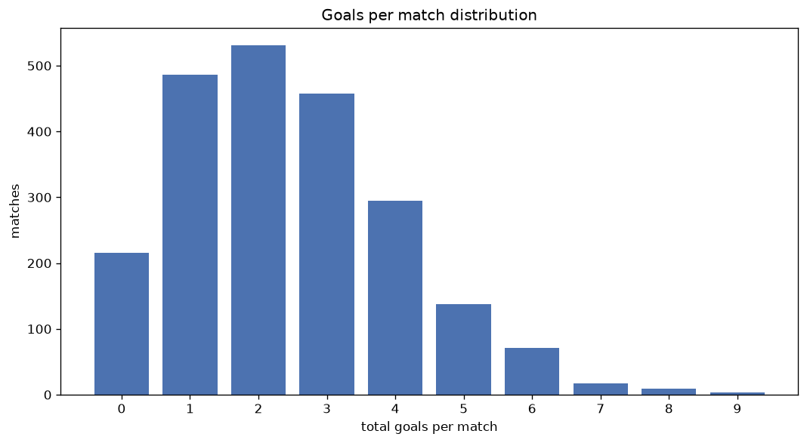
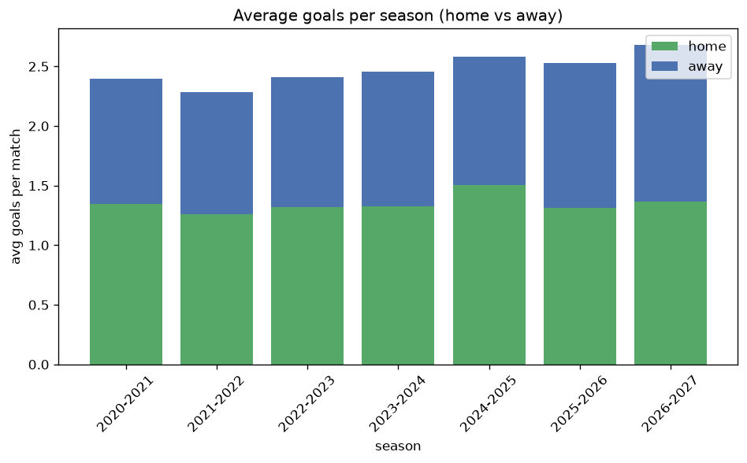

# Goal Analysis
- Report: `goals_analysis`
- Generated: 2026-10-26T01:32:30+00:00
- Script: `backend/scripts/analyze_goals.py` v1.0.0
- League: Ligue 2 (France)
- Scope: league `france2`

## 1. Goals per match distribution
| goals | matches | pct |
|---|---|---|
| 0 | 216 | 9.7% |
| 1 | 486 | 21.9% |
| 2 | 531 | 23.9% |
| 3 | 458 | 20.6% |
| 4 | 295 | 13.3% |
| 5 | 138 | 6.2% |
| 6 | 71 | 3.2% |
| 7 | 17 | 0.8% |
| 8 | 9 | 0.4% |
| 9 | 3 | 0.1% |

## 2. Goals per match per season
| season | matches | total goals | avg home | avg away | avg total |
|---|---|---|---|---|---|
| 2020-2021 | 380 | 910 | 1.345 | 1.05 | 2.395 |
| 2021-2022 | 380 | 868 | 1.258 | 1.026 | 2.284 |
| 2022-2023 | 380 | 916 | 1.321 | 1.089 | 2.411 |
| 2023-2024 | 380 | 933 | 1.326 | 1.129 | 2.455 |
| 2024-2025 | 306 | 789 | 1.507 | 1.072 | 2.578 |
| 2025-2026 | 310 | 784 | 1.313 | 1.216 | 2.529 |
| 2026-2027 | 88 | 236 | 1.364 | 1.318 | 2.682 |

## 3. Home vs away goal share
- Home goals: **2983** (54.9%)
- Away goals: **2453** (45.1%)
- Home/away ratio: **1.216**

| season | home goals | away goals | total | home pct | away pct |
|---|---|---|---|---|---|
| 2020-2021 | 511 | 399 | 910 | 56.2% | 43.8% |
| 2021-2022 | 478 | 390 | 868 | 55.1% | 44.9% |
| 2022-2023 | 502 | 414 | 916 | 54.8% | 45.2% |
| 2023-2024 | 504 | 429 | 933 | 54.0% | 46.0% |
| 2024-2025 | 461 | 328 | 789 | 58.4% | 41.6% |
| 2025-2026 | 407 | 377 | 784 | 51.9% | 48.1% |
| 2026-2027 | 120 | 116 | 236 | 50.8% | 49.2% |

## 4. BTTS (Both Teams To Score)
- Overall: **1080** of `2224` (48.6%)

| season | matches | BTTS | pct |
|---|---|---|---|
| 2020-2021 | 380 | 180 | 47.4% |
| 2021-2022 | 380 | 176 | 46.3% |
| 2022-2023 | 380 | 181 | 47.6% |
| 2023-2024 | 380 | 185 | 48.7% |
| 2024-2025 | 306 | 147 | 48.0% |
| 2025-2026 | 310 | 160 | 51.6% |
| 2026-2027 | 88 | 51 | 58.0% |

## 5. Clean sheets
- Home clean sheets: **773** (34.8%)
- Away clean sheets: **587** (26.4%)
- Total clean sheets recorded: **1360**
- Matches with at least one clean sheet: **1144** (51.4%)
- Both teams kept clean sheets (0-0): **216**

| season | matches | home CS | away CS | total CS | matches w/ CS |
|---|---|---|---|---|---|
| 2020-2021 | 380 | 142 | 95 | 237 | 200 (52.6%) |
| 2021-2022 | 380 | 138 | 104 | 242 | 204 (53.7%) |
| 2022-2023 | 380 | 134 | 101 | 235 | 199 (52.4%) |
| 2023-2024 | 380 | 133 | 107 | 240 | 195 (51.3%) |
| 2024-2025 | 306 | 104 | 74 | 178 | 159 (52.0%) |
| 2025-2026 | 310 | 99 | 84 | 183 | 150 (48.4%) |
| 2026-2027 | 88 | 23 | 22 | 45 | 37 (42.0%) |

## 6. Scoring intensity
- First-half goals: **2390** (44.0%)
- Second-half goals: **3038** (56.0%)
- Avg first-half goals per match: **1.077**
- Avg second-half goals per match: **1.369**
- Second-half-only scoring (HT 0-0, FT goals >= 1): **562** (25.3%)
- *5 match(es) excluded (no HT score recorded).*

| season | matches | 1st half | 2nd half | 1st half pct | 2nd half pct |
|---|---|---|---|---|---|
| 2020-2021 | 380 | 385 | 522 | 42.4% | 57.6% |
| 2021-2022 | 380 | 381 | 484 | 44.0% | 56.0% |
| 2022-2023 | 380 | 400 | 515 | 43.7% | 56.3% |
| 2023-2024 | 380 | 417 | 515 | 44.7% | 55.3% |
| 2024-2025 | 306 | 342 | 447 | 43.3% | 56.7% |
| 2025-2026 | 310 | 365 | 419 | 46.6% | 53.4% |
| 2026-2027 | 88 | 100 | 136 | 42.4% | 57.6% |

## 7. First-goal timing
- Matches with first-goal time recorded: `2004` of `2224` (90.1%)
- Goalless matches: `220`
- Min `1` | Max `98` | Mean `32.54` | Median (p50) `27.0`

| bucket | count | % of matches | % of scoring matches |
|---|---|---|---|
| 1-15 | 644 | 29.0% | 32.1% |
| 16-30 | 456 | 20.5% | 22.8% |
| 31-45 | 308 | 13.8% | 15.4% |
| 46-60 | 306 | 13.8% | 15.3% |
| 61-75 | 150 | 6.7% | 7.5% |
| 76-90 | 114 | 5.1% | 5.7% |
| 91-120 | 26 | 1.2% | 1.3% |

---
*All statistics are computed from PostgreSQL tables (read-only). Run with `python backend/scripts/analyze_goals.py` to regenerate.*

## Charts

