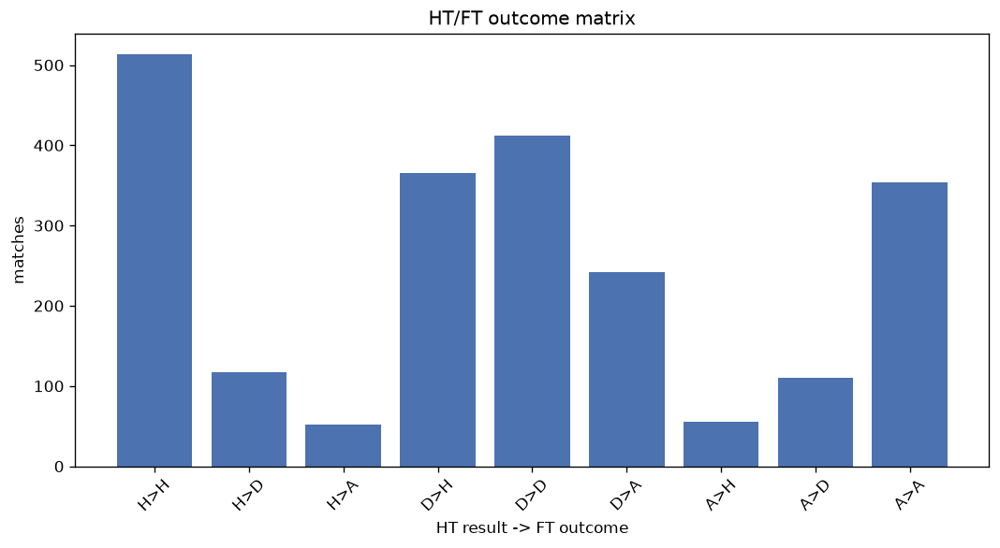
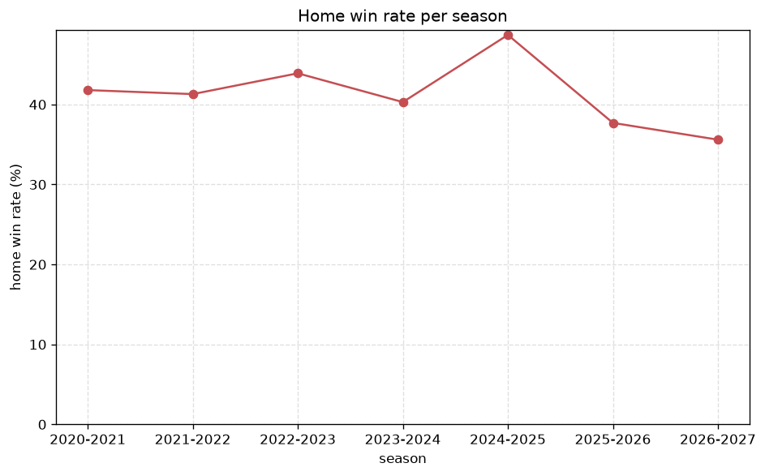

# Match Analysis
- Report: `matches_analysis`
- Generated: 2026-10-29T01:59:55+00:00
- Script: `backend/scripts/analyze_matches.py` v1.0.0
- League: Ligue 2 (France)
- Scope: league `france2`

## 1. Overall summary
| metric | value |
|---|---|
| Matches | 2226 |
| Home wins | 934 (42.0%) |
| Draws | 640 (28.8%) |
| Away wins | 652 (29.3%) |
| Total goals | 5441 |
| Average goals per match | 2.444 |
| Goalless matches | 216 (9.7%) |

## 2. Per-season breakdown
| season | matches | home wins | draws | away wins | total goals | avg goals | goalless |
|---|---|---|---|---|---|---|---|
| 2020-2021 | 380 | 159 (41.8%) | 127 (33.4%) | 94 (24.7%) | 910 | 2.395 | 37 (9.7%) |
| 2021-2022 | 380 | 157 (41.3%) | 106 (27.9%) | 117 (30.8%) | 868 | 2.284 | 38 (10.0%) |
| 2022-2023 | 380 | 167 (43.9%) | 103 (27.1%) | 110 (28.9%) | 916 | 2.411 | 36 (9.5%) |
| 2023-2024 | 380 | 153 (40.3%) | 109 (28.7%) | 118 (31.1%) | 933 | 2.455 | 45 (11.8%) |
| 2024-2025 | 306 | 149 (48.7%) | 72 (23.5%) | 85 (27.8%) | 789 | 2.578 | 19 (6.2%) |
| 2025-2026 | 310 | 117 (37.7%) | 95 (30.6%) | 98 (31.6%) | 784 | 2.529 | 33 (10.6%) |
| 2026-2027 | 90 | 32 (35.6%) | 28 (31.1%) | 30 (33.3%) | 241 | 2.678 | 8 (8.9%) |

## 3. HT/FT outcome matrix
| HT result \ FT result | Home | Draw | Away | total |
|---|---|---|---|---|
| HT home lead | 513 (75.2%) | 117 (17.2%) | 52 (7.6%) | 682 |
| HT draw | 365 (35.8%) | 412 (40.4%) | 242 (23.7%) | 1019 |
| HT away lead | 56 (10.8%) | 110 (21.2%) | 354 (68.1%) | 520 |
- *5 match(es) excluded (no HT score recorded).*

## 4. Comeback matches
- Home comebacks (trailing at HT, won at FT): **56** (2.5%)
- Away comebacks (trailing at HT, won at FT): **52** (2.3%)

### Home comebacks
| season | home | away | HT | FT |
|---|---|---|---|---|
| 2020-2021 | Chambly | Chateauroux | 0-1 | 2-1 |
| 2020-2021 | Nancy | Chateauroux | 0-1 | 2-1 |
| 2020-2021 | Chateauroux | Sochaux | 0-1 | 2-1 |
| 2020-2021 | Grenoble | Guingamp | 0-1 | 2-1 |
| 2020-2021 | Pau FC | Clermont | 0-1 | 2-1 |
| 2021-2022 | Grenoble | Nimes | 0-1 | 2-1 |
| 2021-2022 | Nancy | Guingamp | 0-1 | 2-1 |
| 2021-2022 | Guingamp | Dijon | 0-1 | 3-2 |
| 2021-2022 | Sochaux | Caen | 0-2 | 3-2 |
| 2021-2022 | Paris FC | Sochaux | 0-1 | 3-1 |
| 2021-2022 | Pau FC | Amiens | 0-1 | 2-1 |
| 2021-2022 | Toulouse | Paris FC | 0-1 | 2-1 |
| 2021-2022 | Guingamp | Caen | 0-1 | 2-1 |
| 2021-2022 | Toulouse | Nimes | 0-1 | 2-1 |
| 2022-2023 | Amiens | Dijon | 0-1 | 2-1 |
| 2022-2023 | Annecy | Sochaux | 0-1 | 2-1 |
| 2022-2023 | Caen | Grenoble | 0-1 | 2-1 |
| 2022-2023 | Caen | Dijon | 0-1 | 2-1 |
| 2022-2023 | Bastia | Sochaux | 1-2 | 3-2 |
| 2022-2023 | St Etienne | Guingamp | 1-2 | 3-2 |
| 2022-2023 | Paris FC | Sochaux | 0-1 | 2-1 |
| 2023-2024 | Bastia | Troyes | 0-2 | 3-2 |
| 2023-2024 | Rodez | Angers | 0-1 | 4-1 |
| 2023-2024 | Rodez | Caen | 2-3 | 5-3 |
| 2023-2024 | Concarneau | Dunkerque | 1-2 | 4-3 |
| 2023-2024 | Auxerre | Quevilly Rouen | 1-2 | 3-2 |
| 2023-2024 | Auxerre | Caen | 0-1 | 2-1 |
| 2023-2024 | Paris FC | Grenoble | 0-1 | 2-1 |
| 2023-2024 | Annecy | Valenciennes | 0-1 | 2-1 |
| 2023-2024 | St Etienne | Bordeaux | 0-1 | 2-1 |
| 2023-2024 | Angers | Troyes | 0-1 | 2-1 |
| 2024-2025 | Paris FC | Dunkerque | 0-1 | 3-2 |
| 2024-2025 | AC Ajaccio | Troyes | 0-1 | 2-1 |
| 2024-2025 | Dunkerque | Bastia | 0-1 | 2-1 |
| 2024-2025 | Amiens | Rodez | 0-1 | 2-1 |
| 2024-2025 | Dunkerque | Troyes | 0-1 | 2-1 |
| 2024-2025 | Rodez | Grenoble | 0-1 | 2-1 |
| 2024-2025 | Lorient | Annecy | 0-1 | 4-2 |
| 2024-2025 | Lorient | Dunkerque | 1-2 | 4-2 |
| 2024-2025 | Bastia | Guingamp | 0-1 | 3-1 |
| 2024-2025 | Guingamp | Clermont | 0-1 | 3-1 |
| 2024-2025 | Rodez | Dunkerque | 0-1 | 5-1 |
| 2024-2025 | AC Ajaccio | Red Star | 0-1 | 2-1 |
| 2025-2026 | Amiens | Rodez | 0-1 | 2-1 |
| 2025-2026 | Troyes | Amiens | 0-1 | 3-1 |
| 2025-2026 | Boulogne | Grenoble | 0-1 | 3-1 |
| 2025-2026 | Clermont | Dunkerque | 0-1 | 2-1 |
| 2025-2026 | Laval | Grenoble | 0-1 | 3-2 |
| 2025-2026 | Red Star | Bastia | 1-3 | 4-3 |
| 2025-2026 | Rodez | Troyes | 0-1 | 2-1 |
| 2025-2026 | Rodez | Amiens | 1-2 | 3-2 |
| 2025-2026 | Pau FC | Guingamp | 0-1 | 2-1 |
| 2026-2027 | Reims | Annecy | 0-1 | 3-1 |
| 2026-2027 | Guingamp | Annecy | 0-1 | 2-1 |
| 2026-2027 | Dunkerque | St Etienne | 0-1 | 2-1 |
| 2026-2027 | Pau FC | Grenoble | 0-1 | 2-1 |

### Away comebacks
| season | home | away | HT | FT |
|---|---|---|---|---|
| 2020-2021 | Chambly | Grenoble | 1-0 | 1-2 |
| 2020-2021 | Le Havre | Caen | 1-0 | 1-2 |
| 2020-2021 | Nancy | Toulouse | 1-0 | 1-3 |
| 2020-2021 | Rodez | Amiens | 1-0 | 1-2 |
| 2020-2021 | Chambly | Valenciennes | 1-0 | 1-2 |
| 2020-2021 | Valenciennes | Nancy | 1-0 | 2-3 |
| 2020-2021 | Chambly | Sochaux | 1-0 | 1-4 |
| 2020-2021 | Dunkerque | Nancy | 1-0 | 1-2 |
| 2020-2021 | Nancy | Grenoble | 1-0 | 1-2 |
| 2020-2021 | Le Havre | Chambly | 1-0 | 2-4 |
| 2020-2021 | Chateauroux | Troyes | 1-0 | 1-2 |
| 2020-2021 | Sochaux | Auxerre | 1-0 | 2-3 |
| 2021-2022 | Amiens | Auxerre | 1-0 | 1-2 |
| 2021-2022 | Valenciennes | Quevilly Rouen | 1-0 | 1-2 |
| 2021-2022 | Guingamp | Sochaux | 1-0 | 1-2 |
| 2021-2022 | Grenoble | Dijon | 1-0 | 1-2 |
| 2021-2022 | Quevilly Rouen | Pau FC | 1-0 | 1-2 |
| 2021-2022 | Le Havre | Auxerre | 1-0 | 1-2 |
| 2021-2022 | Dijon | Nancy | 1-0 | 2-3 |
| 2022-2023 | Laval | Guingamp | 1-0 | 1-2 |
| 2022-2023 | Laval | Le Havre | 1-0 | 1-3 |
| 2022-2023 | Paris FC | Rodez | 1-0 | 1-2 |
| 2022-2023 | Sochaux | Caen | 1-0 | 1-2 |
| 2022-2023 | Guingamp | Nimes | 1-0 | 1-2 |
| 2022-2023 | Amiens | Bordeaux | 1-0 | 1-2 |
| 2022-2023 | Nimes | Dijon | 1-0 | 1-2 |
| 2022-2023 | Quevilly Rouen | Amiens | 1-0 | 1-3 |
| 2023-2024 | Annecy | Guingamp | 1-0 | 1-4 |
| 2023-2024 | Caen | Grenoble | 1-0 | 1-2 |
| 2023-2024 | St Etienne | Pau FC | 1-0 | 1-2 |
| 2023-2024 | Annecy | Caen | 1-0 | 1-2 |
| 2023-2024 | Bastia | Caen | 1-0 | 1-2 |
| 2023-2024 | Angers | Amiens | 1-0 | 1-3 |
| 2023-2024 | Concarneau | Angers | 2-0 | 2-4 |
| 2023-2024 | Amiens | Pau FC | 1-0 | 2-3 |
| 2023-2024 | Dunkerque | Auxerre | 1-0 | 1-3 |
| 2023-2024 | Quevilly Rouen | Dunkerque | 1-0 | 1-2 |
| 2023-2024 | Pau FC | Bastia | 1-0 | 1-2 |
| 2023-2024 | Laval | Troyes | 1-0 | 1-2 |
| 2023-2024 | Grenoble | Amiens | 1-0 | 1-3 |
| 2024-2025 | Rodez | Laval | 1-0 | 1-3 |
| 2024-2025 | Laval | Clermont | 1-0 | 1-2 |
| 2024-2025 | Paris FC | Martigues | 1-0 | 1-2 |
| 2024-2025 | Amiens | Metz | 1-0 | 1-2 |
| 2025-2026 | Clermont | St Etienne | 1-0 | 1-2 |
| 2025-2026 | Bastia | Rodez | 1-0 | 2-3 |
| 2025-2026 | Reims | Rodez | 1-0 | 1-2 |
| 2025-2026 | Annecy | Troyes | 1-0 | 1-2 |
| 2025-2026 | Pau FC | Nancy | 1-0 | 1-3 |
| 2026-2027 | Nantes | Rodez | 2-1 | 2-5 |
| 2026-2027 | Annecy | Dijon | 1-0 | 1-2 |
| 2026-2027 | Rodez | Nancy | 2-1 | 3-4 |

## 5. HT lead conversion
| HT state | matches | converted to win | held as draw | collapsed to loss |
|---|---|---|---|---|
| Home lead | 682 | 513 (75.2%) | 117 (17.2%) | 52 (7.6%) |
| Away lead | 520 | 354 (68.1%) | 110 (21.2%) | 56 (10.8%) |

### Matches level at half-time
| FT result | count | pct |
|---|---|---|
| Home win | 365 | 35.8% |
| Draw | 412 | 40.4% |
| Away win | 242 | 23.7% |
- *5 match(es) excluded (no HT score recorded).*

## 6. First-goal timing
- Matches with a first-goal time recorded: `2006` of `2226` (90.1%)

Outcome distribution by first-goal timing bucket:
| bucket | matches | % of matches | home | draw | away |
|---|---|---|---|---|---|
| 1-15 | 644 | 28.9% | 294 (45.7%) | 151 (23.4%) | 199 (30.9%) |
| 16-30 | 456 | 20.5% | 196 (43.0%) | 109 (23.9%) | 151 (33.1%) |
| 31-45 | 309 | 13.9% | 140 (45.3%) | 69 (22.3%) | 100 (32.4%) |
| 46-60 | 307 | 13.8% | 148 (48.2%) | 66 (21.5%) | 93 (30.3%) |
| 61-75 | 150 | 6.7% | 82 (54.7%) | 20 (13.3%) | 48 (32.0%) |
| 76-90 | 114 | 5.1% | 59 (51.8%) | 9 (7.9%) | 46 (40.4%) |
| 91-120 | 26 | 1.2% | 15 (57.7%) | 0 (0.0%) | 11 (42.3%) |

## 7. Goalless matches
- Overall: **216** of `2226` (9.7%)

| season | matches | goalless | pct |
|---|---|---|---|
| 2020-2021 | 380 | 37 | 9.7% |
| 2021-2022 | 380 | 38 | 10.0% |
| 2022-2023 | 380 | 36 | 9.5% |
| 2023-2024 | 380 | 45 | 11.8% |
| 2024-2025 | 306 | 19 | 6.2% |
| 2025-2026 | 310 | 33 | 10.6% |
| 2026-2027 | 90 | 8 | 8.9% |

---
*All statistics are computed from PostgreSQL tables (read-only). Run with `python backend/scripts/analyze_matches.py` to regenerate.*

## Charts

