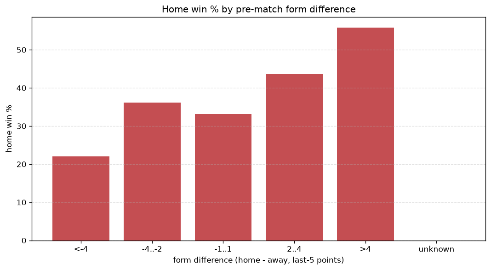
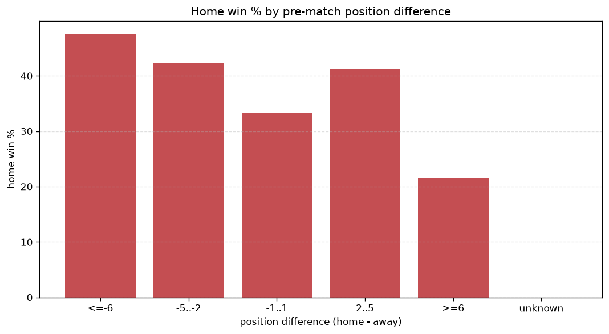

# Relationships Analysis
- Report: `relationships`
- Generated: 2026-10-30T03:51:42+00:00
- Script: `backend/scripts/analyze_relationships.py` v1.0.0
- League: Ligue 2 (France)
- Scope: league `france2`

- Matches analysed: **2136** (23 leakage-safe pre-match features).

## 1. Correlation matrix
_Pearson correlation of each pre-match feature with observed goals; sorted by |corr(total goals)|._

| feature | corr(home) | corr(away) | corr(total) |
|---|---|---|---|
| home_team_goals_scored_last_5 | 0.147 | -0.049 | 0.073 |
| home_points_before_match | 0.112 | -0.022 | 0.066 |
| home_team_home_goals_avg | 0.123 | -0.061 | 0.048 |
| away_points_before_match | 0.012 | 0.057 | 0.047 |
| home_team_goals_conceded_last_5 | -0.012 | 0.063 | 0.034 |
| home_position_before_match | -0.131 | 0.091 | -0.034 |
| position_difference | -0.139 | 0.101 | -0.032 |
| home_team_points_last_5 | 0.112 | -0.075 | 0.031 |
| points_difference | 0.153 | -0.122 | 0.029 |
| away_team_goals_conceded_last_5 | 0.051 | -0.014 | 0.028 |
| home_rest_days | -0.014 | -0.022 | -0.025 |
| home_team_home_win_rate | 0.101 | -0.073 | 0.024 |
| away_rest_days | -0.015 | -0.019 | -0.024 |
| away_team_goals_scored_last_5 | -0.013 | 0.049 | 0.023 |
| away_team_away_win_rate | -0.003 | -0.025 | -0.019 |
| home_team_wins_last_5 | 0.105 | -0.087 | 0.017 |
| away_team_away_conceded_avg | 0.025 | -0.005 | 0.015 |
| home_team_home_conceded_avg | -0.028 | 0.050 | 0.014 |
| away_position_before_match | 0.061 | -0.049 | 0.011 |
| away_team_away_goals_avg | -0.005 | 0.019 | 0.009 |
| away_team_wins_last_5 | -0.017 | 0.008 | -0.006 |
| rest_days_difference | 0.002 | -0.008 | -0.004 |
| away_team_points_last_5 | -0.022 | 0.025 | 0.000 |

## 2. Form vs outcome
_Home win/draw/away % per bucket of `home_team_points_last_5 - away_team_points_last_5`._

| bucket | matches | home | draw | away | home % | draw % | away % |
|---|---|---|---|---|---|---|---|
| <-4 | 332 | 108 | 114 | 110 | 32.5% | 34.3% | 33.1% |
| -4..-2 | 454 | 178 | 133 | 143 | 39.2% | 29.3% | 31.5% |
| -1..1 | 641 | 261 | 164 | 216 | 40.7% | 25.6% | 33.7% |
| 2..4 | 447 | 213 | 132 | 102 | 47.7% | 29.5% | 22.8% |
| >4 | 262 | 142 | 69 | 51 | 54.2% | 26.3% | 19.5% |
| unknown | 0 | 0 | 0 | 0 | - | - | - |

## 3. Position vs outcome
_Home win/draw/away % per bucket of `position_difference` (home position - away position; negative favours the home team)._

| bucket | matches | home | draw | away | home % | draw % | away % |
|---|---|---|---|---|---|---|---|
| <=-6 | 505 | 266 | 136 | 103 | 52.7% | 26.9% | 20.4% |
| -5..-2 | 376 | 177 | 101 | 98 | 47.1% | 26.9% | 26.1% |
| -1..1 | 287 | 118 | 86 | 83 | 41.1% | 30.0% | 28.9% |
| 2..5 | 400 | 155 | 109 | 136 | 38.8% | 27.2% | 34.0% |
| >=6 | 568 | 186 | 180 | 202 | 32.7% | 31.7% | 35.6% |
| unknown | 0 | 0 | 0 | 0 | - | - | - |

## 4. Rest advantage
_Home win/draw/away % per bucket of `rest_days_difference` (home rest - away rest). Matches with unknown rest are bucketed separately._

| bucket | matches | home | draw | away | home % | draw % | away % |
|---|---|---|---|---|---|---|---|
| <-1 | 193 | 94 | 41 | 58 | 48.7% | 21.2% | 30.1% |
| -1..0 | 121 | 57 | 39 | 25 | 47.1% | 32.2% | 20.7% |
| 0 | 1466 | 612 | 411 | 443 | 41.7% | 28.0% | 30.2% |
| 1..2 | 215 | 82 | 68 | 65 | 38.1% | 31.6% | 30.2% |
| >2 | 81 | 38 | 30 | 13 | 46.9% | 37.0% | 16.0% |
| unknown | 60 | 19 | 23 | 18 | 31.7% | 38.3% | 30.0% |
- *60 match(es) had unknown rest difference (missing rest data on at least one side).*

## 5. Home team quality
_Home win rate by `home_team_home_win_rate` tier (split at 0.5)._

- `< 0.5` tier: **38.3%** home win (523/1364)
- `>= 0.5` tier: **49.1%** home win (379/772)
- Home-win gap (>= split minus < split): **+10.8 pp**

| tier | label | matches | home | draw | away | home % |
|---|---|---|---|---|---|---|
| low | < 0.5 | 1364 | 523 | 401 | 440 | 38.3% |
| high | >= 0.5 | 772 | 379 | 211 | 182 | 49.1% |

## 6. Feature averages by result
_Mean feature value per outcome; `range` is home-minus-away spread of the group means._

| feature | home mean | draw mean | away mean | range |
|---|---|---|---|---|
| points_difference | 1.908 | -0.825 | -2.822 | 4.730 |
| home_points_before_match | 25.945 | 23.639 | 22.223 | 3.721 |
| position_difference | -1.157 | 0.587 | 2.024 | 3.182 |
| home_position_before_match | 9.426 | 10.557 | 11.386 | 1.960 |
| away_position_before_match | 10.583 | 9.971 | 9.362 | 1.221 |
| away_points_before_match | 24.037 | 24.464 | 25.045 | 1.008 |
| home_team_points_last_5 | 6.574 | 5.908 | 5.661 | 0.914 |
| home_team_goals_scored_last_5 | 5.836 | 5.196 | 5.051 | 0.784 |
| home_team_goals_conceded_last_5 | 5.428 | 5.508 | 5.830 | 0.402 |
| away_team_goals_scored_last_5 | 5.395 | 5.778 | 5.669 | 0.383 |
| rest_days_difference | -0.057 | 0.182 | -0.166 | 0.347 |
| away_rest_days | 7.898 | 7.723 | 8.068 | 0.345 |
| home_team_wins_last_5 | 1.757 | 1.518 | 1.444 | 0.313 |
| away_team_goals_conceded_last_5 | 5.496 | 5.547 | 5.244 | 0.303 |
| away_team_points_last_5 | 6.166 | 6.448 | 6.468 | 0.302 |
| home_team_home_goals_avg | 1.287 | 1.179 | 1.134 | 0.153 |
| home_team_home_conceded_avg | 0.973 | 1.000 | 1.077 | 0.105 |
| away_team_wins_last_5 | 1.625 | 1.712 | 1.691 | 0.087 |
| home_team_home_win_rate | 0.420 | 0.388 | 0.347 | 0.073 |
| away_team_away_goals_avg | 0.974 | 1.033 | 1.038 | 0.064 |
| home_rest_days | 7.839 | 7.903 | 7.902 | 0.064 |
| away_team_away_conceded_avg | 1.218 | 1.236 | 1.189 | 0.048 |
| away_team_away_win_rate | 0.278 | 0.287 | 0.284 | 0.008 |

---
*All features are leakage-safe pre-match values built by `ml.features.build_features.build_rows` from strictly prior matches. Run with `python backend/scripts/analyze_relationships.py` to regenerate.*

## Charts

